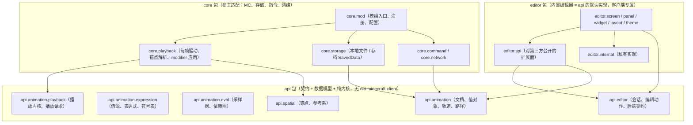
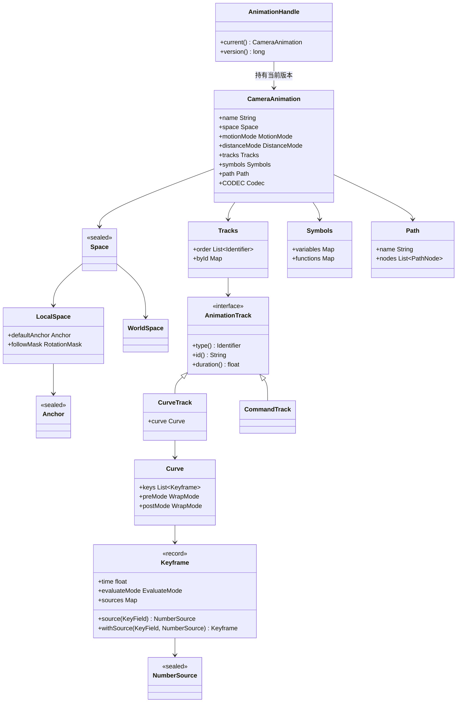
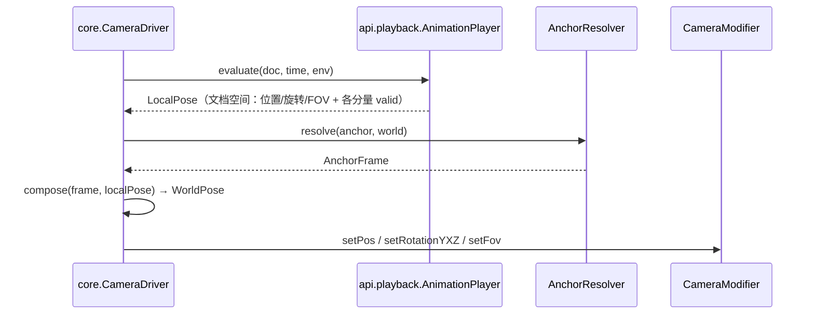
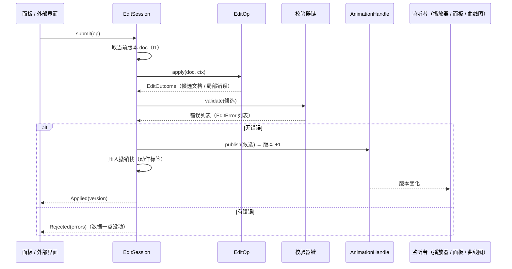
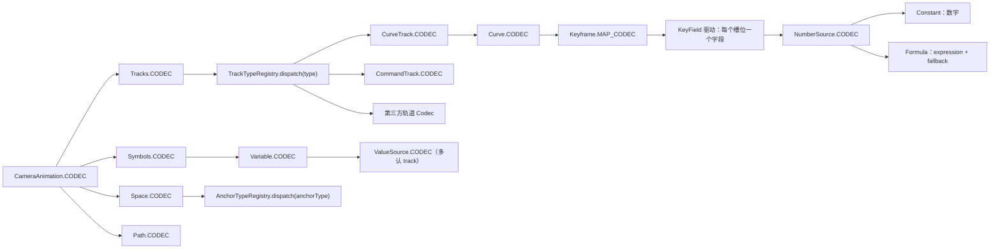
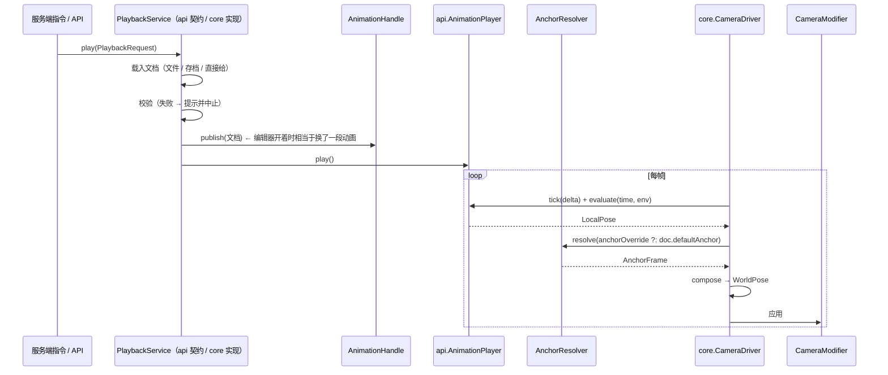
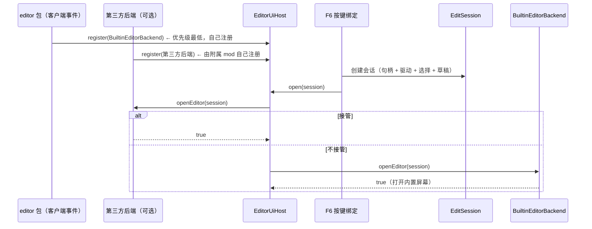

# 相机动画、播放与编辑器：重构设计框架

范围：`api.animation.*`（数据模型与求值）、`core.cmd_camera.*`（播放与指令）、`core.animation.io.*`（存储）、
`api.editor.*` 与 `core.editor.*`（编辑器契约与内置界面）。
`api.camera.*`（操控方案、Tripod 数据）不在本次重构范围内，但 §2 的包边界要为它留好位置。

前提：**允许破坏性修改，不背向前兼容。** 本文件只给框架，不含实现；本文件不修改任何代码。

写法：结论先行，逐节给形状与判据；UML 用 Mermaid（GitHub / VS Code 可直接渲染），每张图后面有一句"怎么读"。

---

## 0. 已定事项（本轮）

| # | 决策 | 来源 |
| --- | --- | --- |
| D1 | **单 Gradle 模块 + 三个顶层包 `api` / `core` / `editor`**，依赖方向由包可见性与 CI 判据守住 | 本轮确认 |
| D2 | **数据模型走"不可变文档 + 句柄"**（编辑产出新版本，校验通过才发布）；撤销 = 版本栈 | **本轮倾向，待确认**：§3.0 展开解释它到底是什么意思，附录 D 给出改选"可变文档"时的差异清单 |
| D3 | **锚点归动画资产可带默认值，播放请求可覆盖，编辑器另有预览锚点** | 本轮确认 |
| D4 | **锚点参考系 = 平移 + 可选的三轴旋转**（逐轴启用，不做缩放） | 本轮确认 |
| D5 | **校验策略 = 硬拒绝 + 结构化原因；输入过程中的中间态留在 UI 草稿里** | 本轮确认 |
| D6 | **扩展点四层全要**：后端级 / 数据级 / 面板级 / 组件级 | 本轮确认 |
| D7 | **序列化职责落到各对象自身，统一用 MC 的 Codec 系统**；分派用注册表 | 本轮确认（既有文档同向） |
| D8 | 沿用"**不允许绕过**"：改数据只有一条受控入口 | 沿用约束文档 §7.5 |
| D9 | 沿用"**图的归属挂在动画上**"，但形态改为"候选文档上的纯函数"（见 §5.6） | 沿用 + 本文件改写 |

与既有四份文档的关系：

| 文档 | 本文件怎么处理 |
| --- | --- |
| `design-keyframe-value-source-target.md` | **沿用**：`NumberSource`（两态）/`ValueSource`（三态）、`KeyField` 是字段唯一真理来源、回退只有一个点、`TrackRef` 在类型上进不了关键帧字段。这些结论已落地，本文件只在"不可变"下重新确认它们的写法 |
| `design-review-keyframe-value-source.md` | 历史问题定位，已被上一份文档的目标形态覆盖，本文件不再引用 |
| `design-evaluation-graph2-editor-constraints.md` | **部分取代**：§4（自定义 `RefGraph`）与 §7（门面 `AnimationEdits`）的方向保留；§5（sealed 结果）、§6（`reconcile` 对账）、§8（收窄写方法）、§9（批量替换重建）在不可变文档下**大多不再需要**，理由见 §5.6 与附录 A |
| `design-api-default-editor.md` | **沿用结论**：默认实现留在实现包里注册进契约、不把 13k 行 UI 搬进 `api`；本文件把它落成 `editor` 包（D1） |

---

## 1. 目标与不变量

### 1.1 目标

| # | 目标 | 判据（可检查） |
| --- | --- | --- |
| G1 | 职责分离 | 三个顶层包的依赖方向单向；`api` 无 `net.minecraft.client` 引用；数据层不认识渲染、渲染层不认识存储 |
| G2 | 可扩展 | 新的轨道类型 / 值源类型 / 锚点类型不需要改数据层与编辑器；新的界面可整体接管，也可只加一个面板 |
| G3 | 内置编辑器是 api 的默认实现 | 打开编辑器只有一条路：建会话 → 询问后端；内置界面是**注册进来的最低优先级后端**，不再是 `if` 之后的兜底分支 |
| G4 | 非法数据不入数据系统 | 提交、解码、收包三个入口都过校验；失败即拒绝，且给出结构化原因 |
| G5 | 序列化归各对象自身 | 每个数据类型自带 `Codec`；`core` 与 `editor` 里不再出现任何磁盘字段名 |
| G6 | 支持 local 模式 | 文档可声明"局部空间 + 默认锚点"，播放请求可覆盖锚点；编辑器有独立预览锚点 |
| G7 | 播放内核可单测 | 求值与播放推进不依赖 Minecraft，可在 `src/test` 里跑 |

### 1.2 不变量

| # | 不变量 | 由什么保证 |
| --- | --- | --- |
| I1 | **已发布的文档永远合法**：任何时刻 `handle.current()` 拿到的版本都通过了全部校验 | 提交管线（§5.4）是唯一的发布入口 |
| I2 | **文档不可变**：`CameraAnimation` 及其全部子对象无写方法 | 值对象只暴露 `with*` 派生方法；`record` / 私有 final 字段 |
| I3 | **唯一可变点是句柄**：播放器、编辑器、信息面板持有的都是 `AnimationHandle` | 所有取用点拿 `handle.current()`，不再各自持有文档 |
| I4 | **一次提交一个版本**：提交要么整份落地并 +1 版本，要么一点都不落 | `EditOp` 是纯函数，不修改输入 |
| I5 | **草稿不是数据**：UI 里编辑中的文本 / 拖拽中的中间值不进文档 | 草稿存在会话里（§5.1），提交时才成为 `EditOp` |
| I6 | **求值只有一个入口**：界面预览、曲线图、播放都走同一个采样器 | 沿用现状（`CurveSampler` 是唯一入口） |
| I7 | **锚点只影响姿态合成，不影响文档**：同一份文档在不同锚点下播出的局部轨迹逐位相同 | 锚点解析与姿态合成在求值之后、应用之前（§4.5） |
| I8 | **`api` 纯度**：`api` 不引 `net.minecraft.client`；客户端专属契约放 `editor` 包的公开面 | 依赖检查（§2.4） |

---

## 2. 分层：模块与包

### 2.1 依赖方向



**怎么读**：箭头是"依赖"。`api` 在底部、不认识任何人；
**`core` 与 `editor` 之间一条边都没有**——两边各自只依赖 `api`，靠 `api` 里的两个服务碰头：
`CameraControlClaims`（编辑器告诉播放层"相机由我接管"+ 自由视角姿态）与
`CameraProbes`（编辑器读当前相机姿态，实现在 `core`，因为它才是认识基础 mod 的那一层），
详见 §7.6。`editor.spi` 是"默认实现对外的一部分"：第三方界面要么只用 `api`，
要么额外依赖 `editor.spi`（§8.3）。

### 2.2 包清单

| 包 | 职责 | 允许依赖 | 客户端类 |
| --- | --- | --- | --- |
| `api.animation` | 文档、值对象、轨道、路径、Codec | `api.animation.expression`、`api.spatial`、DFU、joml、jspecify | 否 |
| `api.animation.expression` | 值源、表达式编译求值、符号表 | 仅 DFU / joml / jspecify / slf4j | 否 |
| `api.animation.eval` | 采样器、求值环境、依赖图（校验用） | `api.animation*`、`expression`、`curve` | 否 |
| `api.animation.playback` | 时间推进、姿态求值、Tick 轨道分发、播放请求、两个接触面服务（§7.6） | `api.animation`、`api.spatial` | 否 |
| `api.spatial` | 锚点类型（固定坐标 / 实体 / 玩家）、参考系变换 | joml、`Identifier`、DFU | 否 |
| `api.editor` | `EditorSession` / 编辑动作 / 错误类型 / `EditorUiBackend` / `EditorUiHost` | `api.animation*`、`Component` | 否 |
| `core.playback` | 每帧驱动：读世界与玩家、解析锚点、应用 `CameraModifier` | `api.*`、`core.storage`、free camera api | 是 |
| `core.storage` | 本地文件、存档 `SavedData`、路径与动画的命名空间 | `api.*`（只用 Codec） | 部分 |
| `core.command` / `core.network` | 指令与播放包 | `api.*` | 部分 |
| `core.mod` | 模组入口、注册表登记、配置、安装 `CameraProbes`、注册 `@Plugin` | `api.*`、`core.*`（**不含 `editor`**） | 是 |
| `editor` | 内置界面：屏幕、面板、控件、布局、主题、默认后端 | `api.*`、`editor.spi` | 是 |
| `editor.spi` | 面板注册、组件复用、后端转发的公开契约 | `api.*` | 是 |

### 2.3 与现状的映射（大件）

| 现状 | 去处 | 说明 |
| --- | --- | --- |
| `api.animation.*`（4,910 行） | 留在 `api.animation.*` | 改造成不可变（§3），Codec 内聚（§6） |
| `core.cmd_camera.playback.CameraPlayer` | 求值部分 → `api.animation.playback.AnimationPlayer`；每帧驱动 → `core.playback.CameraDriver` | 切掉 MC 依赖，换来 G7 |
| `core.animation.io.AnimationCodec` | 拆解：字段级下沉到各对象的 `Codec`；容器级变成 `api.animation.CameraAnimation.CODEC`；IO 只剩 `core.storage` | G5 |
| `core.editor`（44 文件 / 13,162 行） | `editor` 包（原样搬迁 + 改造调用点） | D1；`BuiltinEditorSession` 删除（内置界面直接走会话） |
| `api.editor`（3 文件） | `api.editor`，补齐写动作与草稿 | §8.1 |
| `core.cmd_camera.CmdCamera` | `core.playback.CameraDriver` + `core.mod` 的插件注册 | 组装与调度拆开 |
| `core.cmd_camera.CmdCameraKeyMapping`（F6/F7/F8/F9，直接引用编辑器屏幕与插件单例） | 按键跟着动作走：F6/F9 → `editor` 包；F7/F8 → `core.playback`，只认 `api.playback.PlaybackService` | 拆开之后 `core` 不再引用编辑器屏幕 |
| `core.editor.CameraScreens.editing()` | `editor` 侧的 `CameraControlClaim` 登记（§7.6） | `core` 不再认识编辑器屏幕 |
| `EditorContext.currentCameraPosition()`（直接读 `ModifierManager`） | `api.playback.CameraProbes`（实现在 `core.mod`） | 界面不再依赖基础 mod 的实现类 |
| `EvaluationGraph`（v1）/ `EvaluationGraph2`（v2，未接入） | 合并成一个 `DependencyGraph`，形态是候选文档上的纯函数 | §5.6 |

### 2.4 CI 判据

```text
# 依赖方向（三条边都必须为空）
grep -rn "net\.minecraft\.client"            src/main/java/.../api     → 必须为空
grep -rn "free_camera_api_tripod\.core"      src/main/java/.../api     → 必须为空
grep -rn "free_camera_api_tripod\.editor"    src/main/java/.../api     → 必须为空
grep -rn "free_camera_api_tripod\.editor"    src/main/java/.../core    → 必须为空
grep -rn "free_camera_api_tripod\.core"      src/main/java/.../editor  → 必须为空

# 序列化职责（磁盘字段名不得出现在容器、存储与界面里）
grep -rnE '"(tracks|variables|functions|keys|motionMode|preMode|postMode)"' core/ editor/ → 必须为空

# 绕过写入口（不可变之后这条只是保险，不是主要手段）
grep -rnE '\.(addChannel|removeChannel|renameCurveTrack|copyFrom|addVariable|removeVariable)\(' editor/ → 必须为空

# 数据类不得有写方法
grep -rnE 'public\s+(void|CameraAnimation|Curve|Path)\s+\w+\(' src/main/java/.../api/animation → 逐条人工确认（只允许 with* 派生）
```

---

## 3. 数据模型：不可变文档

### 3.0 为什么选"不可变文档 + 句柄"（D2 的展开）

现状是**一份可变对象被三处共同持有**：播放器、编辑器、信息面板拿的都是同一个 `CameraAnimation`，
读档只能 `copyFrom` 原地替换（`CameraAnimation.java:469`，注释里写明"不能换对象"），
撤销靠整份 JSON 快照 + 每帧 250ms 节流（约束文档 §9.3 记录了"节流窗口内的编辑被整个漏掉"）。
这三个事实合起来决定了三件事只能靠纪律：

1. **非法值只能"先写后回滚"**：写方法在数据类上，校验在调用点，写坏了只能再写回去。
2. **播放器可能读到半成品**：一帧之内数据被改到一半，采样出来的是中间态。
3. **撤销粒度按时间切**：捕获点绑在帧循环上，不绑在用户动作上。

改成不可变之后，这三件事都变成结构问题而不是纪律问题：

| 病 | 不可变之后 |
| --- | --- |
| 非法值落地 | 编辑产出**候选文档**，校验通过才发布；不通过时世界里根本不存在这个版本 |
| 半成品被读到 | 播放器每帧 `handle.current()` 拿到的是一个完整版本；换版本是换引用（原子） |
| 撤销粒度 | 提交点就是用户动作边界，版本栈天然按动作切 |
| 成环校验 | 在候选文档上重算依赖图，"改之前判环"与"改之后判环"是同一件事（§5.6） |
| 求值缓存失效 | 缓存键从"对象身份 + 键数 + 版本号"退化成"文档版本 + 帧号"，不再有"同对象下一帧"的陷阱 |

具体长这样（最小例子：把一个关键帧的时间从 1.0 改到 1.5）：

```text
编辑前   handle.current() == docA          // 播放器这一帧读到的就是 docA
拖拽中   不碰文档：面板用草稿画预览
松手提交 candidate = docA.withKey(0, key.withTime(1.5f))   // docA 一个字段都没动
         validate(candidate) → 空错误表                      // 不通过就到此为止，世界里没有这一版
         handle.publish(candidate)                           // handle.current() == docB
撤销     handle.publish(docA)                               // 版本栈里存的就是引用
```

看清三点：**`docA` 在整个过程中一直可读、一直合法**（所以播放器不会读到"改了一半"的文档）；
**`withKey(...)` 是派生而不是修改**（所以"忘记调校验就写进去"这条路不存在）；
**撤销是换回一个旧引用**（所以不需要 JSON 快照，也不需要 250ms 节流）。

**代价与边界**（这些要在动手前认下来）：

- **每次提交一次拷贝**。动画规模是"几十条轨道 × 几百个键"，一次提交拷贝的是一棵小对象树；
  真正的交互热路径（拖拽关键帧）用"拖拽期间只画预览、松手才提交一次"处理，与 D5 的草稿态是同一套机制。
- **对象身份不再稳定**。现有代码里"按对象身份存选中"已经基本改成按名字 / id 查（既有文档 §6.1 已点到），
  这一轮要把剩下几处一并改成按 id 寻址。
- **派生存量（弧长表、搜索索引）不能放在 `record` 里**。规则见 §3.2。
- **内存**：版本栈保留 N 个版本（默认 64，与现状同量级）。若实测吃紧，再引入结构共享
  （持久化集合）或改存逆向操作；这两条都不影响本框架的接口形状。

### 3.1 文档形状



**怎么读**：`AnimationHandle` 是唯一可变的东西，它指向当前版本；下面整棵树都是不可变的。
图里的 `WorldSpace` / `LocalSpace` 就是 §4.1 的 `Space.World` / `Space.Local`（图中不写点号是为了排版）；
`Anchor` 只出现在 `Space.Local` 里。
`Tracks` 把"有序"与"按 id 查"分开：顺序是时间轴显示顺序，也是序列化顺序（沿用现状语义）。

### 3.2 值对象规则

| 形态 | 用在 | 规则 |
| --- | --- | --- |
| `record` | 纯数据叶子：`Keyframe`、`Constant`、`Formula`、`TrackRef`、`PathNode`、`FixedAnchor`、`EntityAnchor`、`EditError` | 无派生缓存，全部字段参与 `equals` |
| `final class` + 私有不可变字段 | 有派生存量的：`Curve`（弧长 / 搜索用不到，但有键列表规模）、`Path`（弧长表） | 派生值 `volatile` 惰性计算，只在自身内部写，外部看不到；`with*` 返回新实例 |
| 接口 + `sealed` | 命名空间封闭且校验要穷尽的：`NumberSource`、`ValueSource`、`Anchor`、`Space`、`EditOp` | `switch` 必须穷尽；新增一支就是一次编译错误清单，这正是我们要的 |
| 接口 + 注册表 | 允许第三方扩展的：`AnimationTrack`（+`CurveTrack`/`CommandTrack` 等） | 类型 id + `MapCodec` + 工厂登记在注册表里（§6.2） |

一句话：**"封闭的用 sealed、开放的用注册表"**；不要为了扩展性把所有东西都做成注册表
（那会把"忘记处理某一支"从编译错误降级成运行期 bug）。

### 3.3 句柄

```java
/// 动画句柄：整个系统里唯一可变的那一层。
/// 播放器、编辑器、信息面板都持有它，而不是持有文档。
public final class AnimationHandle {
    private volatile CameraAnimation current;
    private final AtomicLong version;

    public CameraAnimation current();   // 已发布版本，必然合法（I1）
    public long version();

    /// 发布新版本。**不是公开 API**：只由 EditSession 与 PlaybackService 调用，
    /// 两者都必须先在候选文档上跑完整校验（§5.4）。包内可见即达此目的。
    void publish(CameraAnimation next);
}
```

### 3.4 轨道的能力分层（沿用）

`AnimationTrack` 只发放"所有轨道都成立"的成员（`type` / `id` / `duration` / `keyCount`…），
能力用**独立接口**叠加，**不放进基接口**：

| 能力接口 | 含义 | 谁实现 |
| --- | --- | --- |
| `CurveTrack` | 有可编辑的曲线（曲线图、关键帧面板要它） | 相机属性通道、通用曲线轨道 |
| `TickTrack` | "经过即触发"，播放器按时间区间分发 | 指令轨道、事件轨道 |
| `RenamableTrack` | 可以就地改名（id 就是显示名） | 扩展轨道 |

不可变下有一个小改动：`TickTrack.advance(from, to)` 是**副作用**（触发指令），
它不能是文档上的方法。改为播放内核在推进时间时，把区间交给一个 `TickDispatcher`，
由宿主（`core`）注册的分发器去执行副作用——**文档只描述"什么时候该触发"，不描述"触发做什么"**。

### 3.5 求值缓存与版本

| 缓存 | 现状键 | 目标键 |
| --- | --- | --- |
| 公式编译结果 | 公式文本（全局驻留，上限 512） | 不变（与文档无关） |
| 键槽位采样（`CurveSample`） | 曲线身份 + 键数 + scope 身份 + 帧版本 | **文档版本 + scope 帧版本 + 曲线 id** |
| 变量 / 轨道读数 | scope 内的帧缓存 | 不变 |
| 弧长表 | `Path` 内部按需重建 | 不变（在不可变 `Path` 内部惰性） |

---

## 4. 空间与 local 模式

### 4.1 空间模式

文档声明自己描述的是哪种空间：

```java
public sealed interface Space {
    /// 世界空间：位置 / 旋转就是世界坐标（今天的行为）
    record World() implements Space { }

    /// 局部空间：位置 / 旋转相对于锚点的参考系
    record Local(Anchor defaultAnchor, RotationMask followMask) implements Space { }
}
```

| 模式 | 路径节点、坐标通道的含义 | 适用 |
| --- | --- | --- |
| `World` | 绝对世界坐标 | 与地形绑定的运镜（今天所有动画） |
| `Local` | 相对锚点的局部坐标 | 跟随实体的运镜、可复用到不同地点的动画 |

模式是文档属性，且**不改变通道集合**（与 `MotionMode` 正交）：
`MotionMode` 决定"位置由路径给还是由三轴给"，`Space` 决定"这些数在哪个坐标系里"。

### 4.2 锚点

```java
public sealed interface Anchor {
    Codec<Anchor> CODEC = AnchorTypeRegistry.dispatch(Anchor::type);

    /// 以某个固定坐标为原点（"以某个坐标"）
    record Fixed(Vec3 position) implements Anchor { }

    /// 以某个实体为原点（"以某个实体"）；followRotation 见 §4.3
    record Entity(UUID uuid) implements Anchor { }

    /// 以某个玩家为原点（多人时常用）
    record Player(UUID uuid) implements Anchor { }
}
```

第三方要加锚点类型（例如"跟随某个 BlockEntity"、"跟随某个队伍的中心"）走注册表：
`AnchorTypeRegistry.register(id, MapCodec, resolverFactory)`。解析器由 `core` 侧提供
（它才知道怎么在世界里找实体），`api` 侧只认"id + 数据 + 一个能把数据解析成参考系的接口"。

### 4.3 参考系变换

```java
/// 逐轴启用：某轴为 false 表示该轴不参与跟随（等价于该轴取单位值）
public record RotationMask(boolean x, boolean y, boolean z) {
    public static final RotationMask NONE  = new RotationMask(false, false, false);
    public static final RotationMask ALL   = new RotationMask(true, true, true);
    public static final RotationMask YAW   = new RotationMask(false, true, false);
}

/// 锚点解析出来的参考系：一个位置 + 一组旋转（YXZ，与相机同序）
public record AnchorFrame(Vec3 position, Vec3 rotation, RotationMask mask) {
    public Vec3 toWorld(Vec3 local);          // 平移 + 按 mask 旋转
    public Vec3 toLocal(Vec3 world);          // 逆变换
    public Vec3 rotateToWorld(Vec3 localRot); // 角度合成
}
```

- **位置**：`world = anchorPos + R(mask, rotation) * local`。
- **旋转**：按四元数合成 `q_world = q_anchor' * q_local`，其中 `q_anchor'` 只含被 mask 启用的轴
  （逐轴启用时先把锚点欧拉角按 mask 置零，再转四元数）——这样"只跟随偏航"这类需求是精确的，
  不是近似。边界上只在相机应用处转欧拉，文档内部一律用同一序（YXZ）。
- **mask 从哪来**：默认取文档的 `Space.Local.followMask`（作者的选择："这段动画跟着转多少"）；
  播放请求覆盖锚点时也可以一并给出 mask（`PlaybackRequest(anchorOverride, followMaskOverride)`）。
  固定坐标锚点没有旋转，mask 对它没有影响——这是合法输入，不是错误。
- **不做缩放**：D4 已定。留一个未来的 `scale` 位不实现，避免现在就把矩阵搬进来。

### 4.4 锚点归属：三层各管一段（D3）

| 层 | 谁 | 内容 | 序列化 |
| --- | --- | --- | --- |
| 资产 | 文档 `Space.Local.defaultAnchor` | 作者希望的默认原点 | 是（进动画文件） |
| 播放 | `PlaybackRequest.anchorOverride` | 这一次播放实际用的原点 | 否（进指令 / API 调用） |
| 编辑 | `EditorSession.previewAnchor()` | 编辑器里预览用的原点 | 否（会话状态，可记住在配置里） |

解析顺序：`播放请求覆盖` → `文档默认锚点` → **失败降级**（见下）。

**降级策略**（建议，列为待定项 §10-2）：锚点无法解析时（实体不在客户端追踪范围内、UUID 已失效）
按这个顺序退：① 该锚点最近一次解析成功的位置（会话内缓存）→ ② 文档的默认锚点 →
③ 世界空间（把局部坐标当世界坐标用）+ 在动作栏提示一条"锚点不可用，已按世界坐标播放"。
**绝不静默播错**：提示是这套降级的一部分，不是可选项。

### 4.5 姿态合成：local pose → world pose



**怎么读**：求值只产出"文档空间"的姿态；锚点参与的是它后面那一步。
这条边界就是 I7：**换锚点不改变求值结果，只改变合成结果**，因此
"local 模式的动画"与"世界空间的动画"共用同一个求值内核，也共用同一套曲线图与预览。

**"未接管轴"在 local 下的准确口径**（这一条不写清就会出 bug）：

现状是"某个轴没有关键帧就不接管该轴，沿用玩家当前坐标"（`CameraPlayer.java:100-124`）。
local 下不能直接沿用世界坐标，否则锚点一动画面就跳。正确做法是**在文档空间里沿用**：

```text
1. base_local = frame.toLocal(玩家眼睛位置)
2. base_local 按 valid 位被 localPose 逐轴覆盖
3. 位置 = frame.toWorld(base_local)      ← 回到世界空间
4. 同理，未接管的旋转分量在 local 下取"锚点参考系里的玩家朝向"
```

于是 `World` 模式是这条公式在 `frame = 单位变换` 时的特例——**实现上只有一条路径**。

### 4.6 编辑器里的 local 预览

- 会话持有一个预览锚点（默认取文档的 `defaultAnchor`，没有则取"当前相机所在位置"）。
- 视口里给一个可见的参考系指示（原点 + 三轴短线段，只在 local 模式下画）。
- 两个便捷动作：`以当前相机位置为锚点`、`以准星所指实体为锚点`。
- 切换 `World ↔ Local` 时**不做坐标换算**（与 `DistanceMode` 的换算不同）：
  这句切换的含义是"这些数从现在起按另一个坐标系解读"，自动换算会把作者的意图改掉。
  切到 local 时给一句提示（"位置数将按锚点参考系解读，建议先把锚点设到当前相机位置"）。

### 4.7 播放请求

```java
/// 一次播放请求：播哪份文档、用哪个锚点、怎么播。
public record PlaybackRequest(CameraAnimation animation,
                              @Nullable Anchor anchorOverride,
                              @Nullable RotationMask followMaskOverride,
                              float speed, boolean loop, float startTime) { }
```

来源三类，汇流到同一个请求：本地文件（`core.storage` 读名字）、存档（连同 JSON 或 NBT 一起送）、
API 直接给文档。服务端指令只表达"播哪段 + 锚点意图"，相机依然只在客户端存在（沿用现状）。

---

## 5. 编辑落地：草稿 → 校验 → 提交

### 5.1 三种状态

| 状态 | 住在哪 | 生命周期 | 能进数据系统吗 |
| --- | --- | --- | --- |
| **文档版本**（已发布） | `AnimationHandle` | 直到下一次提交 | 是（I1） |
| **草稿**（编辑中） | `EditorSession` 的 `EditDraft` | 任意长；面板重建不丢 | 否（I5） |
| **编辑意图**（`EditOp`） | 提交的那一瞬间 | 一次提交 | 是（落地后成为文档） |

草稿的形态：一个"按字段寻址的暂存区"（`draft.text(path)` / `draft.number(path)`），
外加组合动作的暂存（例如"新建轨道"对话框里已填的名字）。**草稿不做校验**——它本来就允许非法，
一个正在输入 `1..2` 的数值框不该被拒绝；校验只发生在提交那一刻（D5）。

### 5.2 编辑意图与结果

```java
public sealed interface EditOp permits
        SetMotionMode, SetSpace, SetAnchor, SetDistanceMode, RenameDocument,
        AddTrack, RemoveTrack, RenameTrack, ReorderTrack, ReplaceTrack,
        AddKey, RemoveKey, MoveKey, SetKeyTime, SetKeySource, SetKeyEvaluateMode,
        AddSymbol, RemoveSymbol, RenameSymbol, SetSymbolSource, SetFunctionBody,
        ReplacePath, ReplaceDocument {
    /// 纯函数：不修改输入。要么给出候选文档，要么给出结构化错误。
    EditOutcome apply(CameraAnimation doc, EditContext ctx);
}

/// 意图级结果：还没有"版本"这个概念（版本由会话在发布时给）
public sealed interface EditOutcome {
    record Ok(CameraAnimation candidate) implements EditOutcome { }
    record Err(List<EditError> errors) implements EditOutcome { }
}

/// 会话级结果：已经走过校验与发布
public sealed interface EditResult {
    /// 通过校验并已发布
    record Applied(long version, CameraAnimation document) implements EditResult { }
    /// 被拒：数据一点没动
    record Rejected(List<EditError> errors) implements EditResult { }
}

public record EditError(ErrorCode code, String path, Component message, List<Fix> fixes) { }

/// 可点一下的修复项：把"能修但不自己修"的东西交给用户
public record Fix(Component label, EditOp replacement) { }
```

两个结果类型看起来重复，其实是两件事：`EditOutcome` 是**意图**的结果（还没有版本），
`EditResult` 是**会话**的结果（版本已 +1 或数据一点没动）。分开写的好处是
"意图"可以在没有会话的地方单测（例如校验器用例），而"发布"只发生在会话里。

`EditOp` **不序列化**（它是内存里的意图，不是数据），因此可以放心用 `sealed`：穷尽性由编译器保证。
`EditContext` 携带意图需要的外部信息（当前时间、当前相机姿态、锚点解析结果等），
它是只读的，不允许反过来改数据。

### 5.3 四层校验

| 层 | 管什么 | 例子 | 谁实现 | 拒绝还是修复 |
| --- | --- | --- | --- | --- |
| L1 语法 / 格式 | 文本与数值本身能不能成立 | 公式编译、枚举名、数字非有限 | `Compiler`、`Codec` | 拒绝 |
| L2 结构 | 文档内部的引用与唯一性 | 轨道 id 唯一、变量名唯一、变量绑定的轨道存在、键时间递增 | 结构校验器 | 拒绝 |
| L3 语义 | 跨对象的含义 | 依赖成环、`TrackRef` 出现在关键帧槽位、`MotionMode` 与通道集合一致 | 语义校验器 | 拒绝 |
| L4 领域 | 数值是否合理 | 时间 ≥ 0、曲柄长度 ≤ 1.5 倍基准、FOV 区间、单帧键数上限 | 领域校验器 | 拒绝（默认）+ 给 `Fix` |

```java
/// 校验器：在候选文档上跑，纯函数，不修改任何东西
public interface DocumentValidator {
    List<EditError> validate(CameraAnimation candidate);
}
```

- 内置校验器登记在 `api` 的校验注册表里，第三方可注册（数据级扩展的一部分）。
- **L4 的越界也不自动夹取**（D5）：越界就拒绝，同时给一个 `Fix`（"夹取到 1.5 并继续"），
  用户点一下才生效。这样"数据被悄悄改过"这件事不存在。
- 校验器的执行顺序固定：L1 → L2 → L3 → L4；前一层有错就短路（不在一个已经结构损坏的文档上跑语义检查）。

### 5.4 提交管线



**怎么读**：唯一的发布点在管线末端；`EditOp` 与校验器都是纯函数，
所以"校验通过"与"落地"之间没有任何可以插进去的路径——这就是 I1/I4 的实现方式。

### 5.5 撤销重做

- **粒度**：一个提交一个撤销项（不再按 250ms 时间窗切）。拖拽类动作在开始拖拽时开一次"合并窗口"，
  松手时提交一次；窗口内的中间值只画预览。
- **内容**：版本栈保存 `(version, label, CameraAnimation)`；因为文档不可变，栈里存的是引用，不会被后续编辑改坏。
- **上限**：默认 64 个版本（沿用现状量级）；超出丢最老的。
- **不减配的纪律**：撤销 / 重做本身就是一次 `publish`，同样走校验（版本本来就合法，这里是免费的自检）。
- **不放进撤销栈的**：播放 / 停止 / 定位播放头 / 切换预览锚点 —— 它们是会话状态，不是文档内容。

### 5.6 依赖图：从"增量维护 + 对账"改成"候选文档上的纯函数"

约束文档 §4–§9 为一件事做了大量设计：**图是增量维护的，所以要防止它与数据脱节**
（自定义 `RefGraph`、sealed `Removal`、`reconcile` 对账、七条破坏用例、收窄写方法……）。

不可变文档把这件事变简单了：**校验发生在候选文档上，而候选文档是完整的**，
所以图不需要增量，也不需要记账：

```java
/// 依赖图：变量 / 函数 / 轨道三类节点，边来自编译后的语法树（沿用 v1 的口径）
public final class DependencyGraph {
    public static DependencyGraph of(CameraAnimation doc);   // 一次整体重建，几十到几百节点
    public Optional<List<String>> cycle();                    // 环上的名字（沿用 cycleText 的呈现）
}
```

由此带来的删减（相对约束文档）：

| 约束文档里的手段 | 目标框架里 |
| --- | --- |
| 自定义 `RefGraph`（重数是一等公民） | **不需要**：只在候选文档上整体重算，重数天然正确 |
| sealed `Removal` / `Edit` 结果 | 语义并入 `EditResult` / `EditError`（§5.2） |
| `reconcile` 对账 + `Drift` + 静态开关 + CI 破坏用例 | **不需要**：没有"账"可坏 |
| §8 收窄数据类写方法（包内可见 / 换包） | **不需要**：不可变值对象根本没有写方法 |
| §9.1 图挂在动画上、`copyFrom` 自动重建 | 形态保留：图从文档派生，文档换了图自然换 |
| §9.3 撤销里不放图的逻辑 | 保留（撤销只碰版本栈） |

**代价**：每次提交重算一次图 + 一次 DFS。图很小（几十到几百节点），
而提交是用户动作边界（不是每帧），这个代价远比"增量记账 + 对账"的复杂度便宜。
若哪天实测到瓶颈，再在 `DependencyGraph` 内部做增量——**但那是实现细节，不是接口**。

> 这条与既有文档的结论不冲突：约束文档 §11.1 已经论证过"增量用于改、整体重建用于批量"，
> 只是当时的数据模型可变，所以"改之前判环"必须靠增量。候选文档上一切都能整体重算。

### 5.7 "绕过"在类型上不可能

不可变之后，"绕过写入口直接改数据"这句话没有对应的代码可以写：
`CameraAnimation` 没有 setter，`Curve` 没有 `key(...)` 写方法，`Variable` 没有 `source(...)`。
唯一的"改"是 `handle.publish(next)`，而它是包内可见、只被 `EditSession` 与 `PlaybackService` 调用。
因此 §2.4 里那条 grep 判据只是**最后一道保险**，不再是主要手段。

---

## 6. 序列化：每个对象自带 Codec

### 6.1 规则

| 规则 | 说明 |
| --- | --- |
| 每个数据类型自带 `Codec` / `MapCodec` | 字段名、默认值、校验都写在这个类型旁边 |
| 容器只做组装 | `CameraAnimation.CODEC` 组合各成员的 codec，不认识任何具体字段名 |
| 空值有明确语义 | `optionalFieldOf` + 默认值；不写"缺字段就静默降级"的模糊逻辑 |
| 解码即校验 | `Codec` 失败 = 拒绝加载，错误信息带路径（DFU 自带） |
| 多态用分派 | 轨道 / 值源 / 锚点三类用 `dispatch` + 注册表 |

### 6.2 组合与分派



**怎么读**：分派只发生在**允许第三方扩展**的三处（轨道类型、值源类型、锚点类型）；
封闭的枚举（`MotionMode`、`WrapMode`、`EvaluateMode`、`KeyField`）用普通 codec。

两个值得写清楚的形状：

```java
/// 值源类型：登记 id + codec + 求值器 + 能力声明。
/// 内置三项（Constant / Formula / TrackRef）就是最先登记的那三个。
public record ValueSourceType<T extends ValueSource>(
        Identifier id,
        MapCodec<T> codec,
        Capability capability,              // NUMBER（可作关键帧字段）| VARIABLE_ONLY
        SourceEvaluator<T> evaluator) { }

public interface ValueSource {
    ValueSourceType<?> type();
    /// 求值；算不出来返回 NaN。回退仍然只有一个点（evaluateOrFallback）
    float evaluate(@Nullable Scope scope);
    /// 固定值 / 公式的回退值；没有回退语义的来源（如轨道读数）返回 NaN
    float fallback();
}

/// 关键帧字段的类型：只接受 capability = NUMBER 的来源。
/// 内置的 TrackRef **不实现** 这个接口，所以"轨道读数挂到关键帧字段"在自带类型里仍是编译错误；
/// 第三方类型由注册时的 capability + 提交期校验兜住（见下面的取舍说明）
public interface NumberSource extends ValueSource { }
```

```java
/// 值源的磁盘写法保持"数字即固定值、对象即公式"的可读性
public final class ValueSourceCodecs {
    public static final Codec<NumberSource> NUMBER = ValueSourceTypeRegistry.dispatchNumber();
    public static final Codec<ValueSource> VALUE  = ValueSourceTypeRegistry.dispatchValue();
}
```

**一处需要认下来的取舍**：现状的 `NumberSource` / `ValueSource` 是 `sealed`，
好处是求值层的 `switch` 天然穷尽、`TrackRef` 进不了关键帧字段是**编译期**事实。
要开放"第三方值源类型"，就得把封闭性从 `sealed` 换成"注册表 + 能力声明"，
编译期的穷尽性随之让位给注册期声明与提交期校验。
建议的折中：**保留 `sealed` 作为默认形态，注册表只对"声明了 capability 的第三方类型"开口**
（即 `ValueSource` 由 sealed 改为普通接口，但求值入口仍是注册表分派）。
若不想动已经落地的表达式层，也可以本轮**只开轨道类型与锚点类型**这两个扩展点——
这一条列为待定项 §10-9，需要拍板。

关键帧那一层则是另一种写法：**槽位由枚举驱动，加字段只改枚举**。

```java
/// 关键帧：槽位仍按 KeyField 寻址；codec 是对外平坦、内部循环生成的 MapCodec
public record Keyframe(float time, EvaluateMode evaluateMode, Map<KeyField, NumberSource> sources) {
    public static final MapCodec<Keyframe> MAP_CODEC = KeyframeCodec.create();  // 由 KeyField 循环生成字段
    public static final Codec<Keyframe> CODEC = MAP_CODEC.codec();

    public Keyframe withSource(KeyField field, NumberSource source);   // 派生新值
}
```

### 6.3 磁盘格式（样例，非最终）

```json
{
  "name": "opening",
  "space": { "type": "local", "anchor": { "type": "entity", "uuid": "..." }, "follow": "y" },
  "motionMode": "PATH",
  "distanceMode": "ABSOLUTE",
  "tracks": [
    { "type": "free_camera_api_tripod:curve", "id": "fov", "preMode": "CLAMP", "postMode": "CLAMP",
      "keys": [ { "time": 0.0, "value": 70.0, "evaluateMode": "LINEAR" } ] },
    { "type": "free_camera_api_tripod:command", "id": "cmd1",
      "keys": [ { "time": 1.5, "command": "say hi" } ] }
  ],
  "variables": [ { "name": "speed", "source": 1.0 } ],
  "functions": [ { "name": "ease", "parameters": ["a"], "body": "a * a" } ],
  "path": { "name": "Path", "nodes": [ { "position": [0, 0, 0], "pathMode": "LINEAR", "smooth": true } ] }
}
```

三点说明：

1. **不再要求与旧格式逐字节一致**（前提里已定不背向前兼容）。借这次机会统一：
   所有分派都用 `type` 一个字段、所有枚举用名字、所有"可选对象"缺省即默认值。
2. `run/camera_animations` 下现有两个测试文件会在新格式下读不出来——可写一个**一次性转换器**
   （旧 `AnimationCodec` 读进来 → 新 `Codec` 写出去），也可以直接不用。列为待定项 §10-4。
3. **读档从"宽松"改成"严格"**，这是一处刻意的行为变化：现状是缺字段 / 类型错 / 枚举名非法一律降级
   （`AnimationCodec` 类文档写明"反序列化一律宽松"）。新口径是**拒绝加载并指出路径**，
   因为"非法数据不入数据系统"在解码这条路上同样成立。给一个"以诊断模式打开"的只读入口，
   把宽松解析的结果显示出来，方便用户定位是哪个文件坏了。

### 6.4 版本与迁移

- 顶层放 `dataVersion`；解码时版本高于当前则拒绝（避免把新版文件读成缺字段的合法文档）。
- 迁移（DataFixer 或手写 `DocumentUpgrade`）只在"需要读旧世界存档"时才做；
  本轮不做，只留字段与接口位置。
- 网络包用 `StreamCodec`（`CameraPlaybackPayload` 已有先例），内容为"名字 + 文档 + 锚点请求"。

### 6.5 载体

| 载体 | 用在哪 | 说明 |
| --- | --- | --- |
| `JsonOps` | 本地文件 `*.animation.json` / `*.path.json` | 保持人可读、可手工编辑、可 diff |
| `NbtOps` | 存档 `SavedData` | 沿用 `CompoundTag` 存档；**存的仍是文档本身**，不再是"JSON 字符串塞进字符串" |
| `StreamCodec` | 播放包 | 只传"要播什么"，不传"怎么播"（速度 / 循环由客户端策略决定） |

`core.storage` 只做三件事：找路径、读写字节、报告 IO 错误；**它不认识任何字段名**（G5 判据）。

---

## 7. 播放

### 7.1 内核（`api.animation.playback`，无 MC 依赖）

```java
/// 播放内核：只推进时间与求值，不碰世界、不碰相机、不持编辑状态
public final class AnimationPlayer {
    public AnimationPlayer(AnimationHandle handle);
    public void tick(float deltaSeconds);              // 时钟推进；循环 / 停在末尾的边界口径沿用现状
    public LocalPose evaluate(float time, EvalEnv env); // 文档空间姿态（位置 / 旋转 / FOV + valid 位）
    public void play(); public void pause(); public void stop(); public void seek(float time);
    public void speed(float s); public void loop(boolean b);
    public State state();
}

public interface TickDispatcher {                      // 副作用由宿主注入
    void advance(AnimationTrack track, float fromTime, float toTime);
}
```

**边界口径沿用现状**（现有实现里已经处理好、不要重写的那几处）：循环回绕时"先走到结尾、再从 0 走到新位置"，
末尾停住时把最后一段走完（`CameraPlayer.java:52-79`）；
坐标 / FOV / 旋转各自带 `valid` 位，"没有关键帧的轴不接管"（§4.5 给出 local 下的准确写法）。

### 7.2 宿主（`core.playback`）

```java
/// 每帧驱动：把内核的局部姿态变成世界姿态并应用到相机修饰器
public final class CameraDriver {
    public void update(float partialTicks);   // 由 CameraPlugin.update 调用
}
```

职责清单（一件都不能多）：

1. 从世界读内置量（世界时间 `wt`）灌进求值环境；
2. 解析锚点（实体 / 玩家 / 固定坐标）→ `AnchorFrame`；
3. 把 `LocalPose` 合成为世界姿态（§4.5）；
4. 应用 `CameraModifier`（`setPos` / `setRotationYXZ` / `setFov`，逐分量按 `valid` 位开关）；
5. 把 `TickTrack` 的区间交给注册的分发器执行副作用。

`CameraDriver` 是 `core` 里唯一认识 free camera api 的地方；内核完全不认识它。

### 7.3 播放流程（含 local 锚点）



### 7.4 与编辑器的关系

编辑器不是另一个播放器，而是**同一个内核的另一个宿主**：
编辑器的播放头驱动 `AnimationPlayer.evaluate`，视口用的就是它的结果；
因此"预览看到的"与"世界里播出来的"必然一致（I6 的直接收益）。

### 7.5 指令与网络

```text
cmd_camera play <targets> local <name>   [anchor <pos>|entity <selector>] [loop] [speed <v>]
cmd_camera play <targets> storage <name> [anchor ...] [loop] [speed <v>]
cmd_camera stop <targets>
```

指令只做三件事：解析参数、读文档（存档侧）、发一条 `CameraPlaybackPayload`。
锚点参数是**意图**（"跟随这个实体"），解析发生在客户端（只有它知道实体在哪）。

### 7.6 编辑器与播放层的接触面（`core` 与 `editor` 互不认识的实现方式）

现状里 `core.cmd_camera.CmdCamera.update` 直接问 `core.editor.CameraScreens.editing()`
（"编辑器开着没有"），`core.editor.EditorContext` 又直接读基础 mod 的 `ModifierManager` 取当前相机姿态。
这两条边是 `core ↔ editor` 双向耦合的来源，必须用两个 `api` 侧的服务把它翻过来：

```java
// api.playback
/// 相机控制声明：谁想接管相机，就在这里登记；播放层每帧读一次
public interface CameraControlClaim {
    boolean claimed();                       // 编辑器打开期间为 true
    Optional<LocalPose> overridePose();      // 自由视角：直接给定姿态，不走文档求值
}

public final class CameraControlClaims {
    public static void register(CameraControlClaim claim);
    public static void unregister(CameraControlClaim claim);
    public static boolean anyClaimed();
    public static Optional<LocalPose> overridePose();
}

/// 相机探针：把"当前相机在哪、朝哪、FOV 多少"做成契约
public interface CameraProbe {
    Vec3 position(); Vec3 rotation(); float fov();
}
public final class CameraProbes { public static void install(CameraProbe probe); public static CameraProbe get(); }

/// 播放服务：把"播这一段 / 停"做成契约。按键、指令、网络包都只认它，
/// 不再直接摸插件单例（现状是各处 `CmdCamera.INSTANCE.player()...`）
public interface PlaybackService {
    void play(PlaybackRequest request);
    void stop();
    void toggle();
    PlaybackState state();
}
public final class PlaybackServices { public static void install(PlaybackService service); public static PlaybackService get(); }
```

| 现状的边 | 目标 |
| --- | --- |
| `core` → `core.editor.CameraScreens` | `editor` 在屏幕打开 / 关闭时 `CameraControlClaims.register/unregister`；`core.playback` 只问 `CameraControlClaims` |
| 编辑器的自由视角姿态 | 通过 `CameraControlClaim.overridePose()` 交出，播放层原样应用 |
| `editor` → `ModifierManager`（基础 mod 的实现类） | `core.mod` 安装 `CameraProbes` 的实现（它就是认识基础 mod 的那一层）；`editor` 只认 `CameraProbes` |
| 各处 → `CmdCamera.INSTANCE.player()` | `PlaybackServices.get().toggle()/stop()`（按键、指令、收包三处都走它） |

于是 **`core` 与 `editor` 之间一条边都不需要**（§2.1）：两边各自依赖 `api`，
连"注册默认后端"这件事也由 `editor` 包自己在客户端事件里完成（`@EventBusSubscriber(dist = Dist.CLIENT)`），
不需要 `core.mod` 去引用它。

---

## 8. 编辑器：契约与默认实现

### 8.1 契约（`api.editor`）

```java
public interface EditorSession {
    // —— 文档（只读）+ 版本。文档本身不可变，所以这里不需要"只读视图"这一层
    CameraAnimation animation();
    long version();

    // —— 唯一的写入口（§5.2）
    EditResult submit(EditOp op);

    // —— 草稿（§5.1）：编辑中的中间态，面板重建不丢
    EditDraft draft();

    // —— 撤销重做（§5.5）
    boolean canUndo(); boolean canRedo();
    void undo(); void redo();
    List<Component> historyLabels();

    // —— 播放（§7.1，会话只是转发）
    float playheadTime(); boolean playing();
    void togglePlay(); void stopPlayback(); void seek(float time);

    // —— 选择与视图（沿用现状分组）
    @Nullable Identifier selectedTrack(); int selectedKeyIndex(); int selectedPathIndex();
    void selectTrack(Identifier id); void selectKey(int index); void selectPathNode(int index);
    float pixelsPerSecond(); void pixelsPerSecond(float v);
    float viewStartTime(); void viewStartTime(float v);

    // —— 空间预览锚点（§4.6）
    Anchor previewAnchor(); void previewAnchor(Anchor anchor);

    // —— 提示 / 二次确认（沿用现状语义：只有确认之后动作才执行）
    @Nullable Component pendingConfirm(); void confirmPending(); void dismissPending();
    void notify(Component message); @Nullable Component statusMessage();

    void close();
}
```

**相对现状的关键补齐**（这是"内置编辑器成为默认实现"的前提）：

1. 写动作从"只到关键帧与路径点"扩到**全量**：变量 / 函数 / 轨道 / 槽位来源 / 整份替换。
2. 新增 `submit(EditOp)` 这条统一入口——现状是会话之外各面板直接改数据。
3. 新增 `draft()`：草稿必须住在会话里，否则换界面（内置 ↔ 第三方）会丢掉编辑中的内容。
4. 新增 `undo/redo`：撤销是会话状态，不是某个界面的私有栈。

### 8.2 内置编辑器 = 默认后端

```java
/// editor 包：默认后端。优先级最低，谁都能盖住它。
public final class BuiltinEditorBackend implements EditorUiBackend {
    public static final int PRIORITY = Integer.MIN_VALUE;

    @Override public int priority() { return PRIORITY; }

    @Override public boolean openEditor(EditorSession session) {
        Minecraft.getInstance().setScreen(new CameraEditorScreen(session));
        return true;
    }
}
```

```java
/// api.editor：后端的注册与询问
public final class EditorUiHost {
    public static void register(EditorUiBackend backend);
    public static boolean open(EditorSession session);        // 依次询问，第一个接管的胜出
    public static boolean openDefault(EditorSession session);  // 直接交给默认实现（供"包一层"转发）
    public static boolean hasBackend();
}
```

| 变化 | 现状 | 目标 |
| --- | --- | --- |
| 打开路径 | `EditorConfig.MODERN_UI_COMPAT` 为真才问后端，否则硬编码回退（`CameraEditorScreen.java:1231-1245`） | 只有一条：建会话 → `EditorUiHost.open(session)`；内置界面也在注册表里 |
| 内置界面拿到的 | `EditorContext`（宽，直连数据） | `EditorSession`（窄，与第三方同一份契约）——**默认实现遵守自己发放的契约** |
| 第三方"包一层" | 做不到（只能整体接管） | `EditorUiHost.openDefault(session)` 转发给默认实现 |
| `MODERN_UI_COMPAT` | 决定"要不要问后端" | 语义收敛为"允许 / 不允许第三方接管"（或直接删除，列为待定项 §10-5） |
| 注册时机 | 客户端入口里 `EditorConfig.MODERN_UI_COMPAT.get() && EditorUiHost.open(...)`（`CameraEditorScreen.java:1231-1245`） | `editor` 包自己的客户端订阅者注册默认后端；`core` 不参与 |

### 8.3 四个扩展点

| 级别 | 接口 / 注册表 | 第三方要做什么 | 用在哪 |
| --- | --- | --- | --- |
| 后端级 | `EditorUiBackend` + `EditorUiHost` | 实现 `openEditor`，可转发给默认实现 | 换整套界面（Modern UI 等） |
| 数据级 | `TrackTypeRegistry` / `ValueSourceTypeRegistry` / `AnchorTypeRegistry` | 登记 id + `MapCodec` + 工厂 / 解析器 | 新轨道（事件、特效）、新值源、新锚点 |
| 面板级 | `editor.spi.PanelRegistry` | 登记 `PanelDescriptor(id, title, factory, placement)` | 往内置编辑器里加一个面板（不用重写整个界面） |
| 组件级 | `editor.spi` 的组件契约（表达式编辑器、变量表、时间轴…） | 把组件摆进自己的 `Screen` | 只想要"那个表达式编辑器" |

```java
/// editor.spi：面板描述（id 同时是语言键与布局串里的键）
public record PanelDescriptor(Identifier id, Component title,
                              PanelFactory factory, PanelPlacement placement) { }

/// editor.spi：组件契约——能在给定矩形里画自己并接收输入
public interface EditorComponent {
    void render(GuiGraphics graphics, UiRect rect, float partialTick);
    boolean mouseClicked(double x, double y, int button);
    boolean keyPressed(int keyCode, int scanCode, int modifiers);
    void setFocus(boolean focused);
}
```

**边界说明**：`editor.spi` 里必然出现 `net.minecraft.client` 类型（组件要画在 `GuiGraphics` 上），
所以它**不能放 `api`**（I8）。这正是 D1 把界面单独放一个包的原因：
`api` 保持纯契约，第三方"只要契约"或"契约 + 默认组件"自己选。

### 8.4 会话持有什么

| 字段 | 归属 | 为什么 |
| --- | --- | --- |
| `AnimationHandle` | 会话（由宿主注入，全局一份） | 播放器与编辑器必须看到同一份文档 |
| 草稿 `EditDraft` | 会话 | 换界面不丢编辑中的内容 |
| 撤销栈 | 会话 | 撤销是编辑行为，不是界面行为 |
| 选择 / 时间轴视图 | 会话 | 现状已如此（第三方界面与内置界面共享） |
| 预览锚点 | 会话 | 只影响预览（D3） |
| 播放头 / 播放状态 | 播放内核 | 会话只转发 |

### 8.5 打开流程



**怎么读**：没有任何 `if (有没有第三方) … else 内置` 的分支；"默认"只是优先级最低的那个后端。
注册动作由 `editor` 包自己在客户端事件里完成（`@EventBusSubscriber(dist = Dist.CLIENT)`），
所以 `core.mod` 一行都不用提到它（§7.6）。
第三方想"先做点自己的事再交给内置界面"，就在自己的 `openEditor` 里先做事、再
`return EditorUiHost.openDefault(session)`。

### 8.6 面板协议

面板从 `EditorContext` 直连改为"面板 = 会话的视图"：

| 现状 | 目标 |
| --- | --- |
| 面板构造时拿到 `EditorContext`（含动画、播放器、模型、信息、确认框） | 面板实现 `EditorPanel`，通过 `session()` 取只读状态、通过 `session().submit(op)` 改数据 |
| 面板重建要手动 `widgets.clear()` | 面板获得"按版本重建"的统一钩子：`session.version()` 变化 → 重建视图模型（widget 仍由面板管理） |
| 表达式窗口由 `EditorContext` 持有（模态） | 抽成 `editor.spi` 组件，内置界面与第三方界面共用同一个实现 |
| 面板 id 只出现在语言键与布局串 | 面板 id 进 `PanelRegistry`，默认布局由注册表推导（加面板不必改布局常量） |

### 8.7 客户端约束

- `editor.*` 全部客户端专属：类上加 `@Mod(value = MODID, dist = Dist.CLIENT)` 的入口或
  `@EventBusSubscriber(value = Dist.CLIENT)` 注册；
- `core.playback` / `core.network` 里引用客户端类的部分同样标注；
- `api` 侧不得出现任何 `net.minecraft.client.*`（§2.4 判据）。

---

## 9. 迁移路径与验收

每个阶段都能单独编译、单独交付；顺序按"依赖方向从下往上"。

| 阶段 | 做什么 | 验收判据 |
| --- | --- | --- |
| **P0 冻结与骨架** | 建三个顶层包；把现有 `core.editor` 原样搬进 `editor`（只改包名），`api`/`core`/`editor` 的依赖方向立起来（`core ↔ editor` 的三条边按 §7.6 翻成 `api` 侧服务：屏幕接管、相机探针、按键归属） | `.\gradlew compileJava` 通过；§2.4 的五条依赖判据全部通过；游戏内行为与今天一致 |
| **P1 数据模型不可变化** | `CameraAnimation` 与子对象改不可变；`AnimationHandle` 上线；调用点改 `handle.current()` | 数据类无写方法（判据：`api.animation` 里搜不到返回 `void` 的 setter）；现有单测与手写冒烟通过 |
| **P2 Codec 内聚** | 每个类型自带 `Codec`；`AnimationCodec` 拆解；`core.storage` 只读写字节；读档改严格 | §2.4 的"序列化职责"判据通过（`core` / `editor` 里搜不到磁盘字段名）；损坏文件被拒绝并给出路径（新增用例） |
| **P3 校验与提交** | `EditOp` / `EditResult` / 校验注册表 / `EditSession`；面板改走 `submit` | 编辑脚本冒烟：每步要么 `Applied` 且版本 +1，要么 `Rejected` 且文档逐位不变；环 / 重名 / 未定义引用三类用例各有断言 |
| **P4 播放拆分与 local** | `AnimationPlayer` 提到 `api`；`core.playback.CameraDriver`；`Space` / `Anchor` / 参考系 | 内核可在 `src/test` 里跑（无 MC）；local 模式下换锚点，局部轨迹逐位相同（I7 用例） |
| **P5 编辑器收口与扩展点** | 内置后端注册；`openDefault`；会话补齐写动作与撤销；面板注册表；组件抽取 | 写一个"只包一层"的示例后端能把内置界面调起来；不装第三方后端时行为与今天一致 |
| **P6 收尾** | 删除 `EvaluationGraph2` 与对账相关的未接入代码；文档同步到 `animation-editor-guide.md` | 全仓搜不到 `EvaluationGraph2`；指南与新模型一致 |

**风险与对策**

| 风险 | 影响 | 对策 |
| --- | --- | --- |
| 不可变化触碰 13k 行界面代码，改动面大 | 工期 | P1 与 P5 之间界面只做"取数方式"的机械替换；校验与提交（P3）先上，面板逐个迁移 |
| 每次提交拷贝文档 | 拖拽卡顿 | 拖拽期间只画预览、松手提交一次；必要时引入结构共享 |
| 读档改严格会拒绝手写文件 | 用户抱怨 | 提供诊断模式只读打开 + 明确错误路径；一次性转换器（可选） |
| 第三方界面依赖 `editor.spi` 后与内置实现耦合 | 长期维护 | `editor.spi` 明确定为公开面并单独写文档；`editor.internal` 里的一切随时可改 |
| 锚点在多人环境下解析失败 | 播错位置 | §4.4 的三级降级 + 必提示（列为待定项） |

---

## 10. 决策记录与待定项

**已定**：见 §0 的 D1–D9。

**待定**（按需要拍板的先后排）：

1. **不可变文档是否最终拍板**（D2）。本文件以它为主线；若改选"值对象不可变 + 容器可变"，
   差异清单见附录 D——主要影响 §5（校验、撤销、绕过）与 §3，其余章节不变。
2. **锚点解析失败的降级策略**（§4.4 给了建议：最近已知位置 → 文档默认锚点 → 世界坐标 + 提示）。
3. **多人游戏下锚点的同步粒度**：只发"实体 UUID"（客户端自己解析）还是连"锚点类型 + 参数"一起发？
   前者简单，后者可扩展（第三方锚点类型在服务端也要能表达）。
4. **旧文件转换器**是否要做（`run/camera_animations` 下现有两个测试文件）。
5. **`MODERN_UI_COMPAT` 的去留**：保留为"允许第三方接管"的开关，还是删除（永远询问后端）。
6. **表达式层（`expression`）是否与本轮同批重构**：本文件假设它保持现状（已落地的形态很好），
   只把它接到不可变文档上。
7. **撤销栈上限与内存策略**：默认 64 个版本；是否需要结构共享。
8. **`editor` 是否将来拆独立 source set / 子模块**：本轮不拆，但包边界先立好，拆的时候不返工。
9. **值源类型是否开放给第三方**（§6.2 的取舍）：开放就把 `sealed` 换成"注册表 + 能力声明"，
   代价是求值层 `switch` 的编译期穷尽性；不开放则本轮只开轨道类型与锚点类型两个数据级扩展点。
10. **键的"单帧唯一时间"是否作为硬规则**：现状允许同时间键（插入即覆盖），新框架建议在 L2 结构层
    明确成"同一轨道内时间唯一"，需要确认是否与作者习惯冲突。

---

## 附录 A：与约束文档的逐项对照

| 约束文档的手段 | 目标框架 | 原因 |
| --- | --- | --- |
| 自定义 `RefGraph`（重数一等公民） | 不采纳 | 候选文档上整体重算，天然没有影子状态 |
| sealed `Removal`（删节点被引用） | 转化为 `EditError` + `Fix` | 编辑器要的"结构化原因 + 可点修复"已经由错误模型承担 |
| `Edit`（`Applied` / `Rejected`） | `EditResult` | 同上，且语义扩到全部编辑动作 |
| `reconcile` 对账 + `Drift` + 七条破坏用例 | 不采纳 | 没有增量记账，就没有"账坏了"这一类 |
| 唯一写入口 `AnimationEdits` | `EditSession.submit(EditOp)` | 形状保留，落点从"转发给数据类方法"变成"产出候选文档" |
| 收窄数据类写方法 | 不适用 | 不可变值对象没有写方法 |
| 图挂在 `CameraAnimation` 上 | 保留 | 判据不变：所有整份替换路径都在它的作用域内 |
| 批量替换自动重建 | 成为唯一形态 | 每次提交都是"整份新版本" |
| 编辑脚本 + CI 门禁 | 保留并扩展 | 断言从"对账为空"改成"要么版本 +1 且校验通过，要么文档逐位不变" |

## 附录 B：现状 → 目标 类映射

| 现状 | 目标 | 备注 |
| --- | --- | --- |
| `api.animation.CameraAnimation`（可变） | `api.animation.CameraAnimation`（不可变 record/final） | 去掉全部写方法 |
| `api.animation.CameraAnimationc` | 删除 | 不可变之后不需要只读视图 |
| `api.animation.Keyframe` / `Keyframec` | `Keyframe`（record）；`Keyframec` 可保留为"只报数"的最小接口（渲染用） | 是否保留列为实现细节 |
| `api.animation.curve.Curve` | 不可变 `Curve` + `with*` | 弧长表惰性 |
| `api.animation.path.Path` / `PathNode` | 同上 | |
| `CameraAnimationc` / `Pathc` / `Curvec`（只读视图三件套） | 删除 | 数据不可变之后，"只读视图"这一层没有存在意义；渲染与信息面板直接读文档 |
| `api.animation.expression.SymbolTable` | `Symbols`（不可变） | 名字规则与 `shadowing` 判定原样保留 |
| `api.animation.expression.Variable` | 不可变 `Variable` | |
| `api.animation.eval.EvaluationGraph` / `EvaluationGraph2` | `DependencyGraph`（纯函数） | v2 未接入，直接删 |
| `api.animation.eval.CurveSampler` / `ExpressionScope` | 保留，缓存键改为文档版本 | I6 |
| `core.cmd_camera.playback.CameraPlayer` | 拆分：`api.animation.playback.AnimationPlayer` + `core.playback.CameraDriver` | |
| `core.cmd_camera.CmdCamera` | `core.playback.CameraDriver` + `core.mod` 注册 | |
| `core.cmd_camera.CameraPose` | `api.animation.playback.LocalPose`（+ `WorldPose`） | 位置 / 旋转 / FOV + valid 位 |
| `core.cmd_camera.edit.CameraEditorModel` | `editor` 包内的视图模型（选中、自由视角）+ 会话的选择状态 | 视图模型不进 `api` |
| `core.animation.io.AnimationCodec` | 拆到各对象的 `Codec`；容器级进 `api.animation` | |
| `core.animation.io.AnimationFiles` / `AnimationSavedData` | `core.storage.*` | 只读写字节 |
| `api.editor.EditorSession` | 扩写（§8.1） | |
| `core.editor.BuiltinEditorSession` | 删除 | 内置界面直接用会话 |
| `core.editor.*`（44 文件） | `editor.*` + `editor.spi` | 搬包 + 调用点改造 |
| `core.editor.EditorHistory` | 会话的 `UndoStack`（版本栈） | 去掉节流与 JSON 快照 |

## 附录 C：关键接口签名草案

```java
// ── api.spatial ────────────────────────────────────────────────
public sealed interface Anchor permits Anchor.Fixed, Anchor.Entity, Anchor.Player {
    Codec<Anchor> CODEC = AnchorTypeRegistry.dispatch();
    Identifier type();

    record Fixed(Vec3 position) implements Anchor { }
    record Entity(UUID uuid) implements Anchor { }
    record Player(UUID uuid) implements Anchor { }
}

public record RotationMask(boolean x, boolean y, boolean z) { }

public record AnchorFrame(Vec3 position, Vec3 rotation, RotationMask mask) {
    public Vec3 toWorld(Vec3 local);
    public Vec3 toLocal(Vec3 world);
    public Vec3 rotate(Vec3 localRotation);
}

/// 锚点解析：由宿主实现（它才知道怎么在世界里找实体）
public interface AnchorResolver {
    Optional<AnchorFrame> resolve(Anchor anchor);
}

// ── api.animation.playback ─────────────────────────────────────
public record LocalPose(Vec3 position, boolean positionValid,
                        Vec3 rotation, boolean rotationValid,
                        float fov, boolean fovValid) { }

public record EvalEnv(float worldTime, Scope scope) { }

public interface TickDispatcher {
    void advance(AnimationTrack track, float fromTime, float toTime);
}

// ── api.editor ─────────────────────────────────────────────────
public interface EditSession {
    CameraAnimation animation();
    long version();
    EditResult submit(EditOp op);
    EditDraft draft();
    boolean canUndo(); boolean canRedo();
    void undo(); void redo();
    List<Component> historyLabels();
}
```

## 附录 D：若改选"可变文档"（选项 2 / 3）要改哪些节

| 章节 | 变化 |
| --- | --- |
| §3 | 值对象仍不可变，但 `CameraAnimation` / `Symbols` / `Tracks` 保留写方法（收窄为包内可见）；"句柄"退化为现状的原地 `copyFrom` |
| §5.4 | 提交管线从"产出候选文档"变成"先校验、后就地写入"；要补一条"写入过程不可被打断"的纪律 |
| §5.6 | 依赖图回到增量维护 + 对账，约束文档 §4–§9 整套重新生效（`RefGraph`、`reconcile`、七条破坏用例） |
| §5.5 | 撤销栈需要重新设计捕获点（现状的节流 bug 要单独修） |
| §7 | 播放器可能读到写入中间态，需要在提交前后加版本判断 |
| 其余（§2、§4、§6、§8、§9） | 不变 |

## 附录 E：术语表

| 术语 | 含义 |
| --- | --- |
| 文档 / 版本 | 一份不可变的 `CameraAnimation`；每次提交产出一个新版本 |
| 句柄 `AnimationHandle` | 指向当前版本的唯一可变点 |
| 草稿 `EditDraft` | UI 里编辑中的中间态，不是数据 |
| 编辑意图 `EditOp` | 一次提交的纯函数描述；不序列化 |
| 校验器 | 在候选文档上跑的纯函数，返回结构化错误 |
| 锚点 `Anchor` | "以什么为原点"：固定坐标 / 实体 / 玩家，可扩展 |
| 参考系 `AnchorFrame` | 锚点解析出的位置 + 旋转（逐轴启用） |
| 空间 `Space` | 文档自述的坐标系：世界 / 局部 |
| 局部姿态 `LocalPose` | 求值结果，仍在文档空间；合成后才变成世界姿态 |
| 后端 `EditorUiBackend` | 界面实现；内置编辑器就是优先级最低的那个 |
