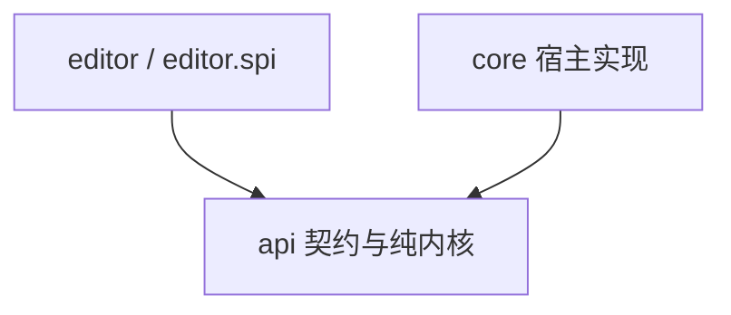

# 相机动画、播放与编辑器重构设计

## 1. 范围与决策

本设计覆盖动画数据、表达式求值、播放、空间变换、存储、网络及编辑器契约与实现。对应现有 `api.animation.*`、`api.editor.*`、`core.cmd_camera.*`、`core.animation.io.*` 和 `core.editor.*`。

`api.camera.*` 的操控方案与 Tripod 数据不在本次重构范围内；播放宿主可通过适配器复用基础相机能力。

本轮纳入每机位注视、空间读数、避障、多机位同时渲染与合成、声明式世界采样、参考音轨及编辑辅助。支持注视目标、机位活动与玩家相机来源的阶跃时间控制，以及分屏/画中画矩形的位置和尺寸动画；不引入独立剪辑片段系统、目标平滑混合、镜头交叉淡化或任意形状遮罩。视频/图片序列导出、分路抓取、外部相机格式互导、反向播放、父子 rig、物理/IK 与协作不在本轮范围；合成结果可交给外部工具录制。景深、运动模糊和色彩分级不作为本轮能力承诺，未来需专门的渲染管线或着色器集成，不能表述为 Minecraft 原理上无法实现。

功能对照与采纳理由见[功能对照评审](<review-feature-parity.md>) §9；本文与 [UI 设计](<design-editor-ui-framework.md>)为合并后的规范。

允许破坏性修改，不保证旧 API 和旧文件格式兼容，不提供旧格式转换器。本文中的接口为契约草案；实现必须满足所列行为与验收条件。

### 1.1 决策表

保留既有决策编号，新增本次评审确定的规则。

| 编号 | 决策 |
| --- | --- |
| D1 | 使用单 Gradle 模块，顶层包为 `api`、`core`、`editor` |
| D2 / D10 | 使用不可变文档、只读句柄和受控发布；撤销保存文档版本 |
| D3 | 每机位可保存默认锚点、注视目标与避障设置；播放请求按 RigId 覆盖；会话持有独立预览设置 |
| D4 | 参考系支持平移和逐轴启用的旋转，不支持缩放 |
| D5 | 非法提交必须拒绝并返回结构化诊断；输入中间态保存在草稿中 |
| D6 | 提供后端、数据、面板、组件四级扩展 |
| D7 | 数据类型负责自身 Codec；开放类型通过注册表分派 |
| D8 | 所有已发布文档变更必须经过统一文档存储对象 |
| D9 | 依赖图由文档派生，在候选文档上整体构建，不维护独立增量状态 |
| D11 | 正式播放中锚点解析失败时终止播放、释放相机控制、保留失败时刻并提示 |
| D12 | 网络传输锚点类型与完整参数，不传选择器字符串 |
| D13 | 不提供旧格式迁移；格式不支持时返回明确诊断 |
| D14 | 删除 `MODERN_UI_COMPAT`，使用 `editor.backend` 选择后端 |
| D15 | 暂不拆分编辑器 source set 或子模块，先建立包依赖边界 |
| D16 | 值源保持 sealed；数据类型扩展开放轨道、锚点与世界采样类型 |
| D17 | 同一轨道内键时间唯一；不自动量化时间，不静默覆盖冲突键 |
| D18 | 删除隐式运行期 fallback；任一当前活动机位的启用通道或其他实际依赖求值错误终止整场。仅允许作者在 sample(name, fallback) 中显式处理 UNKNOWN，其他错误不被兜底 |
| D19 | 文档与发布序号作为单个快照读取；发布限制在宿主指定线程，提交检查基版本 |
| D20 | 机位、轨道、关键帧、路径节点、标记、采样、音频引用与叠加元素采用文档内稳定 ID；显示名称与类型标识分离 |
| D21 | 输入草稿与可采样预览候选分离；预览候选不得发布为正式文档 |
| D22 | 同文档多机位共享时钟、符号、事件及世界事实；文档级 cameraSource 阶跃轨道在 Player 与活动 Rig 之间显式选择，取消固定 primaryRigId |
| D28 | 注视、机位活动与相机来源使用正式时间轴的有类型关键帧轨道，仅允许 STEP；共用关键帧编辑/历史/校验基础设施，不另建状态键系统。矩形使用数值曲线；不通过 Tick 事件切换状态，不加入平滑注视或非矩形边界 |
| D23 | 布局为可撤销创作数据；性能降级仅为宿主运行状态，必须可见，不改写文档 |
| D24 | 世界采样仅声明式、只读已加载/已同步数据；本轮各客户端本地采样，不承诺跨客户端一致 |
| D25 | 音频整体在全部非音频阶段验收后实施；最终阶段内部先独立 API 与可选接入，再波形卡点，后有声同步；音频与图片只存资源引用，不随文档自动打包 |
| D26 | 成片遮幅、字幕、图片及透明度动画纳入独立阶段；编辑构图辅助与停靠布局仅属会话/客户端视图 |
| D27 | 自动恢复保存已发布快照，独立于正式保存及撤销历史；恢复必须经正常解码和校验 |

### 1.2 不变量

| 编号 | 不变量 | 保证方式 |
| --- | --- | --- |
| I1 | 已发布文档通过全部强制静态校验 | 文档存储对象统一校验与发布 |
| I2 | 内置文档及其子对象深不可变 | 防御性复制、不可变值、无可变对象泄漏 |
| I3 | 一次读取获得匹配的文档与发布序号 | 单个 `AnimationSnapshot` 引用 |
| I4 | 一次提交原子成功或失败 | 候选构造、校验、发布；失败不改变文档和历史 |
| I5 | 一帧内所有机位使用同一文档与世界事实快照 | 帧开始捕获文档、基础姿态、锚点、目标及采样表，执行和渲染阶段只读 |
| I6 | 曲线、数值预览和姿态使用同一求值规则 | 统一采样器与显式求值上下文 |
| I7 | 不读取空间事实的公式与锚点无关；读取者显式依赖本帧空间事实 | 空间读数先于求值冻结，依赖标记与缓存包含事实身份；参考系合成仍在求值后 |
| I8 | `api` 不依赖客户端类或实现包 | 自动依赖检查 |
| I9 | 运行期错误不得伪装为合法数值或未编写通道 | 独立求值状态与诊断 |
| I10 | 草稿、选择和视图状态不进入文档历史 | 会话状态与文档分离 |

静态合法不等于任意时刻、任意环境下均可求值。试算不能替代运行期检查。

## 2. 分层与服务边界

### 2.1 包职责

| 包 | 职责 | 允许的主要依赖 |
| --- | --- | --- |
| `api.animation` | 不可变文档、轨道、路径、稳定 ID、Codec | 表达式与空间值类型、DFU、common 类型 |
| `api.animation.expression` | 值源、编译、符号与函数契约 | JDK、必要的序列化依赖 |
| `api.animation.eval` | 采样、求值上下文、依赖图、诊断 | 动画与表达式模型 |
| `api.animation.document` | 快照、只读句柄、文档存储、校验、历史 | 动画与纯编辑操作契约 |
| `api.animation.playback` | 时间推进、播放请求、帧准备、播放服务契约 | 动画、求值、空间契约 |
| `api.spatial` | 空间模式、锚点数据、参考系变换契约 | 不可变数学值、DFU、common 类型 |
| `api.storage` | 动画与路径资源条目、读写结果、存储服务契约 | 文档与诊断 |
| `api.editor` | 会话、编辑操作、草稿、预览、交互请求、后端契约 | 动画、文档、播放、存储契约 |
| `core.playback` | 世界事实采集、锚点/目标解析、避障、相机应用、事件执行及参考音频宿主 | `api.*`、基础相机 API |
| `core.render` | 多机位离屏渲染、合成、兼容性探测与性能预算 | `api.*`、客户端渲染宿主 |
| `core.storage` | 文件、SavedData、字节读写、资源服务实现 | `api.*`、宿主 IO |
| `core.command` / `core.network` | 指令、请求编解码、双端协议 | `api.*`、宿主接口 |
| `core.mod` | 生命周期、配置、注册与服务装配 | `api.*`、`core.*` |
| `editor` | 内置屏幕、面板、布局、主题、默认后端 | `api.*`、客户端 UI |
| `editor.spi` | 面板注册与可复用组件的公开契约 | `api.*`、客户端 UI |
| `editor.internal` | 不承诺兼容的内部实现 | 编辑器内部类型 |

纯编辑操作契约置于顶层 `api.animation.edit`，快照、存储、事务及历史置于 `api.animation.document`；`api.editor` 使用这些契约，文档存储不得反向依赖编辑器会话。按 P1 计划 Q13，document 的提交入口与 edit 的结果类型允许双向包引用；该例外不放宽 api 对 core/editor 的禁止依赖。

依赖方向：



`core` 与 `editor` 不得互相依赖。`api` 可使用必要的 Minecraft common 类型，但不得引用 `net.minecraft.client`。求值、时间推进及空间计算测试不得启动 Minecraft 客户端或加载游戏世界。

### 2.2 宿主服务

| 服务 | 用途 | 实现方 |
| --- | --- | --- |
| `AnimationResourceService` | 列出、加载、保存动画与路径资源 | `core.storage` |
| `PlaybackService` | 播放、停止、切换状态、查询失败原因 | `core.playback` |
| `CameraProbe` | 读取宿主基础世界姿态 | `core` |
| `CameraControlClaims` | 编辑器相机接管与自由视角覆盖 | `api` 契约，编辑器登记，播放宿主读取 |
| 轨道、锚点与采样类型注册表 | 编解码、能力描述与校验 | common 注册；客户端解析、采集与执行独立注册 |
| `FrameFactsProvider` | 一帧内解析机位空间事实与声明式世界采样 | `api` 契约，`core.playback` 实现 |
| `CameraCompositionService` | 消费已准备的多机位帧、输出合成及报告降级 | `api` 数据与生命周期契约，`core.render` 客户端实现 |
| `ReferenceAudioService` | 资源解析、波形与后续有声同步 | `api` 契约，宿主实现；编辑器不直接操作声源 |

资源服务返回条目、数据和结构化诊断；编辑器不得直接调用存储实现或解析磁盘字段。文件浏览界面由编辑器实现。

服务通过宿主注入会话和驱动器；生命周期装配负责默认实现注册。客户端实现不得在 common 类初始化时加载。

### 2.3 自动依赖检查

必须检查以下禁止依赖：

- `api → net.minecraft.client`。
- `api → core / editor`。
- `core → editor`。
- `editor → core`。
- `editor.spi → editor.internal`。

使用编译产物依赖检查或架构测试作为正式门禁；文本搜索仅作为辅助检查。资源路径或字符串内容不得代替类型依赖判定。

## 3. 文档、快照与发布

### 3.1 数据形状

```text
CameraAnimation
  dataVersion / name
  rigs: 有序 CameraRig 集合
  cameraSource: KeyframeTrack<CameraSource>，默认 Player
  tracks: 文档级有序轨道（事件等）
  symbols: 共享变量与函数
  markers: Marker(MarkerId, time, label, kind)
  samples: WorldSample 声明集合
  audioRefs: ReferenceAudio 引用集合
  overlays: 有序成片叠加元素集合

CameraRig
  id: RigId / name
  channels: 有序相机通道集合
  path / motionMode / distanceMode
  space: 含默认锚点及旋转跟随掩码
  aim: KeyframeTrack<AimState>，默认 Off
  obstacle: 避障默认设置
  view:
    enabled: 静态作者总开关
    active: KeyframeTrack<Boolean>，默认 true
    rect: 固定坐标模式及 AnimatedNumber x/y/width/height
    zOrder / resolutionScale / updateEveryFrames: 静态配置

AnimationTrack
  type: Identifier
  id: TrackId
  name: String
  duration / keyCount
```

类型标识使用 `Identifier`；文档对象身份使用稳定 ID；用户名称使用 `String`。相机通道的语义键（如 `position.x`、`fov`）与 `TrackId` 分离，并在每个机位内保持唯一；`TrackId` 在整份文档内唯一，`TrackRef` 仍以一个轨道 ID 引用，不增加机位二元键。

机位顺序、机位内通道顺序与文档级轨道顺序均持久化，分别服务显示、序列化及文档事件的稳定分派。按 ID 查询表由同一集合派生，不作为第二份可独立修改的数据。

机位至少有一个。固定 `primaryRigId` 及逐机位 `primary` 标志取消，使用文档级 `cameraSource` 明确指定每个时刻的玩家相机来源。播放时长取静态启用机位的姿态、注视、活动状态、布局轨道，以及相机来源、文档轨道、标记和叠加范围的最大有限结束时间；音频阶段另加入音轨范围。静态属性及末键保持不产生无限时长。标记不产生 Tick、指令或发声副作用，但依当前规则参与时长推导；是否分离播放范围与编辑范围仍属另行裁决，不能仅以“不触发事件”为由删除其贡献。

`view.rect` 相对最终输出画布，支持归一化 x/y/width/height 或角落锚定与像素偏移，两种坐标模式静态互斥。位置与尺寸可随时间变化，矩形外部分裁剪；隐藏使用活动状态，不用零尺寸。边界仅为矩形，不包含圆角、独立裁剪动画或任意遮罩。层级相同按机位文档顺序合成。质量设置为作者请求，宿主可见地降级但不改写文档。

`RigId`、`TrackId`、`KeyId`、`PathNodeId`、`MarkerId`、`SampleId`、音频引用与叠加元素 ID 在各自 ID 类型的文档作用域内唯一并持久化。时间属性的轨道和键同样持有稳定 ID；移动、排序、重命名、撤销保留 ID，复制生成新 ID。整份换档建立新的文档作用域。

#### 3.1.1 有类型关键帧轨道

注视、机位活动与相机来源直接使用时间轴关键帧系统。`KeyframeTrack<T>` 为契约草案名，表达有类型的 `AnimationTrack`；它与数值轨道共享 TrackId、KeyId、秒基准时间、排序、增删/移动/框选/吸附/复制粘贴、事务、撤销与 Codec/校验流程，不再另建 StepProperty 容器或状态键编辑系统。轨道类型负责值的 Codec、引用校验、值编辑器和允许的插值模式；不要求所有轨道采用同一个 Java 数值 Keyframe record。

每条轨道保存显式默认值和严格递增的关键帧。注视、活动、来源轨道只允许 `STEP`：首键前使用默认值，键时间起使用新值直到下个键，末键后保持。时间有限、非负且同轨唯一，空轨使用默认值。状态值使用原生类型，不用浮点数编码目标/布尔/机位，不强塞进 NumberSource、数值曲柄或数值 KeyField；当前不允许表达式决定这些控制状态。`TrackRef` 仍只读取受支持的数值姿态通道，引用非数值状态轨道须静态拒绝。

模型中的 `aim / view.active / cameraSource` 是对应轨道的有类型访问入口，轨道只持久化一次；不再在通用轨道表内存一份可独立修改的副本。统一时间轴从文档级轨道、机位通道及这些入口派生只读轨道目录，全部 TrackId 在文档内唯一。

| 属性 | 值类型 | 用途 |
| --- | --- | --- |
| `rig.aim` | `Off` 或 `Target(AimTarget)` | 切换完整注视配置，包括目标、掩码与偏移 |
| `rig.view.active` | boolean | 描述机位随时间参与姿态准备与合成的状态 |
| `cameraSource` | `Player` 或 `Rig(RigId)` | 明确驱动玩家相机的来源 |

例如注视轨道在 0 秒为 Target(A)、10 秒为 Target(B)，则 `[0,10)` 注视 A，10 秒起注视 B。目标立即切换，不引入双目标混合或平滑过渡。20 秒结束应由实际动画长度或后续键明确，不从“前后十秒”的标签推断。

“前 1 秒注视，后 1 秒按旋转关键帧”使用同一时间轴：注视轨道 0 秒 Target(A)、1 秒 Off；旋转轨道 1 秒 R₁、2 秒 R₂。`[0,1)` 注视覆盖启用的 Yaw/Pitch，Roll 来自旋转；从恰好 1 秒起（含该时刻）停止覆盖，采用当前旋转轨道 R₁→R₂。Off 不保存或恢复旧旋转，也不自动插入旋转键；没有旋转通道时仍按 ABSENT 补基础姿态，不冻结上一帧。交还可有角度跳变，需要连续衔接时使用 §4.7 的显式姿态捕获工具；动态目标下不承诺自动平滑。

运行活动状态为 `view.enabled && view.active.at(t)`，与性能暂时停路、UI 行过滤分开。未活动机位不主动准备姿态或渲染；其他通道通过 TrackRef 引用它时，相关数值和空间依赖仍按需求值，错误照常处理。未被选中的注视目标不要求当前存在，但所有键的类型、配置和文档引用必须静态合法。

`cameraSource` 默认 Player；选择 Rig 时，引用必须存在且在该时刻活动。验证器合并来源与活动状态的所有阶跃边界，检查每个区间及最终时间，拒绝失活来源。删除机位或关闭其总开关必须在同一候选中修复来源轨道，否则拒绝。不得自动选择第一个活动机位。

状态由时间纯求值，不通过 Tick 事件修改运行状态。定位、从中途播放及循环回绕均直接求该时刻状态；相机来源立即交接，不做交叉淡化。选择 Player 才释放播放接管；Player 的姿态来自当前游戏事实，不承诺跨次回放相同。

#### 3.1.2 连续布局属性

`AnimatedNumber` 为常量 NumberSource 或数值曲线的封闭分支，复用现有编译、关键帧与插值规则。没有曲线键时使用显式默认值，非空曲线首末范围外保持端点；不增加布局专用的隐式求值路径。布局数值不通过 TrackRef 对外提供读数，避免扩大现有机位通道引用语义。

布局可使用文档时间与不依赖机位上下文的符号/样本；绑定时拒绝隐式读取当前编辑机位空间事实。显式 TrackRef 仍在被引用姿态通道所属机位上下文求值。

在当前活动机位的每帧检查 x/y/width/height 均有限且 width、height 为正。曲线过冲与公式导致的中间帧非法属于运行期错误，终止整场；试算不能替代检查。静态存在合法键不等于连续区间合法。

示例：第二机位 active 默认 false，10 秒设 true；矩形在 10 秒为 `(0.70, 0.05, 0.25, 0.25)`，20 秒为 `(0.50, 0, 0.50, 0.50)`，可线性插值得到从右上角小窗到右半屏的变化。相机来源可始终为机位 1，也可在 10 秒显式改为活动的机位 2；这与第二路出现是两个独立创作动作。

### 3.2 深不可变规则

- 集合和数组在构造时防御性复制，不保留调用方可变容器。
- 对外不得暴露可变数组、集合、JOML 向量或可变 `Component` 实例。诊断消息、修复标签、事务及历史动作标签使用封闭不可变 `LocalizedMessage`；不保存 Component，也不依赖其 copy() 实现深隔离。
- 文档数学数据使用不可变值；JOML 可变类型仅用于计算缓冲区。
- `with*` 返回派生对象，只复制变化路径，允许共享未变化的不可变对象。
- 惰性缓存不得影响逻辑相等性，不得泄漏内部可变结果。
- 内置类型由实现保证深不可变；第三方类型必须满足不可变 SPI 契约。

第三方对象的不可变性是扩展契约，不能宣称由开放 Java 接口完全强制。框架必须复制自身持有的外层容器。

### 3.3 快照与只读句柄

```java
public record AnimationSnapshot(Revision revision, CameraAnimation document) {}

public interface AnimationHandle {
    AnimationSnapshot snapshot();
}
```

实现以一个 `volatile AnimationSnapshot` 保存当前状态。`revision` 是该存储实例单调递增的发布序号；撤销、重做及整份换档都产生新的发布序号；同一存储实例不因换档重置或回退，旧 expectedRevision 在换档后失效。不得分别读取文档和计数器来组成快照。

`AnimationHandle` 不提供发布方法。所有变更由 `AnimationDocumentStore` 处理：

```text
检查 expectedRevision
→ 执行纯编辑操作
→ 校验候选
→ 更新历史与快照
→ 通知监听者
```

- 发布必须在宿主指定线程执行；客户端使用主线程。纯内核不依赖客户端线程实现。
- 后台任务只构造候选或执行纯校验，结果回到发布线程后重新检查基版本。
- 过期提交返回 `STALE_REVISION`，不得自动覆盖当前文档。
- 文档、历史和发布序号更新完成后才通知监听者。
- 通知期间禁止重入同步写入：同步 submit 返回 REENTRANT_SUBMIT，不修改文档、不隐式排队。延迟提交使用 submitAfterNotifications，在通知结束后按提交顺序执行并重新检查基版本，结果在存储线程恰好回调一次；调用方不能阻塞等待同线程队列。
- 初始化、编辑、换档、网络载入和历史恢复均通过存储对象。

提交以 `EditSubmission(EditOp operation, Revision expectedRevision, LocalizedMessage label)` 携带操作、基版本与不可变动作标签；成功且内容有变化时标签随历史项保存，拒绝不写历史。实际存储、线程检查和队列尚待 core；现有接口固定同步拒绝与显式延迟的区别。

<a id="derived-query-rules"></a>
### 3.4 派生数据与缓存

| 数据 | 规则 |
| --- | --- |
| 编译结果 | 按公式文本缓存，使用有界 LRU |
| 依赖图 | 从完整文档及编译后语法树派生，允许按文档身份缓存 |
| 采样结果缓存 | EvaluationKey 包含 snapshotId、contextId、worldInstanceId、frameIndex、sampleTime、可空 RigId、trackId、factsIdentity 与 sampleTableVersion；sampleTime 有限非负并正规化 -0.0。单键字段/槽位缓存若另行建立，必须再区分 KeyId/槽位，不能仅复用轨道结果键 |
| 变量及轨道读数 | 在单个求值上下文中按帧缓存，失败结果也必须缓存 |
| 路径弧长与查询索引 | 在不可变对象内部惰性计算或使用外部派生缓存 |
| 文档派生查询 | 静态启用机位列表、曲线目录与按现规则计算的时长可在绑定层按不可变文档身份复用；不代表运行期 active(t)、来源或姿态结果 |
| 轨道查找索引 | eval 绑定快照时派生 TrackId 到轨道及所属 Rig 的索引；先验证唯一性，重复 ID 不得静默覆盖 |

快照身份必须区分不同存储实例；相同 `revision` 不代表同一文档。预览候选使用独立身份。

世界实例使用独立运行期 worldInstanceId，同一维度重进世界也分配新值；不能由维度、游戏刻或 revision 推导世界、快照、候选或事实批次身份。EvaluationKey.from 从 CurveSampleRequest 读取 contextId、worldInstanceId、时间、轨道和机位，其他身份由同次绑定分配；采样表版本必须与上下文 facts 一致。当前工厂仍接受调用方提供的快照/事实身份和索引，尚未执行来源一致性验证，core 必须统一生成并绑定，不能将便捷工厂视为已证明同源。

版本变化时重绑定符号表和曲线查询，不得仅清空数值缓存后继续引用旧文档。未解析状态使用位掩码或独立标记，不得使用 NaN 兼任哨兵。

文档结构缓存与帧求值缓存分开。前者只在有重复查询需求时建立，后者继续使用时间、机位、环境与事实身份；第三方数据必须满足不可变契约，缓存有界并随会话释放。查找索引用于减少重复线性扫描，不承诺 HashMap 或 Optional 的具体分配次数。内部仅为遍历时避免先物化派生列表；性能收益以实际调用与可复现测量为据，不要求统一将 Stream 改成循环。

编译绑定还须区分符号、样本声明与内置函数版本。不可变 `FrameFacts` 含世界/维度身份、游戏刻与 partial tick、实际所需机位锚点和已选择目标的读数、采样表及有效性，不进入文档。状态键跨界、世界切换、预览目标变化、采样更新和上下文切换均使相关缓存失效；缓存身份包含有效 AimState、来源和活动集合，不能仅比较 RigId。

曲线、试算或洋葱皮跨越多个时间状态时，先逐采样时间确定控制状态，再由宿主为该批实际需要的外部目标冻结当前世界读数；不能把 A 的读数冒充切换后的 B。求值阶段仍只读已准备事实，不在公式中查询世界。批量采样预算不足或缺事实时明确报告不可用/Incomplete，并标注“固定当前世界事实”，不宣称历史或未来世界状态。正式播放单帧只要求当前实际依赖的目标。

## 4. 编辑、校验与历史

### 4.1 编辑操作

`EditOp` 为 sealed 纯操作契约，包含机位、布局、模式、空间、轨道、关键帧、符号、路径、标记、采样声明、音频引用、叠加元素与文档替换操作。数值与有类型状态轨道共用关键帧受控编辑入口；值修改由轨道能力分派，跨轨粘贴需值类型和语义兼容，否则原子拒绝。复合修改一次校验发布。操作不得修改输入或执行 IO。

```java
public sealed interface EditOutcome {
    record Ok(CameraAnimation candidate) implements EditOutcome {}
    record Err(List<Diagnostic> diagnostics) implements EditOutcome {}
}

public sealed interface EditResult {
    record Applied(AnimationSnapshot snapshot,
                   List<Diagnostic> diagnostics) implements EditResult {}
    record Rejected(List<Diagnostic> diagnostics) implements EditResult {}
}
```

诊断至少包含稳定错误码、严重级别、不可变可本地化消息、显式作用域、对象或字段定位及可选修复操作。采用当前契约：

- `LocalizedMessage` 为 sealed 的 Literal / Translatable，翻译参数仅允许文本、有限数字、布尔和嵌套消息，参数列表防御性复制；Formatting 仅含 RGB 颜色、粗体、斜体、下划线。诊断、Fix、事务及历史共享此描述类型，宿主显示时再渲染为 Component；click/hover、selector、NBT 和任意 contents 不在该消息契约内。
- `DiagnosticScope.Document(Revision)` 强制非空版本，允许对象/字段定位与 Fix；`DiagnosticScope.File(ResourceId resource)` 标识文件/解码资源，仅允许无对象 ID 的字段定位，不允许 Fix。不得以可空基版本兼表两种作用域。
- Fix 的 baseRevision 必须等于 Document scope 的 revision。异步结果、定位跳转和修复提交均须核对适用作用域与当前版本，过期结果不得定位/修改新文档。候选及会话身份的绑定由后续宿主负责，不因增加作用域 record 就视为已实现。

批量移动、粘贴、模式切换等复合操作必须构造一个完整候选，一次校验、一次发布，不得循环提交单对象操作。

第三方专属数据通过 `ReplaceTrack(expectedRevision, trackId, replacement)` 提交。注册的轨道与采样类型校验器参与统一校验。需要通用时间轴编辑的轨道提供纯派生能力接口；数据接口不得发放原地增删移动方法。

保留具体 EditOp，状态键单值修改由 SetStateKey 描述，值类型依目标轨道能力校验；跨轨不兼容整批拒绝。草稿字段用 EditTarget.Field(owner, fieldPath)：owner 保留文档/机位/轨道/键等对象种类，路径在该对象内解释，不允许 Field 再嵌套 Field。当前字段路径仍为非空字符串，字段枚举/适配规则与轨道能力分派留到编辑实现；选择仍按对象/键 ID，不必与字段草稿同构。

### 4.2 静态校验

| 层级 | 职责 | 例子 |
| --- | --- | --- |
| L1 格式与语法 | 输入是否可解析 | Codec、公式语法、有限常量 |
| L2 结构与引用 | 唯一性与引用完整性 | 稳定 ID、名称冲突、轨道/机位/样本引用、cameraSource 机位存在、数值键与离散键时间顺序 |
| L3 语义 | 跨对象约束 | 依赖环、函数参数个数、样本名字字面量绑定、机位作用域、来源机位在全部被选区间活动、模式与通道关系 |
| L4 领域 | 可静态判定的数值约束 | 时间非负、FOV 范围、曲柄约束、布局正尺寸、机位/采样/资源/烘焙规模上限 |

校验顺序为 L1 → L2 → L3 → L4；前一层失败时不继续依赖其结果的校验。校验器不得修改候选，不得隐式夹取、覆盖或量化输入。可修复问题通过显式修复操作处理。

依赖图从编译后语法树构建，正确处理函数形参作用域。未定义引用与环分别报告。无环不代表调用深度或求值工作量有界；静态检查可判定的最长调用链，运行期继续执行资源上限。

内置与第三方校验器在启动阶段注册并冻结。提交、解码完成和收包载入采用同一组强制文档校验规则。

### 4.3 试算

试算是有预算的诊断检查，不是全时间域安全证明。

- 采样包括关键时刻、区间中点和固定步长；策略可配置但必须有上限。
- 同时限制最大采样点数、求值工作量与输出诊断数。
- TrialResult 使用 PASSED / FAILED / INCOMPLETE 与 TrialReport：包含 rangeStart/rangeEnd、samplingStrategy、samplesChecked、fixedFactsIdentity 或 fixedFactsNote，以及 incompleteReason。区间有限非负且结束不早于开始，点数非负；世界依赖由生产者提供实际使用的固定事实，不能只填说明而伪称全域检查。
- `Passed` 仅表示已检查点未发现错误。

- FAILED 至少含一条 ERROR；PASSED 和 INCOMPLETE 不得含已确认 ERROR。INCOMPLETE 必须有不可变未完成原因，其他状态不能携带该原因；hasError 与错误诊断一致。上述状态/报告不变量已有构造检查，采样步长、预算默认值和截断算法仍待实现。
- 确定发现求值错误时拒绝候选；预算不足时允许提交并附 `Incomplete` 提示。
- 依赖 `wt` 时必须说明检查的世界时间；非确定公式返回 `Incomplete` 提示，不以一次随机结果作为提交拒绝依据。
- 试算不得执行 Tick 轨道或其他副作用。
- 空间事实或样本无法取得时返回 `Incomplete`，不因缺少编辑环境拒绝合法结构；完整输入下确定发现的公式错误仍拒绝。
- 世界依赖公式须注明使用的固定事实与时间；这不是对动态世界的覆盖。

试算结果不得用于删除运行期有限性检查、深度保护或工作量限制。

### 4.4 时间与冲突

- 同一轨道内关键帧时间必须有限、非负且唯一，按严格递增顺序存储。数值键与状态键构造及 withTime 均拒绝 NaN、正负 Infinity 和负时间；不能仅检查 isInfinite。输入草稿保留非法文本，不构造含非法时间的键。
- 时间存储与内核统一用秒，不默认量化；可按设定 tick rate / 参考帧率显示刻、帧与时间码，显示帧率不改变模拟精度。
- 吸附是显式编辑行为，不属于校验器。吸附源可分别启用：时间网格、可见关键帧、文档标记、播放头与预览区间边界；使用屏幕距离阈值，等距按稳定优先级选择，并展示目标。
- 输入构造时统一 `-0.0` 为 `0.0`，不改变其他有效时间。
- 移动或粘贴发生冲突时拒绝整个候选，并提供覆盖、合并或跳过的显式操作。
- 批量编辑先计算全部最终位置，再检查冲突，避免处理顺序改变结果。
- 拖动期间高亮冲突目标并显示诊断。

### 4.5 撤销与重做

- 一个成功提交对应一个历史项；无内容变化不新增历史。按 ID 派生替换未找到或替换内容相等时应避免新建文档根，保留原实例；提交层须单独诊断不存在/过期的编辑目标，不能把未变化候选当作目标存在的证明。
- 历史保存不可变文档引用与动作标签，不序列化为 JSON。
- 撤销恢复旧文档并生成新发布序号，不重复执行全时间轴试算。
- 校验规则在会话生命周期内保持不变；历史恢复可执行轻量结构断言。
- 默认上限为 64 项和估算 32 MiB 双限，超出时移除最旧项。
- 内存估算考虑共享对象，避免将每个版本按完整深拷贝累加；估算不是精确堆内存计量。
- 整份换档清空历史、选择、交互请求和草稿，并提示用户。
- 播放状态、播放头、预览锚点、预览循环区间与视图参数不进入文档历史。

### 4.6 编辑工具

缓动预设写入明确的插值模式及曲柄值，不新增隐式算法。批量偏移、缩放、取反须区分值域和时间域；针对公式显式选择构造等价公式或拒绝，不能仅修改 literal。每次操作构造完整候选，冲突时整体拒绝，只产生一个撤销项。

烘焙须指定机位/轨道、区间、步长、插值策略、最大键数与完整环境。冻结文档和事实输入，全部采样成功后原子替换；缺输入、未兜底 UNKNOWN、ERROR 或超预算时不发布。世界/非确定依赖提示“固化这份事实/这次结果”，不得伪称可复现世界历史；预览区间不隐式决定烘焙范围。

### 4.7 将注视姿态转为旋转键并关闭注视

这是显式编辑工具，不是运行期切换器。作者选择机位与时间 t，冻结基文档、求值环境和当前世界事实，先得到关闭注视前的有效姿态，再一次性写入同时间的旋转 X/Y/Z 常量键与注视 Off 键。它不增加平滑混合、运行期继承上一帧角度或世界历史记录。

- 默认捕获 t 时刻有效注视配置；若 t 已有 Off 键，可显式使用紧邻 t 左侧区间生效的 Target 配置求值；该区间为 Off 时不得向更早处寻找旧目标。位置、旋转和目标事实仍取 t，不使用 t−epsilon 的姿态或上一次显示帧；没有有效 Target 时报告不可捕获。
- 捕获旋转在注视之后、避障位置修正之前取得，包含保留的 Roll；用同一 t 的锚点掩码旋转逆变换转回机位文档空间，再按 YXZ 弧度输出完整 XYZ 数值键。欧拉角选择与已有曲线相邻值相容的等价分支，避免无意义整周跳转；不将其宣称为全区间平滑保证。
- 请求/预览覆盖若固定为 Target，仅写文档 Off 不能关闭它。工具必须提示先清除这类覆盖，再按清除后的上下文重新预览和捕获；不得静默修改播放请求或把未关闭的结果显示为成功。
- 预览明确列出新增/替换的键、采样时刻、世界事实与参考系，以及插值影响。同时间已有键保留 KeyId，新增键生成新 ID；替换已有值、公式或影响邻段的插值设置必须显式确认，不静默覆盖。其他时间键保留，工具不自行补后续旋转动作。
- 目标/锚点缺失、方向退化、转换/领域错误或过期基版本均拒绝整个候选，不允许只关闭注视或只写部分旋转。世界读取发生在准备阶段；纯 EditOp 仅消费已冻结且带基版本的结果，完整校验后一次发布、一次撤销。
- 连续衔接仅针对所捕获事实下的边界姿态。固定旋转键不会随目标未来移动而更新；重新播放时目标或锚点不同可能产生跳变。旋转轨道在注视区间仍正常求值并检查错误，工具不得把 NaN/错误隐藏为注视覆盖。

## 5. 草稿、预览与选择

### 5.1 编辑事务

```text
已发布快照
  └─ 编辑事务：基版本、目标、动作标签、输入草稿
       ├─ 输入未完成：保留文本与诊断
       └─ 可构造候选：生成独立预览快照
```

会话负责事务，面板只读取状态和提交意图。

会话将事务的操作、基版本与动作标签组装为 EditSubmission，不让每个 EditOp 重复持有标签；同步提交与监听通知中的延迟提交遵守 §3.3。

```java
public interface EditorSession {
    AnimationSnapshot snapshot();
    EditResult submit(EditSubmission submission);
    EditTransaction beginEdit(EditTarget target, LocalizedMessage label);
    PreviewState preview();
    EditResult commit(EditTransaction transaction);
    void cancel(EditTransaction transaction);
}
```

输入草稿允许暂时非法。不能解析的文本不进入文档候选；可构造候选的数据进入独立预览，不发布到正式句柄。

### 5.2 统一预览

- 时间轴、曲线、变量列和视口读取同一个预览候选与求值环境。
- 预览使用与正式播放相同的采样与姿态合成规则。
- 拖动更新只执行轻量检查和当前帧求值，不逐次运行完整试算。
- 候选不完整、结构不合法或本帧求值失败时，显示诊断且不应用该帧预览姿态。
- 松手或确认后执行完整提交；成功仅产生一个撤销项。
- 取消后丢弃候选，恢复已发布快照的预览。
- 基版本变化时事务标记为过期，禁止自动覆盖；用户需重新开始编辑。
- 面板重建、活动机位切换或后端切换不得丢失草稿；按稳定目标保存不等于允许过期基版本提交。
- 预览锚点/目标变化及事实刷新须同时使曲线、数值列、合成视口失效。避障和合成复用播放宿主服务。
- 轨道显隐、曲线 solo 只过滤编辑展示，不改变求值、事件或正式播放。机位启用状态属于文档编辑；不提供会话 mute 隐式改变播放。

### 5.3 选择状态

选择保存稳定 ID，不保存轨道对象或长期有效的集合下标。

```java
public record KeySelection(TrackId trackId, KeyId keyId) {}
```

版本变化时在新文档中解析选择；对象不存在则清除。移动、排序和重命名保留选择；整份换档清空选择。界面索引仅用于当前快照的展示，不得跨版本执行编辑。

## 6. 求值与空间变换

### 6.1 值源与采样状态

保留封闭值源层级：

```java
public sealed interface ValueSource permits NumberSource, TrackRef {}
public sealed interface NumberSource extends ValueSource permits Constant, Formula {}
```

`TrackRef` 不实现 `NumberSource`，不能进入关键帧字段。关键帧字段仍由 `KeyField` 统一驱动。

删除 `evaluateOrFallback`。`Formula.literal` 仅用于切回数值模式时初始化输入，不参与求值。变量的 UI 初始值同样不得作为运行期替代值。

公共采样结果区分以下状态：

| 状态 | 含义 | 处理 |
| --- | --- | --- |
| `ABSENT` | 没有编写该通道 | 使用宿主基础姿态对应分量 |
| `VALUE` | 得到有限合法数值 | 参与合成 |
| `ERROR` | 已编写但本帧求值失败 | 正式播放终止；编辑预览标错 |

内部可使用 NaN 传播失败，公共结果必须携带状态及诊断定位。Infinity、求值异常、资源上限及最终领域越界同样是错误。失败结果也必须缓存，不能因 NaN 哨兵而重复求值。

插值参与项失败时传播错误，不跳过失败端点。无环境静态读取只能明确读取 literal 或常量，不得伪装为动态采样结果；依赖当前值的插键必须提供完整求值环境。

采样入口使用 `CurveSampler.sample(CurveSampleRequest)`；请求显式携带 EvaluationContext、TrackId、可空 RigId 和有限非负 sampleTime，不依赖当前编辑机位或采样器隐式环境。EvaluationContext.bind 是统一绑定入口，约定快照、FrameFacts、TrackLookup、TrackIndex 同源；目前只是包装工厂，索引构建/身份分配/一致性检查仍待 core。普通曲线须明确空间上下文，只有无机位空间依赖时 RigId 可空；TrackRef 切到被引用轨道所属机位。

表达式实现还须满足：

- 编译与求值失败返回结构化诊断，由宿主决定展示和日志，不在底层静默替换数值。
- 函数参数个数与名字作用域在提交期检查；运行期深度和工作量超限必须可诊断。
- `random()` 保留为明确标注的非确定函数，不保证预览与多次播放一致；提供显式种子和时间输入的确定性替代函数。
- 提供 `noise(seed, t)` 等纯函数，明确范围与函数版本，不依赖采样顺序、线程随机源或发布序号。
- 提供 `step` 与惰性 `select(cond, a, b)`：有限条件非零为真，仅求值选中分支，静态校验仍检查两个分支引用与依赖。急切实参函数不能保护错误分支。
- 空间读数明确区分世界坐标、机位锚点局部坐标与锚点到目标距离，只读外部锚点/目标事实，不得反读待求值相机造成循环。速度若后续支持，须由宿主提供明确速度事实，不能从任意前次求值差分推断。
- 共享符号读取当前机位空间事实时，求值与缓存须带 RigId；TrackRef 使用被引用轨道所属机位上下文。无机位上下文的入口须显式指定机位或报告缺失。
- 编译器、语法树和解释器实现不作为稳定扩展接口公开。

### 6.2 姿态类型

| 类型 | 用途 |
| --- | --- |
| `DocumentPose` | 位置 x/y/z、旋转 pitch/yaw/roll 使用 AxisSample 三态，FOV 使用 ChannelSample，带汇总诊断；掩码派生 |
| `WorldPose` | 已补全并完成参考系合成，可交给相机的完整姿态 |
| `PoseBuffer` | 内部可复用计算缓冲区，不进入文档与历史 |

AxisSample 为 Absent / Value(double finite) / Error(ERROR Diagnostic)。DocumentPose 的位置/旋转掩码仅由 VALUE 轴派生，不承担错误表示；hasError 检查六轴、FOV 及汇总 ERROR，任一实际依赖错误阻止合成。轴/FOV 诊断汇总由结果生产者负责，当前构造器不自动汇总；三轴不全为值时完整向量查询为空，消费方必须先看错误状态，不得按 ABSENT 补错轴。自由视角覆盖返回 WorldPose，不经过锚点变换。

### 6.3 空间与锚点

```java
public sealed interface Space {
    record World() implements Space {}
    record Local(@Nullable Anchor defaultAnchor,
                 RotationMask followMask) implements Space {}
}

public interface Anchor {
    Identifier type();
}

public record RotationMask(boolean x, boolean y, boolean z) {}
```

锚点为开放不可变契约。内置类型包括固定坐标、实体 UUID、玩家 UUID。类型 ID、`MapCodec`、`StreamCodec` 在 common 侧注册；客户端解析器单独注册，不在 common 初始化过程中加载。

FrameFacts.RigFacts 的 anchor/target 均为非空 SpatialResolution：NotRequired、Resolved(ResolvedAnchor)、Failed(ERROR Diagnostic)。合法不需要与解析失败不能再以同一个 null 表示；Failed 阻止依赖它的通道/姿态。空间读取与最终合成算法仍待宿主，不能以 record 三态已存在宣称失败消费已验证。

对每个机位，锚点优先级为播放覆盖、机位文档默认；选定覆盖锚点解析失败后不得尝试默认锚点。局部空间允许无默认锚点，但开始播放前必须由请求提供有效锚点。

编辑会话按 RigId 独立保存预览锚点；初始化可使用机位文档默认值，无默认值时显式建立当前相机位置的固定预览锚点。此操作不修改文档。

`MotionMode` 决定位置来自路径或坐标通道；`Space` 决定参考系，两者正交。实体/玩家锚点与注视目标共用本帧 partial tick 插值位置和旋转，旋转沿最短弧插值，固定锚点不插值。瞬移、维度切换或无有效历史时使用当前宿主状态，不跨维度平滑。这不引入带记忆的相机平滑器。

`AimTarget(Anchor target, RotationMask mask, Vec3 offset)` 的偏移沿世界轴；只支持 Yaw/Pitch 注视掩码，Roll 保留通道/基础姿态，静态拒绝启用 Roll 注视。先对当前时间的 `rig.aim` 求值，再应用请求覆盖：继承使用该时刻状态，禁用得到 Off，替换在整次播放中使用请求给定的固定 Target，不回写或改动状态键。预览覆盖采用相同规则。只有实际需要的有效目标进入本帧解析；切换 A/B 之前不解析未来目标。世界空间也可注视；当前 Off 或未声明锚点时，依赖对应空间读数的公式报告上下文缺失。

### 6.4 合成规则

位置与旋转的合成顺序：

```text
读取宿主基础世界姿态
→ 转换到文档参考系
→ 用 VALUE 分量覆盖，保留 ABSENT 分量
→ 检查 ERROR
→ 合成为 WorldPose
→ 按机位目标方向覆盖世界 Yaw/Pitch，保留 Roll
→ 避障宿主修正位置（如启用）
→ 最终有限性与领域检查
→ 准备全部机位姿态，再交给相机/合成宿主
```

- 位置：`world = anchorPosition + R * local`。
- 旋转使用四元数合成：`qWorld = qAnchorMasked * qLocal`。
- 掩码作用于约定为 YXZ 顺序的锚点欧拉角，未启用轴置零后构造四元数。
- 旋转单位统一为弧度；欧拉角顺序与转换实现集中定义。
- 未编写旋转分量在锚点参考系内由基础姿态补全，再参与合成。
- 世界空间使用单位参考系，复用同一合成规则。
- 固定锚点旋转为单位旋转，不应用缩放。
- 每帧先求旋转通道并合成世界旋转，再由当前注视键值覆盖启用的世界 Yaw/Pitch；Off 不覆盖任何轴，立即使用当前旋转通道结果，不恢复缓存旧角度。原通道仍须通过错误检查。目标重合或方向非有限是错误；垂直方向的 Yaw 使用本帧注视前 Yaw，不读上帧输出。
- 避障在注视后只修正位置，不再次注视；“精确朝向目标”指避障前姿态。结果不反写文档、曲线或试算。局部机位以解析锚点为碰撞起点，世界机位以本帧基础相机位置为起点，限制起点到期望位置的墙体遮挡；不是带历史的运动碰撞模拟。
- 现有 `enableObstacle()` 围绕玩家眼睛做第三人称避障，不能直接代替任意机位算法；宿主须提供每路独立适配并验证预览/播放一致。当前依赖的 `aimAt` 保留 Roll，但纯姿态求解仍用于掩码、多路及退化方向处理。内核用弧度，基础 CameraModifier API 的角度边界统一转换为度。
- 计算接口支持目标参数写入，复用缓冲区，避免增加每帧临时分配。

自动路径切线朝向、专用 orbit 图元与父子 rig 暂不纳入；路径/三角函数可实现环绕，不宣称已有自动切线约束。

切换 World / Local 仅改变空间解释，不自动换算坐标；界面必须提示并显示预览参考系。距离模式切换是显式编辑操作；涉及表达式时必须保持求值语义，不能仅换算 literal。

## 7. 播放与事件

### 7.1 内核与宿主

播放内核负责时间、状态、文档空间求值及事件区间准备；不读取世界、不写相机、不执行指令。宿主负责环境数据、锚点解析、参考系合成、相机应用和事件执行。

```java
public record PlaybackRequest(
        CameraAnimation animation,
        Map<RigId, RigPlaybackOverrides> rigOverrides,
        float speed,
        boolean loop,
        float startTime) {}
```

`RigPlaybackOverrides` 描述每路锚点、跟随掩码、注视与避障覆盖；注视支持显式禁用。未知 RigId 拒绝，不把一份覆盖隐式施加到所有机位。请求不含分路导出字段。

速度必须有限且大于零；第一版不支持反向播放。开始时间必须有限、非负且位于可播放范围，空动画仅接受零时刻。编辑屏幕不主动暂停世界；动画暂停不等于世界冻结，不新增多人服务器暂停能力。请求通过文档校验后由同一文档存储切换文档；编辑器打开时按整份换档处理。

PlaybackService.start 先校验请求与 expectedRevision，并准备初始运行条件；全部成功后才由同一 store 换档、递增序号并切换播放状态。启动准备失败时原文档、序号、播放状态与相机控制不变，不允许先换档再回滚。此规则区别于已启动播放中的失败终止；实际原子切换实现仍待 core。

### 7.2 帧准备与执行

每帧只捕获一次正式快照，按以下顺序处理：

```text
准备阶段：
计算目标时间及跨越区间
→ 纯求值 cameraSource、机位活动及注视状态，应用显式覆盖并确定实际依赖
→ 一次捕获环境、基础姿态、实际所需锚点/目标与声明式采样
→ 在同一事实快照上求值当前活动机位及被引用通道，完成注视、避障、矩形与姿态检查
→ 检查渲染能力及可选音频；事件预算须在区间展开/事件生成时已持续检查
→ 得到携带捕获 AnimationSnapshot、相机来源、活动集合、姿态/矩形/层级/质量、冻结事实与有序事件的 PreparedFrame 或错误

执行阶段：
成功：更新时间与状态 → 按 cameraSource 应用或释放玩家相机 → 提交多路渲染与音频同步 → 文档事件仅分发一次
失败：记录失败时刻 → 终止播放并释放控制 → 不执行本帧事件
```

全部当前活动机位须通过准备，即使因性能策略暂不重绘也不能跳过求值错误检查。不活动机位不主动求值姿态、矩形或渲染，但指向其通道的 TrackRef 仍按实际依赖求值；仅需要数值及公式空间事实时，不额外执行该机位的注视姿态求解或避障。任一实际依赖失败终止整场，准备成功前不应用任一路新姿态。来源 Rig 在当前时刻失活属于无效文档或准备错误，不自动交还玩家或选择其他机位。

事件准备必须为纯操作。执行阶段不承诺对宿主副作用进行事务回滚；执行器异常必须终止后续分发并报告已发生的部分执行。

普通停止与失败终止分开：`stopAndReset()` 重置播放头；`halt(reason, failureTime)` 保留失败时刻供诊断。继续播放前必须重新校验运行条件。

### 7.3 失败规则

| 情形 | 正式播放 | 编辑预览 |
| --- | --- | --- |
| 任一所需锚点/目标不可用、类型或解析器缺失 | 终止并释放相机，保留失败时刻，提示原因 | 显示参考系错误，不应用该帧预览姿态 |
| 启用通道求值错误、最终姿态非法 | 同上，不执行本帧事件 | 对应曲线断线、数值列显示错误，不应用该帧预览姿态 |
| 活动机位矩形非法，或 cameraSource 指向不活动/不存在的 Rig | 终止整场并定位属性；无效来源通常应在提交或载入时拒绝 | 显示矩形字段或冲突区间，不应用该帧预览结果 |
| 通道未编写 | 使用基础姿态分量 | 相同规则 |
| 事件工作量超限 | 终止并报告，不静默丢弃 | 显式预览播放采用同一规则 |
| 必需样本 UNKNOWN 且无显式默认值 | 终止整场，指名样本及原因 | 依赖通道标错；试算可为 Incomplete |
| 渲染宿主异常 | 停止后续输出与事件、释放资源，报告可能的部分执行 | 显示错误，不呈现为新的成功帧 |
| 性能/兼容性降级 | 可见可恢复的运行策略，不等同求值失败 | 展示受影响机位、当前质量及原因 |

当前实际依赖的锚点与目标必须每帧解析或复查有效性；不能要求未来状态引用的对象现在存在。运行期提示应按一次失败汇总，避免逐通道重复刷屏。

### 7.4 Tick 轨道

轨道只描述事件数据；宿主按轨道类型注册执行器。文档对象不得包含发指令或访问世界的方法。

- 正向推进区间为 `(from, to]`。
- 从零开始播放及进入每个新循环时，单独包含零时刻事件一次。
- 跨越多个周期时完整处理各周期，不能只对最终时间取模后分发两段。
- 事件列表按跨越区间/周期的推进顺序，再按区间内时间递增；仅同一发生时刻跨轨道按文档轨道顺序。EventDispatcher 接收整帧，从 frame.snapshot 解析载荷并原序消费，不重新读取当前 store。
- 定位、暂停、拖动草稿和试算不触发事件。
- 编辑器显式播放才执行事件。
- 每帧限制事件执行数量及区间处理工作量；在展开区间、生成事件时就检查，超限立即停止准备，不能先完整展开再交执行器限流。当前 EventBudget 类型已定义，但 prepareFrame 尚无预算参数，准备器注入/配置的承载方式须在 core 实现前补明，不宣称已运行限额。
- 循环、末尾停止、从中途开始和零长度动画均有独立边界测试。

### 7.5 相机接管

编辑器通过带生命周期的登记令牌声明接管，相机控制声明可提供自由视角 `WorldPose`。关闭会话或切换世界时释放令牌。

推荐在宿主主线程协调仲裁与写相机。声明注册 PoseProvider，宿主每帧以 winningPose 一次捕获 Claim + WorldPose，provider 每帧至多调用一次；捕获期间登记/释放影响下一次捕获，已开始的本次结果最多应用一次。释放后不得发起新调用或复用旧缓存；provider 禁止发布文档或嵌套捕获，异常转本帧准备失败，不静默退回 Player。线性化已有接口说明，线程限定、重入检测与每帧次数由 core 验证；当前接口尚未明示线程约束。

多个声明按显式优先级和稳定登记顺序仲裁；只有获胜声明影响相机。没有编辑器覆盖声明时，由正式播放状态和 `cameraSource.at(t)` 决定接管：Player 使用正常玩家相机并作为底图；Rig 使用该活动机位的最终姿态。副机位活动、机位排序、UI 选择和性能降级均不能自行改变来源。相机来源的阶跃变化立即交接，不做平滑；普通定位可更新预览来源，但不触发 Tick 副作用。相机探针读取宿主基础姿态，不得将上一帧本插件输出再次作为基础输入。

### 7.6 多机位渲染与合成

`CameraCompositionService` 接收 `PreparedFrame`，以同一目标时钟绘制当前活动机位。世界/实体模拟与文档事件每帧只执行一次；各视角的提取、剔除、投影、提交与区块可见性调度可能重复，不承诺“区块构建只跑一次”。当前 Minecraft 26.1.2 的提取/渲染分阶段架构要求每路拥有独立视角状态，不能仅替换全局相机后复用主视角提取结果。

- 每个活动机位按本帧已求值矩形、静态层级与稳定顺序合成；当前相机来源 Rig 可复用正常世界画面，是否避免重复绘制由适配层验证。来源为 Player 时保留正常玩家画面作为底图，活动机位按布局叠加。

- RigPose 在准备阶段冻结 zOrder、resolutionScale、updateEveryFrames；按 zOrder 升序绘制，大层级在上，同层按文档机位顺序。CompositionRequest 的 includePlayerBase 在来源 Player 时必须为真，由合成服务交叉检查；不能只依靠输出尺寸 record 的局部校验。
- 宿主集中隔离/恢复相机、目标、投影、视角提取、雾、后处理与提交集合，异常路径也须清理。渲染期间不接受重入发布或编辑操作；渲染目标、尺寸与临时状态不暴露到 common API。
- 固定层序：机位世界画面 → 成片叠加（遮幅/字幕/图片/透明度）→ 游戏 HUD → 编辑器构图辅助 → 编辑器工作区 → UI 菜单/提示/模态。成片叠加不使用 UI `OverlayHost`。
- 声音监听器每帧只更新一次，跟随实际玩家相机来源：Rig 的最终姿态或正常玩家相机。副机位不得更新监听器或重复播放世界声音；参考音频是非空间声音，独立音频接入仍最后实施。
- 合成矩形每帧更新，其宽高比驱动当前机位投影；内部渲染分辨率与矩形尺寸分离，以尺寸分档、容量复用和滞回控制重分配，不因每像素变化逐帧销毁目标。实际分辨率与质量偏差必须可查询。
- 不活动机位停止世界渲染，不提交旧画面；离屏目标允许在有界空闲缓存内短期复用，超时或超预算释放。重新活动时必须准备有效新帧，不能先显示停用前缓存。窗口/全屏/缩放变化集中调整目标，换世界或会话关闭释放资源。

质量策略支持路数/显存/帧时上限、分辨率降低、隔帧复用、末尾副机位暂时停路及一键单路。优先保留当前来源 Rig，再按活动机位文档顺序；来源为 Player 时按活动机位顺序保留合成路。不得因降级改写 cameraSource、view.enabled、活动轨道或矩形曲线。连续超预算才降级，恢复有滞回，阈值由实测确定。必须显示降分辨率、旧帧的采样时刻/延迟、停路原因和恢复状态；活动切换或来源交接时不得复用此前活动区间的旧帧。隔帧复用不代表所有路图像始终同一瞬间。

RigRenderStatus.SampleIdentity 同时包含 renderFrameIndex、animationTime、gameTick、worldInstanceId、snapshotId、activityGeneration、sourceGeneration；候选快照独立分配身份，任一生命周期身份不匹配即使游戏刻相同也失效。已呈现必须有采样身份，FRAME_SKIPPED 必须呈现复用画面，RIG_PAUSED 不呈现。实际缓存失效、质量档位、显存/帧时阈值与兼容矩阵由 R0/core 实测，数据结构检查不等于纹理失效已经实现。

多机位兼容性是验证门槛。已有 PiP 只拷贝主目标，不能证明第二视角渲染可用；全面迁移机位数据模型前先完成原生管线最小双路验证，再测优化/着色器组合。使用 Minecraft 渲染抽象有助隔离但不保证兼容。已知不兼容时可见地退回单路；真正渲染异常须终止，不能伪装性能降级。未被客户端加载的远端区块不因多机位而强制加载，不承诺远距离完整场景。

### 7.7 声明式世界采样

文档只声明要读什么；宿主在帧准备阶段生成不可变表，表达式不能在求值中任意访问世界。

```text
WorldSample
  id: SampleId
  name: 文档内唯一名称
  kind: Identifier
  args: 类型自身 MapCodec 定义的不可变参数
  resampleEveryTicks: 正整数，默认 1
SampleReading = VALUE(finiteNumber, sampledAt) | UNKNOWN(reason, sampledAt)
```

表达式使用 `sample("名字")` 或 `sample("名字", fallback)`。名字必须为静态字符串，提交期绑定到 SampleId；重命名须显式同步引用或拒绝产生悬空引用。现有表达式仅有数值/名字/调用且急切求值，故须新增受限字符串参数或样本引用 AST、惰性选择节点，并同步编译、常量折叠、依赖分析与预算；不引入通用字符串值源，也不开放值源扩展。

- 只返回有限数值，分类信息用匹配条件产生 0/1，不能用 ID 哈希代表分类。最小类型是方块匹配、光照、受支持实体属性；后续加入群系、天气/月相及已同步记分板。属性须有类型白名单，枚举用具名匹配，不任意反射字段。
- 只读已加载且客户端可见的数据，绝不触发区块加载。文档参数是静态坐标或外部 Anchor 引用，不能依赖待求值相机、公式或其他样本；动态采样位置需未来单独设计依赖阶段。
- 默认每游戏刻重采一次，帧准备冻结本帧可用表；重采周期按游戏刻计，暂停时不因渲染频率重复采集，插值实体空间事实仍逐渲染帧解析。切世界、声明/参数改变或重新解析资源使缓存失效。表版本仅在读数、有效性或采样时间元数据改变时变化。
- 同参采样去重，提交校验声明数量/周期/参数规模，宿主限制采集工作量。当前周期因未加载/未同步而取不到数据须写 UNKNOWN，不能沿用旧成功值伪装新读数；采集器异常、非法输出和预算违规为独立采集错误，不能标成可兜底的 UNKNOWN。试算因自身检查预算未完成仍按 §4.3 返回 Incomplete。
- `sample(name)` 读取 UNKNOWN 时使依赖通道 ERROR，终止播放并指名样本；双参形式只在 UNKNOWN 时惰性求值 fallback。未知样本名、类型配置错误、异常、预算违规及 fallback 自身错误不能被隐藏。未使用的 UNKNOWN 只在面板提示，不主动终止无依赖的播放。
- 试算缺少事实返回 Incomplete；编辑器展示当前值、采样时间、依赖世界状态及 UNKNOWN 原因，可将引用插入公式。曲线是固定事实上的时间采样，不保证世界将来如此。
- 本轮每客户端独立本地采样，结果可能不同；一份请求附表不等于动态同步，当前网络协议不增加服务端采样表。持续服务端采集、时序与丢包策略留待后续另议。

采样类型注册与锚点同构：common 侧注册类型 ID、MapCodec/StreamCodec、结构校验及能力描述，客户端注册采集器。不得在 common 初始化时加载客户端类。类型不存在在解码时报错，客户端采集器缺失则报告运行能力缺失。

### 7.8 参考音轨与成片叠加

本节音频内容仅在 §10 的最终音频阶段实施，不作为前期文档模型、存储、播放或 UI 重构的验收前置条件。参考音轨通过可选独立音频 mod 接入，规则见[独立音频 API 设计](<design-spatial-audio-api.md>)：未安装或版本不兼容时，含音频文档不能完整打开，仅可提示后显式导入非音频部分；缺 mod、资源或所需能力时阻止播放。已安装但资源缺失时可编辑引用并重新绑定。成片叠加仍在非音频阶段实施。

`ReferenceAudio` 保存稳定 ID、资源引用、内容哈希、动画起始偏移、源片段范围与增益等创作数据；标记独立于音轨，自动节拍检测产生的标记须由作者显式确认后提交。引用定位通过资源服务与客户端授权资源根，不将发送方绝对路径作为接收方可读取路径。音频/图片不自动打包，分享时显示缺失或哈希不匹配，并允许显式重绑定；限制解码大小和资源预算。

A1 在兼容音频 mod 可用后实现资源引用、波形异步缓存、源时间与动画时间对应、手动/辅助节拍标记及吸附；明确此时只做视觉参考，不承诺发声。资源缺失时可诊断和重绑定，不允许绕过依赖或资源检查播放含音频文档。波形缓存按内容哈希、解码参数和资源版本分离，取消任务不得覆盖新资源的波形。

A2 增加有声同步前，必须验证解码、播放时钟、任意定位、暂停/恢复、循环、正速变速、音量/静音、失焦、世界切换与释放。参考音频以共享动画传输时钟为主，声音宿主报告实际播放位置并进行有界漂移校正，不能让各音轨各自驱动时间。原版声音抽象和独立播放器均需实证评估，裸 OpenAL 不是已确定的唯一实现。支持格式、变速是否变调与缺失资源的正式播放策略在 A2 能力验证后作为明确决策确认，未定前不宣称 A2 完成。定位/试算不触发事件，拖动试听需显式开启。

成片叠加分独立阶段：O1 遮幅；O2 字幕与图片（资源、字体、对齐、时间区间）；O3 透明度与淡入淡出。每元素持久化稳定 ID、类型、启用、层级、起止时间及类型参数，使用受控内置数据分支或现有轨道能力，不新增第四类开放注册表。数值参数复用封闭 NumberSource 与统一采样，静态标签不自动变为表达式。元素同层按文档顺序合成，淡入淡出仅改变元素透明度，不是镜头间过渡。缺失图片/字体在编辑器显示诊断，正式启用的必需叠加资源不可解析时按准备失败处理；不可悄悄省略。构图安全框、三分线和几何洋葱皮是编辑器辅助，不随成片输出。

## 8. 序列化、存储与网络

### 8.1 Codec

- 数据类型维护自身字段名、`Codec` 或 `MapCodec`。
- 文档 Codec 组合成员 Codec；容器只认识自身字段，不复制子对象字段规则。
- 轨道、锚点与世界采样通过类型注册表分派；封闭值源与内置叠加元素使用固定分支。

- 采样先读取 kind，再通过冻结注册表选择参数 MapCodec；kind 与 SampleArgs.type 必须一致。覆盖编码保留继承/显式禁用/替换分支，StreamCodec 不用可空值抹平意图。
- 机位列表、cameraSource 默认值与阶跃键、注视与活动状态、矩形默认值与曲线、标记、采样、音频引用与叠加元素均参与往返；不序列化 FrameFacts、渲染目标或运行降级状态。状态轨道使用既有轨道类型注册表与关键帧成员 Codec，保存原生值和仅 STEP 的插值约束；不序列化独立 StepProperty 副本，不新增第四类开放注册表。
- `KeyField` 统一驱动关键帧来源字段，避免多处维护槽位清单。
- 必填字段缺失、类型错误、非法枚举及未知类型必须报错；可选字段仅使用明确定义的缺省值。
- 子对象解码执行局部约束；整份文档解码完成后执行统一文档校验。
- 不得将部分解码结果作为合法文档发布。
- 曲线通道的标签、颜色和默认信息由通道描述注册表派生；用户可编辑的轨道名称或外观覆盖显式存储。

顶层必须含 `dataVersion`，新格式从 1 开始。版本缺失、较旧或高于当前支持范围均明确拒绝，不尝试按当前默认字段读取。

磁盘和网络解码均限制嵌套深度、对象数量与输入字节规模，在遍历/分配前或过程中检查；未知类型、版本和非法字段失败不发布部分结果。上限默认值、两阶段分派和完整 Codec/解码测试当前仍未交付，不能把严格规则已写进设计视为已实现。

### 8.2 存储与诊断

| 载体 | 用途 |
| --- | --- |
| `JsonOps` | 本地动画和路径文件 |
| `NbtOps` | SavedData 文档，不再内嵌 JSON 字符串 |
| `StreamCodec` | 播放请求及来源数据 |

存储实现负责资源定位、字节与 Ops 转换、调用 Codec、报告错误，不解释文档子对象字段。

文件诊断使用 storage.ResourceId，不再用自由字符串；当前 value 为非空白相对资源标识。资源根、本地路径映射与安全校验由资源服务定义，不能把 ResourceId 仅非空白检查当成绝对路径/越界路径已被拒绝。服务、恢复槽、Codec 与网络压缩实现仍待相应批次。

诊断模式为只读资源视图，展示文件、字段或对象路径、错误码和消息，不构造可发布的非法文档。JSON 源码行列仅在解析器可提供时展示，不将 DFU 字段路径等同于源码位置。

消息显示经无状态 LocalizedMessageRenderer，每次生成独立 Component，保留翻译键、fallback、参数顺序与嵌套样式；不得先转纯字符串或将结果写回契约/共享可变状态。接口已交付，实际渲染器、语言切换与安全显示缓存待宿主实现和测试。

### 8.3 网络

网络请求包含：

- 动作与数据来源：本地名称、随包文档或停止。
- 按 RigId 编码的锚点类型与完整参数、可选旋转跟随掩码、注视/避障覆盖及明确禁用语义。
- 播放速度、循环和开始时间。
- 协议版本及必要的数据规模限制。

服务端执行选择器并生成具体锚点，不把选择器字符串发送给客户端。玩家锚点指向实际解析出的玩家；“每个接收者自身”必须是明确语义，不能覆盖显式指定的其他玩家。

注册表 ID 与类型 Codec 在双端可用；锚点解析器与本轮采样采集器只在客户端。编解码边界必须将未知类型、缺失实现、版本或规模错误转换为可报告的请求失败，不得静默构造默认锚点。请求载入后仍执行文档与播放参数校验。

### 8.4 自动保存与恢复

自动恢复按防抖/周期捕获已发布快照，通过资源服务异步写入独立恢复槽，使用临时文件与原子替换策略；完成回调不得把新版本错误标记为已正式保存。恢复槽按资源身份区分，限制数量、体积和保留期，错误可诊断且不阻断编辑。自动恢复不覆盖用户正式文件，也不保存渲染缓存或撤销栈。

启动或重开资源时展示恢复版本与正式版本的身份/时间，让用户选择恢复、忽略或删除恢复槽；恢复经正常 Codec 与文档校验，再作为整份换档进入存储。会话草稿不属于已发布文档，首阶段不承诺恢复非法/未提交输入，UI 必须说明保护边界。

## 9. 编辑器契约与扩展

### 9.1 会话状态

会话除提交与预览外提供：

- 撤销、重做、动作标签。
- 播放状态、播放头、定位与显式播放控制。
- 基于稳定 ID 的选择。
- 时间轴视图、按 RigId 的预览锚点/目标/避障与草稿，以及 `activeRigId`。
- 会话预览循环区间 `[in, out]`（有限且 `0 <= in < out <= duration`）；仅影响显式编辑预览，不改变正式播放请求或文档时长。普通定位不发事件；区间循环时每次入口包含边界事件一次，其他推进仍用 `(from, to]`，不补发区间外事件。空动画禁用区间循环。
- 曲线显隐/solo、构图辅助、几何洋葱皮与采样事实时间标识。几何洋葱皮只画位置/视锥，预算有上限，不重复世界渲染；世界依赖使用固定事实并标注，不制造历史世界状态。
- 音轨/标记、世界采样实时读数、机位布局及成片叠加的面板模型。
- 带选项的交互请求与状态诊断。
- 明确的关闭及资源释放流程。

文档存储与播放内核由宿主注入，不由屏幕构造私有副本。界面后端切换复用会话；关闭屏幕与关闭会话的生命周期必须区分。

### 9.2 交互请求

```java
public record InteractionRequest(
        InteractionId id,
        LocalizedMessage message,
        List<InteractionOption> options) {}
```

交互请求的消息采用 LocalizedMessage，沿用不可变消息边界；此处为后续 api.editor 目标签名，当前尚未交付 InteractionRequest 实现。会话提供 `choose(requestId, optionId)` 与取消入口。二元确认是普通选项请求；路径新建、绑定及来源选择使用同一协议。过期请求、已关闭请求和无效选项必须拒绝，不能执行旧回调。

### 9.3 后端选择

内置界面通过 `EditorUiBackend` 注册，具有稳定 ID 和最低优先级。打开流程统一为创建或恢复会话，再交给 `EditorUiHost`。

| `editor.backend` | 行为 |
| --- | --- |
| `auto` | 按优先级依次询问；同优先级按 ID 稳定排序；内置实现最低 |
| 指定已注册且接管的 ID | 使用指定后端 |
| 指定已注册但拒绝接管的 ID | 提示失败，不自动切换 |
| 指定未注册 ID | 警告并打开内置实现 |

保留 `openDefault(session)`，允许第三方包装后转发。拒绝接管的后端不得关闭会话或遗留接管令牌。默认实现由编辑器客户端生命周期入口自行注册，`core` 不引用编辑器类。

### 9.4 扩展面

| 级别 | 契约 | 规则 |
| --- | --- | --- |
| 后端 | `EditorUiBackend`、`EditorUiHost` | 可整体替换或转发默认界面 |
| 数据 | 轨道、锚点、世界采样类型注册表与校验器 | Codec 与客户端解析或执行分离；遵守不可变契约 |
| 面板 | `editor.spi.PanelRegistry` | 描述 ID、标题、工厂、布局位置；通过会话编辑 |
| 组件 | `editor.spi` 公开组件 | 提供生命周期、渲染、布局、焦点及完整输入派发 |

组件输入至少覆盖按键、字符、鼠标按下与释放、移动、拖动和滚轮。`editor.spi` 可依赖客户端 UI 类型，不得依赖 `editor.internal`。公开组件需要内部实现时通过工厂返回契约实例。

内置面板与第三方面板均不得直接修改文档。按快照身份重建视图模型，不得因此丢失会话草稿或选中 ID。

## 10. 迁移与验收

每阶段必须可编译、可验证；包隔离在依赖替代契约建立后执行，不以机械搬包代替职责拆分。

| 阶段 | 内容 | 验收 |
| --- | --- | --- |
| P0 行为基线 | 测试真实采样、时间区间、批量编辑、撤销、模式切换；修正阻碍迁移的数据丢失问题 | 用例覆盖真实调用链，明确记录需改变的旧行为 |
| P1 边界服务与内核 | 抽出播放内核；建立资源、相机和轨道能力契约；迁移编辑模型归属，再搬编辑器包 | 编译通过；禁止依赖检查通过；不需要客户端启动即可测试纯内核 |
| P2 不可变与提交 | 稳定 ID、内置文档不可变、快照存储、最小提交和撤销；同步切换全部写调用 | 不存在修改已发布数据的路径；一次提交原子成功或失败；旧对象选择问题消除 |
| P3 Codec 与诊断 | Codec 内聚、严格解码、分层校验、试算与结构化诊断；统一载入入口 | 提交、读档和收包应用同一文档规则；错误文档不发布 |
| P4 空间、预览与失败 | 逐轴采样状态、每机位 local/注视/避障、FrameFacts、草稿预览、运行期失败与事件准备执行 | 相同完整上下文得到相同结果；显式空间依赖正确失效；任一路错误姿态不应用，失败帧不执行事件 |
| P5 扩展与清理 | 后端配置、交互请求、面板和组件 SPI、默认实现接入；删除旧实现与重复路径 | 外部后端完成编辑、路径绑定、撤销和保存；默认后端可转发；指南同步 |

P2 内部可按功能切片迁移，但同一阶段完成不可变发布前必须切换全部存量写调用。不得保留直接写方法以通过不可变验收。P3 之前可保留格式适配层，其内部必须通过 P2 的受控操作构造文档。

功能分期中，非音频功能与 P0–P5 交叉安排；机位模型须提前验证。**音频整体留到最终阶段**：P0–P5、R0–R3、S1–S2、O1–O3 和 E1 的非音频内容完成并验收后，再实施独立音频 API、相机适配、音频数据与 Codec、波形 UI 和有声同步。前期仅保留本文的目标模型与服务边界，不要求实现音频字段、注册、后端探针或占位 UI；独立标记、非音频吸附和普通世界声音的单监听器/不重复播放约束不受延期影响。

| 阶段 | 内容与进入条件 | 验收 |
| --- | --- | --- |
| R0 宿主验证 | 全面机位模型迁移前做原生双路渲染、独立提取/恢复及基础避障验证 | 两个独立视角；无重复模拟/声音/事件；异常后主状态恢复；记录兼容矩阵 |
| R1 数据与两路 | P2 纳入机位、cameraSource、注视/活动状态与矩形时间属性及稳定 ID，P3 纳入 Codec 与来源区间校验；先验证固定状态两路 | 同一目标时钟、单路基线、任一路实际依赖失败全停 |
| R2 时间控制与布局编辑 | 有类型目标/活动/来源关键帧轨道、矩形曲线、默认值与插键、预设、注视转旋转键工具和 activeRigId | 任意定位一致；10 秒切目标/第二路出现/矩形变化；1 秒 Off 交还旋转；捕获原子可撤销、切换不丢草稿 |
| R3 多路预算 | N 路、质量预算、隔帧/停用及恢复、兼容退回单路 | 运行降级可见、旧帧有时间标识；不篡改创作数据 |
| S1 采样内核 | 随 P3/P4 接入声明、AST/依赖、惰性求值与最小采样类型 | 帧内一致、UNKNOWN/显式默认值正确；本地语义清楚 |
| S2 采样编辑 | 扩充类型、实时面板、插入引用与预算调优 | 无世界加载副作用；面板/曲线事实一致 |
| O1–O3 成片叠加 | 先遮幅，再字幕图片，后透明度动画 | 独立资源与时间规则；固定层序；不是镜头过渡 |
| E1 编辑辅助 | 标记、非音频吸附、预览区间、噪声、缓动/批量/烘焙、构图与几何洋葱皮、单位/快捷键/帮助、恢复槽 | 按对应契约验收，不依赖音频完成 |
| A0 最终阶段：音频基础 | 全部非音频阶段验收后，按独立音频设计验证并实施 API、资源、空间声源、生命周期和相机可选适配 | 后端能力与依赖隔离通过验证，不反向阻塞前期交付 |
| A1 最终阶段：视觉音轨 | 依赖 A0，实施音频引用/Codec、波形、偏移、音频标记辅助与吸附 | 安装兼容音频 mod 后启用；缺依赖仅允许显式导入非音频部分 |
| A2 最终阶段：有声同步 | 依赖 A1，完成定位、暂停、循环、变速、漂移与资源预检 | 缺 mod、资源或所需能力时阻止播放并提示；运行期失败终止整场 |

A0–A2 统称最终音频阶段，具体内部顺序见[独立音频 API 设计](<design-spatial-audio-api.md>) §9。本文其余章节的音频字段、行为和测试均在该阶段生效；前期完成条件只覆盖已实施的非音频范围。

### 10.1 必需测试

- 提交拒绝时，文档、发布序号和历史均不变；过期基版本明确拒绝。
- 一帧内发生后续提交时，当前帧仍只使用捕获的快照。
- 同一 store 换档、撤销、重做继续递增发布序号，旧请求始终拒绝（随存储实现验证）；同帧同轨不同 sampleTime 缓存键不等，负零正规化，非有限/负采样时间拒绝。
- 消息参数列表与嵌套消息无可变别名；File 作用域拒绝对象 ID 和 Fix，Document 作用域版本非空且与 Fix 一致。宿主异步诊断绑定与消息渲染随后续实现验证，不能以契约测试代替。
- 构造参数或 getter 返回值不能修改已发布内置文档；历史版本不被后续操作污染。
- 变量、函数、轨道引用与作用域、无环深调用、运行期工作量上限分别测试。
- 窄时间区间错误、`wt` 变化、非确定函数及试算预算不足不能被误报为全域安全。
- `ABSENT` 与 `ERROR` 区分；NaN、Infinity 和最终姿态越界不得进入相机。
- local 下逐轴补全、旋转掩码、YXZ 合成与逆变换；不读空间事实时换锚点不改文档空间结果，显式依赖者重算；弧度/度边界转换正确。
- 正式播放失败释放控制、保留失败时刻、不分发该帧事件；编辑器仍可编辑保存合法文档。
- 批量移动非连续选择、跨轨道选择、时间冲突、撤销后选择解析与整份换档清理。
- 数值键与状态键构造/withTime 的 NaN、±Infinity、负时间拒绝，±0 规范化与同轨冲突、合法乱序整理和容器防御性复制；按 ID 无变化替换保留根身份，不存在编辑目标显式拒绝。
- 当前时长规则下远端标记延长 duration；静态禁用机位与禁用叠加不贡献时长。绑定索引对重复 ID 拒绝、跨机位上下文正确、换档/撤销/候选不串缓存；动态活动与世界事实变化不能被静态列表缓存掩盖。
- 拖动时曲线、数值列、视口使用同一候选；取消不发布，提交只产生一个历史项。
- 循环零时刻、跨多周期、末尾、定位和事件上限；暂停与试算无副作用。
- Codec 往返保留稳定 ID 与顺序；未知类型、非法版本和结构损坏明确拒绝。
- 第三方专属轨道替换经过校验并可撤销；未知锚点/采样类型、解析器/采集器缺失可诊断。
- 多机位共享文档与事实；cameraSource 在 Player 与活动 Rig 间唯一选择；TrackRef 跨机位使用正确空间上下文；静态总开关、时间活动与性能停路分离。
- 0/10 秒注视 A/B，在 10 秒前不解析未选 B；Off、请求覆盖、10 秒边界、直接定位 15 秒和循环回绕结果一致。
- 第二路 10 秒起活动并从小窗插值到半屏；活动切换不显示旧纹理，动态宽高比正确，目标重分配受预算控制。
- 来源 Rig 在任一被选区间失活必须拒绝；删除/关闭来源与修复来源键必须原子提交。显式 Player 与 Rig 交接不自动选路，不产生额外事件。
- 布局常量/曲线 Codec 往返、首键前默认值/端点保持、插值过冲或公式产生非正尺寸时拒绝或运行停播；不以零尺寸隐藏机位。
- 有类型状态键与数值键共用时间轴编辑、冲突与稳定 ID；错误值类型、数值插值模式及非数值 TrackRef 静态拒绝，Codec 往返不丢默认值或原生类型。
- 0 秒 Target(A)、1 秒 Off，旋转 1 秒 R₁、2 秒 R₂：在 1 秒前、恰好 1 秒和之后检查覆盖/交还、Roll、ABSENT、直接定位及循环，无历史姿态依赖。
- 注视转旋转工具在 World/Local 和旋转掩码下匹配捕获事实的边界朝向；同时间 Off 使用左侧目标但 t 时刻事实；同时间键/公式替换确认、有效覆盖提示、过期和解析失败原子拒绝、一次撤销完整恢复；移动目标重播不误报连续保证。
- 注视掩码、Roll、垂直/重合退化、partial tick/瞬移规则；每路避障起点、顺序及预览/播放一致。
- 样本字符串绑定、重命名、UNKNOWN、惰性默认值/选择、静态双分支校验与资源预算；不触发加载；采样周期与世界切换失效。
- 多路渲染状态/异常恢复、窗口重建、降级与恢复、陈旧帧标识、单一声音监听与一次事件执行，在客户端验证。
- 烘焙和批量运算原子提交；预览区间入口事件与循环边界；恢复槽不覆盖正式文件且恢复必经校验。
- A1 波形与资源版本对应；A2 在能力确认后验证时钟同步及生命周期；O1–O3 资源缺失与合成层序分别验收。
- 外部后端完成带选项的路径绑定、保存与关闭；后端失败不泄漏会话或相机接管。

### 10.2 完成条件

- 自动依赖检查通过，内置与第三方界面使用同一会话写契约。
- 求值链不存在隐式运行期 fallback；sample 的显式 UNKNOWN 默认值仅按 §7.7 生效；不存在 NaN 同时表示“未解析”和“错误”的缓存。
- 旧的 `copyFrom`、JSON 历史、直接可变数据写入和硬编码后端回退路径删除。
- `EvaluationGraph` 与未接入的 `EvaluationGraph2` 统一为文档派生依赖图。
- 资源实现不复制子对象字段规则；诊断界面不自行解码文档。
- 迁移后的使用指南、扩展契约及测试与本设计一致。
