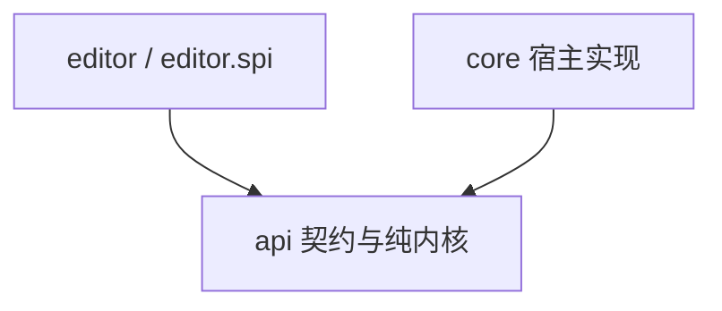

# 相机动画、播放与编辑器重构设计

## 1. 范围与决策

本设计覆盖动画数据、表达式求值、播放、空间变换、存储、网络及编辑器契约与实现。对应现有 `api.animation.*`、`api.editor.*`、`core.cmd_camera.*`、`core.animation.io.*` 和 `core.editor.*`。

`api.camera.*` 的操控方案与 Tripod 数据不在本次重构范围内。

允许破坏性修改，不保证旧 API 和旧文件格式兼容，不提供旧格式转换器。本文中的接口为契约草案；实现必须满足所列行为与验收条件。

### 1.1 决策表

保留既有决策编号，新增本次评审确定的规则。

| 编号 | 决策 |
| --- | --- |
| D1 | 使用单 Gradle 模块，顶层包为 `api`、`core`、`editor` |
| D2 / D10 | 使用不可变文档、只读句柄和受控发布；撤销保存文档版本 |
| D3 | 动画可保存默认锚点，播放请求可覆盖，编辑会话持有独立预览锚点 |
| D4 | 参考系支持平移和逐轴启用的旋转，不支持缩放 |
| D5 | 非法提交必须拒绝并返回结构化诊断；输入中间态保存在草稿中 |
| D6 | 提供后端、数据、面板、组件四级扩展 |
| D7 | 数据类型负责自身 Codec；开放类型通过注册表分派 |
| D8 | 所有已发布文档变更必须经过统一文档存储对象 |
| D9 | 依赖图由文档派生，在候选文档上整体构建，不维护独立增量状态 |
| D11 | 正式播放中锚点解析失败时终止播放、释放相机控制、保留失败时刻并提示 |
| D12 | 网络传输锚点类型与完整参数，不传选择器字符串 |
| D13 | 不提供旧格式迁移；格式不支持时返回明确诊断 |
| D14 | 删除 `MODERN_UI_COMPAT`，使用 `editor.backend` 选择后端 |
| D15 | 暂不拆分编辑器 source set 或子模块，先建立包依赖边界 |
| D16 | 值源保持 sealed；数据扩展仅开放轨道与锚点类型 |
| D17 | 同一轨道内键时间唯一；不自动量化时间，不静默覆盖冲突键 |
| D18 | 删除运行期 fallback；正式播放遇到启用通道求值错误时终止，编辑预览显示错误且该帧不应用预览姿态 |
| D19 | 文档与发布序号作为单个快照读取；发布限制在宿主指定线程，提交检查基版本 |
| D20 | 轨道、关键帧、路径节点采用文档内稳定 ID；显示名称与类型标识分离 |
| D21 | 输入草稿与可采样预览候选分离；预览候选不得发布为正式文档 |

### 1.2 不变量

| 编号 | 不变量 | 保证方式 |
| --- | --- | --- |
| I1 | 已发布文档通过全部强制静态校验 | 文档存储对象统一校验与发布 |
| I2 | 内置文档及其子对象深不可变 | 防御性复制、不可变值、无可变对象泄漏 |
| I3 | 一次读取获得匹配的文档与发布序号 | 单个 `AnimationSnapshot` 引用 |
| I4 | 一次提交原子成功或失败 | 候选构造、校验、发布；失败不改变文档和历史 |
| I5 | 正式播放一帧内使用同一快照 | 帧开始捕获快照，禁止中途重新取文档 |
| I6 | 曲线、数值预览和姿态使用同一求值规则 | 统一采样器与显式求值上下文 |
| I7 | 锚点不改变文档空间求值结果 | 求值后进行参考系合成 |
| I8 | `api` 不依赖客户端类或实现包 | 自动依赖检查 |
| I9 | 运行期错误不得伪装为合法数值或未编写通道 | 独立求值状态与诊断 |
| I10 | 草稿、选择和视图状态不进入文档历史 | 会话状态与文档分离 |

静态合法不等于任意时刻、任意环境下均可求值。试算不能替代运行期检查。

## 2. 分层与服务边界

### 2.1 包职责

| 包 | 职责 | 允许的主要依赖 |
| --- | --- | --- |
| `api.animation` | 不可变文档、轨道、路径、稳定 ID、Codec | 表达式与空间值类型、DFU、common 类型 |
| `api.animation.expression` | 值源、编译、符号与函数契约 | JDK、必要的序列化依赖 |
| `api.animation.eval` | 采样、求值上下文、依赖图、诊断 | 动画与表达式模型 |
| `api.animation.document` | 快照、只读句柄、文档存储、校验、历史 | 动画与纯编辑操作契约 |
| `api.animation.playback` | 时间推进、播放请求、帧准备、播放服务契约 | 动画、求值、空间契约 |
| `api.spatial` | 空间模式、锚点数据、参考系变换契约 | 不可变数学值、DFU、common 类型 |
| `api.storage` | 动画与路径资源条目、读写结果、存储服务契约 | 文档与诊断 |
| `api.editor` | 会话、编辑操作、草稿、预览、交互请求、后端契约 | 动画、文档、播放、存储契约 |
| `core.playback` | 世界数据读取、锚点解析、相机应用、事件执行 | `api.*`、基础相机 API |
| `core.storage` | 文件、SavedData、字节读写、资源服务实现 | `api.*`、宿主 IO |
| `core.command` / `core.network` | 指令、请求编解码、双端协议 | `api.*`、宿主接口 |
| `core.mod` | 生命周期、配置、注册与服务装配 | `api.*`、`core.*` |
| `editor` | 内置屏幕、面板、布局、主题、默认后端 | `api.*`、客户端 UI |
| `editor.spi` | 面板注册与可复用组件的公开契约 | `api.*`、客户端 UI |
| `editor.internal` | 不承诺兼容的内部实现 | 编辑器内部类型 |

纯编辑操作契约置于 `api.animation.document` 的子包；`api.editor` 使用这些契约，文档存储不得反向依赖编辑器会话。

依赖方向：



`core` 与 `editor` 不得互相依赖。`api` 可使用必要的 Minecraft common 类型，但不得引用 `net.minecraft.client`。求值、时间推进及空间计算测试不得启动 Minecraft 客户端或加载游戏世界。

### 2.2 宿主服务

| 服务 | 用途 | 实现方 |
| --- | --- | --- |
| `AnimationResourceService` | 列出、加载、保存动画与路径资源 | `core.storage` |
| `PlaybackService` | 播放、停止、切换状态、查询失败原因 | `core.playback` |
| `CameraProbe` | 读取宿主基础世界姿态 | `core` |
| `CameraControlClaims` | 编辑器相机接管与自由视角覆盖 | `api` 契约，编辑器登记，播放宿主读取 |
| 轨道类型与能力注册表 | 编解码、通用键编辑、事件分派描述 | common 注册，宿主执行副作用 |

资源服务返回条目、数据和结构化诊断；编辑器不得直接调用存储实现或解析磁盘字段。文件浏览界面由编辑器实现。

服务通过宿主注入会话和驱动器；生命周期装配负责默认实现注册。客户端实现不得在 common 类初始化时加载。

### 2.3 自动依赖检查

必须检查以下禁止依赖：

- `api → net.minecraft.client`。
- `api → core / editor`。
- `core → editor`。
- `editor → core`。
- `editor.spi → editor.internal`。

使用编译产物依赖检查或架构测试作为正式门禁；文本搜索仅作为辅助检查。资源路径或字符串内容不得代替类型依赖判定。

## 3. 文档、快照与发布

### 3.1 数据形状

```text
CameraAnimation
  name
  space
  motionMode
  distanceMode
  tracks: 有序轨道集合
  symbols: 变量与函数
  path: 路径节点集合

AnimationTrack
  type: Identifier
  id: TrackId
  name: String
  duration / keyCount
```

类型标识使用 `Identifier`；文档对象身份使用稳定 ID；用户名称使用 `String`。相机通道的语义键（如 `position.x`、`fov`）与 `TrackId` 分离，并在文档内保持唯一。

轨道顺序是时间轴显示顺序和序列化顺序。按 ID 查询表由同一集合派生，不作为第二份可独立修改的数据。

`TrackId`、`KeyId`、`PathNodeId` 在各自文档作用域内唯一并持久化。移动、排序、重命名、撤销保留 ID；复制对象生成新 ID。整份换档建立新的文档作用域。

### 3.2 深不可变规则

- 集合和数组在构造时防御性复制，不保留调用方可变容器。
- 对外不得暴露可变数组、集合、JOML 向量或可变 `Component` 实例。
- 文档数学数据使用不可变值；JOML 可变类型仅用于计算缓冲区。
- `with*` 返回派生对象，只复制变化路径，允许共享未变化的不可变对象。
- 惰性缓存不得影响逻辑相等性，不得泄漏内部可变结果。
- 内置类型由实现保证深不可变；第三方类型必须满足不可变 SPI 契约。

第三方对象的不可变性是扩展契约，不能宣称由开放 Java 接口完全强制。框架必须复制自身持有的外层容器。

### 3.3 快照与只读句柄

```java
public record AnimationSnapshot(long revision, CameraAnimation document) {}

public interface AnimationHandle {
    AnimationSnapshot snapshot();
}
```

实现以一个 `volatile AnimationSnapshot` 保存当前状态。`revision` 是该存储实例单调递增的发布序号；撤销恢复旧文档时也产生新的发布序号。不得分别读取文档和计数器来组成快照。

`AnimationHandle` 不提供发布方法。所有变更由 `AnimationDocumentStore` 处理：

```text
检查 expectedRevision
→ 执行纯编辑操作
→ 校验候选
→ 更新历史与快照
→ 通知监听者
```

- 发布必须在宿主指定线程执行；客户端使用主线程。纯内核不依赖客户端线程实现。
- 后台任务只构造候选或执行纯校验，结果回到发布线程后重新检查基版本。
- 过期提交返回 `STALE_REVISION`，不得自动覆盖当前文档。
- 文档、历史和发布序号更新完成后才通知监听者。
- 通知期间禁止重入发布；后续请求排队执行。
- 初始化、编辑、换档、网络载入和历史恢复均通过存储对象。

### 3.4 派生数据与缓存

| 数据 | 规则 |
| --- | --- |
| 编译结果 | 按公式文本缓存，使用有界 LRU |
| 依赖图 | 从完整文档及编译后语法树派生，允许按文档身份缓存 |
| 关键帧槽位采样 | 键包含快照身份、求值上下文身份与帧序号、曲线 ID |
| 变量及轨道读数 | 在单个求值上下文中按帧缓存，失败结果也必须缓存 |
| 路径弧长与查询索引 | 在不可变对象内部惰性计算或使用外部派生缓存 |

快照身份必须区分不同存储实例；相同 `revision` 不代表同一文档。预览候选使用独立身份。

版本变化时重绑定符号表和曲线查询，不得仅清空数值缓存后继续引用旧文档。未解析状态使用位掩码或独立标记，不得使用 NaN 兼任哨兵。

## 4. 编辑、校验与历史

### 4.1 编辑操作

`EditOp` 为 sealed 纯操作契约，包含模式、空间、轨道、关键帧、符号、路径与文档替换操作。操作不得修改输入或执行 IO。

```java
public sealed interface EditOutcome {
    record Ok(CameraAnimation candidate) implements EditOutcome {}
    record Err(List<Diagnostic> diagnostics) implements EditOutcome {}
}

public sealed interface EditResult {
    record Applied(AnimationSnapshot snapshot,
                   List<Diagnostic> diagnostics) implements EditResult {}
    record Rejected(List<Diagnostic> diagnostics) implements EditResult {}
}
```

诊断至少包含稳定错误码、严重级别、对象或字段定位、可本地化消息及可选修复操作。带引用的诊断和修复必须关联基版本；过期修复需重新生成。

批量移动、粘贴、模式切换等复合操作必须构造一个完整候选，一次校验、一次发布，不得循环提交单对象操作。

第三方专属数据通过 `ReplaceTrack(expectedRevision, trackId, replacement)` 提交。注册的轨道校验器参与统一校验。需要通用时间轴编辑的轨道提供纯派生能力接口；数据接口不得发放原地增删移动方法。

### 4.2 静态校验

| 层级 | 职责 | 例子 |
| --- | --- | --- |
| L1 格式与语法 | 输入是否可解析 | Codec、公式语法、有限常量 |
| L2 结构与引用 | 唯一性与引用完整性 | 稳定 ID、名称冲突、轨道存在、键时间顺序 |
| L3 语义 | 跨对象约束 | 依赖环、函数参数个数、名字作用域、模式与通道关系 |
| L4 领域 | 可静态判定的数值约束 | 时间非负、FOV 范围、曲柄约束、数据规模上限 |

校验顺序为 L1 → L2 → L3 → L4；前一层失败时不继续依赖其结果的校验。校验器不得修改候选，不得隐式夹取、覆盖或量化输入。可修复问题通过显式修复操作处理。

依赖图从编译后语法树构建，正确处理函数形参作用域。未定义引用与环分别报告。无环不代表调用深度或求值工作量有界；静态检查可判定的最长调用链，运行期继续执行资源上限。

内置与第三方校验器在启动阶段注册并冻结。提交、解码完成和收包载入采用同一组强制文档校验规则。

### 4.3 试算

试算是有预算的诊断检查，不是全时间域安全证明。

- 采样包括关键时刻、区间中点和固定步长；策略可配置但必须有上限。
- 同时限制最大采样点数、求值工作量与输出诊断数。
- 报告采样范围、环境参数和完成状态：`Passed`、`Failed`、`Incomplete`。
- `Passed` 仅表示已检查点未发现错误。
- 确定发现求值错误时拒绝候选；预算不足时允许提交并附 `Incomplete` 提示。
- 依赖 `wt` 时必须说明检查的世界时间；非确定公式返回 `Incomplete` 提示，不以一次随机结果作为提交拒绝依据。
- 试算不得执行 Tick 轨道或其他副作用。

试算结果不得用于删除运行期有限性检查、深度保护或工作量限制。

### 4.4 时间与冲突

- 同一轨道内关键帧时间必须有限、非负且唯一，按严格递增顺序存储。
- 时间不默认量化；吸附是显式编辑行为，不属于校验器。
- 输入构造时统一 `-0.0` 为 `0.0`，不改变其他有效时间。
- 移动或粘贴发生冲突时拒绝整个候选，并提供覆盖、合并或跳过的显式操作。
- 批量编辑先计算全部最终位置，再检查冲突，避免处理顺序改变结果。
- 拖动期间高亮冲突目标并显示诊断。

### 4.5 撤销与重做

- 一个成功提交对应一个历史项；无内容变化不新增历史。
- 历史保存不可变文档引用与动作标签，不序列化为 JSON。
- 撤销恢复旧文档并生成新发布序号，不重复执行全时间轴试算。
- 校验规则在会话生命周期内保持不变；历史恢复可执行轻量结构断言。
- 默认上限为 64 项和估算 32 MiB 双限，超出时移除最旧项。
- 内存估算考虑共享对象，避免将每个版本按完整深拷贝累加；估算不是精确堆内存计量。
- 整份换档清空历史、选择、交互请求和草稿，并提示用户。
- 播放状态、播放头、预览锚点与视图参数不进入文档历史。

## 5. 草稿、预览与选择

### 5.1 编辑事务

```text
已发布快照
  └─ 编辑事务：基版本、目标、动作标签、输入草稿
       ├─ 输入未完成：保留文本与诊断
       └─ 可构造候选：生成独立预览快照
```

会话负责事务，面板只读取状态和提交意图。

```java
public interface EditorSession {
    AnimationSnapshot snapshot();
    EditResult submit(EditOp op, long expectedRevision);
    EditTransaction beginEdit(EditTarget target, Component label);
    PreviewState preview();
    EditResult commit(EditTransaction transaction);
    void cancel(EditTransaction transaction);
}
```

输入草稿允许暂时非法。不能解析的文本不进入文档候选；可构造候选的数据进入独立预览，不发布到正式句柄。

### 5.2 统一预览

- 时间轴、曲线、变量列和视口读取同一个预览候选与求值环境。
- 预览使用与正式播放相同的采样与姿态合成规则。
- 拖动更新只执行轻量检查和当前帧求值，不逐次运行完整试算。
- 候选不完整、结构不合法或本帧求值失败时，显示诊断且不应用该帧预览姿态。
- 松手或确认后执行完整提交；成功仅产生一个撤销项。
- 取消后丢弃候选，恢复已发布快照的预览。
- 基版本变化时事务标记为过期，禁止自动覆盖；用户需重新开始编辑。
- 面板重建或界面后端切换不得丢失会话中的草稿。

### 5.3 选择状态

选择保存稳定 ID，不保存轨道对象或长期有效的集合下标。

```java
public record KeySelection(TrackId trackId, KeyId keyId) {}
```

版本变化时在新文档中解析选择；对象不存在则清除。移动、排序和重命名保留选择；整份换档清空选择。界面索引仅用于当前快照的展示，不得跨版本执行编辑。

## 6. 求值与空间变换

### 6.1 值源与采样状态

保留封闭值源层级：

```java
public sealed interface ValueSource permits NumberSource, TrackRef {}
public sealed interface NumberSource extends ValueSource permits Constant, Formula {}
```

`TrackRef` 不实现 `NumberSource`，不能进入关键帧字段。关键帧字段仍由 `KeyField` 统一驱动。

删除 `evaluateOrFallback`。`Formula.literal` 仅用于切回数值模式时初始化输入，不参与求值。变量的 UI 初始值同样不得作为运行期替代值。

公共采样结果区分以下状态：

| 状态 | 含义 | 处理 |
| --- | --- | --- |
| `ABSENT` | 没有编写该通道 | 使用宿主基础姿态对应分量 |
| `VALUE` | 得到有限合法数值 | 参与合成 |
| `ERROR` | 已编写但本帧求值失败 | 正式播放终止；编辑预览标错 |

内部可使用 NaN 传播失败，公共结果必须携带状态及诊断定位。Infinity、求值异常、资源上限及最终领域越界同样是错误。失败结果也必须缓存，不能因 NaN 哨兵而重复求值。

插值参与项失败时传播错误，不跳过失败端点。无环境静态读取只能明确读取 literal 或常量，不得伪装为动态采样结果；依赖当前值的插键必须提供完整求值环境。

表达式实现还须满足：

- 编译与求值失败返回结构化诊断，由宿主决定展示和日志，不在底层静默替换数值。
- 函数参数个数与名字作用域在提交期检查；运行期深度和工作量超限必须可诊断。
- `random()` 保留为明确标注的非确定函数，不保证预览与多次播放一致；提供显式种子和时间输入的确定性替代函数。
- 确定性替代函数不得依赖采样顺序、线程随机源或发布序号。
- 编译器、语法树和解释器实现不作为稳定扩展接口公开。

### 6.2 姿态类型

| 类型 | 用途 |
| --- | --- |
| `DocumentPose` | 文档空间中的逐轴采样结果；带位置、旋转掩码与诊断 |
| `WorldPose` | 已补全并完成参考系合成，可交给相机的完整姿态 |
| `PoseBuffer` | 内部可复用计算缓冲区，不进入文档与历史 |

位置和旋转分别使用三轴存在掩码；FOV 单独标记。错误不得压缩为缺失位。自由视角覆盖返回 `WorldPose`，不经过锚点变换。

### 6.3 空间与锚点

```java
public sealed interface Space {
    record World() implements Space {}
    record Local(@Nullable Anchor defaultAnchor,
                 RotationMask followMask) implements Space {}
}

public interface Anchor {
    Identifier type();
}

public record RotationMask(boolean x, boolean y, boolean z) {}
```

锚点为开放不可变契约。内置类型包括固定坐标、实体 UUID、玩家 UUID。类型 ID、`MapCodec`、`StreamCodec` 在 common 侧注册；客户端解析器单独注册，不在 common 初始化过程中加载。

锚点优先级为播放覆盖、文档默认；选定覆盖锚点解析失败后不得尝试默认锚点。局部空间允许无默认锚点，但开始播放前必须由请求提供有效锚点。

编辑会话独立保存预览锚点；初始化可使用文档默认值，无默认值时显式建立当前相机位置的固定预览锚点。此操作不修改文档。

`MotionMode` 决定位置来自路径或坐标通道；`Space` 决定这些数值的参考系，两者正交。

### 6.4 合成规则

位置与旋转的合成顺序：

```text
读取宿主基础世界姿态
→ 转换到文档参考系
→ 用 VALUE 分量覆盖，保留 ABSENT 分量
→ 检查 ERROR
→ 合成为 WorldPose
→ 最终有限性与领域检查
→ 应用相机
```

- 位置：`world = anchorPosition + R * local`。
- 旋转使用四元数合成：`qWorld = qAnchorMasked * qLocal`。
- 掩码作用于约定为 YXZ 顺序的锚点欧拉角，未启用轴置零后构造四元数。
- 旋转单位统一为弧度；欧拉角顺序与转换实现集中定义。
- 未编写旋转分量在锚点参考系内由基础姿态补全，再参与合成。
- 世界空间使用单位参考系，复用同一合成规则。
- 固定锚点旋转为单位旋转，不应用缩放。
- 计算接口支持目标参数写入，复用缓冲区，避免增加每帧临时分配。

切换 World / Local 仅改变空间解释，不自动换算坐标；界面必须提示并显示预览参考系。距离模式切换是显式编辑操作；涉及表达式时必须保持求值语义，不能仅换算 literal。

## 7. 播放与事件

### 7.1 内核与宿主

播放内核负责时间、状态、文档空间求值及事件区间准备；不读取世界、不写相机、不执行指令。宿主负责环境数据、锚点解析、参考系合成、相机应用和事件执行。

```java
public record PlaybackRequest(
        CameraAnimation animation,
        @Nullable Anchor anchorOverride,
        @Nullable RotationMask followMaskOverride,
        float speed,
        boolean loop,
        float startTime) {}
```

速度必须有限且大于零；第一版不支持反向播放。开始时间必须有限、非负且位于可播放范围，空动画仅接受零时刻。请求通过文档校验后由同一文档存储切换文档；编辑器打开时按整份换档处理。

### 7.2 帧准备与执行

每帧只捕获一次正式快照，按以下顺序处理：

```text
准备阶段：
计算目标时间及跨越区间
→ 读取环境并解析锚点
→ 求值与姿态合成
→ 得到世界姿态、待执行事件或错误

执行阶段：
成功：更新时间与状态 → 应用姿态 → 分发事件
失败：记录失败时刻 → 终止播放并释放控制 → 不执行本帧事件
```

事件准备必须为纯操作。执行阶段不承诺对宿主副作用进行事务回滚；执行器异常必须终止后续分发并报告已发生的部分执行。

普通停止与失败终止分开：`stopAndReset()` 重置播放头；`halt(reason, failureTime)` 保留失败时刻供诊断。继续播放前必须重新校验运行条件。

### 7.3 失败规则

| 情形 | 正式播放 | 编辑预览 |
| --- | --- | --- |
| 锚点不可用、类型或解析器缺失 | 终止并释放相机，保留失败时刻，提示原因 | 显示参考系错误，不应用该帧预览姿态 |
| 启用通道求值错误、最终姿态非法 | 同上，不执行本帧事件 | 对应曲线断线、数值列显示错误，不应用该帧预览姿态 |
| 通道未编写 | 使用基础姿态分量 | 相同规则 |
| 事件工作量超限 | 终止并报告，不静默丢弃 | 显式预览播放采用同一规则 |

锚点必须每帧解析或复查有效性。运行期提示应按一次失败汇总，避免逐通道重复刷屏。

### 7.4 Tick 轨道

轨道只描述事件数据；宿主按轨道类型注册执行器。文档对象不得包含发指令或访问世界的方法。

- 正向推进区间为 `(from, to]`。
- 从零开始播放及进入每个新循环时，单独包含零时刻事件一次。
- 跨越多个周期时完整处理各周期，不能只对最终时间取模后分发两段。
- 同时刻跨轨道事件按文档轨道顺序执行。
- 定位、暂停、拖动草稿和试算不触发事件。
- 编辑器显式播放才执行事件。
- 每帧限制事件执行数量及区间处理工作量；超限明确终止。
- 循环、末尾停止、从中途开始和零长度动画均有独立边界测试。

### 7.5 相机接管

编辑器通过带生命周期的登记令牌声明接管，相机控制声明可提供自由视角 `WorldPose`。关闭会话或切换世界时释放令牌。

多个声明按显式优先级和稳定登记顺序仲裁；只有获胜声明影响相机。没有声明时由正式播放状态决定接管。相机探针读取宿主基础姿态，不得将上一帧本插件输出再次作为基础输入。

## 8. 序列化、存储与网络

### 8.1 Codec

- 数据类型维护自身字段名、`Codec` 或 `MapCodec`。
- 文档 Codec 组合成员 Codec；容器只认识自身字段，不复制子对象字段规则。
- 轨道与锚点通过类型注册表分派；封闭值源使用固定分支。
- `KeyField` 统一驱动关键帧来源字段，避免多处维护槽位清单。
- 必填字段缺失、类型错误、非法枚举及未知类型必须报错；可选字段仅使用明确定义的缺省值。
- 子对象解码执行局部约束；整份文档解码完成后执行统一文档校验。
- 不得将部分解码结果作为合法文档发布。
- 曲线通道的标签、颜色和默认信息由通道描述注册表派生；用户可编辑的轨道名称或外观覆盖显式存储。

顶层必须含 `dataVersion`，新格式从 1 开始。版本缺失、较旧或高于当前支持范围均明确拒绝，不尝试按当前默认字段读取。

### 8.2 存储与诊断

| 载体 | 用途 |
| --- | --- |
| `JsonOps` | 本地动画和路径文件 |
| `NbtOps` | SavedData 文档，不再内嵌 JSON 字符串 |
| `StreamCodec` | 播放请求及来源数据 |

存储实现负责资源定位、字节与 Ops 转换、调用 Codec、报告错误，不解释文档子对象字段。

诊断模式为只读资源视图，展示文件、字段或对象路径、错误码和消息，不构造可发布的非法文档。JSON 源码行列仅在解析器可提供时展示，不将 DFU 字段路径等同于源码位置。

### 8.3 网络

网络请求包含：

- 动作与数据来源：本地名称、随包文档或停止。
- 锚点类型与完整参数。
- 可选旋转跟随掩码。
- 播放速度、循环和开始时间。
- 协议版本及必要的数据规模限制。

服务端执行选择器并生成具体锚点，不把选择器字符串发送给客户端。玩家锚点指向实际解析出的玩家；“每个接收者自身”必须是明确语义，不能覆盖显式指定的其他玩家。

注册表 ID 与类型 Codec 在双端可用；锚点解析器只在客户端。编解码边界必须将未知类型、缺失实现、版本或规模错误转换为可报告的请求失败，不得静默构造默认锚点。请求载入后仍执行文档与播放参数校验。

## 9. 编辑器契约与扩展

### 9.1 会话状态

会话除提交与预览外提供：

- 撤销、重做、动作标签。
- 播放状态、播放头、定位与显式播放控制。
- 基于稳定 ID 的选择。
- 时间轴视图、预览锚点与草稿。
- 带选项的交互请求与状态诊断。
- 明确的关闭及资源释放流程。

文档存储与播放内核由宿主注入，不由屏幕构造私有副本。界面后端切换复用会话；关闭屏幕与关闭会话的生命周期必须区分。

### 9.2 交互请求

```java
public record InteractionRequest(
        InteractionId id,
        Component message,
        List<InteractionOption> options) {}
```

会话提供 `choose(requestId, optionId)` 与取消入口。二元确认是普通选项请求；路径新建、绑定及来源选择使用同一协议。过期请求、已关闭请求和无效选项必须拒绝，不能执行旧回调。

### 9.3 后端选择

内置界面通过 `EditorUiBackend` 注册，具有稳定 ID 和最低优先级。打开流程统一为创建或恢复会话，再交给 `EditorUiHost`。

| `editor.backend` | 行为 |
| --- | --- |
| `auto` | 按优先级依次询问；同优先级按 ID 稳定排序；内置实现最低 |
| 指定已注册且接管的 ID | 使用指定后端 |
| 指定已注册但拒绝接管的 ID | 提示失败，不自动切换 |
| 指定未注册 ID | 警告并打开内置实现 |

保留 `openDefault(session)`，允许第三方包装后转发。拒绝接管的后端不得关闭会话或遗留接管令牌。默认实现由编辑器客户端生命周期入口自行注册，`core` 不引用编辑器类。

### 9.4 扩展面

| 级别 | 契约 | 规则 |
| --- | --- | --- |
| 后端 | `EditorUiBackend`、`EditorUiHost` | 可整体替换或转发默认界面 |
| 数据 | 轨道、锚点类型注册表与校验器 | Codec 与客户端解析或执行分离；遵守不可变契约 |
| 面板 | `editor.spi.PanelRegistry` | 描述 ID、标题、工厂、布局位置；通过会话编辑 |
| 组件 | `editor.spi` 公开组件 | 提供生命周期、渲染、布局、焦点及完整输入派发 |

组件输入至少覆盖按键、字符、鼠标按下与释放、移动、拖动和滚轮。`editor.spi` 可依赖客户端 UI 类型，不得依赖 `editor.internal`。公开组件需要内部实现时通过工厂返回契约实例。

内置面板与第三方面板均不得直接修改文档。按快照身份重建视图模型，不得因此丢失会话草稿或选中 ID。

## 10. 迁移与验收

每阶段必须可编译、可验证；包隔离在依赖替代契约建立后执行，不以机械搬包代替职责拆分。

| 阶段 | 内容 | 验收 |
| --- | --- | --- |
| P0 行为基线 | 测试真实采样、时间区间、批量编辑、撤销、模式切换；修正阻碍迁移的数据丢失问题 | 用例覆盖真实调用链，明确记录需改变的旧行为 |
| P1 边界服务与内核 | 抽出播放内核；建立资源、相机和轨道能力契约；迁移编辑模型归属，再搬编辑器包 | 编译通过；禁止依赖检查通过；不需要客户端启动即可测试纯内核 |
| P2 不可变与提交 | 稳定 ID、内置文档不可变、快照存储、最小提交和撤销；同步切换全部写调用 | 不存在修改已发布数据的路径；一次提交原子成功或失败；旧对象选择问题消除 |
| P3 Codec 与诊断 | Codec 内聚、严格解码、分层校验、试算与结构化诊断；统一载入入口 | 提交、读档和收包应用同一文档规则；错误文档不发布 |
| P4 空间、预览与失败 | 逐轴采样状态、local 合成、锚点、草稿预览、运行期失败与事件准备执行 | 确定性公式在相同上下文得到相同文档空间结果；错误姿态不应用；失败帧不执行事件 |
| P5 扩展与清理 | 后端配置、交互请求、面板和组件 SPI、默认实现接入；删除旧实现与重复路径 | 外部后端完成编辑、路径绑定、撤销和保存；默认后端可转发；指南同步 |

P2 内部可按功能切片迁移，但同一阶段完成不可变发布前必须切换全部存量写调用。不得保留直接写方法以通过不可变验收。P3 之前可保留格式适配层，其内部必须通过 P2 的受控操作构造文档。

### 10.1 必需测试

- 提交拒绝时，文档、发布序号和历史均不变；过期基版本明确拒绝。
- 一帧内发生后续提交时，当前帧仍只使用捕获的快照。
- 构造参数或 getter 返回值不能修改已发布内置文档；历史版本不被后续操作污染。
- 变量、函数、轨道引用与作用域、无环深调用、运行期工作量上限分别测试。
- 窄时间区间错误、`wt` 变化、非确定函数及试算预算不足不能被误报为全域安全。
- `ABSENT` 与 `ERROR` 区分；NaN、Infinity 和最终姿态越界不得进入相机。
- local 下逐轴补全、旋转掩码、YXZ 合成与逆变换；换锚点不改变文档空间结果。
- 正式播放失败释放控制、保留失败时刻、不分发该帧事件；编辑器仍可编辑保存合法文档。
- 批量移动非连续选择、跨轨道选择、时间冲突、撤销后选择解析与整份换档清理。
- 拖动时曲线、数值列、视口使用同一候选；取消不发布，提交只产生一个历史项。
- 循环零时刻、跨多周期、末尾、定位和事件上限；暂停与试算无副作用。
- Codec 往返保留稳定 ID 与顺序；未知类型、非法版本和结构损坏明确拒绝。
- 第三方专属轨道替换经过校验并可撤销；未知锚点与解析器缺失可诊断。
- 外部后端完成带选项的路径绑定、保存与关闭；后端失败不泄漏会话或相机接管。

### 10.2 完成条件

- 自动依赖检查通过，内置与第三方界面使用同一会话写契约。
- 求值链不存在运行期 fallback，也不存在 NaN 同时表示“未解析”和“错误”的缓存。
- 旧的 `copyFrom`、JSON 历史、直接可变数据写入和硬编码后端回退路径删除。
- `EvaluationGraph` 与未接入的 `EvaluationGraph2` 统一为文档派生依赖图。
- 资源实现不复制子对象字段规则；诊断界面不自行解码文档。
- 迁移后的使用指南、扩展契约及测试与本设计一致。
