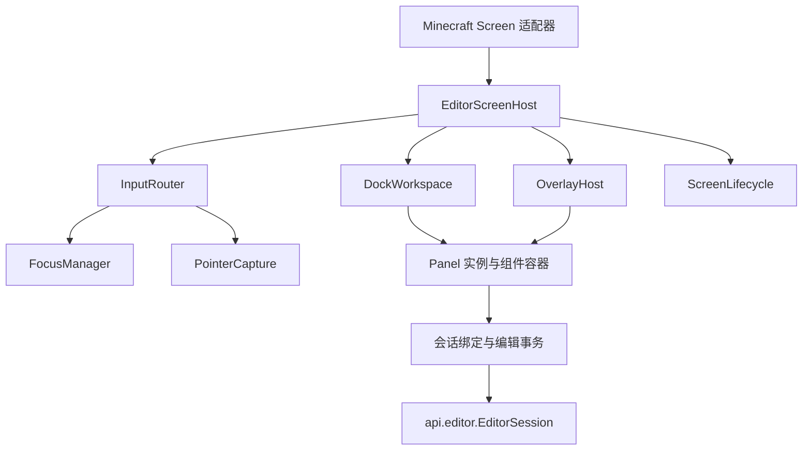

# 编辑器 UI 框架重构设计

## 1. 结论与范围

现有 UI 框架需要局部重构，重点是输入路由、焦点与指针捕获、模态层、控件状态、布局生命周期和会话绑定。继续仅增加面板或替换数据调用，无法满足不可变文档、事务预览与组件扩展要求。

保留现有自绘风格、Minecraft GUI 渲染通道、曲线与时间轴绘图、停靠交互及视口 PiP 渲染。暂不引入新的 UI 库，不建设通用响应式框架或完整样式系统。

本设计补充[动画、播放与编辑器重构设计](<design-animation-editor-framework.md>)的 §2、§5、§9、§10。文档模型、提交校验、稳定 ID 和播放规则以主设计为准；本文规定内置 UI 如何使用这些契约。

本文基于源码静态审查。已确认的事件入口和状态问题列于 §2；实际渲染效果、窗口失焦和游戏输入集成需在客户端验收。

## 2. 现状与依据

下表区分现有缺陷与接入新契约时必然遇到的结构问题。

| 项目 | 代码依据 | 判断 |
| --- | --- | --- |
| 模态事件屏障不完整 | [主屏幕滚轮入口](<../src/main/java/cn/anecansaitin/free_camera_api_tripod/core/editor/CameraEditorScreen.java#L1033>)未检查确认框；[浏览器字符入口](<../src/main/java/cn/anecansaitin/free_camera_api_tripod/core/editor/BrowserScreen.java#L892>)直接转发控件 | 现有路由缺陷；确认框打开时底层仍可接收部分事件 |
| 屏幕间路由分叉 | [主屏幕拖动入口](<../src/main/java/cn/anecansaitin/free_camera_api_tripod/core/editor/CameraEditorScreen.java#L977>)检查模态，[路径屏幕拖动入口](<../src/main/java/cn/anecansaitin/free_camera_api_tripod/core/editor/PathEditorScreen.java#L801>)没有对应检查 | 复制事件分支已导致行为不一致 |
| 焦点兼作鼠标捕获 | [WidgetHost](<../src/main/java/cn/anecansaitin/free_camera_api_tripod/core/editor/widget/WidgetHost.java#L85>)向焦点发送拖动并广播释放；[主屏幕](<../src/main/java/cn/anecansaitin/free_camera_api_tripod/core/editor/CameraEditorScreen.java#L1025>)广播面板拖动 | 无独立捕获所有者、按键归属和取消协议 |
| 点击前全局失焦 | [主屏幕](<../src/main/java/cn/anecansaitin/free_camera_api_tripod/core/editor/CameraEditorScreen.java#L739>)点击前清空全部面板焦点；[文本框](<../src/main/java/cn/anecansaitin/free_camera_api_tripod/core/editor/widget/TextFieldWidget.java#L95>)失焦即提交 | 即使再次点击同一输入框也先结束编辑；提交发生在实际目标路由前 |
| 布局与主题变化销毁控件 | [EditorPanel](<../src/main/java/cn/anecansaitin/free_camera_api_tripod/core/editor/panel/EditorPanel.java#L158>)在 render 中清空重建；[WidgetHost.clear](<../src/main/java/cn/anecansaitin/free_camera_api_tripod/core/editor/widget/WidgetHost.java#L23>)未通知失焦或卸载 | 输入状态丢失，控件替换缺少生命周期 |
| 输入框不能表示提交拒绝 | [数值框提交](<../src/main/java/cn/anecansaitin/free_camera_api_tripod/core/editor/widget/NumberFieldWidget.java#L171>)先更新自身值再调用 void 回调，解析失败保留旧值后仍调用回调 | 无法正确展示 `Rejected`、保留非法草稿或过期基版本 |
| 表达式取消不覆盖符号修改 | [表达式窗口](<../src/main/java/cn/anecansaitin/free_camera_api_tripod/core/editor/ExpressionEditorWindow.java#L978>)直接增删文档变量；[确认逻辑](<../src/main/java/cn/anecansaitin/free_camera_api_tripod/core/editor/ExpressionEditorWindow.java#L847>)分别设置参数与回调 | 不符合一次确认原子提交、取消不改变文档的事务语义 |
| 生命周期混用 | [主屏幕 removed](<../src/main/java/cn/anecansaitin/free_camera_api_tripod/core/editor/CameraEditorScreen.java#L168>)释放接管并重置编辑模式；[视口接管](<../src/main/java/cn/anecansaitin/free_camera_api_tripod/core/editor/ViewportTakeover.java#L162>)直接设置全局光标模式 | 已有释放逻辑可保留，但屏幕暂停、返回与会话关闭需分离 |
| 布局绑定面板实例和精确集合 | [DockLayout](<../src/main/java/cn/anecansaitin/free_camera_api_tripod/core/editor/layout/DockLayout.java#L223>)按实例恢复，集合不完全匹配即拒绝 | 安装或卸载扩展面板使整个布局失效 |
| 布局分隔符与命名空间 ID 冲突 | [浮窗序列化](<../src/main/java/cn/anecansaitin/free_camera_api_tripod/core/editor/layout/DockLayout.java#L179>)使用冒号连接字段 | 不能直接把现有面板名替换成 `Identifier` 而不调整格式 |
| 面板自行检测结构变化 | [关键帧面板](<../src/main/java/cn/anecansaitin/free_camera_api_tripod/core/editor/panel/KeyframePanel.java#L89>)与[变量面板](<../src/main/java/cn/anecansaitin/free_camera_api_tripod/core/editor/panel/VariablePanel.java#L124>)每帧构造字符串决定重建 | 应改为明确的文档、选择和视图失效信号 |

以上问题属于框架职责，不宜继续由每个屏幕和面板独立补充分支。

## 3. 目标结构



### 3.1 职责

| 构件 | 职责 |
| --- | --- |
| `EditorScreenHost` | 组合组件、布局、覆盖层、输入、绘制和生命周期；不持有文档写方法 |
| `InputRouter` | 单点接入全部输入，按相同层序命中和派发 |
| `FocusManager` | 当前焦点作用域、唯一键盘焦点、Tab 导航和焦点恢复 |
| `PointerCapture` | 鼠标按下后的拖动、释放和取消归属 |
| `OverlayHost` | 菜单、下拉、模态、提示的层序与输入屏障 |
| `DockWorkspace` | 面板位置、分隔条、浮窗和停靠操作 |
| `PanelRegistry` | 面板描述、工厂、默认布局位置和最小尺寸 |
| 会话绑定 | 按稳定目标读取值、更新草稿、预览、提交并展示诊断 |
| `ScreenLifecycle` | 屏幕挂载、暂停、恢复、卸载与会话关闭协调 |

主动画屏幕和路径屏幕共享同一宿主，分别配置面板、初始布局和命令。浏览器复用输入、覆盖层、焦点和组件容器，不必继承停靠工作区。

时间轴、曲线和视口作为专用画布组件保留各自绘图和命中算法，通过同一捕获协议执行手势。

### 3.2 包与公开面

- `editor.spi`：组件、面板描述、宿主服务接口、主题与度量只读接口、组件工厂。
- `editor.internal.ui`：路由、焦点、捕获、覆盖层和组件容器实现。
- `editor.internal.layout`：停靠模型、布局计算、配置适配。
- `editor.internal.binding`：会话字段绑定和事务适配。
- `editor.screen / panel / widget / render`：业务界面与可复用实现，逐步迁入目标结构。

公开组件通过工厂创建，仅依赖 `editor.spi` 和 `api`。SPI 不得引用内部宿主实现。Minecraft 事件与绘制类型可出现在客户端 SPI 中，不进入 `api.editor`。

## 4. 输入、焦点与捕获

### 4.1 路由规则

绘制、命中和悬停提示共享同一层序描述。除全局安全释放操作外，输入按以下规则处理：

1. 存在模态时，全部输入只进入最顶层模态作用域；未处理事件也不得传给背景。
2. 非模态菜单或下拉打开时，按其屏障策略处理；外部点击关闭并消费该次点击。
3. 存在指针捕获时，拖动、释放发送给捕获所有者。
4. 无捕获时按反向绘制顺序命中可见、启用且未被裁剪的组件。
5. 键盘与字符只进入当前焦点作用域，再由命令路由处理未消费按键。

鼠标移动、按下、释放、拖动、滚轮，按键按下、释放和字符输入均通过该入口。开发测试事件也进入相同路由，不能绕过模态或捕获规则。

不建设 DOM 式完整捕获/冒泡模型；仅提供命中目标、有限父容器回退和明确屏障，满足当前嵌套需求。

### 4.2 焦点

- 每个屏幕宿主只有一个焦点管理器；组件容器不得保存独立全局焦点。
- 先解析点击目标，再决定是否切换焦点；再次点击同一字段不产生失焦提交。
- 焦点仅能进入当前有效作用域内可见、启用且支持焦点的组件。
- 模态打开保存背景焦点，关闭后仅在原目标仍有效时恢复。
- 面板隐藏、折叠、移除或被模态阻断时撤销其活动焦点。
- Tab / Shift+Tab 在当前作用域内导航；输入框中的空格、剪贴板和编辑快捷键不触发播放或文档删除。

焦点变化通过明确原因通知。普通点击失焦可请求提交；结构卸载、屏幕暂停和布局变化仅保存草稿，不隐式提交。非法提交保留草稿和诊断，允许焦点切换，不静默恢复旧值。

### 4.3 指针捕获

捕获记录组件 ID、鼠标按钮和手势令牌，与键盘焦点独立。

- 按钮、分隔条、框选、关键帧移动和视口路径手势按需申请捕获。
- 拖动与匹配按钮释放只发送给所有者，不广播其他面板。
- 释放后清除捕获；释放事件不得被同帧新建组件再次接收。
- 模态打开、窗口失焦、组件移除、屏幕暂停或会话关闭时发送一次取消并清理。
- 取消手势丢弃未提交预览；不得通过伪造释放事件触发按钮或编辑提交。
- 单纯几何重排可保留仍有效的捕获；目标结构替换必须取消。

路由期间的组件增删、菜单替换和屏幕跳转延迟到事件结束后应用，避免回调修改正在遍历的集合。

## 5. 组件、布局与绘制生命周期

### 5.1 最小组件契约

组件至少提供稳定 UI ID、边界、可见与启用状态、布局、绘制、完整输入和生命周期。事件结果区分“未处理”“已处理”及捕获请求；不以焦点自动推断捕获。

组件树仅承担容器、裁剪和路由关系，不负责自动推导业务依赖。容器对外返回只读子组件视图，替代现有可修改列表暴露。

### 5.2 生命周期与失效

每帧阶段固定为：

```text
接收会话变化与输入结果
→ 更新视图模型及草稿绑定
→ 按需更新组件结构
→ 按需布局
→ 生成绘制数据
→ 提交渲染
```

绘制阶段不得提交文档、创建业务弹窗或清空重建组件。布局产生组件矩形，不负责构造字段回调。

失效信号至少区分：

| 信号 | 处理 |
| --- | --- |
| 文档或选择变化 | 更新对应视图模型；结构确实变化时按 UI ID 替换局部组件 |
| 尺寸或 GUI 缩放变化 | 重新布局现有组件 |
| 主题变化 | 更新绘制样式；仅文字度量变化时重新布局 |
| 播放头或取值变化 | 刷新只读展示与画布，不重建字段 |
| 组件移除 | 取消捕获、撤销焦点、保存草稿、释放订阅 |

无须引入通用差异渲染器。第一版使用显式面板结构键和局部复用；禁止每帧拼接整个数据表字符串判断变化。

### 5.3 裁剪、坐标与提示

统一使用 GUI 逻辑坐标。屏幕、面板内容和画布变换提供显式转换；窗口像素转换仅在平台适配处进行。

裁剪以作用域形式入栈、出栈，实际区域为父子交集，并用于命中测试。即使底层 Minecraft 已支持嵌套裁剪，框架仍需保证配对和输入一致性；不将现有嵌套 scissor 调用本身认定为缺陷。

菜单通过覆盖层绘制，不受面板内容裁剪限制。悬停提示由宿主统一选择最上层命中目标，仅生成一个提示；模态存在时不得展示背景提示。

### 5.4 主题与度量

保留现有颜色和绘图函数，逐步以只读 `UiTheme` 和 `UiMetrics` 传入渲染上下文。组件保存语义颜色角色，不在构造时固化当前主题色。

配色变化不销毁输入框。高度、间距和最小尺寸集中定义；不在所有面板上强制同一最小尺寸。绘图和 PiP 的宿主渲染细节保持内部实现。

## 6. 字段绑定与编辑事务

### 6.1 状态归属

| 状态 | 归属 |
| --- | --- |
| 已发布值、选择与预览候选 | 会话 |
| 输入文本、基版本、字段诊断、复合草稿 | 会话编辑事务 |
| 光标、选区与输入框水平滚动 | 会话附属 UI 状态，按字段 UI ID 保存 |
| 悬停、按钮按下、当前捕获 | 屏幕宿主，暂停时清除 |
| 面板位置、可见性、滚动与展开状态 | 工作区视图状态；需要时写入客户端配置 |

文本与数值框共用文本编辑模型，包含选区、光标、复制粘贴、码点边界、长度限制和字段解析适配。优先评估复用原版文本编辑能力，保持自绘外观；无法满足时仅维护一份文本模型。

数值解析失败保留原始文本并显示诊断，不回调旧值。空文本是否允许由字段策略决定，不由通用文本框统一禁止。

### 6.2 绑定协议

字段绑定使用稳定对象 ID 和字段定位，不捕获可变 `Keyframe` 或旧轨道实例。

```text
读取会话快照及字段值
→ 按字段目标建立或恢复草稿
→ 文本变化更新草稿
→ 可解析时更新预览候选
→ Enter / 普通失焦请求提交
→ Applied 更新基版本；Rejected 保留草稿与诊断
```

同值提交不产生历史项。外部版本变化使草稿过期时显示冲突，不能直接以最新文档覆盖输入。Esc 取消当前字段事务；确认框或更高层模态优先处理 Esc。

表达式窗口中的公式、参数和符号增删属于同一复合事务。确认一次原子提交，取消全部丢弃；窗口关闭不再执行任意文档写回调。组件工厂可在独立 Screen 中装配相同事务绑定。

拖动类编辑使用会话预览事务，捕获取消则取消事务，匹配释放才提交。时间轴、曲线和视口必须读取同一候选快照。

## 7. 覆盖层与屏幕生命周期

### 7.1 覆盖层

`OverlayHost` 统一持有菜单、下拉、表达式窗口和确认视图。模态栈独立管理焦点作用域；会话 `InteractionRequest` 通过请求 ID 和选项 ID 呈现和完成。

打开模态前关闭不兼容菜单并取消背景捕获。请求失效、换档或会话关闭时移除对应视图。完成检查集中执行一次，替代 click、release、key 各入口重复检查窗口状态。

表达式视图不保存实际文档引用或裸写回调。允许组件局部交互回调，但不得绕过会话提交文档。

### 7.2 屏幕与会话

区分以下生命周期：

| 操作 | 行为 |
| --- | --- |
| `attach` | 挂载组件、订阅会话、恢复视图状态 |
| `suspend` | 取消捕获、清空按键集合、释放光标控制、保存草稿；会话保留 |
| `resume` | 重新布局并核对草稿版本，按需恢复有效焦点 |
| `detach` | 移除订阅和 UI 资源，幂等清理 |
| `session.close` | 结束事务、交互请求和会话相机声明，执行会话级关闭 |

导航控制器显式区分进入子屏幕、后端切换和退出会话。Minecraft `removed()` 执行安全的宿主暂停或卸载清理，不直接推断会话应关闭。窗口失焦和世界切换走同一安全释放路径。

视口鼠标锁使用带所有权的 lease；释放旧 lease 不得解锁新宿主的控制。光标 lease 与主设计中的相机声明令牌相互独立，由同一生命周期协调释放。

## 8. 停靠布局与面板扩展

保留现有上下排、单元叠放、分隔条和浮窗操作，不要求改成任意递归停靠树。重构时分离：

- `DockState`：以面板 `Identifier` 保存位置、权重、可见与折叠状态。
- `DockGeometry`：根据状态、窗口尺寸及面板最小尺寸计算矩形。
- `DockController`：接收捕获手势，更新布局状态。
- `PanelRegistry`：提供描述、工厂、默认放置与尺寸约束。

持久化改为带版本的结构化对象，不以冒号、逗号等拼接命名空间 ID。布局格式版本与默认布局调整分开，新增默认面板不自动使用户布局作废。

恢复流程：

1. 解析并验证结构、有限权重、唯一面板引用和尺寸范围。
2. 保留可识别面板的位置与隐藏状态。
3. 未注册面板暂不实例化，保留其配置；不得影响其余面板。
4. 新注册且未配置的面板按描述默认位置加入。
5. 清理空单元，修正越界浮窗；格式整体损坏时才恢复默认布局并提示。

小窗口无法满足全部最小尺寸时，压缩至框架绝对下限，内容由面板滚动。仍无法容纳时允许工作区滚动，保留固定的恢复布局入口，使面板标题可通过导航到达。不得生成负尺寸或将浮窗永久移出可恢复范围。

## 9. 迁移方案

UI 框架迁移不应全部推迟到主设计 P5；事务绑定必须与不可变模型同步落地。

| 阶段 | 内容 | 与主设计关系 |
| --- | --- | --- |
| U0 行为测试与缺陷修正 | 固化模态、焦点、按钮、拖动和取消规则，补齐现有事件屏障 | P0 |
| U1 输入与宿主 | 统一路由、焦点、捕获和覆盖层；现有控件与面板通过适配接入；主屏幕和路径屏幕共用停靠宿主 | P1，可先于数据模型迁移 |
| U2 生命周期与组件 | 分离结构更新、布局和绘制；迁移主题、裁剪和输入清理；浏览器接入公共宿主能力 | P1–P2 |
| U3 会话绑定 | 稳定目标、字段草稿、提交结果、表达式复合事务、手势预览 | 必须随 P2 完成存量写调用切换；预览能力随 P4 完善 |
| U4 工作区与扩展 | ID 布局模型、结构化配置、扩展面板恢复、公开组件工厂和 SPI | P5 |

兼容适配器仅允许过渡，不同时保留两套焦点或输入所有权。每个迁移后的屏幕必须把全部事件交给宿主，不能只迁移点击而保留旧滚轮分支。

保留与调整范围：

| 现有实现 | 处理 |
| --- | --- |
| `UiRect`、绘图数学与曲线/时间轴算法 | 保留，增加交集、坐标转换和统一宿主接入 |
| `Draw`、按钮与标签绘制 | 保留外观，迁移主题上下文与提示管理 |
| `WidgetHost`、`EditorWidget` | 改为组件容器与生命周期契约，移除独立焦点和释放广播 |
| `EditorPanel` | 保留面板边框与标题，拆分布局和结构创建，菜单交给覆盖层 |
| `DockLayout` | 复用计算与交互规则，拆出 ID 状态和配置适配 |
| `CameraEditorScreen`、`PathEditorScreen` | 改为宿主配置与业务命令，删除重复路由 |
| `BrowserScreen` | 保留资源浏览业务，复用公共路由、字段与覆盖层 |
| `ExpressionEditorWindow` | 保留表达式编辑与提示能力，改为会话事务视图 |
| `ViewportTakeover`、PiP 渲染 | 保留控制手感和渲染管线，接入所有权与生命周期 |

## 10. 验收条件

### 10.1 无客户端逻辑测试

输入路由、焦点、捕获、布局状态和绑定适配通过最小测试组件与会话替身验证，不启动游戏世界。

- 模态对全部输入形成屏障，包括字符、滚轮、拖动和释放。
- 重叠浮窗仅最上层目标接收事件，裁剪外组件不命中。
- 同字段点击不失焦；Tab 限定在当前作用域，关闭模态恢复有效焦点。
- 捕获所有者独占拖动和释放；取消不触发按钮或提交。
- 回调打开新模态、移除自身或切换屏幕时无重复事件和集合修改错误。
- 尺寸、主题与只读播放值变化不销毁草稿或重置光标。
- 数值解析失败、提交拒绝和版本过期保留输入及诊断。
- 表达式确认原子提交，取消不改变公式、参数或符号。
- 安装、卸载面板不重置其他布局；命名空间 ID 可完整往返。
- 暂停和关闭清空按键、取消手势并释放令牌；重复清理无副作用。

### 10.2 客户端验收

- 主编辑器、路径屏幕和浏览器采用一致的模态、菜单和焦点行为。
- 中文及非 BMP 字符的移动、选择、删除和长度截断不破坏码点；剪贴板与 GUI 缩放正常。
- 拖动跨面板、打开模态、切换子屏幕、窗口失焦和返回时无残留按钮、飞行按键或锁定光标。
- 调整尺寸、主题、停靠和浮窗时，正在输入的草稿保持，裁剪与提示层序正确。
- 时间轴、曲线与视口预览一致；取消手势不发布，完成手势只增加一个历史项。
- 外部 Screen 可通过组件工厂嵌入表达式编辑器；附加面板无需修改内置屏幕事件分支。

完成后，屏幕负责装配业务，宿主负责 UI 机制，会话负责编辑状态；不再依赖屏幕间复制路由、全局清焦点或广播释放维持交互。
