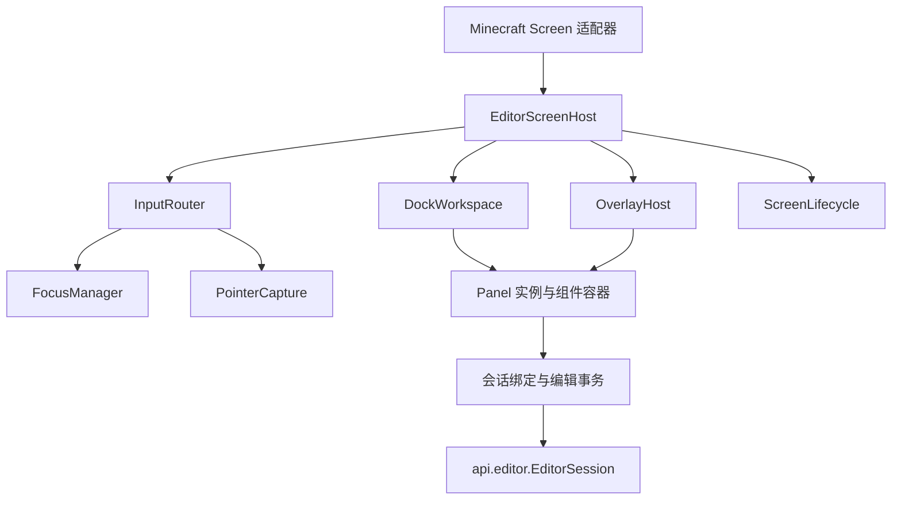

# 编辑器 UI 框架重构设计

## 1. 结论与范围

现有 UI 框架需要局部重构，重点是输入路由、焦点与指针捕获、模态层、控件状态、布局生命周期和会话绑定。继续仅增加面板或替换数据调用，无法满足不可变文档、事务预览与组件扩展要求。

保留现有自绘风格、Minecraft GUI 渲染通道、曲线与时间轴绘图、停靠交互及视口 PiP 的画面拷贝与展示能力。现有 PiP 复用主画面纹理，不等于渲染第二个独立视角；多机位须由宿主另行完成世界渲染验证。暂不引入新的 UI 库，不建设通用响应式框架或完整样式系统。

本轮吸收[功能对照评估](<review-feature-parity.md>)中的 UI 能力，按主设计分层落地：参考音轨先波形卡点、后有声同步；成片遮幅、字幕、图片与淡入淡出全部纳入但独立分期；世界采样仅使用客户端本地可见数据，不加入服务端采样表同步。

本设计补充[动画、播放与编辑器重构设计](<design-animation-editor-framework.md>)的 §2、§5、§9、§10。文档模型、提交校验、稳定 ID 和播放规则以主设计为准；本文规定内置 UI 如何使用这些契约。

本文基于源码静态审查。已确认的事件入口和状态问题列于 §2；实际渲染效果、窗口失焦和游戏输入集成需在客户端验收。

## 2. 现状与依据

下表区分现有缺陷与接入新契约时必然遇到的结构问题。

| 项目 | 代码依据 | 判断 |
| --- | --- | --- |
| 模态事件屏障不完整 | [主屏幕滚轮入口](<../src/main/java/cn/anecansaitin/free_camera_api_tripod/core/editor/CameraEditorScreen.java#L1033>)未检查确认框；[浏览器字符入口](<../src/main/java/cn/anecansaitin/free_camera_api_tripod/core/editor/BrowserScreen.java#L892>)直接转发控件 | 现有路由缺陷；确认框打开时底层仍可接收部分事件 |
| 屏幕间路由分叉 | [主屏幕拖动入口](<../src/main/java/cn/anecansaitin/free_camera_api_tripod/core/editor/CameraEditorScreen.java#L977>)检查模态，[路径屏幕拖动入口](<../src/main/java/cn/anecansaitin/free_camera_api_tripod/core/editor/PathEditorScreen.java#L801>)没有对应检查 | 复制事件分支已导致行为不一致 |
| 焦点兼作鼠标捕获 | [WidgetHost](<../src/main/java/cn/anecansaitin/free_camera_api_tripod/core/editor/widget/WidgetHost.java#L85>)向焦点发送拖动并广播释放；[主屏幕](<../src/main/java/cn/anecansaitin/free_camera_api_tripod/core/editor/CameraEditorScreen.java#L1025>)广播面板拖动 | 无独立捕获所有者、按键归属和取消协议 |
| 点击前全局失焦 | [主屏幕](<../src/main/java/cn/anecansaitin/free_camera_api_tripod/core/editor/CameraEditorScreen.java#L739>)点击前清空全部面板焦点；[文本框](<../src/main/java/cn/anecansaitin/free_camera_api_tripod/core/editor/widget/TextFieldWidget.java#L95>)失焦即提交 | 即使再次点击同一输入框也先结束编辑；提交发生在实际目标路由前 |
| 布局与主题变化销毁控件 | [EditorPanel](<../src/main/java/cn/anecansaitin/free_camera_api_tripod/core/editor/panel/EditorPanel.java#L158>)在 render 中清空重建；[WidgetHost.clear](<../src/main/java/cn/anecansaitin/free_camera_api_tripod/core/editor/widget/WidgetHost.java#L23>)未通知失焦或卸载 | 输入状态丢失，控件替换缺少生命周期 |
| 输入框不能表示提交拒绝 | [数值框提交](<../src/main/java/cn/anecansaitin/free_camera_api_tripod/core/editor/widget/NumberFieldWidget.java#L171>)先更新自身值再调用 void 回调，解析失败保留旧值后仍调用回调 | 无法正确展示 `Rejected`、保留非法草稿或过期基版本 |
| 表达式取消不覆盖符号修改 | [表达式窗口](<../src/main/java/cn/anecansaitin/free_camera_api_tripod/core/editor/ExpressionEditorWindow.java#L978>)直接增删文档变量；[确认逻辑](<../src/main/java/cn/anecansaitin/free_camera_api_tripod/core/editor/ExpressionEditorWindow.java#L847>)分别设置参数与回调 | 不符合一次确认原子提交、取消不改变文档的事务语义 |
| 生命周期混用 | [主屏幕 removed](<../src/main/java/cn/anecansaitin/free_camera_api_tripod/core/editor/CameraEditorScreen.java#L168>)释放接管并重置编辑模式；[视口接管](<../src/main/java/cn/anecansaitin/free_camera_api_tripod/core/editor/ViewportTakeover.java#L162>)直接设置全局光标模式 | 已有释放逻辑可保留，但屏幕暂停、返回与会话关闭需分离 |
| 布局绑定面板实例和精确集合 | [DockLayout](<../src/main/java/cn/anecansaitin/free_camera_api_tripod/core/editor/layout/DockLayout.java#L223>)按实例恢复，集合不完全匹配即拒绝 | 安装或卸载扩展面板使整个布局失效 |
| 布局分隔符与命名空间 ID 冲突 | [浮窗序列化](<../src/main/java/cn/anecansaitin/free_camera_api_tripod/core/editor/layout/DockLayout.java#L179>)使用冒号连接字段 | 不能直接把现有面板名替换成 `Identifier` 而不调整格式 |
| 面板自行检测结构变化 | [关键帧面板](<../src/main/java/cn/anecansaitin/free_camera_api_tripod/core/editor/panel/KeyframePanel.java#L89>)与[变量面板](<../src/main/java/cn/anecansaitin/free_camera_api_tripod/core/editor/panel/VariablePanel.java#L124>)每帧构造字符串决定重建 | 应改为明确的文档、选择和视图失效信号 |

以上问题属于框架职责，不宜继续由每个屏幕和面板独立补充分支。

## 3. 目标结构



### 3.1 职责

| 构件 | 职责 |
| --- | --- |
| `EditorScreenHost` | 组合组件、布局、覆盖层、输入、绘制和生命周期；不持有文档写方法 |
| `InputRouter` | 单点接入全部输入，按相同层序命中和派发 |
| `FocusManager` | 当前焦点作用域、唯一键盘焦点、Tab 导航和焦点恢复 |
| `PointerCapture` | 鼠标按下后的拖动、释放和取消归属 |
| `OverlayHost` | 菜单、下拉、模态、提示的层序与输入屏障 |
| `DockWorkspace` | 面板位置、分隔条、浮窗和停靠操作 |
| `PanelRegistry` | 面板描述、工厂、默认布局位置和最小尺寸 |
| 会话绑定 | 按稳定目标读取值、更新草稿、预览、提交并展示诊断 |
| `ScreenLifecycle` | 屏幕挂载、暂停、恢复、卸载与会话关闭协调 |

主动画屏幕和路径屏幕共享同一宿主，分别配置面板、初始布局和命令。浏览器复用输入、覆盖层、焦点和组件容器，不必继承停靠工作区。

时间轴、曲线和视口作为专用画布组件保留各自绘图和命中算法，通过同一捕获协议执行手势。

### 3.2 包与公开面

- `editor.spi`：组件、面板描述、宿主服务接口、主题与度量只读接口、组件工厂。
- `editor.internal.ui`：路由、焦点、捕获、覆盖层和组件容器实现。
- `editor.internal.layout`：停靠模型、布局计算、配置适配。
- `editor.internal.binding`：会话字段绑定和事务适配。
- `editor.screen / panel / widget / render`：业务界面与可复用实现，逐步迁入目标结构。

公开组件通过工厂创建，仅依赖 `editor.spi` 和 `api`。SPI 不得引用内部宿主实现。Minecraft 事件与绘制类型可出现在客户端 SPI 中，不进入 `api.editor`。

### 3.3 多机位面板与统一预览

UI 只使用主设计模型：`CameraAnimation` 持有 `rigs`、文档级 `cameraSource` 有类型关键帧轨道及 `tracks / symbols / markers / samples / audioRefs / overlays`；`CameraRig` 持有 `id / name / channels / path / motionMode / distanceMode / space / aim / obstacle / view`，其中 `aim`、`view.active` 与文档级 `cameraSource` 是正式时间轴轨道的有类型访问。草案类型名分别为 `KeyframeTrack<AimState>`、`KeyframeTrack<Boolean>`、`KeyframeTrack<CameraSource>`；值域分别为 `Off / Target`、boolean、`Player / Rig`，仅允许 `STEP` 插值。不另设独立 `StepProperty`，不将对象或布尔状态编码成数字，也不强塞进 `NumberSource` 或数值 `KeyField`。这些访问与轨道集合指向同一份轨道数据，保持单一所有权，不重复存储默认值或键表。不在机位中复制文档级音轨、事件或符号，不保存固定 primaryRigId 或逐机位 primary 标志。对象、轨道及关键帧使用文档内稳定 ID，通道语义只要求机位内唯一。

机位面板区分静态总开关 `view.enabled`、本时刻 `view.active` 和宿主性能停路状态；提供注视状态、矩形和静态层级/质量配置。玩家相机来源在文档级属性和时间轴中编辑，可显式选择 Player 或当前活动机位；来源非法时定位到冲突区间，不自动选择其他路。播放与预览覆盖仍通过 `Map<RigId, RigPlaybackOverrides>` 定位。`activeRigId` 仅决定当前编辑对象，不改变 cameraSource 或机位运行活动状态。

时间轴按机位分组显示姿态通道、注视 STEP 轨道、活动 STEP 轨道及布局 x/y/width/height 数值曲线；文档级相机来源 STEP 轨道、事件、音轨、标记与成片叠加独立成组。离散键显示目标名/Off、开关或 Player/Rig，不用数值曲线伪装布尔和对象类型。上述有类型轨道共用 `TrackId / KeyId`、时间排序、增删、移动、框选、吸附、复制、撤销和 Codec 校验基础设施；类型适配器负责值编辑与仅 STEP 的校验，不建立旁路时间表。支持跨机位批量编辑；切换机位按稳定字段目标保存和恢复草稿、光标与选区，不自动提交。过期基版本仍拒绝。

布局画布支持选择、拖动、缩放、层级调整及左右分屏、画中画、四宫格预设。一次手势对应一个预览事务，释放一次提交，取消全部撤回。机位列表、字段、时间轴、曲线和合成视口使用同一候选及 PreparedFrame 中的来源、活动集合、目标与矩形；不能各自抓取世界或求值。不活动机位仍可通过列表编辑，但成片不显示其旧画面；必要的编辑轮廓仅为辅助层。

#### 3.3.1 默认值与当前时间键

字段和画布提供明确的“默认值”与“当前时刻键”编辑模式，不自动猜测写入目标。默认值模式修改有类型关键帧轨道的默认值或未动画化布局常量；已有数值曲线时，引导用户编辑键或显式清除曲线转常量，不直接改默认值来冒充当前画面变化。当前时刻模式在播放头时间新增或修改键；改变状态持续到下一状态键，不隐式生成结束键。

一次布局手势将变化的矩形分量在同一时间写入一个候选；预设同样遵循所选模式。离散选择仅支持阶跃，布局支持数值插值；不提供平滑注视、圆角或任意遮罩入口。10 秒键从 10 秒起生效，界面可显示前后状态并提示来源/活动冲突。

默认值编辑、插键、批量移动、删除和复制均经过统一提交与撤销；源机位关闭、删除和来源轨道修复可组成一个原子操作。不活动仅影响播放，不得因播放头移动销毁该对象的字段草稿。

#### 3.3.2 注视关闭与显式姿态转换

UI 示例：注视轨道在 `[0, 1)` 为目标 A，在 1 秒有 `Off` 键；旋转轨道在 `[1, 2]` 从 R1 插值到 R2。1 秒前注视 A 覆盖其启用的 Yaw/Pitch，Roll 及未接管轴保留旋转轨道结果；1 秒起立即使用旋转轨道在当前时间的值，即 1 秒为 R1、之后沿该轨道到 R2。`Off` 不恢复进入注视前的旧姿态，也不自动插键、平滑或混合；边界是否跳转由两条轨道的实际值决定。

提供独立显式命令“将注视姿态转为旋转键并关闭注视”，供作者把指定时刻的注视结果固化为旋转键。它是一次创作事务，不是播放时的动态平滑交接：

1. 冻结文档候选/基版本、时间 `t`、request/preview 覆盖及所需世界事实，展示事实身份与试算口径；所有求值使用同一冻结上下文。尊重有效覆盖：若 request/preview 强制 `Target`，要求作者先清除该覆盖，否则不能保证文档中的 `Off` 生效，命令不可提交。
2. 在 `t` 求关闭前的有效注视目标姿态。若 `t` 已有 `Off`，可显式使用紧邻 `t` 左侧区间生效的 Target 配置；该区间为 Off 时不追溯更早目标。机位位置、目标及锚点事实仍在 `t` 求值；不读取上一显示帧的姿态或位置。没有有效 `Target`、所需事实缺失或姿态无法求解时给出诊断并拒绝。
3. 将该世界旋转转换到当前机位在 `t` 的 local 参考系，生成完整 XYZ 常量旋转键，并在同一 `t` 生成注视 `Off` 键。候选明确列出将固化的公式、空间与事实，以及所有同 `t` 已有旋转键、注视键或公式的替换；覆盖必须经作者确认，不静默覆盖。
4. 两部分统一校验、一次原子提交并形成一个撤销项。事实/覆盖/基版本过期、转换失败、冲突或任一校验失败均不部分发布；过期后须重新准备和确认，不把旧试算结果套到新上下文。

预览与确认同时提示：该命令只固定所展示事实下 `t` 的姿态；动态目标、锚点或事实后续改变，或之后再次进入 `Target`，仍可能发生跳转。它不添加运行时追踪、自动平滑或持续匹配目标的交接逻辑。

### 3.4 合成宿主服务边界

多机位合成由 `CameraCompositionService` 提供，宿主服务契约放在不引用客户端类型的 `api` 公开面，由 `core` 实现并注入会话/屏幕宿主；`editor` 仅依赖 `api` 与自身 SPI，不导入 `core` 实现。`editor.spi` 可以适配面板调用，但不得另造一套播放或合成语义。

契约至少表达以下边界，不在本文规定实现代码：

| 输入或结果 | 责任 |
| --- | --- |
| 渲染请求 | 引用会话已准备的候选版本、统一时钟与帧身份、各机位已求值姿态、作者布局和成片叠加；不能触发文档发布 |
| 宿主目标描述 | 提供目标尺寸、缩放、生命周期及能力信息；UI 不持有底层渲染目标或操作 GL 状态 |
| 合成结果与状态 | 返回可展示的画面句柄、逐机位实际质量/更新状态、降级原因及结构化失败；标识候选与帧身份，防止拼接不同候选结果 |
| 资源与生命周期 | core 负责独立视角渲染、相机状态保存恢复、目标重建释放及兼容性策略；editor 负责展示、命中、提交创作编辑与状态提示 |

预览与正式播放使用同一合成服务。每路可重复世界渲染，但世界模拟、音轨时钟、采样采集与文档级事件不得按路重复执行。运行时降分辨率、降频、停路及兼容性单路模式要在机位面板和状态区/HUD 明示，注明复用画面的更新时间；这些策略仅改变宿主执行状态，不修改作者 `view.enabled`、布局或历史。作者显式修改启用状态才进入文档事务。求值/锚点/无显式 fallback 的采样错误遵循主设计的整场失败规则，不以性能降级掩盖。

## 4. 输入、焦点与捕获

### 4.1 路由规则

绘制、命中和悬停提示共享同一层序描述。除全局安全释放操作外，输入按以下规则处理：

1. 存在模态时，全部输入只进入最顶层模态作用域；未处理事件也不得传给背景。
2. 非模态菜单或下拉打开时，按其屏障策略处理；外部点击关闭并消费该次点击。
3. 存在指针捕获时，拖动、释放发送给捕获所有者。
4. 无捕获时按反向绘制顺序命中可见、启用且未被裁剪的组件。
5. 键盘与字符只进入当前焦点作用域，再由命令路由处理未消费按键。

鼠标移动、按下、释放、拖动、滚轮，按键按下、释放和字符输入均通过该入口。开发测试事件也进入相同路由，不能绕过模态或捕获规则。

不建设 DOM 式完整捕获/冒泡模型；仅提供命中目标、有限父容器回退和明确屏障，满足当前嵌套需求。

### 4.2 焦点

- 每个屏幕宿主只有一个焦点管理器；组件容器不得保存独立全局焦点。
- 先解析点击目标，再决定是否切换焦点；再次点击同一字段不产生失焦提交。
- 焦点仅能进入当前有效作用域内可见、启用且支持焦点的组件。
- 模态打开保存背景焦点，关闭后仅在原目标仍有效时恢复。
- 面板隐藏、折叠、移除或被模态阻断时撤销其活动焦点。
- Tab / Shift+Tab 在当前作用域内导航；输入框中的空格、剪贴板和编辑快捷键不触发播放或文档删除。

焦点变化通过明确原因通知。普通点击失焦可请求提交；结构卸载、屏幕暂停和布局变化仅保存草稿，不隐式提交。非法提交保留草稿和诊断，允许焦点切换，不静默恢复旧值。

### 4.3 指针捕获

捕获记录组件 ID、鼠标按钮和手势令牌，与键盘焦点独立。

- 按钮、分隔条、框选、关键帧移动和视口路径手势按需申请捕获。
- 拖动与匹配按钮释放只发送给所有者，不广播其他面板。
- 释放后清除捕获；释放事件不得被同帧新建组件再次接收。
- 模态打开、窗口失焦、组件移除、屏幕暂停或会话关闭时发送一次取消并清理。
- 取消手势丢弃未提交预览；不得通过伪造释放事件触发按钮或编辑提交。
- 单纯几何重排可保留仍有效的捕获；目标结构替换必须取消。

路由期间的组件增删、菜单替换和屏幕跳转延迟到事件结束后应用，避免回调修改正在遍历的集合。

### 4.4 命令上下文与帮助

快捷键由命令注册表统一提供动作、可配置按键、适用上下文、可用条件和帮助文本。优先级为顶层模态 → 文本编辑/IME 组合 → 当前画布或面板 → 会话命令 → 游戏输入；已消费事件不继续触发。视口飞行、时间轴步进、曲线编辑与全局播放不能争用同一未声明上下文。按键释放仍按原所有者清理，切换上下文、失焦与暂停清空持续按键状态。

状态栏、右键菜单与字段提示提供上下文帮助：说明字段单位、当前空间、拖动修饰键、吸附来源、公式依赖及诊断定位，并显示实际配置的快捷键。帮助入口不抢占文本输入；不把整套教程系统作为框架迁移前置条件。

## 5. 组件、布局与绘制生命周期

### 5.1 最小组件契约

组件至少提供稳定 UI ID、边界、可见与启用状态、布局、绘制、完整输入和生命周期。事件结果区分“未处理”“已处理”及捕获请求；不以焦点自动推断捕获。

组件树仅承担容器、裁剪和路由关系，不负责自动推导业务依赖。容器对外返回只读子组件视图，替代现有可修改列表暴露。

### 5.2 生命周期与失效

每帧阶段固定为：

```text
接收会话变化与输入结果
→ 更新视图模型及草稿绑定
→ 按需更新组件结构
→ 按需布局
→ 生成绘制数据
→ 提交渲染
```

绘制阶段不得提交文档、创建业务弹窗或清空重建组件。布局产生组件矩形，不负责构造字段回调。

失效信号至少区分：

| 信号 | 处理 |
| --- | --- |
| 文档或选择变化 | 更新对应视图模型；结构确实变化时按 UI ID 替换局部组件 |
| 尺寸、GUI 缩放或全屏变化 | 重新布局现有组件；通知合成宿主按目标实际像素尺寸重建离屏目标，旧目标由宿主安全释放；不改作者归一化布局或丢弃字段草稿 |
| 主题变化 | 更新绘制样式；仅文字度量变化时重新布局 |
| 播放头或取值变化 | 刷新只读展示与画布，不重建字段 |
| 组件移除 | 取消捕获、撤销焦点、保存草稿、释放订阅 |

无须引入通用差异渲染器。第一版使用显式面板结构键和局部复用；禁止每帧拼接整个数据表字符串判断变化。

### 5.3 裁剪、坐标与提示

统一使用 GUI 逻辑坐标。屏幕、面板内容和画布变换提供显式转换；窗口像素转换仅在平台适配处进行。

裁剪以作用域形式入栈、出栈，实际区域为父子交集，并用于命中测试。即使底层 Minecraft 已支持嵌套裁剪，框架仍需保证配对和输入一致性；不将现有嵌套 scissor 调用本身认定为缺陷。

菜单通过覆盖层绘制，不受面板内容裁剪限制。悬停提示由宿主统一选择最上层命中目标，仅生成一个提示；模态存在时不得展示背景提示。

### 5.4 主题与度量

保留现有颜色和绘图函数，逐步以只读 `UiTheme` 和 `UiMetrics` 传入渲染上下文。组件保存语义颜色角色，不在构造时固化当前主题色。

配色变化不销毁输入框。高度、间距和最小尺寸集中定义；不在所有面板上强制同一最小尺寸。绘图和 PiP 的宿主渲染细节保持内部实现。

## 6. 字段绑定与编辑事务

### 6.1 状态归属

| 状态 | 归属 |
| --- | --- |
| 已发布值、选择与预览候选 | 会话 |
| 输入文本、基版本、字段诊断、复合草稿 | 会话编辑事务 |
| 光标、选区与输入框水平滚动 | 会话附属 UI 状态，按字段 UI ID 保存 |
| 悬停、按钮按下、当前捕获 | 屏幕宿主，暂停时清除 |
| 面板位置、可见性、滚动与展开状态 | 工作区视图状态；需要时写入客户端配置 |

文本与数值框共用文本编辑模型，包含选区、光标、复制粘贴、码点边界、长度限制和字段解析适配。优先评估复用原版文本编辑能力，保持自绘外观；无法满足时仅维护一份文本模型。

数值解析失败保留原始文本并显示诊断，不回调旧值。空文本是否允许由字段策略决定，不由通用文本框统一禁止。

### 6.2 绑定协议

字段绑定使用 EditTarget.Field(owner, fieldPath) 的稳定对象种类/ID与对象内字段路径，不捕获可变 Keyframe 或旧轨道实例。Field 不嵌套 Field，字段路径非空；当前仍为字符串路径，合法字段与控件适配由编辑层约定。状态键改值使用 SetStateKey，经轨道能力检查原生值类型；跨轨不兼容整批拒绝。选择仍按对象/键 ID，不必与字段草稿完全同构。

```text
读取会话快照及字段值
→ 按字段目标建立或恢复草稿
→ 文本变化更新草稿
→ 可解析时更新预览候选
→ Enter / 普通失焦组装 EditSubmission（操作、expectedRevision、不可变标签）请求提交
→ Applied 更新基版本；Rejected 保留草稿与诊断
```

诊断、修复说明及事务/历史标签读取 LocalizedMessage，经无状态 LocalizedMessageRenderer 显示适配每次生成独立 Component；不把渲染结果写回契约，不能用 Component.copy() 代替封闭消息树的不可变保证。翻译键、fallback、参数顺序和嵌套样式按主设计 §4.1 保留。显示适配尚待后续 core/editor 批次实现。

对象诊断跳转或执行修复前检查 `DiagnosticScope.Document` 的版本与当前会话；过期时提示并重新生成，不按同 ID 定位到换档后的对象。File(ResourceId) 作用域只显示资源和字段路径，不提供文档对象跳转或 Fix。会话须把异步诊断绑定到正确候选/版本，不由面板自行拼装版本。

监听通知期间不得调用同步写入并等待排队；同步 submit 会返回 REENTRANT_SUBMIT。需要后续修改时使用 submitAfterNotifications，通知结束后重新检查基版本，并由存储线程的完成回调更新 UI；拒绝不新增历史。队列和控件线程适配仍待实现。

同值提交不产生历史项。外部版本变化使草稿过期时显示冲突，不能直接以最新文档覆盖输入。Esc 取消当前字段事务；确认框或更高层模态优先处理 Esc。

表达式窗口中的公式、参数和符号增删属于同一复合事务。确认一次原子提交，取消全部丢弃；窗口关闭不再执行任意文档写回调。组件工厂可在独立 Screen 中装配相同事务绑定。

拖动类编辑使用会话预览事务，捕获取消则取消事务，匹配释放才提交。时间轴、曲线和视口必须读取同一候选快照。

### 6.3 时间轴显示、吸附与预览区间

时间数据始终以秒存储和计算，不做隐式量化。秒、游戏刻（标明每秒刻数）、帧/时间码（标明显示帧率）只负责展示和输入换算；切换显示单位不得重写键时间。逐刻/逐帧步进是显式定位动作，吸附是显式编辑动作，均不要求其他键落到整数刻或帧。

吸附源清单包括：当前单位的时间网格、其他关键帧、文档标记、播放头、音频偏移起点/终点及预览区间边界。波形峰值或节拍候选只有经用户确认形成标记，或被明确启用为吸附源时才参与。提供各源开关、屏幕像素容差、临时禁用修饰键及命中提示；等距候选采用固定优先级并保持稳定。吸附后仍由会话检查最终时间与键冲突，拒绝时不静默移动其他键。

预览 in/out、区间循环、播放头与显示单位属于会话，不写文档、不进撤销历史。区间边界须有限、非负且 in < out；提供清除和恢复全段。区间播放仍为正速度正向播放，不引入反向/乒乓或文档时间重映射；定位和循环事件边界遵循主设计，不由 UI 自行补发事件。

轨道显隐与 solo 仅过滤编辑器中的轨道行、曲线和几何辅助显示，属于视图状态。它们不排除通道求值、事件、声音或机位合成，不改变正式播放结果；不得用 UI mute 赋予轨道停播语义。作者机位启用、音频创作属性和成片叠加可见性如需改变，必须使用各自文档字段事务。

### 6.4 音轨、标记与世界读数面板

音轨部分留到 §9.1 的最终音频阶段；标记和世界读数按非音频阶段实施。音频功能仅在兼容音频 mod 可用后启用；缺依赖时提示且仅可显式导入文档其他部分，播放缺依赖、资源或所需能力的音频文档必须被阻止，具体规则见[独立音频 API 设计](<design-spatial-audio-api.md>) §8.2。

音轨面板显示文档级 `audioRefs` 的资源引用/哈希、偏移、时长与波形缓存状态，支持时间轴对齐和引用编辑；本地文件缺失、格式不支持或哈希不匹配均明确提示，不阻断其他文档编辑。音频文件不随文档打包，波形缓存不是创作数据。第一阶段只做波形、播放头与卡点；第二阶段经宿主音频能力验收后接入有声同步，暂停、定位、变速、循环及漂移校正遵循主设计播放时钟契约。每帧多机位渲染不得重复播放声音。

标记面板编辑文档级稳定 ID、时间、标签与种类，支持定位、注释、从波形创建卡点以及作为吸附源；标记本身不触发 Tick 事件。音轨引用、偏移与标记修改均走同一候选和提交校验。

世界采样面板提供声明、命名、类型、参数、重采周期、当前只读值、样本帧身份/新鲜度、依赖通道及插入 `sample("名字")` 的操作。空间读数区区分 SpatialResolution 的 NotRequired / Resolved / Failed，失败展示诊断，不显示为合法无目标；姿态面板区分 AxisSample 的缺失/有限值/错误，位置和旋转掩码仅为有值轴派生。实时值只读，不通过刷新产生历史项。世界采样只读取本地客户端已可见数据，不触发区块加载，本轮不提供服务端权威采样表、同步按钮或一致性承诺；多人客户端可能得到不同结果，界面与帮助需说明。

`UNKNOWN` 不能显示成 0、旧值或通过状态：指明未加载坐标、缺失实体、未同步记分板等原因，并定位依赖公式/通道。无 fallback 的缺失读数在播放中按错误处理；作者可显式写 `sample("名字", fallback)`，面板仍显示原样本 `UNKNOWN`，另标明该表达式采用显式 fallback。试算缺事实时显示 `Incomplete`，不伪装为通过；具体是否阻断提交服从主设计校验层级。刷新当前世界事实只代表当前帧，不能承诺其他时间或其他客户端得到同值。

### 6.5 缓动预设、批量运算与烘焙

缓动预设先展示所选键的适用插值与曲柄变化；批量偏移、缩放、取反先明确目标机位/通道、单位、常数与公式的处理方式，再生成完整候选。公式不能在未告知作者时被替换成常数。所有目标先计算、后统一校验，预览一致后一次原子提交；任一目标冲突或失败则整批拒绝，不发布部分结果。

烘焙面板明确范围、秒基准采样步长/显示帧率、端点规则、通道、替换策略及预计键数/预算，并提示会固化哪些公式与当前空间/世界输入。按声明的上下文准备可重复试算候选；缺失事实、非有限值或预算超限时报告诊断，不输出半份键表。预览、确认、取消分别对应候选、一次提交、全部丢弃，确认后一次撤销即可恢复。

试算展示 TrialReport 的区间、策略、实际点数、固定事实及未完成原因；FAILED 必有错误，INCOMPLETE 不能承载已确认 ERROR。曲线、试算和洋葱皮使用显式 CurveSampleRequest，同帧可跨时间但时间必须进入缓存键，不读当前选中机位替代轨道所属机位。实际采样和合成仍待 core。

### 6.6 自动恢复提示

按主设计 §8.4 展示恢复槽状态、最近成功保护的已发布版本及写入失败原因。重开时通过会话交互请求选择恢复、忽略或删除，不自动覆盖正式文档。自动恢复不包含未提交草稿，界面须明确说明；后台保存完成也不能把较新编辑错误标记为已正式保存。恢复后使用正常换档流程，不自行反序列化或恢复旧撤销栈。

### 6.7 单位与文本输入能力

字段显示量纲与空间：格、秒/刻/帧、度、路径绝对距离/百分比、归一化画面坐标与像素偏移。百分比显示与内部数值的转换由字段适配器负责，不改变文档单位；混合单位批量操作须显式换算或拒绝，不能依靠标签推断公式量纲。

码点安全不等于支持 IME。平台适配需单独报告组合文本、候选窗定位、提交/取消事件与剪贴板能力；组合期间 Enter/Esc、方向键和字符不得触发播放、提交或删除文档。原版或平台接口不足时明确说明能力边界并保留可用输入路径，在客户端完成中文输入法实测后才能宣称支持，不以普通字符注入测试代替。

## 7. 覆盖层与屏幕生命周期

### 7.1 覆盖层

`OverlayHost` 统一持有菜单、下拉、表达式窗口和确认视图。模态栈独立管理焦点作用域；会话 `InteractionRequest` 通过请求 ID 和选项 ID 呈现和完成。

打开模态前关闭不兼容菜单并取消背景捕获。请求失效、换档或会话关闭时移除对应视图。完成检查集中执行一次，替代 click、release、key 各入口重复检查窗口状态。

表达式视图不保存实际文档引用或裸写回调。允许组件局部交互回调，但不得绕过会话提交文档。

`OverlayHost` 是交互 UI 容器，与文档级成片 `Overlay` 不同。成片遮幅、字幕、图片、淡入淡出由 Compositor 依文档时间求值并进入播放画面；菜单、确认框、提示与模态屏障只存在于编辑交互，不保存为成片素材。

### 7.2 屏幕与会话

区分以下生命周期：

| 操作 | 行为 |
| --- | --- |
| `attach` | 挂载组件、订阅会话、恢复视图状态 |
| `suspend` | 取消捕获、清空按键集合、释放光标控制、保存草稿；会话保留 |
| `resume` | 重新布局并核对草稿版本，按需恢复有效焦点 |
| `detach` | 移除订阅和 UI 资源，幂等清理 |
| `session.close` | 结束事务、交互请求和会话相机声明，执行会话级关闭 |

导航控制器显式区分进入子屏幕、后端切换和退出会话。Minecraft `removed()` 执行安全的宿主暂停或卸载清理，不直接推断会话应关闭。窗口失焦和世界切换走同一安全释放路径。

视口鼠标锁使用带所有权的 lease；释放旧 lease 不得解锁新宿主的控制。光标 lease 与主设计中的相机声明令牌相互独立，由同一生命周期协调释放。

### 7.3 合成与交互层序

从底到顶固定为：**世界多机位画面合成 → 成片叠加（遮幅、字幕、图片、淡入淡出）→ HUD → 编辑构图辅助 → 工作区面板/浮窗 → 交互覆盖层**。世界机位内部按作者 `zOrder` 排序，成片叠加内部按文档顺序/层级规则排序；命中采用同一 UI 层序的反向顺序。HUD 是否显示遵循宿主策略，编辑辅助和工作区不成为文档成片叠加。外部整屏录制会捕获最终显示层，录制成片时应显式隐藏编辑层并按需关闭 HUD。

编辑构图辅助包含三分线、安全框、画幅参照与可视化遮幅预览，仅为会话视图状态；需要实际进入播放画面的遮幅必须建立文档 Overlay。多机位布局手柄位于编辑辅助层，由专用画布按捕获协议命中，不能绕过上层工作区或模态。

成片叠加面板提供类型、资源/文本、位置、时间范围、层级及不透明度/淡入淡出参数；遮幅、字幕、图片与淡入淡出均列入范围，按独立阶段交付。资源缺失和能力不支持必须可见，创作编辑使用统一事务；合成降级显示 SampleIdentity 的实际画面时间与延迟，world/snapshot/活动区间/来源代际变化后不得呈现旧纹理；不把淡入淡出扩展成机位之间的镜头过渡，也不增加分路输出或导出字段。

### 7.4 洋葱皮与世界事实边界

第一阶段洋葱皮仅绘制多时间采样的相机几何、视锥、路径和运动轨迹，不重复世界渲染或推进模拟。采样数、时间间隔、颜色和可见范围属于会话视图选项，并受绘制预算约束。

对不依赖世界的通道可按指定时间求值；若依赖锚点或世界采样，只能明确标注“使用当前帧事实的时间试算”，或者显示不可用。没有记录的历史实体姿态、历史采样和未来世界状态不能被伪造为事实；不能把当前事实复制到各时刻后声称是历史成片。洋葱皮不触发事件、声音或播放副作用，完整世界历史重放不在本轮范围。

## 8. 停靠布局与面板扩展

保留现有上下排、单元叠放、分隔条和浮窗操作，不要求改成任意递归停靠树。重构时分离：

- `DockState`：以面板 `Identifier` 保存位置、权重、可见与折叠状态。
- `DockGeometry`：根据状态、窗口尺寸及面板最小尺寸计算矩形。
- `DockController`：接收捕获手势，更新布局状态。
- `PanelRegistry`：提供描述、工厂、默认放置与尺寸约束。

持久化改为带版本的结构化对象，不以冒号、逗号等拼接命名空间 ID。布局格式版本与默认布局调整分开，新增默认面板不自动使用户布局作废。

恢复流程：

1. 解析并验证结构、有限权重、唯一面板引用和尺寸范围。
2. 保留可识别面板的位置与隐藏状态。
3. 未注册面板暂不实例化，保留其配置；不得影响其余面板。
4. 新注册且未配置的面板按描述默认位置加入。
5. 清理空单元，修正越界浮窗；格式整体损坏时才恢复默认布局并提示。

小窗口无法满足全部最小尺寸时，压缩至框架绝对下限，内容由面板滚动。仍无法容纳时允许工作区滚动，保留固定的恢复布局入口，使面板标题可通过导航到达。不得生成负尺寸或将浮窗永久移出可恢复范围。

### 8.1 屏幕画面布局与工作区布局的区别

作者配置的 cameraSource、注视/活动状态、机位 `view` 矩形默认值与数值曲线、层级和静态总开关均属于创作数据，可保存、分享和撤销。矩形相对输出画布，坐标模式固定为归一化或角落锚定/像素偏移；随时间变化的是位置和尺寸，不插值坐标模式。视口缩放与留白仅通过画布变换映射，不能改写作者矩形。边界仅为矩形，渲染分辨率按宿主预算变化而非每帧跟随矩形重建目标。

`DockState` 中面板宽度、浮窗位置、轨道展开、显示过滤和时间轴缩放属于工作区/会话视图状态，写客户端配置而非动画文档。重排面板不会产生动画历史项，拖动机位画面矩形则会；两类操作使用不同控制器与事务目标，名称中都出现“布局”不构成共享持久化模型的理由。

## 9. 迁移方案

UI 框架迁移不应全部推迟到主设计 P5；事务绑定必须与不可变模型同步落地。

| 阶段 | 内容 | 与主设计关系 |
| --- | --- | --- |
| U0 行为测试与缺陷修正 | 固化模态、焦点、按钮、拖动和取消规则，补齐现有事件屏障 | P0 |
| U1 输入与宿主 | 统一路由、焦点、捕获和覆盖层；现有控件与面板通过适配接入；主屏幕和路径屏幕共用停靠宿主 | P1，可先于数据模型迁移 |
| U2 生命周期与组件 | 分离结构更新、布局和绘制；迁移主题、裁剪和输入清理；浏览器接入公共宿主能力 | P1–P2 |
| U3 会话绑定 | 稳定目标、字段草稿、提交结果、表达式复合事务、手势预览 | 必须随 P2 完成存量写调用切换；预览能力随 P4 完善 |
| U4 工作区与扩展 | ID 布局模型、结构化配置、扩展面板恢复、公开组件工厂和 SPI | P5 |

兼容适配器仅允许过渡，不同时保留两套焦点或输入所有权。每个迁移后的屏幕必须把全部事件交给宿主，不能只迁移点击而保留旧滚轮分支。

保留与调整范围：

| 现有实现 | 处理 |
| --- | --- |
| `UiRect`、绘图数学与曲线/时间轴算法 | 保留，增加交集、坐标转换和统一宿主接入 |
| `Draw`、按钮与标签绘制 | 保留外观，迁移主题上下文与提示管理 |
| `WidgetHost`、`EditorWidget` | 改为组件容器与生命周期契约，移除独立焦点和释放广播 |
| `EditorPanel` | 保留面板边框与标题，拆分布局和结构创建，菜单交给覆盖层 |
| `DockLayout` | 复用计算与交互规则，拆出 ID 状态和配置适配 |
| `CameraEditorScreen`、`PathEditorScreen` | 改为宿主配置与业务命令，删除重复路由 |
| `BrowserScreen` | 保留资源浏览业务，复用公共路由、字段与覆盖层 |
| `ExpressionEditorWindow` | 保留表达式编辑与提示能力，改为会话事务视图 |
| `ViewportTakeover`、PiP 渲染 | 保留控制手感及主画面拷贝/展示能力，接入所有权与生命周期；独立第二视角由 Compositor 宿主另行验证与实现 |

### 9.1 功能交付分期

下列阶段是 UI 功能依赖，不取代 U0–U4，也不把所有功能绑定成一次交付。**音频 UI 及其数据、后端、可选适配整体最后实施**：U0–U4、V1–V3、S1、O1–O3、B1 和 T1 的非音频内容完成并验收后，才进入主设计 A0–A2。前期仅保留音频扩展边界，不创建占位音轨面板，也不要求音频字段或波形能力作为框架验收条件。独立标记、非音频吸附与普通世界声音不重复执行的约束仍正常实施。

| 阶段 | 内容与依赖 | 完成条件 |
| --- | --- | --- |
| V1 多机位最小验证 | 验证独立第二视角与状态恢复，接入合成契约、两路预览、Player/Rig 来源及目标尺寸管理 | 两个真实视角；单一时钟，模拟/事件/声音不重复；来源不由副路或排序改变 |
| V2 多机位与时间创作 | 来源/注视/活动有类型 STEP 关键帧轨道、布局曲线、默认值/插键模式、显式注视姿态转旋转键命令、手势/预设、草稿恢复，依赖 U3 与 V1 | 10 秒切目标、出现第二路和矩形插值可定位预览；来源区间校验；有类型键复用时间轴编辑与 Codec 基础设施，转换命令原子且可撤销 |
| V3 多路与降级 | N 路、质量/降频/路数限制、兼容性退回单路与逐路状态提示 | 降级可见且可恢复，不修改作者启用状态；错误不会变成停路降级 |
| S1 本地采样面板 | 类型/参数声明、实时值、依赖定位、UNKNOWN 与显式 fallback 展示，依赖主设计采集与试算 | 各面板读同一采样帧；缺事实诚实诊断；不引入服务端同步 |
| O1 成片遮幅 | 文档 overlays 面板、时间/层级与遮幅，依赖 V2 合成路径 | 与编辑安全框明确区分，播放/预览一致且可撤销 |
| O2 字幕与图片 | 文本/资源编辑、布局及资源诊断，依赖 O1 | 缺失可见、窗口变化定位稳定、正确位于 HUD 下方 |
| O3 淡入淡出 | 成片叠加不透明度与淡入淡出编辑，依赖 O2 | 按统一时间求值；不增加镜头混合过渡，独立于允许的 cameraSource 阶跃切换 |
| B1 自动恢复 | 恢复状态与恢复/忽略/删除交互，依赖主设计恢复资源服务 | 不覆盖正式文件；失败可见；未提交草稿保护边界清楚 |
| T1 创作工具 | 缓动预设、批量运算、烘焙、会话预览区间、几何洋葱皮、单位和上下文帮助，依赖 U3 | 每次批量确认一次原子提交；辅助显示不改变播放语义；历史世界事实不伪造 |
| A0 最终阶段：音频接入 | 全部非音频阶段验收后，实施独立音频 API 与相机可选桥接，完成能力查询和缺失提示 | 未安装不加载外部类，非音频功能正常；含音频文档仅允许显式导入其他部分 |
| A1 最终阶段：波形与卡点 | 依赖 A0，实施文档音频引用/偏移、资源诊断、波形及音频吸附源 | 安装兼容 mod 后启用；波形版本正确；显示单位不量化时间 |
| A2 最终阶段：有声同步 | 依赖 A1，接入音量、暂停、定位、变速、循环与漂移状态 | 缺 mod、资源或所需能力时阻止播放；真实音频与生命周期验收通过 |

本文其他章节的音轨、波形、音频吸附与声音同步要求均为最终阶段目标；第 10 节对应音频验收随 A0–A2 执行，不阻塞非音频阶段。

IME 与快捷键的基础能力随 U1–U3 验收，不能以 A2 或 V3 尚未完成为由延后输入安全。音频后端能力、渲染兼容矩阵、烘焙预算和资源格式的具体值由对应宿主设计/验证确定；未完成时界面明确标注能力状态，不承诺未经验证的兼容性。

## 10. 验收条件

### 10.1 无客户端逻辑测试

输入路由、焦点、捕获、布局状态和绑定适配通过最小测试组件与会话替身验证，不启动游戏世界。

- 模态对全部输入形成屏障，包括字符、滚轮、拖动和释放。
- 重叠浮窗仅最上层目标接收事件，裁剪外组件不命中。
- 同字段点击不失焦；Tab 限定在当前作用域，关闭模态恢复有效焦点。
- 捕获所有者独占拖动和释放；取消不触发按钮或提交。
- 回调打开新模态、移除自身或切换屏幕时无重复事件和集合修改错误。
- 尺寸、主题与只读播放值变化不销毁草稿或重置光标。
- 数值解析失败、提交拒绝和版本过期保留输入及诊断。
- 表达式确认原子提交，取消不改变公式、参数或符号。
- 安装、卸载面板不重置其他布局；命名空间 ID 可完整往返。
- 暂停和关闭清空按键、取消手势并释放令牌；重复清理无副作用。

### 10.2 功能契约验收

- 多机位所有面板及合成请求携带同一候选/帧身份；切换 `activeRigId` 保留原目标草稿、光标与诊断，外部变更后过期提交仍拒绝。
- cameraSource 可显式选择 Player 或本时刻活动 Rig；机位列表选择不改变来源。文档级音轨、符号、事件、标记与采样不随机位复制。
- 0–10 秒注视 A、10 秒起 B；第二路 10 秒出现并连续移动缩放。直接定位 15 秒、循环、暂停预览与顺序播放的状态一致，不补发控制事件。
- 注视、活动与 cameraSource 是正式有类型 STEP 关键帧轨道；可共用 TrackId/KeyId 执行时间排序、增删、移动、框选、吸附、复制和撤销，Codec 往返保持类型与唯一所有权。非 STEP 插值、数字编码的离散值及错误值类型被拒绝，不经 NumberSource/数值 KeyField 旁路写入。
- 示例 `[0, 1)` 注视 A、1 秒 Off、`[1, 2]` 旋转 R1→R2：顺序播放、直接定位 1 秒及 1.5 秒、暂停预览与循环均立即读取本时刻旋转轨道，不恢复旧姿态、不自动平滑或插键。
- “将注视姿态转为旋转键并关闭注视”在同一 t 生成 local 参考系完整 XYZ 常量旋转键及 Off，一次提交/撤销同时处理全部键；使用带旋转锚点的机位验证世界到 local 的转换。t 已有 Off 时使用左侧有效 Target 配置，但仍使用 t 的机位位置和目标事实；冷启动直接定位与从任意上一显示帧进入的结果一致。
- 转换命令对同 t 已有键/公式先列明覆盖并要求确认；取消无修改。request/preview 强制 Target 时先清除覆盖才允许提交；其他有效覆盖参与冻结求值。事实缺失、求解失败、版本/事实/覆盖过期或任一键校验失败均无部分发布；重新准备后须再次确认。
- 转换预览显示冻结事实与公式固化范围，提示动态目标/锚点后续变化仍可能跳转，不宣称运行时动态平滑交接。
- 默认值与当前时间键模式可辨认；布局预设和手势写入所选目标，取消不发布，一次完成只产生一个历史项。冲突来源区间可定位且提交拒绝。
- 连续改变矩形时投影与裁剪正确，离屏目标不逐帧销毁；活动边界没有旧图残留，不活动机位的草稿保持。
- 一次矩形拖动/预设、一组缓动/批量数值/烘焙确认仅产生一个历史项；任一目标失败无部分发布，取消保留已发布文档。
- 秒/刻/帧切换往返不改存储时间；吸附源开关与冲突诊断可验证，未启用吸附时保留子帧时间。
- in/out 和轨道显隐/solo 不进入文档历史，不改变正式播放通道、事件、音频或成片结果；不出现 UI mute 停播旁路。
- 采样面板、曲线与数值列读取同一事实；UNKNOWN 显示原因，无 fallback 的播放错误与显式 fallback 状态清晰区分；当前帧事实试算不宣称历史有效。
- `OverlayHost` 不写文档 overlays；构图辅助不进入成片；作者成片遮幅/字幕/图片/淡入淡出的修改可保存与撤销。
- 降级状态与作者 `view.enabled` 分离；工作区重排不改作者布局；宿主目标重建不产生创作历史项。
- 几何洋葱皮不调用世界渲染、模拟、事件或声音；依赖未知历史事实时标记不可用或当前事实试算。
- 自动恢复状态与正式保存状态区分；恢复选择走会话请求与正常载入；后台完成不清除新编辑的未保存状态。
- editor 对 api/SPI 的依赖可静态核对，不能通过导入 core 合成实现完成预览。

### 10.3 客户端验收

- 主编辑器、路径屏幕和浏览器采用一致的模态、菜单和焦点行为。
- 中文及非 BMP 字符的移动、选择、删除和长度截断不破坏码点；剪贴板与 GUI 缩放正常。
- 拖动跨面板、打开模态、切换子屏幕、窗口失焦和返回时无残留按钮、飞行按键或锁定光标。
- 调整尺寸、主题、停靠和浮窗时，正在输入的草稿保持，裁剪与提示层序正确。
- 时间轴、曲线与视口预览一致；取消手势不发布，完成手势只增加一个历史项。
- 外部 Screen 可通过组件工厂嵌入表达式编辑器；附加面板无需修改内置屏幕事件分支。

- 独立第二视角看到不同机位姿态，世界时间、采样表、事件和声音每帧只准备/执行一次；所有路使用同一时钟，不把主画面拷贝当多机位通过。
- 窗口缩放、GUI 缩放和全屏切换后离屏目标正确重建释放，归一化布局保持；内存/显存资源不随切换累计，目标重建期间草稿不丢失。
- 按约定层序检查多机位、成片叠加、HUD、构图辅助、工作区和菜单/模态，确认图层与命中一致；录制时能隐藏编辑层。
- 故意超出性能预算及测试着色器/优化模组环境，验证降级/单路回退及恢复可见；作者启用状态和文档历史不变，数据失败仍明确终止。
- A1 验证缺失音频、波形加载、偏移、标记与吸附；A2 使用实际本地音频验证定位、循环、正速度变速、暂停恢复、音量、失焦和世界/维度切换，检查漂移与声音源释放。
- 本地区块未加载、实体消失及记分板未同步时，UNKNOWN 原因、依赖通道与显式 fallback 均可见；多人帮助明确本地事实可能不同。
- 中文 IME 实测组合文本、候选窗定位、确认/取消与中英文切换；验证组合期间 Enter/Esc 不提交文档或启动播放。若平台缺少必要接口，记录不支持的具体能力与可用输入路径。
- 可配置快捷键在文本、模态、时间轴、曲线、视口飞行和游戏上下文间不重复触发；帮助显示当前绑定及字段单位。

完成后，屏幕负责装配业务，宿主负责 UI 机制，会话负责编辑状态；不再依赖屏幕间复制路由、全局清焦点或广播释放维持交互。
