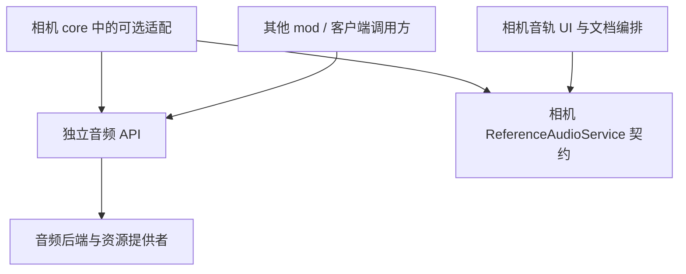

# 独立三维空间音效 API 的必要性与接口设计

## 1. 结论与已确认范围

建议建立独立音频 API mod，以客户端音频资源、非空间播放和三维声源为核心，通过可选适配接入相机 mod。相机文档、时间轴编排、音轨面板、波形展示、标记与吸附继续保留在相机 mod。

这是新增子系统的边界设计，不是搬迁已有音频实现。**音频整体安排在最终阶段**：相机与 UI 框架重构、多机位、世界采样、成片叠加、恢复与非音频创作工具全部完成并验收后，再启动音频后端探针、独立 API 实现、相机适配、波形及有声同步。前期仅保留本文的设计边界，不建立实现依赖或占位功能。最终阶段内部先验证后端，再稳定接口和发布独立制品。

用户已确认：

- 独立 API 同时覆盖通用三维空间音效和非空间参考音轨。
- 相机侧通过可选扩展集成；编排、UI 和适配代码可保留在相机 mod 内。
- 首版仅提供客户端 API，不包含服务端触发与跨客户端同步。
- 音频功能仅在安装兼容音频 mod 后启用。不含音频内容的相机功能不依赖该 mod。
- 未安装时，含音频文档不能完整进入编辑会话；提示缺失后仅允许显式导入非音频部分。
- 播放含音频内容的文档前，必须检查音频 mod、资源及所需能力；缺失或不满足时阻止播放并提示，不自动忽略音频。

本文为分析与接口草案，不修改现有两份设计。独立 mod 的正式名称、包名及发布坐标在实现前确定，不影响本文边界。

## 2. 当前依据

| 依据 | 含义 |
| --- | --- |
| [主设计 §7.8](<design-animation-editor-framework.md#L580>)规定 A1 波形卡点、A2 有声同步，并将格式、变速与缺失策略留给宿主验证 | 音频后端尚未定型，不能将规划能力当作已有实现 |
| [主设计 §7.6](<design-animation-editor-framework.md#L540>)规定单一监听器，参考音频为非空间声音 | 三维声源是新增能力；不能直接把参考音轨改成空间声音 |
| [UI 设计 §6.4](<design-editor-ui-framework.md#L245>)通过资源引用、波形状态和播放时钟使用音频 | 编辑器需要能力契约，不需要直接持有声音引擎对象 |
| 对 `src` Java 源码中的 audio、sound、音频、音效及常见声音接口搜索均无匹配 | 当前没有可直接抽取的音频播放器、解码器或声源模块 |
| [CameraPlayer](<../src/main/java/cn/anecansaitin/free_camera_api_tripod/core/cmd_camera/playback/CameraPlayer.java#L17>)只推进动画时间和分发轨道 | 当前逐帧浮点时间不等于音频设备时间，不能直接承诺同步精度 |
| [CmdCamera](<../src/main/java/cn/anecansaitin/free_camera_api_tripod/core/cmd_camera/CmdCamera.java#L46>)驱动相机插件更新，未更新声音监听器 | 新的监听器集成必须验证基础相机与 Minecraft 声音系统的实际更新顺序 |
| [构建依赖](<../build.gradle#L164>)尚未声明独立音频库；[环境版本](<../gradle.properties#L16>)为 Minecraft 26.1.2、NeoForge 26.1.2.36-beta | 本文不认定当前 Minecraft 声音后端已经满足任意定位、变速或独立监听器能力 |

未检查 Minecraft 声音引擎内部源码或运行声音实验；后端相关结论是验证要求，而非实现能力声明。

## 3. 是否有必要独立

### 3.1 收益与成本

| 维度 | 独立 API 的收益 | 成本或限制 |
| --- | --- | --- |
| 复用 | 实体循环声、环境声、剧情语音、机器音效和参考音乐可共享资源与播放管理 | 仅相机使用时，独立版本和发布维护收益较小 |
| 依赖 | 无需安装相机或编辑器即可使用空间音效 | 可选接入需单独处理缺失、版本不兼容与类加载 |
| 稳定性 | 解码、线程、设备切换、资源释放集中维护 | 音频设备和 Minecraft 版本变化增加兼容测试 |
| 领域边界 | 声源与监听器不依赖 RigId、动画文档和 UI | 必须防止把相机时间轴模型复制进音频 API |
| 功能演进 | 可分别迭代空间声、媒体定位、分析和后端 | 不宜在首次发布时承诺全部能力与格式 |

对于更新设计中的“非空间参考音轨”单一需求，独立三维音效 mod 并非必要。用户新增了通用空间声源目标后，独立边界有明确价值，适合作为独立产品方向。

现在仅确定独立契约与依赖方向。全部非音频阶段验收后，再验证空间播放和参考音轨两条路径，实施相机 A1/A2 并发布稳定 API；波形可用不代表三维 API 或有声同步完成。

### 3.2 与原版声音能力的关系

简单资源包音效、固定位置播放和常规实体声音应优先复用 Minecraft 已有能力。独立 API 的价值在于统一受控声源、资源提供者、生命周期、可查询失败，以及可选的定位、外部时钟和分析能力。

独立 API 不接管所有原版声音，不自动将每个游戏声源迁移到新引擎，不向调用方公开 OpenAL source、buffer 或设备句柄。

## 4. 归属与依赖



| 独立音频 mod | 相机 mod |
| --- | --- |
| 音频资源描述、解析、内容身份和解码 | `ReferenceAudio`、AudioRefId、源片段、动画起始偏移及创作增益 |
| 非空间与三维声音实例、状态、增益、循环 | 动画到源时间映射、预览区间、播放控制联动 |
| 会话、组、生命周期、设备与资源错误 | 整场失败与可见提示、文档历史和资源重绑定 |
| 后端能力与定位完成确认、播放位置估计 | 决定哪些能力是本次播放必需条件 |
| 可选 PCM 分析、波形数据 | 波形绘制、卡点、节拍确认、吸附与标记 |
| 声源世界位置、局部监听参考系、距离衰减 | 解析机位/实体目标，提供最终姿态，不重复按机位发声 |

音频 API 不认识 `CameraAnimation`、`RigId`、`EditorSession`、相机锚点类型、表达式求值器或面板。相机适配器将这些对象转换为音频值对象。

波形绘制永远不进入音频 mod；分析数据服务可作为可选能力提供。自动节拍结果仅为候选，不修改相机标记。

## 5. 能力分层

| 能力层 | 最小内容 | 发布要求 |
| --- | --- | --- |
| 基础播放 | 异步加载、非空间/三维播放、暂停恢复、停止、增益、基础循环、资源作用域 | 独立 API 首个可用版本必须具备 |
| 空间控制 | 移动声源、单一有效监听参考系、显式衰减、世界身份隔离 | 三维 API 首版必须验证 |
| 媒体定位 | 时长、可定位范围、任意位置请求与完成结果、源时间估计 | 相机 A2 的前置能力，不由基础播放隐式保证 |
| 外部时钟 | 批量时间目标、跳转与循环代次、位置反馈、漂移报告 | 相机 A2 必须验证 |
| 分析 | 元数据、带源时间索引的波形摘要、可取消分析 | 相机 A1 可使用，不依赖发声 |
| 高级处理 | 保持音高变速、遮挡、混响、方向性、HRTF、自动多普勒 | 不纳入首版保证 |

能力必须按后端、资源和播放模式查询。某后端支持短 PCM 精确定位，不代表其流式文件或注册声音事件也支持相同定位。

## 6. API 形状

下列签名描述职责，不构成可直接编译的完整实现。`AudioResult<T>` 为成功值或结构化错误；异步操作返回 `CompletionStage<AudioResult<T>>`，不得用 null 或成功完成掩盖失败。

### 6.1 入口、会话和资源

```java
public interface AudioService {
    AudioCapabilities capabilities();
    AudioSession openSession(SessionOptions options);
    CompletionStage<AudioResult<PreparedAudio>> prepare(
            AudioAssetRef asset, PrepareOptions options);
    AudioAnalysis analysis(); // 通过 capability 判断可用操作
}

public interface AudioSession extends AutoCloseable {
    AudioResult<Voice> createVoice(PreparedAudio asset, VoiceSpec spec);
    CompletionStage<AudioResult<BatchReceipt>> submit(AudioBatch batch);
    SessionStatus status();
    void close();
}
```

- `PreparedAudio` 表示准备好的资产句柄，不是声源；一个资产可创建多个独立声音实例。
- `AudioAssetRef` 使用资源命名空间或注册提供者的逻辑键，可带预期内容哈希；不把调用方绝对路径作为通用持久化引用。
- Minecraft 资源、授权本地资源根属于首批资源提供方式；首版不包含 HTTP 下载、媒体打包或远端路径访问。
- `PrepareOptions` 声明解码预算、所需能力及声道转换策略；不要求所有文件预解码到内存。
- 元数据包含资源代次、内容身份、源采样率、声道数、源 PCM 帧数或时长未知状态。
- 资源包重载和内容改变产生新代次；相同路径不能继续冒充原内容。旧任务不得覆盖新代次结果。
- 关闭资产句柄释放调用方引用；播放期间由 voice 持有底层引用，直到停止释放。会话关闭停止其全部 voice 并取消所属待执行命令。

资源预算限制解码字节、时长、缓存、并发任务与声源数量。流式解码和波形分析使用工作线程，客户端主线程不得等待完整解码。

### 6.2 声音实例

```java
public record VoiceSpec(
        PlaybackMode mode,
        AudioBusId bus,
        double gain,
        RateMode rateMode,
        double rate,
        LoopRegion loop) {}

public interface Voice extends AutoCloseable {
    VoiceId id();
    VoiceStatus status();
    CompletionStage<AudioResult<CommandReceipt>> command(VoiceCommand command);
    void close();
}
```

`PlaybackMode` 为明确分支：

- `NonSpatial`：与世界距离和监听朝向无关；参考音乐默认保留立体声。
- `Spatial`：世界位置、衰减模型和声道转换策略；首版以单声道点声源为保证目标。

声源状态包含 `READY / PLAYING / PAUSED / ENDED / STOPPED / FAILED / CLOSED`。准备过程由资产任务报告。暂停保留位置；停止终止当前播放，可在资源有效且句柄未关闭时显式重新定位播放；关闭幂等且不可再用。

命令至少覆盖播放、暂停、停止、增益、位置、定位和播放倍率。提交时检查参数，执行失败仍需异步回报。状态快照带命令序号和更新时间，调用后不能假定设备已立即生效。

增益、位置、倍率必须有限；增益非负、倍率大于零。循环区间使用源音频时间或源 PCM 帧，采用左闭右开 `[start, end)`。不以音量零代替暂停或释放。

`RateMode` 区分随速度变调与保持音高。首版优先验证随速度变调；保持音高未经实现不得通过调整 pitch 冒充。调用要求不可用模式时返回 `UNSUPPORTED_CAPABILITY`。

### 6.3 三维声源与监听器

```java
public record WorldAudioFrame(
        WorldKey world,
        double monotonicSeconds,
        ListenerPose listener,
        List<EmitterUpdate> emitters) {}

public record ListenerPose(Position3d position, Direction3d forward, Direction3d up) {}
```

- 世界坐标使用双精度值，距离以格为单位；方向采用向前和向上单位向量，避免依赖相机欧拉角约定。
- 首版不自动启用速度多普勒；未来速度必须是带单位和时间依据的显式输入，不能从任意两次 seek 差分推导。
- 默认跟随 Minecraft 实际有效监听姿态。调用方只更新声源，不需每创建一个声源就登记监听器。
- 通常一个客户端只有一个实际输出监听姿态。音频会话不是多个硬件监听器；多机位或多次世界渲染不得逐路更新监听器。
- 相机适配每输出帧只提供一个已准备的最终监听姿态，按 `cameraSource.at(t)` 选择来源 Rig 的最终姿态或正常玩家相机；不再读取固定 primaryRigId。来源阶跃立即更新监听参考系，不从该跳变自动推导多普勒速度。该适配仍在最终音频阶段实施。
- 若需要覆盖监听器，使用带优先级、所有权和过期条件的 lease。仲裁后每音频更新周期仅提交一次，释放旧 lease 不影响新所有者。
- 不允许相机渲染第二路视角时临时改变全局声音监听器；监听更新必须位于多路渲染之外。
- 仅改变新 API 自己的声源监听参考系，可在后端能力允许时进行相对坐标转换；它不会自动改变原版世界声音。若不能可靠实现，明确报告不支持。
- 要影响原版世界声音，必须由一个经过验证的 Minecraft 监听器适配负责，不允许多个 mod 各自无序写全局监听器。独立 API 首版不默认取得此控制权。

首版衰减支持无衰减与一种明确的距离模型，例如线性模型：`d <= referenceDistance` 为原增益，区间内线性降至零，`d >= maxDistance` 为零；距离参数有限且 `0 <= referenceDistance < maxDistance`。模型由一个层负责，不能同时叠加软件与后端默认衰减。

立体声空间化必须显式选择：拒绝、按固定规则混合为单声道，或选择后端明确支持的空间立体声模式。不得静默下混或承诺任意多声道都能成为点声源。

声源与监听器具有 world/维度身份，跨世界不可混响或继续按旧坐标发声。实体跟随由调用方在可用世界数据中解析后更新位置；首版不把 Entity 或相机 Anchor 对象传给独立 API。实体失效时由显式策略停止或暂停，不能无提示保持最后位置。

### 6.4 外部时钟与定位

```java
public record TransportTarget(
        long epoch,
        long sequence,
        double sourceSeconds,
        double rate,
        boolean playing,
        double capturedAtMonotonicSeconds) {}

public record PlaybackReading(
        long epoch,
        long appliedSequence,
        double estimatedSourceSeconds,
        double sampledAtMonotonicSeconds,
        PositionPrecision precision) {}
```

- 独立播放可由引擎时钟推进；参考音轨采用外部时间目标，由相机唯一传输时钟驱动。
- 同一会话的一组音轨在一个 batch 提交，接受成功仅表示通过检查/入队；不得宣称硬件采样级原子起播。
- 定位、换文档、循环跳回或资源替换增加 `epoch`；旧 epoch 的解码回调与播放命令失效。
- 定位请求返回完成后的实际位置和精度。压缩流重建、定位索引与解码预滚均属后端责任，不能以“停止后重播”伪装任意定位。
- `PlaybackReading` 是源位置估计，需说明是解码、设备提交或估计可听位置；不能把入队样本数宣称为用户已经听到的位置。
- 不在每个视频帧强制 seek。根据位置反馈，小误差容忍，必要时在声明范围内调整倍率，大误差显式重定位；同时报告校正及可能的声音中断。
- 漂移阈值、定位误差、设备缓冲与重采样行为经实测确定，通过能力描述与运行状态报告，本文不预设毫秒精度。
- 剪辑边界与位置查询采用双精度秒或源帧编号，边界转换集中处理，不沿用动画 float 累加作为音频精确游标。

后端可提供时钟绑定扩展，但不得让每条音轨各自反向驱动动画时钟。画面与音频异步输出，准备检查不能保证将来设备执行成功；异步错误回报后相机按明确策略结束或标记播放失败，不声称能够回滚已经听到的声音。

### 6.5 分析与波形

分析请求输入资产代次、源区间、摘要分辨率和声道策略，返回每窗口 min/max、可选 RMS、源帧范围及未完成状态。长文件使用分级摘要与预算，不返回整段可变 PCM 给 UI。

缓存键包含内容哈希、解码/转换版本、声道策略与摘要参数。取消分析不影响其他使用者的播放或缓存；完成结果必须核对资产代次。

分析可在无播放设备时运行，但相机的音频分析功能同样要求安装兼容音频 mod。相机通过自身 `ReferenceAudioService` 调用独立 mod 的分析能力；相机侧可保留摘要后处理与 UI，不另建一套用于绕过依赖的播放器或解码后端。未满足分析能力时报告不可用，不能将其标记为 A1 波形功能完成。非音频文档标记仍可独立编辑。

### 6.6 线程、混音与诊断

- 公共控制入口在客户端线程检查会话状态并分配命令序号，向后端线程队列提交；平台声音 API 只在其要求的线程调用。
- 状态查询返回不可变快照；回调回到声明的客户端执行器，不在设备回调中调用 UI 或相机文档提交。
- 每个会话有 group/bus，关闭相机只停止本会话音频，不能调用全局 stopAll。
- 用户主音量及关联声音分类必须生效；创作增益与用户音量分离，用户音量为零不是资源错误。
- 暂停、失焦、世界切换与资源重载分别定义策略；不得因集成服务器暂停与编辑器暂停混用而产生隐式继续或双重暂停。
- 设备丢失、解码失败、资源不匹配、能力不支持、预算超限、定位失败和过期命令采用稳定错误码。
- 声源耗尽时默认返回明确错误；若调用方显式允许低优先级淘汰或虚拟化，必须报告实际状态，不能把未发声视为正常播放。
- 引擎重载或设备重建使用代次隔离，旧句柄不能操作被复用的底层 source。

## 7. 后端策略与技术验证

| 路线 | 优点 | 必须验证的内容 |
| --- | --- | --- |
| Minecraft 声音系统适配 | 易于复用用户音量、设备与游戏生命周期 | 公共扩展是否支持外部文件、源位置查询、流式定位与外部时钟 |
| 宿主声音系统的受控底层扩展 | 可共享设备与部分混音控制 | 内部接口、线程和资源重载兼容；不得泄漏后端句柄 |
| 独立音频后端 | 可独立实现资源和时间控制 | 设备竞争、两套主音量、延迟、声源限制、与原版听觉参考系一致性 |

首轮优先验证宿主复用路线；原版抽象不满足媒体定位时再实现定位后端扩展。不同能力可由不同后端提供，但同一 voice 只归一个后端，不能重复解码播放。

禁止先将 OpenAL 固定为公共 API。默认整个引擎共享受控后端，不能为每个会话或调用者新建设备/上下文。是否需要 mixin、独立上下文或特定解码库，应由当前 Minecraft 版本实验决定。首版格式清单在探针完成后公布；不预先承诺 MP3、任意压缩文件、保持音高变速或 HRTF。

定位、格式与声道能力按结构化描述返回。未决的是技术验证结果，不是调用方自行猜测的隐式降级行为。

## 8. 相机 mod 的可选集成

### 8.1 类加载与构建

相机保留自身 `ReferenceAudioService`，以能力与诊断隔离外部实现。独立音频 mod 不依赖相机；相机 `api` 的公开签名和文档 Codec 不引用可选 mod 类型。

- 可选桥接代码放在相机 `core.compat.audio`，仅在客户端检测到兼容版本后加载。
- 对外部 API 使用 `compileOnly`，开发运行使用独立可选运行依赖；发布元数据声明客户端 optional，不打包另一份同名 API 类。
- 不在 common 静态字段、公共方法签名、自动扫描订阅者或始终加载的 mixin 中引用可选类。
- 若加载器扫描无法可靠隔离，改为独立 compat 插件制品；不要求第一版就拆出第三个 jar。
- 未安装、有安装但版本不兼容、能力不足均有明确状态，不能统一表示成“资源缺失”。

### 8.2 功能行为

| 环境 | 相机行为 |
| --- | --- |
| 未安装或版本不兼容 | 音频功能不启用；不含音频文档正常编辑播放；含音频文档完整打开与播放被阻止，并提示缺失依赖 |
| 选择仅导入其他部分 | 经显式确认生成不含音频的新候选，按正常导入校验；不覆盖原文件 |
| 安装且分析能力可用 | 可执行 A1 资源引用、波形与卡点编辑；此时不宣称 A2 可用 |
| 安装且满足媒体能力 | 含音频文档可通过资源检查后同步播放；非空间声音独立于各机位渲染 |
| 仅支持基础三维音效、不支持文档所需定位 | 通用声源可用；该音频文档播放被阻止并提示具体缺失能力 |
| 资源缺失、哈希不匹配或格式不支持 | 已安装时可编辑引用并重绑定，完整播放被阻止 |
| 播放中设备或声音实例失败 | 终止整场播放，释放相机与本会话声音，保留失败时刻并报告可能的部分输出 |

播放检查针对整份文档中声明参与播放的全部音频内容，不仅检查起播时刻已经活动的片段。加载、解码和能力预检完成后才开始相机与声音；检查通过仍不能排除后续异步设备错误。

未安装时，“仅导入其他部分”是一次显式的数据转换：资源层先识别音频字段并报告受限打开状态，用户确认后移除音频引用及其附属音频编排，不把缺少外部类型伪装成普通完整解码成功。独立文档标记默认保留；若未来出现指向音频对象的其他引用，必须同时明确处理或拒绝导入，不能产生悬空引用。派生文档重新计算时长、执行完整校验、建立新的会话与历史；不得静默覆盖源文件或回存为“完整保留”的文档。资源原件保留，可在安装依赖后重新完整打开。

相机自己的资源引用模型和 Codec 不依赖外部 mod 类，因此可以识别缺失内容并执行上述流程；未安装时不提供引用、偏移或波形编辑旁路。不含音频的手工标记仍属于普通编辑能力。

音轨 UI 不操作 Voice，而读取会话音频状态；偏移、片段范围和增益通过文档事务修改，设备实际播放位置与资源诊断不进入撤销栈。

相机同步映射在适配层计算：设动画起始时间为 `offset`，源片段为 `[in, out)`，片段内倍率为 1，则 `sourceTime = in + (animationTime - offset)`，只在 `[offset, offset + out - in)` 活动；全局播放倍率影响该目标随现实时间的变化速度。未来独立片段倍率需新增显式创作字段，不能悄悄改变当前时长规则。

片段未开始或已结束时停止其活动声音；循环回绕由传输 epoch 明确处理，不能既让底层自由循环又由相机定位造成重复。暂停、普通定位与试算默认不发声；拖动试听另设显式能力，首版不默认启用。

### 8.3 主设计与 UI 设计的后续调整位置

| 位置 | 后续应调整的内容 |
| --- | --- |
| 主设计 §2.2 | `ReferenceAudioService` 保留，宿主改为可选分析/播放提供者与独立音频桥接 |
| 主设计 §7.6 | 单监听器规则保留；明确声音监听更新不在多路渲染内部 |
| 主设计 §7.8 | 参考音轨仍为非空间；补充缺依赖时的受限导入和播放阻止规则，不把三维声源隐式加入 `audioRefs` |
| UI 设计 §6.4、A1/A2 | 展示安装、版本、分析/播放/定位能力与资源状态，而非只有一个启用开关 |
| 两份设计验收 | 增加未安装、仅分析、基础空间声、完整同步及异步设备失败用例 |

三维音效的创作轨道若后续加入相机，应单独定义空间声源、位置来源和时间映射；本次独立 API 分析不自动扩大 `ReferenceAudio` 数据语义。

## 9. 实施顺序与完成门槛

以下 F0–F5 是最终音频阶段内部顺序，进入条件为主设计及 UI 设计的全部非音频阶段完成验收。不得提前开展音频后端探针、数据/Codec、解码、波形面板或可选桥接实现。主设计 A0 对应 F0–F2 的基础与可选接入，A1 对应 F3 的相机分析集成，A2 对应 F4；F5 为整体发布验收。

| 阶段 | 交付 | 门槛 |
| --- | --- | --- |
| F0 能力探针 | 原生非空间立体声、单声道移动声源、衰减与监听更新；资源加载、暂停和释放 | 与当前 Minecraft 版本真实联调，排除多路渲染重复发声 |
| F1 资源与生命周期 | 独立构建边界、资产、会话、voice、错误与音量集成、相机可选加载 | 无相机依赖，独立示例调用可播放和清理；专用服务器不加载客户端实现 |
| F2 空间 API | 显式声道策略、世界身份、移动位置、监听器策略 | 左右/远近/旋转/维度/瞬移行为可验证；原版声音不被无意改写 |
| F3 分析与视觉音轨 | 波形摘要、取消、缓存代次、无设备分析；相机音频字段/Codec、引用、偏移、波形与音频吸附 | 相机通过服务完成视觉卡点，缺依赖受限导入正确；UI 不加载引擎细节 |
| F4 媒体与同步 | 源时间、定位确认、外部时钟、批量目标、循环与漂移 | 使用长文件和实际设备测量误差、延迟、CPU 与资源释放；缺依赖/资源时阻止播放 |
| F5 稳定发布 | 独立版本、能力清单、示例、可选兼容桥及文档同步 | API 不泄漏后端；安装/缺失/不兼容均不破坏非音频功能 |

进入最终音频阶段后，分析与空间开发可在基础能力完成后并行；不得据此提前到非音频阶段。精确媒体同步不得以简单事件播放替代验收。首版无需服务端网络协议，也不在资源对象中预留未经设计的远端 URL 自动下载能力。

## 10. 验收与风险

### 10.1 纯逻辑与替身后端

- 参数、循环边界、资源代次和过期命令检查。
- voice 状态转换、关闭幂等、会话只停止自有声音。
- 参考音轨时间映射、跳转/循环 epoch 和多轨批量序号。
- 加载取消、波形旧结果不覆盖新资源、共享资产引用释放。
- 后端能力不足明确拒绝，不隐式下混、改调或跳过定位。
- 相机无依赖启动、缺失能力状态、只读诊断不产生文档历史。
- 含音频文档未安装依赖时阻止完整打开，仅经确认生成非音频派生文档；原文件保持不变。
- 缺 mod、资源、哈希或定位能力时，播放前检查失败，不能先播放画面后补提示。

### 10.2 客户端实验

- 非空间立体声不随监听朝向改变；单声道空间声左右定位与距离衰减一致。
- cameraSource 在 Player 与不同活动 Rig 间阶跃交接、副机位出现/消失及矩形动画期间，仅更新一次监听器、播放一次声音；不从来源瞬变推导多普勒。
- 对比原版世界声音，确认独立声源参考系和全局监听覆盖的影响范围。
- 长流文件、近末尾定位、连续跳转、暂停恢复、正倍率变速和循环衔接。
- 记录实际源位置误差、可听延迟与漂移，不能以图上游标一致替代听觉验收。
- 用户主音量与分类、失焦、游戏暂停、世界切换、设备切换、资源重载和声源耗尽。
- 关闭编辑器、切换后端、加载新文档后无残留声源、线程、流或原生 buffer。
- 已安装、未安装及不兼容版本测试；客户端功能不使专用服务器加载声音类。

主要风险是将通用短音效与长媒体定位混为同一种后端能力、同时控制 Minecraft 全局监听器、在 UI 帧率上模拟精确设备时钟，以及把独立发布范围扩展成完整音频工作站。通过能力分层、单所有者、时间反馈和可选桥接控制这些风险。
