# 相机动画编辑与播放系统 UML：类图与活动图

> 更新：2026-10-22。源码基线：`7095284`（C5，P1 最后一项代码提交）；本文编写时工作树为 `3f676c9` 之后的文档同步提交。P1 的 `_v2` 主源码为 220 个 Java 文件，全部公开契约位于 `api`，`core` / `editor` 仅保留空包占位。
>
> 行为依据：[动画、播放与编辑器重构设计](<design-animation-editor-framework.md>)、[编辑器 UI 框架设计](<design-editor-ui-framework.md>)、[独立空间音频 API 设计](<design-spatial-audio-api.md>) 与 [P1 实现总结与契约计划](<refactor/P1-contract-plan.md>)。本文只把设计中的**已确认规则**画成图和表，不新增产品裁决。

## 0. 范围、基线与读图约定

### 0.1 本文描述什么

P1 交付的是**编译期可用的公开契约**：不可变文档、轨道与值源、编辑意图与校验结果、求值上下文、播放帧、存储/恢复、编辑器会话，以及开放类型注册表。它**不是**一个已经能播放动画的运行时：

| 层 | P1 状态 | 本文处理方式 |
| --- | --- | --- |
| `api.*` 契约 | 已交付并参与编译/测试 | 类图中的实线类、接口、record、sealed 分支 |
| `core.*` 宿主实现 | 未实现，无源码 | 活动图中以“宿主（待实现）”泳道/虚线框标记 |
| `editor.*` 界面实现 | 未实现，只有 `package-info` | 只画契约与会话生命周期，不画不存在的面板类 |
| 旧根包 `free_camera_api_tripod` | 保留但未接线 | 不纳入本文；P1 不以其行为为准 |
| 音频后端 | 仅保留 `AudioRef` / `AudioRefId` 身份边界 | 只画文档字段，不展开音频服务 |
| 叠加成片 O1–O3 | 只有 `OverlayElement` 暂存与拒绝非空编码 | 标注“分期实现”，不画最终渲染路径 |

因此：

- **类图**描述 P1 真实存在的类型及其静态关系；不为了“看起来完整”而虚构 `core` 类。
- **活动图**描述设计规定的运行流程；其中宿主/渲染/IO 步骤不是 P1 已验收行为，统一用黄色虚线样式标出。
- 图里的中文步骤若带“（待实现）”，表示该步骤需要 `core` / `editor` 接线，不能从 P1 类型存在推导出已运行。

### 0.2 图例

| 记号 | 含义 |
| --- | --- |
| `<<interface>>` / `<<record>>` / `<<sealed>>` / `<<enum>>` | Java 类型种类；sealed 的 `permits` 分支画成空心三角继承 |
| `A <|-- B` | B 继承/实现 A（实线空心三角；`<|..` 为虚线实现） |
| `A *-- B` | 组合：A 持有 B 的生命周期/所有权 |
| `A o-- B` | 聚合/可空引用：A 引用 B，但不拥有其生命周期 |
| `A --> B` | 关联/调用依赖 |
| `A ..> B` | 单向依赖（参数、返回值或宿主装配） |
| `"1"` / `"0..*"` / `"1..*"` | 基数；文档集合的顺序由集合自身表达，不另画顺序字段 |
| 黄色虚线框 | 设计中的宿主实现步骤，P1 未交付 |

**标识约定**：`RigId`、`TrackId`、`KeyId`、`PathNodeId`、`MarkerId`、`SampleId`、`AudioRefId`、`OverlayId` 都是独立的 record，字段为 `String value`，实现 `DocumentObjectId`。类图中只在字段类型处出现，不逐个展开，以免掩盖真正的结构关系。

### 0.3 建议阅读顺序

- 只看整体：**C1 → C2 → C9 → A4 → A5**。
- 看编辑链路：**C2 → C3 → C5 → C6 → C7a/C7b → A2 → A3 → A8**。
- 看工具与诊断：**C5b → C6 → A8**。
- 看求值链路：**C4 → C7a/C7b → C8 → A6**。
- 看资源与扩展：**C11 → C12 → A1 → A9 → A10**。

---

## 1. 系统总览

### C1 服务与端口类图

P1 的系统边界由一组**端口（interface）**和不可变数据构成。实现方不在本图中，见 §1.1 的映射表。

```mermaid
classDiagram
    direction TB

    class AnimationHandle {
        <<interface>>
        +snapshot() AnimationSnapshot
    }

    class AnimationDocumentStore {
        <<interface>>
        +snapshot() AnimationSnapshot
        +submit(EditSubmission) EditResult
        +submitAfterNotifications(EditSubmission, Consumer) long
        +switchDocument(CameraAnimation, Revision, SessionSwitch) EditResult
        +undo(Revision) EditResult
        +redo(Revision) EditResult
        +history() UndoHistory
    }

    class EditorSession {
        <<interface>>
        +snapshot() AnimationSnapshot
        +submit(EditSubmission) EditResult
        +beginEdit(EditTarget, LocalizedMessage) EditTransaction
        +draft(EditTransaction) EditDraftState
        +preview() PreviewState
        +commit(EditTransaction) EditResult
        +cancel(EditTransaction) void
        +undo() EditResult
        +redo() EditResult
        +playbackClock() PlaybackClock
        +viewState() SessionViewState
        +close() void
    }

    class EditorUiHost {
        <<interface>>
        +open(EditorSession, EditorBackendSelector) void
        +openDefault(EditorSession) void
    }

    class EditorUiBackend {
        <<interface>>
        +id() Identifier
        +priority() int
        +canOpen(EditorSession) boolean
        +open(EditorSession) void
    }

    class EditorBackendSelector {
        <<record>>
        +Identifier backendId
        +isAuto() boolean
    }

    class EditTools {
        <<interface>>
        +applyEasing(EasingRequest) ToolResult
        +applyBatchTransform(BatchTransformRequest) ToolResult
        +bake(BakeRequest) ToolResult
        +captureAim(AimCaptureRequest) ToolResult
    }

    class PlaybackService {
        <<interface>>
        +state() PlaybackState
        +failure() PlaybackFailure
        +start(PlaybackRequest, Revision) StartResult
        +pause() void
        +resume() void
        +seek(float) void
        +stopAndReset() void
        +halt(PlaybackFailure) void
        +prepareFrame(long, float, EventBudget) PreparedFrame
    }

    class FrameFactsProvider {
        <<interface>>
        +prepare(FrameFactsRequest) FrameFacts
    }

    class CameraCompositionService {
        <<interface>>
        +compose(PreparedFrame, CompositionRequest) CompositionResult
    }

    class CameraControlClaims {
        <<interface>>
        +register(int, LocalizedMessage, PoseProvider) Claim
        +release(Claim) void
        +winner() Optional
        +winningPose() Optional
    }

    class CameraProbe {
        <<interface>>
        +basePose() WorldPose
    }

    class EventDispatcher {
        <<interface>>
        +dispatch(PreparedFrame, EventBudget) Result
    }

    class AnimationResourceService {
        <<interface>>
        +load(ResourceId) LoadResult
        +save(ResourceId, CameraAnimation) SaveResult
        +saveAsync(ResourceId, CameraAnimation, Consumer) void
        +entry(ResourceId) Optional
        +entries() List
    }

    class RecoveryService {
        <<interface>>
        +slots() List
        +capture(AnimationSnapshot, ResourceId, Consumer) void
        +restore(RecoverySlot) LoadResult
        +discard(RecoverySlot) void
        +decide(RecoverySlot, RecoveryDecision) void
    }

    class DocumentCodec {
        <<final>>
        +of(DocumentRegistries, DocumentValidator) DocumentCodec
        +decode(DynamicOps, Object) DocumentDecodeResult
        +encode(CameraAnimation, DynamicOps) DataResult
    }

    class DocumentValidator {
        <<interface>>
        +layer() ValidationLayer
        +validate(CameraAnimation) List~Diagnostic~
    }

    class DocumentRegistries {
        <<record>>
        +AnchorTypeRegistry anchors
        +TrackTypeRegistry tracks
        +SampleTypeRegistry samples
        +anchorCodec() Codec
    }

    class TypeCapabilityService {
        <<interface>>
        +anchor(Identifier) TypeCapability
    }

    class ExpressionCompiler {
        <<interface>>
        +compile(String) CompilationResult
    }

    class ExpressionEvaluator {
        <<interface>>
        +evaluate(CompiledExpression, ExpressionInputs) ExpressionSample
    }

    AnimationHandle <|-- AnimationDocumentStore
    EditorSession ..> AnimationDocumentStore : 写入/撤销/重做
    EditorSession ..> AnimationSnapshot : 读取已发布快照
    EditorSession ..> PlaybackService : 预览与播放控制
    EditorSession ..> EditTools : 工具服务（宿主注入）

    EditorUiHost ..> EditorSession
    EditorUiHost ..> EditorBackendSelector
    EditorUiHost ..> EditorUiBackend
    EditorUiBackend ..> EditorSession

    AnimationDocumentStore ..> DocumentValidator : 发布前校验
    AnimationDocumentStore ..> AnimationSnapshot : 原子发布
    DocumentCodec ..> DocumentValidator
    DocumentCodec ..> DocumentRegistries
    AnimationResourceService ..> DocumentCodec : 载入/保存
    RecoveryService ..> AnimationResourceService : 恢复槽 IO

    PlaybackService ..> FrameFactsProvider : 帧事实
    PlaybackService ..> CameraCompositionService : 多路合成
    PlaybackService ..> CameraControlClaims : 相机接管
    PlaybackService ..> EventDispatcher : 文档事件
    PlaybackService ..> AnimationDocumentStore : start 换档
    PlaybackService ..> ExpressionEvaluator : 宿主装配
    CameraControlClaims ..> CameraProbe : 基础姿态

    TypeCapabilityService ..> DocumentRegistries : 能力查询
```

**读图要点**：

- `EditorSession` 是编辑器侧的**唯一写入面**：面板不直接改 `CameraAnimation`，也不直接持有 `core` 存储实现。
- `AnimationDocumentStore` 是发布端口，`AnimationHandle` 只提供只读快照。二者分开，避免把发布能力泄漏给只读消费者。
- `PlaybackService` 的 `prepareFrame` 返回 `@Nullable PreparedFrame`；失败通过 `failure()` 查询，并由宿主进入 `HALTED`。图中的 `..>` 是宿主装配关系，不是接口方法参数。
- `ExpressionEvaluator` 与 `FrameFactsProvider` 都只在 `eval` 契约内出现；`api.expression` 本身不依赖 `eval`。

### 1.1 设计实现方与 P1 状态

| 端口 | 设计实现方 | P1 状态 | 本文对应图 |
| --- | --- | --- | --- |
| `AnimationDocumentStore` | `core`（文档存储/发布/历史） | 只有接口 | C5、A1、A2 |
| `PlaybackService` | `core.playback` | 只有接口 | C9、A4、A5、A7 |
| `FrameFactsProvider` | `core.playback` | 只有接口 | C7a、A4 |
| `CameraCompositionService` | `core.render` | 只有接口 | C9、A5 |
| `CameraControlClaims` / `CameraProbe` | `core` + 编辑器登记 | 只有接口 | C9、A5 |
| `AnimationResourceService` / `RecoveryService` | `core.storage` | 只有接口 | C11、A1、A9 |
| `EditorUiHost` / `EditorUiBackend` / `EditorSession` | `editor` + `editor.spi` | 只有接口 | C10、A10 |
| `DocumentRegistries` / 三类 `*TypeRegistry` | common 注册；客户端执行部件单独注册 | 契约/校验钩子已交付，注册表实现未交付 | C12 |
| `ExpressionCompiler` / `ExpressionEvaluator` | 表达式实现 + `core` 求值 | 接口已交付，编译器/解释器未实现 | C8、A6 |
| 音频服务 | 独立音频 mod | 未实施；只有 `AudioRef` 身份 | 不展开 |

### 1.2 分层与依赖门禁

P1 的可编译依赖规则（源码与产物检查）比类图更重要：

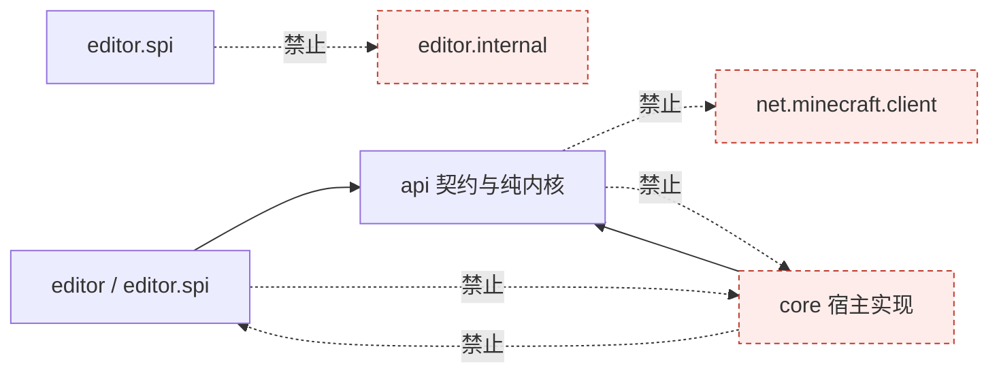

- `api.animation.expression` 只依赖 JDK（以及必要的序列化库），不依赖 `eval` / `edit` / `playback` / `block`。
- 按 Q13，`edit ↔ document` 允许双向引用；这是唯一放宽的同层例外，不放宽 `api → core/editor`。
- `document` 不得反向依赖 `editor`；编辑器只能通过 `EditorSession` / `AnimationDocumentStore` 写入。
- `editor.spi` 可依赖客户端 UI 类型，但不能依赖 `editor.internal`。

---

## 2. 文档模型

### C2 文档聚合类图

`CameraAnimation` 是编辑与播放共用的**深不可变**根对象。集合顺序本身就是创作信息：`rigs` 顺序服务显示，机位内 `channels` 顺序服务序列化，文档级 `tracks` 顺序服务事件分派。按 ID 的查询表由这些集合派生，不另存一份可独立修改的数据。

```mermaid
classDiagram
    direction LR

    class CameraAnimation {
        <<record>>
        +int dataVersion
        +String name
        +List~CameraRig~ rigs
        +CameraSourceTrack cameraSource
        +List~AnimationTrack~ tracks
        +Symbols symbols
        +List~Marker~ markers
        +List~WorldSample~ samples
        +List~AudioRef~ audioRefs
        +List~OverlayElement~ overlays
        +float duration()
        +Optional~CameraRig~ rig(RigId)
        +Optional~AnimationTrack~ track(TrackId)
        +Optional~CurveTrack~ curveTrack(TrackId)
        +List~CameraRig~ enabledRigs()
    }

    class CameraRig {
        <<record>>
        +RigId id
        +String name
        +List~CurveTrack~ channels
        +Path path
        +MotionMode motionMode
        +DistanceMode distanceMode
        +Space space
        +AimTrack aim
        +ObstacleSettings obstacle
        +RigView view
        +float contentDuration()
        +Optional~CurveTrack~ channel(CameraChannel)
    }

    class RigView {
        <<record>>
        +boolean enabled
        +ActiveTrack active
        +Rect rect
        +int zOrder
        +double resolutionScale
        +int updateEveryFrames
        +float layoutDuration()
    }

    class Rect {
        <<sealed>>
        +boolean isStatic()
        +boolean scalesWithWindow()
        +float endTime()
    }

    class RectNormalized["RigView.Rect.Normalized"] {
        <<record>>
        +AnimatedNumber x
        +AnimatedNumber y
        +AnimatedNumber width
        +AnimatedNumber height
    }

    class RectAnchored["RigView.Rect.Anchored"] {
        <<record>>
        +Corner corner
        +AnimatedNumber x
        +AnimatedNumber y
        +AnimatedNumber width
        +AnimatedNumber height
    }

    class Corner["RigView.Rect.Corner"] {
        <<enum>>
        TOP_LEFT
        TOP_RIGHT
        BOTTOM_LEFT
        BOTTOM_RIGHT
    }

    class Path {
        <<record>>
        +String name
        +List~PathNode~ nodes
        +int size()
    }

    class PathNode {
        <<record>>
        +PathNodeId id
        +Vec3 position
        +Vec3 inTangent
        +Vec3 outTangent
        +PathMode mode
        +boolean smooth
    }

    class Symbols {
        <<record>>
        +List~Variable~ variables
        +List~CustomFunction~ functions
        +Optional~Variable~ variable(String)
        +Optional~CustomFunction~ function(String)
    }

    class Marker {
        <<record>>
        +MarkerId id
        +float time
        +String label
        +MarkerKind kind
    }

    class WorldSample {
        <<record>>
        +SampleId id
        +String name
        +Identifier kind
        +SampleArgs args
        +int resampleEveryTicks
    }

    class AudioRef {
        <<record>>
        +AudioRefId id
        +String asset
        +String contentHash
        +float offset
        +float sourceIn
        +float sourceDuration
        +float gain
        +float endTime()
    }

    class OverlayElement {
        <<record>>
        +OverlayId id
        +OverlayKind kind
        +boolean enabled
        +int zOrder
        +float startTime
        +float endTime
        +NumberSource opacity
        +float fadeInDuration
        +float fadeOutDuration
        +Object content
    }

    class CameraSourceTrack {
        <<record>>
        +TrackId id
        +String name
        +CameraSource defaultValue
        +List~ValueKeyframe~ keys
    }

    class CameraSource {
        <<sealed>>
        +Optional~RigId~ rigOptional()
    }

    class CameraSourcePlayer["CameraSource.Player"] {
        <<record>>
    }

    class CameraSourceRig["CameraSource.Rig"] {
        <<record>>
        +RigId rigId
    }

    class AnimationTrack {
        <<sealed>>
        +TrackId id
        +String name
        +Identifier type
        +float duration()
        +int keyCount()
    }

    class CurveTrack {
        <<record>>
        +TrackId id
        +String name
        +CameraChannel channel
        +Curve curve
    }

    class AimTrack {
        <<record>>
        +TrackId id
        +String name
        +AimState defaultValue
        +List~ValueKeyframe~ keys
    }

    class ActiveTrack {
        <<record>>
        +TrackId id
        +String name
        +Boolean defaultValue
        +List~ValueKeyframe~ keys
    }

    class Space {
        <<sealed>>
    }

    class ObstacleSettings {
        <<record>>
        +boolean enabled
        +double margin
    }

    class MotionMode {
        <<enum>>
        PATH
        COORDINATE
    }

    class DistanceMode {
        <<enum>>
        ABSOLUTE
        PERCENT
    }

    class PathMode {
        <<enum>>
        LINEAR
        BEZIER
        CATMULL_ROM
    }

    class MarkerKind {
        <<enum>>
        GENERIC
        BEAT
        SECTION
    }

    class OverlayKind {
        <<enum>>
        LETTERBOX
        SUBTITLE
        IMAGE
    }

    class AnimatedNumber {
        <<sealed>>
    }

    class Curve {
        <<record>>
        +List~Keyframe~ keys
        +Wrap preMode
        +Wrap postMode
    }

    class NumberSource {
        <<sealed>>
    }

    class ValueKeyframe {
        <<record>>
        +KeyId keyId
        +float time
        +T value
    }

    class Vec3 {
        <<record>>
        +double x
        +double y
        +double z
    }

    class CameraChannel {
        <<enum>>
        POSITION_X
        POSITION_Y
        POSITION_Z
        ROTATION_X
        ROTATION_Y
        ROTATION_Z
        FOV
        PATH_DISTANCE
    }

    class SampleArgs {
        <<interface>>
        +Identifier type()
    }

    class AimState {
        <<sealed>>
    }

    class Variable {
        <<record>>
        +String name
        +ValueSource source
    }

    class CustomFunction {
        <<record>>
        +String name
        +List~String~ parameters
        +String body
    }

    CameraAnimation "1" *-- "1..*" CameraRig : rigs
    CameraAnimation "1" *-- "1" CameraSourceTrack : cameraSource
    CameraAnimation "1" *-- "1" Symbols : symbols
    CameraAnimation "1" *-- "0..*" Marker : markers
    CameraAnimation "1" *-- "0..*" WorldSample : samples
    CameraAnimation "1" *-- "0..*" AudioRef : audioRefs
    CameraAnimation "1" *-- "0..*" OverlayElement : overlays
    CameraAnimation "1" *-- "0..*" AnimationTrack : tracks

    CameraRig "1" *-- "0..*" CurveTrack : channels
    CameraRig "1" *-- "1" Path : path
    CameraRig "1" *-- "1" AimTrack : aim
    CameraRig "1" *-- "1" RigView : view
    CameraRig --> MotionMode : motionMode
    CameraRig --> DistanceMode : distanceMode
    CameraRig --> Space : space
    CameraRig --> ObstacleSettings : obstacle

    RigView "1" *-- "1" ActiveTrack : active
    RigView "1" *-- "1" Rect : rect

    Rect <|-- RectNormalized
    Rect <|-- RectAnchored
    RectNormalized "1" o-- "4" AnimatedNumber : x/y/width/height
    RectAnchored "1" o-- "4" AnimatedNumber : x/y/width/height
    RectAnchored --> Corner : corner

    Path "1" *-- "0..*" PathNode : nodes
    PathNode --> Vec3 : position/tangents
    PathNode --> PathMode : mode

    Symbols "1" *-- "0..*" Variable : variables
    Symbols "1" *-- "0..*" CustomFunction : functions

    Marker --> MarkerKind : kind
    WorldSample --> SampleArgs : args
    OverlayElement --> OverlayKind : kind
    OverlayElement --> NumberSource : opacity
    CameraSourceTrack "1" *-- "0..*" ValueKeyframe : keys
    CameraSourceTrack --> CameraSource : default/keys
    CameraSource <|-- CameraSourcePlayer
    CameraSource <|-- CameraSourceRig
    CameraSourceRig --> RigId : rigId

    CurveTrack "1" *-- "1" Curve : curve
    CurveTrack --> CameraChannel : channel
    KeyframeTrack "1" *-- "0..*" ValueKeyframe : keys
    AimTrack --> AimState : default/keys
```

**结构约束**（来自设计 §3.1、§3.1.1、§3.1.2）：

| 约束 | 说明 |
| --- | --- |
| 机位至少一台 | `CameraAnimation` 构造期拒绝空 `rigs`；空文档无法出画面 |
| 名称非空 | 文档、机位、轨道名称均拒绝空白 |
| 状态轨道只存一份 | `aim`、`view.active`、`cameraSource` 是正式轨道，`tracks` 中不再存可独立修改的副本 |
| 顺序即语义 | `rigs` → 显示/同层合成顺序；`channels` → 序列化顺序；`tracks` → 事件分派顺序 |
| 布局两种坐标模式互斥 | `Rect.Normalized` 与 `Rect.Anchored` 是 sealed 分支，构造后不互换 |
| 布局与时长 | `duration()` 取启用机位的姿态/注视/活动/布局曲线、来源、文档轨道、标记、音频/叠加范围的有限最大结束时间；静态布局值不延长动画 |
| 声音不参与求值 | `AudioRef` 是身份与范围边界；P1 不实现音频后端 |
| 叠加暂不可编码 | `overlays` 非空时根 Codec 双向拒绝，避免静默丢弃作者数据 |

### C3 轨道与值源类图

轨道分三类：数值曲线轨道（`CurveTrack`）、有类型状态关键帧轨道（`KeyframeTrack<T>` 的三个分支）、文档级扩展轨道（`AnimationTrack.ExtensionTrack`）。三套身份（类型 `Identifier`、文档对象 ID、用户名称）互不替代。

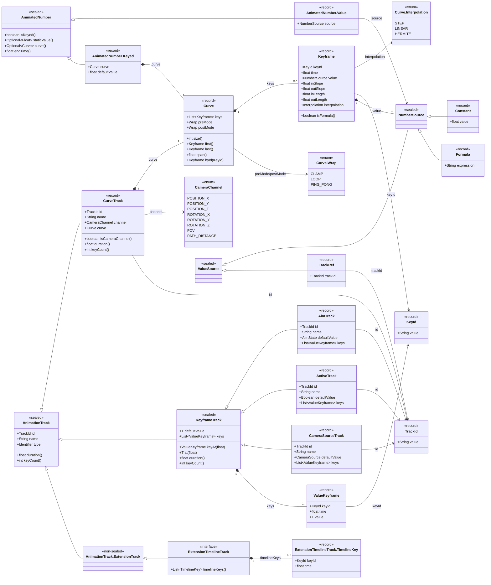

**轨道语义表**：

| 轨道 | 值类型 | 允许插值 | 归属 | 默认/末键行为 |
| --- | --- | --- | --- | --- |
| `CurveTrack` | 数值曲线（`NumberSource` 关键帧） | `STEP` / `LINEAR` / `HERMITE` | 机位 `channels` 或文档级扩展 | 空曲线为空；曲线外按 `Wrap`，布局 `Keyed` 强制 `CLAMP/CLAMP` |
| `AimTrack` | `AimState.Off` / `Target(AimTarget)` | 仅 `STEP` | 每机位 `aim` | 首键前 `Off`；末键后保持 |
| `ActiveTrack` | `Boolean` | 仅 `STEP` | 每机位 `view.active` | 首键前默认值；末键后保持 |
| `CameraSourceTrack` | `CameraSource.Player` / `Rig(RigId)` | 仅 `STEP` | 文档级 `cameraSource` | 默认 `Player`；末键后保持 |
| `ExtensionTimelineTrack` | 由扩展轨道自定义 | 由扩展定义 | 文档级 `tracks` | 派生稳定 `KeyId` 与有限非负、严格递增的时间 |

**关键不变量**：

1. `ValueSource` 是封闭层级：`NumberSource`（`Constant` / `Formula`）与 `TrackRef` 并列；`TrackRef` **不实现** `NumberSource`，因此不能进入关键帧字段。
2. 状态轨道只持久化一次：`rig.aim`、`rig.view.active`、文档 `cameraSource` 是正式轨道；`tracks` 只放扩展轨道。
3. 关键帧时间以秒存储，有限、非负、同轨唯一；输入乱序会整理，但不修改调用方容器；`-0.0` 正规化为 `0.0`。
4. 空曲线/空轨道使用显式默认值；非空曲线外保持端点（布局）；状态轨道不通过浮点编码。
5. `TrackId` 在整份文档内唯一；通道语义键（如 `position.x`）只在机位内唯一，二者不互相替代。

---

## 3. 空间与姿态

### C4 空间、锚点与姿态值类图

空间类型只负责**参考系解释**，姿态结果才是可交给宿主相机的完整值。它们全部是不可变值；世界读取与插值发生在 `AnchorResolver` / `FrameFactsProvider` 侧，不进入文档。

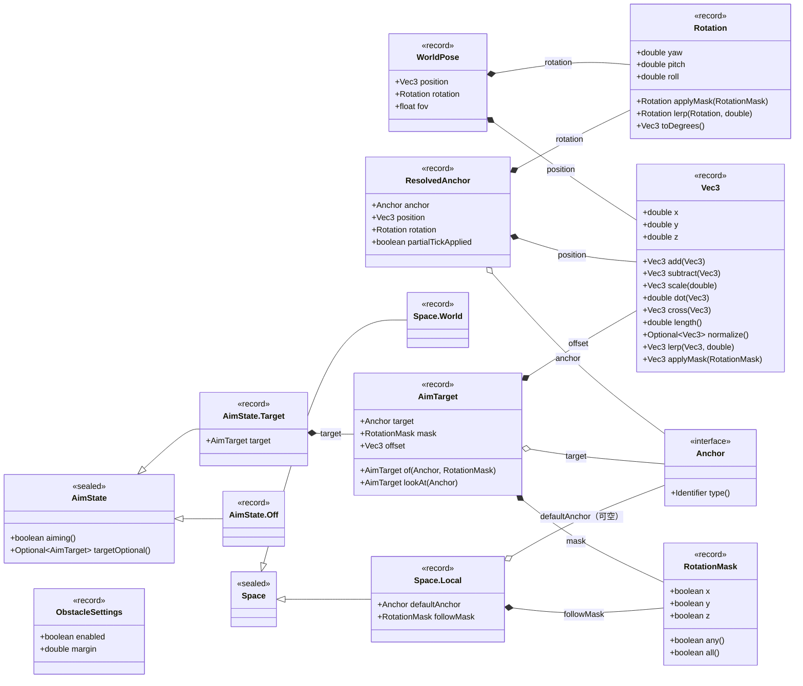

**语义与约束**（设计 §6.2–§6.4）：

| 项 | 规则 |
| --- | --- |
| `MotionMode` × `Space` | 两者正交：`MotionMode` 决定位置来自路径还是坐标通道，`Space` 决定参考系；四种组合都合法 |
| 切换空间 | 只改变解释，**不自动换算**已有坐标；公式坐标不能机械改写 |
| 锚点优先级 | 播放覆盖 → 机位文档默认 → 无；局部空间允许无默认锚点，但开始播放前必须由请求提供有效锚点 |
| 覆盖失败 | 选定的覆盖锚点解析失败后**不得**回退默认锚点；失败就是失败 |
| 旋转单位 | 内部统一弧度，欧拉顺序 YXZ；`WorldPose.fov` 为度、有限且为正 |
| 注视掩码 | `AimTarget.mask` 只支持 Yaw/Pitch；启用 Roll 的注视在 L3 静态拒绝 |
| 偏移 | `AimTarget.offset` 沿世界轴；不是机位局部轴 |
| 插值 | 实体/玩家锚点按 partial tick 插值并标记 `partialTickApplied`；固定锚点不插值 |
| 避障 | 只修正位置，不再次注视；“精确朝向目标”指避障前姿态；不写回文档 |
| 无默认空间 | `Space.Local.defaultAnchor` 可空；不能把“缺锚点”伪装成世界空间 |

`ResolvedAnchor` 是**一帧事实**，不是文档数据；它由客户端解析器产出，`SpatialResolution` 在 C7a 中区分 `NotRequired / Resolved / Failed`。

---

## 4. 编辑、校验与发布

### C5 文档存储、编辑操作与历史类图

发布端口的职责是**原子换版本**，不是“就地修改文档”。所有写入都经过 `EditOp` → 候选 → 统一校验 → 发布序号 → 通知监听者；失败时文档、历史、序号都不变。

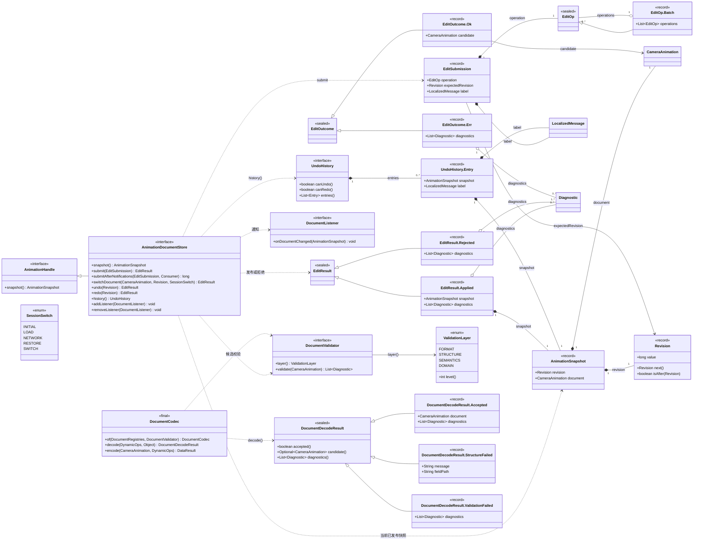

**发布规则**（设计 §3.3、§4.1、§4.5）：

1. `submit` 先比较 `expectedRevision` 与当前快照的 `revision`；不匹配返回 `STALE_REVISION`，不自动覆盖。
2. 纯应用 `EditOp`：`Batch` 一次构造完整候选，不循环提交单对象操作；目标不存在时由提交层明确拒绝，不静默创建。
3. 候选经统一校验（L1→L4）；任一 `ERROR` 整体拒绝，不发布部分结果。
4. 无内容变化不新增历史，也不产生新文档根；是否返回“成功”由提交层决定，但不得把“未变化”当成“目标存在”的证明。
5. 有变化时写入历史（快照 + 不可变标签），清空 redo 栈，`revision.next()` 后原子发布，最后通知监听者。
6. 通知期间同步 `submit` 返回 `REENTRANT_SUBMIT`，不修改文档、不隐式排队；需要后续修改用 `submitAfterNotifications`，通知结束后按提交顺序重查基版本，结果恰好回调一次。
7. `undo` / `redo` 恢复旧内容但**生成新发布序号**，不重跑全时间轴试算；换档（`switchDocument`）清空历史、选择、交互请求与草稿，且序号不重置/不回退。

**`EditOp` 家族**（每个变体一个 record；`Batch` 为复合）：

| 分组 | 变体 |
| --- | --- |
| 文档 | `RenameDocument`、`ReplaceDocument` |
| 机位 | `AddRig`、`RemoveRig`、`ReplaceRig`、`ReorderRigs`、`SetRigName`、`SetRigSpace`、`SetRigMotionMode`、`SetRigDistanceMode`、`SetRigPath`、`SetRigAim`、`SetRigObstacle`、`SetRigView`、`SetRigEnabled`、`SetRigRect`、`SetRigZOrder`、`SetRigQuality` |
| 机位通道 | `AddChannel`、`RemoveChannel`、`ReplaceChannel` |
| 文档轨道 | `AddTrack`、`RemoveTrack`、`ReplaceTrack`、`RenameTrack`、`ReorderTracks`、`SetCameraSource` |
| 关键帧 | `AddNumberKey`、`AddValueKey`、`RemoveKey`、`MoveKeys`、`SetKeyValue`、`SetStateKey`、`SetKeyHandles`、`SetKeyInterpolation`、`ReplaceKeys`、`ReplaceValueKeys`；辅助 record `KeyMove` |
| 符号表 | `AddVariable`、`RemoveVariable`、`ReplaceVariable`、`AddFunction`、`RemoveFunction`、`ReplaceFunction` |
| 路径 | `AddPathNode`、`RemovePathNode`、`ReplacePathNode`、`ReorderPathNodes` |
| 标记/采样/音频/叠加 | `AddMarker`、`RemoveMarker`、`ReplaceMarker`；`AddSample`、`RemoveSample`、`ReplaceSample`；`AddAudioRef`、`RemoveAudioRef`、`ReplaceAudioRef`；`AddOverlay`、`RemoveOverlay`、`ReplaceOverlay`、`ReorderOverlays` |
| 复合 | `Batch` |

**校验层级**（设计 §4.2）：

| 层 | 职责 | 例子 |
| --- | --- | --- |
| L1 格式与语法 | 输入是否可解析 | Codec、公式语法、有限常量 |
| L2 结构与引用 | 唯一性与引用完整性 | 稳定 ID、名称冲突、轨道/机位/样本引用、`cameraSource` 机位存在、键时间顺序 |
| L3 语义 | 跨对象约束 | 依赖环、函数实参个数、样本名字面量绑定、来源机位在全部被选区间活动、模式与通道关系 |
| L4 领域 | 可静态判定的数值约束 | 时间非负、FOV 范围、曲柄约束、布局正尺寸、机位/采样/资源/烘焙规模上限 |

### C5b 编辑工具与试算类图

`EditTools` 只生成 `ToolResult.Ready(EditOp)` 或整体 `Rejected`，不发布、不读当前 store；试算返回 `TrialResult`，用于提交前的有预算检查。两类请求都显式携带冻结快照/上下文/基版本，避免工具算法从“当前状态”偷读输入。

```mermaid
classDiagram
    direction TB

    class EditTools {
        <<interface>>
        +applyEasing(EasingRequest) ToolResult
        +applyBatchTransform(BatchTransformRequest) ToolResult
        +bake(BakeRequest) ToolResult
        +captureAim(AimCaptureRequest) ToolResult
    }

    class EasingRequest {
        <<record>>
        +TrackId trackId
        +List~KeyId~ keyIds
        +EasingPreset preset
        +AnimationSnapshot snapshot
    }

    class EasingPreset {
        <<record>>
        +String id
        +Curve.Interpolation interpolation
        +float inSlope
        +float outSlope
        +float inLength
        +float outLength
    }

    class BatchTransformRequest {
        <<record>>
        +TrackId trackId
        +List~KeyId~ keyIds
        +BatchTransform transform
        +AnimationSnapshot snapshot
    }

    class BatchTransform {
        <<record>>
        +float timeOffsetSeconds
        +float valueScale
        +float valueOffset
        +boolean negateValues
    }

    class BakeRequest {
        <<record>>
        +RigId rigId
        +TrackId trackId
        +float startTime
        +float endTime
        +float stepSeconds
        +Curve.Interpolation interpolation
        +int maxKeys
        +EvaluationContext context
    }

    class AimCaptureRequest {
        <<record>>
        +RigId rigId
        +float time
        +AimCaptureMode mode
        +AimOverride override
        +Revision baseRevision
        +EvaluationContext context
    }

    class AimCaptureMode {
        <<enum>>
        CURRENT
        LEFT_TARGET
    }

    class ToolResult {
        <<sealed>>
    }

    class ToolReady["ToolResult.Ready"] {
        <<record>>
        +EditOp operation
        +List~Diagnostic~ diagnostics
    }

    class ToolRejected["ToolResult.Rejected"] {
        <<record>>
        +List~Diagnostic~ diagnostics
    }

    class TrialRun {
        <<record>>
        +CameraAnimation candidate
        +int maxSamples
        +int maxEvaluations
        +int maxDiagnostics
        +String fixedFactsNote
    }

    class TrialResult {
        <<record>>
        +TrialStatus status
        +TrialReport report
        +List~Diagnostic~ diagnostics
        +boolean hasError()
    }

    class TrialReport["TrialResult.TrialReport"] {
        <<record>>
        +float rangeStart
        +float rangeEnd
        +String samplingStrategy
        +int samplesChecked
        +Long fixedFactsIdentity
        +String fixedFactsNote
        +LocalizedMessage incompleteReason
    }

    class TrialStatus {
        <<enum>>
        PASSED
        FAILED
        INCOMPLETE
    }

    class AnimationSnapshot {
        <<record>>
        +Revision revision
        +CameraAnimation document
    }

    class EvaluationContext {
        <<record>>
        +long contextId
        +AnimationSnapshot snapshot
        +FrameFacts facts
        +TrackLookup tracks
        +TrackIndex trackIndex
    }

    class EditOp {
        <<sealed>>
    }

    class CurveInterpolation["Curve.Interpolation"] {
        <<enum>>
        STEP
        LINEAR
        HERMITE
    }

    class AimOverride {
        <<sealed>>
    }

    class Diagnostic {
        <<record>>
        +DiagnosticCode code
        +Severity severity
        +LocalizedMessage message
        +DiagnosticScope scope
    }

    EditTools ..> EasingRequest
    EditTools ..> BatchTransformRequest
    EditTools ..> BakeRequest
    EditTools ..> AimCaptureRequest
    EditTools ..> ToolResult

    EasingRequest "1" *-- "1" EasingPreset : preset
    EasingRequest --> AnimationSnapshot : snapshot
    EasingRequest --> TrackId : trackId
    EasingRequest --> KeyId : keyIds
    EasingPreset --> CurveInterpolation : interpolation

    BatchTransformRequest "1" *-- "1" BatchTransform : transform
    BatchTransformRequest --> AnimationSnapshot : snapshot
    BatchTransformRequest --> TrackId : trackId
    BatchTransformRequest --> KeyId : keyIds

    BakeRequest "1" *-- "1" EvaluationContext : context
    BakeRequest --> RigId : rigId
    BakeRequest --> TrackId : trackId
    BakeRequest --> CurveInterpolation : interpolation

    AimCaptureRequest "1" *-- "1" EvaluationContext : context
    AimCaptureRequest --> RigId : rigId
    AimCaptureRequest --> AimCaptureMode : mode
    AimCaptureRequest --> AimOverride : override
    AimCaptureRequest --> Revision : baseRevision

    ToolResult <|-- ToolReady
    ToolResult <|-- ToolRejected
    ToolReady "1" *-- "1" EditOp : operation
    ToolReady o-- "0..*" Diagnostic : diagnostics
    ToolRejected "1" o-- "1..*" Diagnostic : diagnostics

    TrialResult --> TrialStatus : status
    TrialResult "1" *-- "1" TrialReport : report
    TrialResult o-- "0..*" Diagnostic : diagnostics
    TrialReport o-- LocalizedMessage : incompleteReason
    TrialRun --> CameraAnimation : candidate
    TrialRun ..> TrialResult : 产生
```

**工具与试算不变量**：

| 规则 | 说明 |
| --- | --- |
| 只出意图 | `ToolResult.Ready` 携带 `EditOp` 与提示诊断，不带快照写入能力；`Rejected` 至少一条诊断 |
| 不发布 | 工具不调用 store、不读当前文档；调用方用同一 `baseRevision` 组装 `EditSubmission` |
| 基版本一致 | `AimCaptureRequest.baseRevision` 必须等于冻结快照的 `Revision`；其它请求的 `snapshot` 就是基版本 |
| 工具差异 | 缓动/批量先算全部目标再统一校验；烘焙全部采样成功才原子替换；注视捕获先求关闭前姿态，固定 `Replace(Target)` 覆盖必须先清除 |
| 试算不是证明 | `TrialResult.PASSED` 只表示已检查点未发现错误；`FAILED` 必有 ERROR，`PASSED/INCOMPLETE` 不得含 ERROR，`INCOMPLETE` 必有原因 |
| 事实身份 | `TrialReport.fixedFactsIdentity` / `fixedFactsNote` 说明实际使用的固定事实；不能把有限试算写成全域保证 |
| 不触发副作用 | 试算不执行 Tick 轨道、不写文档、不发布；非确定公式报 `Incomplete`，不以一次随机结果拒绝 |

### C6 诊断与本地化消息类图

诊断是**不可变、带作用域**的值：文档作用域必须绑定发布版本；文件作用域只描述资源与字段，不提供对象跳转或修复。消息树同样不可变，显示时才由无状态渲染器生成 `Component`。

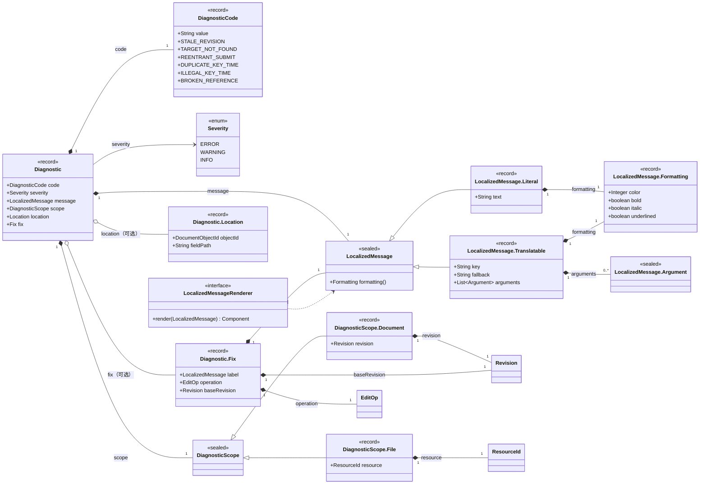

**诊断边界**（设计 §3.2、§4.1、§8.2）：

| 规则 | 含义 |
| --- | --- |
| 文档作用域必须有 `Revision` | `DiagnosticScope.Document(Revision)` 不允许空版本；对象/字段定位与 `Fix` 只在此作用域可用 |
| 文件作用域禁止 `Fix` 与对象 ID | `DiagnosticScope.File(ResourceId)` 只描述资源与字段路径；不把运行期错误伪装成解码错误 |
| `Fix` 版本必须匹配 | `fix.baseRevision()` 必须等于 `Document` 作用域的 `revision`；异步定位/修复必须重新检查适用版本 |
| 消息树不可变 | `Literal` / `Translatable` 加受限 `Formatting`；参数只允许文本、有限数字、布尔与嵌套消息 |
| 显示无状态 | `LocalizedMessageRenderer` 每次生成独立 `Component`，不先转纯文本、不把结果写回契约 |

`DiagnosticCode` 的公开常量只是 P1 已固定的稳定码；后续实现可增加领域码，但不得改变已有语义。

---

## 5. 求值与表达式

### C7a 帧事实与逐机位计划

`FrameFacts` 是一帧的**冻结事实**：维度/世界实例、游戏刻与 partial tick、逐机位生效锚点/目标/注视、采样表与有效性。它不进入文档，也不能跨世界实例复用。

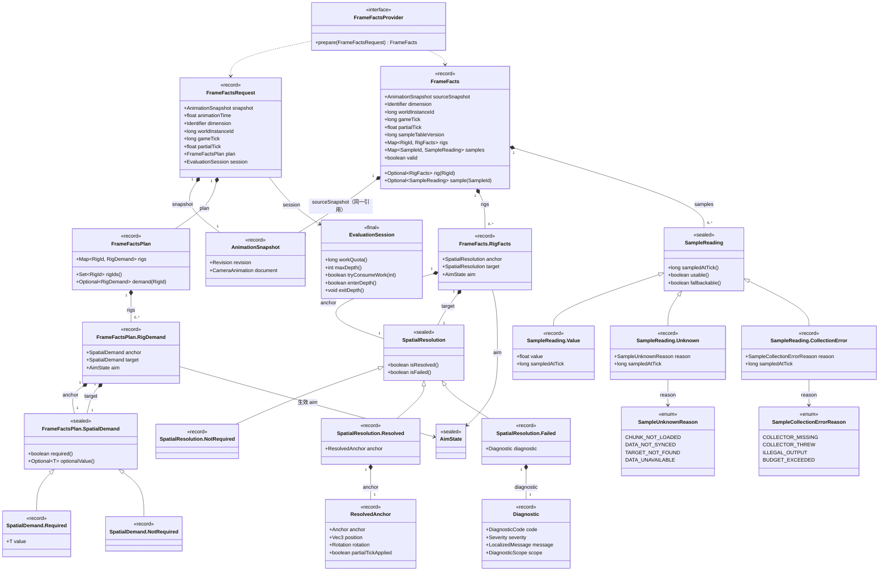

**事实与计划规则**：

| 规则 | 说明 |
| --- | --- |
| 一次捕获 | `FrameFacts.sourceSnapshot` 必须保留请求快照的**同一引用**；同 revision/同内容的异源快照不能冒充同源 |
| 只准备实际依赖 | `FrameFactsPlan` 逐机位给出覆盖后的生效锚点、`AimState` 与 `anchor/target` 的 `Required/NotRequired`；provider 不重读默认配置 |
| 目标必须匹配 | 若 plan 要求解析目标，该目标必须等于本帧生效 `AimState` 的 Target；解析一个不会被使用的目标只会在失败时误伤整场 |
| 世界实例身份 | `worldInstanceId` 独立分配；同一维度重进世界也变化，不能由维度/游戏刻/revision 推导 |
| 错误不压成缺失 | `SpatialResolution` 三态区分 `NotRequired / Resolved / Failed`；`Failed` 阻止依赖它的通道与姿态 |
| 采样三态 | `VALUE / UNKNOWN / COLLECTION_ERROR`；只有 `UNKNOWN` 可被作者显式默认值兜底，采集错误不可兜底 |
| 采样时间 | `sampledAtTick` 使用 long 游戏刻；表版本只在读数、有效性或采样时间元数据改变时变化 |

### C7b 求值上下文与采样结果

`EvaluationContext` 把快照、事实、轨道查找与索引绑定成一次求值的同源输入；`CurveSampleRequest` 显式携带上下文、轨道、可空机位与采样时间，不依赖“当前编辑机位”。

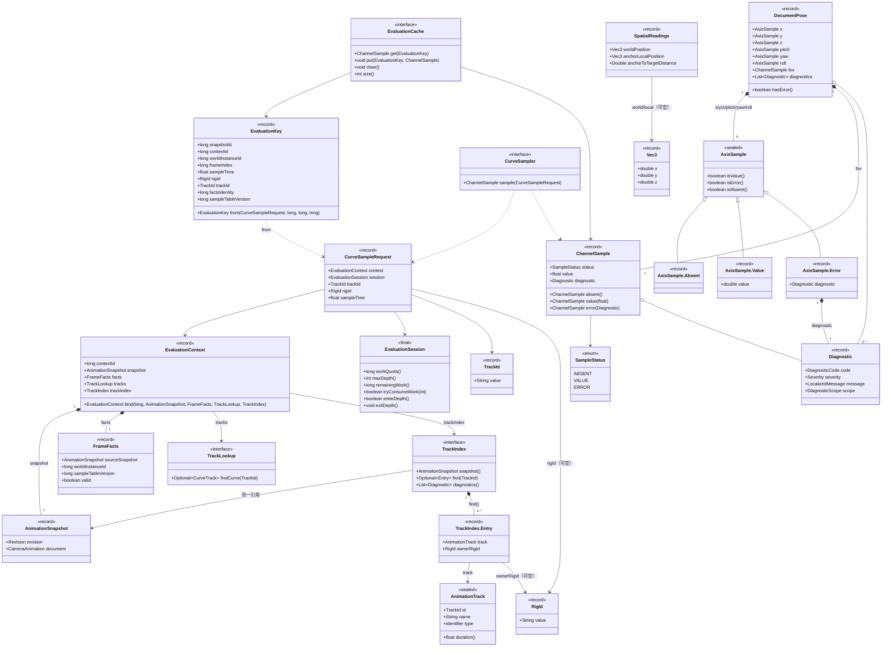

**求值身份与采样规则**：

| 规则 | 说明 |
| --- | --- |
| 同源用引用身份 | `EvaluationContext` 拒绝 `facts.sourceSnapshot != snapshot`，也拒绝 `trackIndex.snapshot() != snapshot`；同 revision/同内容不算同源 |
| `EvaluationKey` 组成 | 快照、上下文、世界实例、帧、`sampleTime`、可空 `RigId`、`TrackId`、事实身份、采样表版本；`sampleTime` 有限非负并正规化 `-0.0` |
| 缓存边界 | 确定性结果/领域失败可按身份缓存；工作量/深度资源失败及其失败树不得进入会话无关缓存；缓存命中不消耗额度 |
| 采样入口 | `CurveSampler.sample(CurveSampleRequest)` 显式携带上下文、轨道、可空机位和有限非负时间；不依赖当前编辑机位或采样器隐式环境 |
| 姿态三态 | 六轴 `AxisSample`；掩码只由 `VALUE` 轴派生；`hasError` 检查六轴、FOV 与汇总诊断；任一实际依赖错误阻止合成 |
| 空间读数 | `SpatialReadings` 区分世界坐标、机位锚点局部坐标与锚点到目标距离；只读外部事实，不反读待求值相机 |

---

### C8 表达式编译与求值类图

`expression` 包保持独立：只负责源码 → 不透明句柄 + 轻量引用/诊断，不公开语法树，不依赖 `eval`/`block`/`edit`/`playback`。`eval` 侧的 `ExpressionEvaluator` 才持有快照、事实、机位上下文与采样器。

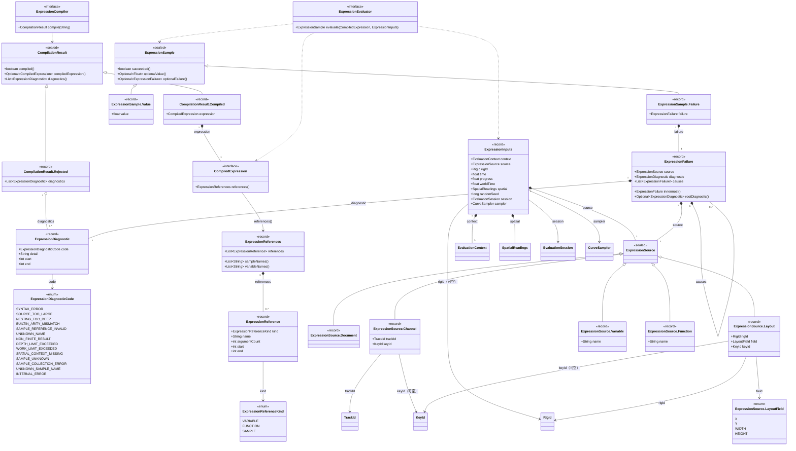

**表达式语义**（设计 §4.2、§6.1；P1 只交付接口）：

1. **编译纯函数**：只读源码，不访问世界、不读文档、不产生副作用；编译失败不产生句柄。
2. **作用域检查不在编译期**：变量/自定义函数是否存在、实参个数是否匹配符号表、样本名是否绑定到采样声明，由 L3 统一校验使用 `CompiledExpression.references()` 完成。
3. **内建认识**：`t`、`p`、`wt`；`step`、惰性 `select(cond,a,b)`、`noise(seed,t)`、`random()` 与常用数学函数。`select` 只求值选中分支，但静态仍检查两分支引用。
4. **样本语义**：`sample(name)` 遇 `UNKNOWN` 返回 `SAMPLE_UNKNOWN` 失败；`sample(name,fallback)` **仅在 UNKNOWN 时**惰性求值 fallback；`COLLECTION_ERROR` 不可兜底；未知样本名返回 `UNKNOWN_SAMPLE_NAME`。
5. **失败链**：任何失败返回 `ExpressionSample.Failure`，携带源码身份、本层区间与嵌套原因链；不返回 `NaN`/`Infinity`，不静默替换数值。
6. **缓存**：编译按源码文本有界缓存；求值缓存身份必须包含上下文、机位、事实版本、入口源码位置与有效 `AimState`，不能只比较表达式文本；命中取回的失败按当前 `ExpressionSource` 重新包装。
7. **非确定**：`random()` 明确非确定，预览与多次播放不保证一致；试算遇到非确定公式应报 `Incomplete`，不能以一次随机结果作为拒绝依据。

---

## 6. 播放、合成与事件

### C9 播放、帧准备与合成类图

播放内核只负责时间、状态、文档空间求值与事件区间准备；宿主负责世界事实、锚点解析、参考系合成、相机应用和事件执行。`PreparedFrame` 是两阶段之间**唯一**的数据交接面：执行/合成不得重新读取 store。

```mermaid
classDiagram
    direction LR

    class PlaybackService {
        <<interface>>
        +PlaybackState state()
        +PlaybackFailure failure()
        +StartResult start(PlaybackRequest, Revision)
        +void pause()
        +void resume()
        +void seek(float)
        +void stopAndReset()
        +void halt(PlaybackFailure)
        +PreparedFrame prepareFrame(long, float, EventBudget)
    }

    class StartResult["PlaybackService.StartResult"] {
        <<record>>
        +boolean accepted
        +PlaybackFailure failure
    }

    class PlaybackState {
        <<enum>>
        IDLE
        PLAYING
        PAUSED
        HALTED
    }

    class PlaybackFailure {
        <<record>>
        +Reason reason
        +LocalizedMessage message
        +float failureTime
        +List~Diagnostic~ diagnostics
    }

    class FailureReason["PlaybackFailure.Reason"] {
        <<enum>>
        ANCHOR_UNAVAILABLE
        AIM_UNAVAILABLE
        EVALUATION_ERROR
        INVALID_LAYOUT
        INVALID_CAMERA_SOURCE
        EVENT_BUDGET_EXCEEDED
        SAMPLE_UNKNOWN
        RENDER_FAILURE
        HOST_CAPABILITY_MISSING
    }

    class PlaybackRequest {
        <<record>>
        +CameraAnimation animation
        +Map~RigId, RigPlaybackOverrides~ rigOverrides
        +float speed
        +boolean loop
        +float startTime
    }

    class PlaybackClock {
        <<record>>
        +float time
        +float speed
        +boolean loop
        +float duration
        +boolean isFinished()
    }

    class PreparedFrame {
        <<record>>
        +PlaybackClock clock
        +AnimationSnapshot snapshot
        +CameraSource source
        +List~RigPose~ rigs
        +List~Event~ events
        +FrameFacts facts
        +List~Diagnostic~ diagnostics
        +boolean isExecutable()
    }

    class PreparedEvent["PreparedFrame.Event"] {
        <<record>>
        +TrackId trackId
        +float time
    }

    class RigPose {
        <<record>>
        +RigId rigId
        +WorldPose pose
        +ResolvedRect rect
        +int zOrder
        +double resolutionScale
        +int updateEveryFrames
    }

    class ResolvedRect {
        <<sealed>>
        +boolean scalesWithWindow()
        +boolean normalized()
    }

    class RRNormalized["ResolvedRect.Normalized"] {
        <<record>>
        +double x
        +double y
        +double width
        +double height
    }

    class RRAnchored["ResolvedRect.Anchored"] {
        <<record>>
        +RigView.Rect.Corner corner
        +double x
        +double y
        +double width
        +double height
    }

    class EventBudget {
        <<record>>
        +int maxEvents
        +int maxIntervals
    }

    class EventDispatcher {
        <<interface>>
        +Result dispatch(PreparedFrame, EventBudget)
    }

    class DispatchResult["EventDispatcher.Result"] {
        <<record>>
        +int dispatched
        +PlaybackFailure failure
        +boolean succeeded()
    }

    class EventExecutor {
        <<interface>>
        +DispatchResult execute(PreparedFrame, List~PreparedFrame.Event~)
    }

    class EventExecutorRegistry {
        <<record>>
        +List~Entry~ entries
        +Optional~EventExecutor~ find(Identifier)
    }

    class ExecutorEntry["EventExecutorRegistry.Entry"] {
        <<record>>
        +Identifier trackType
        +EventExecutor executor
    }

    class CameraCompositionService {
        <<interface>>
        +CompositionResult compose(PreparedFrame, CompositionRequest)
    }

    class CompositionRequest {
        <<record>>
        +int width
        +int height
        +boolean includePlayerBase
    }

    class CompositionResult {
        <<record>>
        +boolean presented
        +List~RigRenderStatus~ statuses
        +PlaybackFailure failure
    }

    class RigRenderStatus {
        <<record>>
        +RigId rigId
        +boolean rendered
        +int width
        +int height
        +DegradeReason degradeReason
        +SampleIdentity sampledFrame
        +RigQualityStatus quality
    }

    class SampleIdentity["RigRenderStatus.SampleIdentity"] {
        <<record>>
        +long renderFrameIndex
        +float animationTime
        +long gameTick
        +long worldInstanceId
        +long snapshotId
        +long activityGeneration
        +long sourceGeneration
    }

    class RigQualityStatus {
        <<record>>
        +OutputPixelRect fullRect
        +OutputPixelRect visibleRect
        +int requestedWidth
        +int requestedHeight
        +int actualWidth
        +int actualHeight
        +double density
        +boolean clippedDownsample
        +boolean offscreen()
    }

    class OutputPixelRect {
        <<record>>
        +int x
        +int y
        +int width
        +int height
        +long area()
        +Optional~OutputPixelRect~ intersection(OutputPixelRect)
        +boolean contains(OutputPixelRect)
    }

    class DegradeReason {
        <<enum>>
        RESOLUTION_REDUCED
        FRAME_SKIPPED
        RIG_PAUSED
        SINGLE_RIG_FALLBACK
        CANVAS_OFFSCREEN
    }

    class CameraControlClaims {
        <<interface>>
        +Claim register(int, LocalizedMessage, PoseProvider)
        +void release(Claim)
        +Optional~Claim~ winner()
        +Optional~ClaimedPose~ winningPose()
    }

    class Claim["CameraControlClaims.Claim"] {
        <<record>>
        +long id
        +int priority
        +LocalizedMessage owner
    }

    class ClaimedPose["CameraControlClaims.ClaimedPose"] {
        <<record>>
        +Claim claim
        +WorldPose pose
    }

    class PoseProvider["CameraControlClaims.PoseProvider"] {
        <<interface>>
        +WorldPose pose()
    }

    class CameraProbe {
        <<interface>>
        +WorldPose basePose()
    }

    class AimOverride {
        <<sealed>>
        +boolean inherits()
        +boolean disables()
        +Optional~AimTarget~ fixedTarget()
    }

    class AimInherit["AimOverride.Inherit"] {
        <<record>>
    }

    class AimDisabled["AimOverride.Disabled"] {
        <<record>>
    }

    class AimReplace["AimOverride.Replace"] {
        <<record>>
        +AimTarget target
    }

    class RigPlaybackOverrides {
        <<record>>
        +Anchor anchor
        +RotationMask followMask
        +AimOverride aim
        +ObstacleSettings obstacle
    }

    PlaybackService --> PlaybackState : state()
    PlaybackService --> PlaybackFailure : failure()
    PlaybackService ..> PlaybackRequest : start
    PlaybackService ..> StartResult : 启动结果
    PlaybackService ..> PreparedFrame : prepareFrame
    PlaybackService --> CameraControlClaims : 接管/释放
    PlaybackService --> EventDispatcher : 事件分发

    PlaybackFailure "1" *-- "1" FailureReason : reason
    PlaybackFailure "1" *-- "1" LocalizedMessage : message
    PlaybackFailure "1" *-- "0..*" Diagnostic : diagnostics

    PreparedFrame "1" *-- "1" PlaybackClock : clock
    PreparedFrame "1" *-- "1" AnimationSnapshot : snapshot
    PreparedFrame "1" *-- "1" CameraSource : source
    PreparedFrame "1" *-- "0..*" RigPose : rigs（活动机位顺序）
    PreparedFrame "1" *-- "0..*" PreparedEvent : events
    PreparedFrame "1" *-- "1" FrameFacts : facts
    PreparedFrame o-- "0..*" Diagnostic : diagnostics

    RigPose "1" *-- "1" WorldPose : pose
    RigPose "1" *-- "1" ResolvedRect : rect
    ResolvedRect <|-- RRNormalized
    ResolvedRect <|-- RRAnchored

    EventDispatcher ..> PreparedFrame
    EventDispatcher ..> EventBudget
    EventDispatcher ..> DispatchResult
    EventDispatcher --> EventExecutorRegistry : 按轨道类型查找
    EventExecutorRegistry "1" *-- "0..*" ExecutorEntry : entries
    ExecutorEntry --> EventExecutor : executor

    CameraCompositionService ..> PreparedFrame
    CameraCompositionService ..> CompositionRequest
    CameraCompositionService ..> CompositionResult
    CompositionResult "1" *-- "0..*" RigRenderStatus : statuses
    CompositionResult o-- PlaybackFailure : failure
    RigRenderStatus o-- SampleIdentity : sampledFrame
    RigRenderStatus o-- RigQualityStatus : quality
    RigRenderStatus --> DegradeReason : degradeReason
    RigQualityStatus "1" *-- "1" OutputPixelRect : fullRect
    RigQualityStatus o-- OutputPixelRect : visibleRect

    CameraControlClaims "1" *-- "0..*" Claim : 登记
    CameraControlClaims ..> ClaimedPose
    ClaimedPose "1" *-- "1" Claim : claim
    ClaimedPose "1" *-- "1" WorldPose : pose
    CameraControlClaims ..> PoseProvider

    AimOverride <|-- AimInherit
    AimOverride <|-- AimDisabled
    AimOverride <|-- AimReplace
    AimReplace "1" *-- "1" AimTarget : target
    RigPlaybackOverrides o-- Anchor : anchor
    RigPlaybackOverrides o-- RotationMask : followMask
    RigPlaybackOverrides "1" *-- "1" AimOverride : aim
    RigPlaybackOverrides o-- ObstacleSettings : obstacle
    PlaybackRequest "1" *-- "1" CameraAnimation : animation
    PlaybackRequest *-- "0..*" RigPlaybackOverrides : rigOverrides
```

**播放不变量**（设计 §7.1–§7.6）：

| 规则 | 说明 |
| --- | --- |
| 启动原子性 | `start` 先校验请求与 `expectedRevision` 并准备初始条件；全部成功后才换档、递增序号、切到 `PLAYING`。失败时原文档、序号、播放状态与相机控制不变 |
| 线程约束 | `PlaybackService`、`CameraControlClaims` 的登记/释放/捕获与 `PoseProvider` 均限宿主主线程；非法线程拒绝，不静默排队 |
| 两阶段 | 准备阶段纯求值并冻结快照/事实/姿态/矩形/质量请求/事件；执行阶段不重读 store。任一路实际依赖失败整帧不执行 |
| 相机来源 | `Player` 保留玩家相机；`Rig` 使用该活动机位最终姿态。来源失活是准备错误，不自动交还玩家或换机位 |
| 编辑器接管优先 | 存在获胜 `CameraControlClaims` 时应用其 `ClaimedPose`；否则按正式播放状态与 `cameraSource.at(t)`。每帧 `winningPose` 至多捕获一次 |
| 降级不改文档 | `RigRenderStatus` / `RigQualityStatus` / `DegradeReason` 只描述宿主运行状态；不改写 `cameraSource`、`view.enabled`、活动轨道或矩形曲线 |
| 采样身份 | 呈现画面（含复用）必须带 `SampleIdentity`；`FRAME_SKIPPED` 呈现复用帧，`RIG_PAUSED` 不呈现；身份不符立即失效 |
| 事件顺序 | 先按推进区间/周期，再按区间内时间，再按同刻文档轨道序；执行器只接收原序连续同类型片段或单事件，不跨类型/周期聚合重排 |
| 事件预算 | `prepareFrame` 在区间展开/事件生成时消费 `EventBudget`，超限立即停止准备，不能先完整展开再限流 |
| 失败与停止 | `stopAndReset` 重置播放头；`halt(failure)` 保留失败时刻与原因；失败不执行本帧事件，不承诺回滚宿主副作用 |

**多机位合成顺序**：按 `zOrder` 升序，同层按文档机位顺序；来源 `Player` 时保留正常玩家底图，`includePlayerBase` 必须为真；声音监听器每帧只更新一次，跟随实际来源；成片叠加在机位画面之后、HUD 之前。

---

## 7. 编辑器会话

### C10 编辑器会话、草稿与交互类图

`EditorSession` 是 UI 与文档/播放之间的**唯一会话面**。面板只读快照、维护字段草稿、发出提交意图；会话把事务组装为 `EditSubmission`，并把预览候选与正式发布分开。

```mermaid
classDiagram
    direction LR

    class EditorSession {
        <<interface>>
        +snapshot() AnimationSnapshot
        +submit(EditSubmission) EditResult
        +beginEdit(EditTarget, LocalizedMessage) EditTransaction
        +draft(EditTransaction) EditDraftState
        +updateDraftText(EditTransaction, String, String) void
        +updateDraftOperation(EditTransaction, EditOp) void
        +preview() PreviewState
        +commit(EditTransaction) EditResult
        +cancel(EditTransaction) void
        +undo() EditResult
        +redo() EditResult
        +playbackState() PlaybackState
        +playbackClock() PlaybackClock
        +seek(float) void
        +play() void
        +pause() void
        +viewState() SessionViewState
        +updateViewState(SessionViewState) void
        +interactions() List
        +choose(InteractionId, String) void
        +cancelInteraction(InteractionId) void
        +close() void
    }

    class EditorUiHost {
        <<interface>>
        +open(EditorSession, EditorBackendSelector) void
        +openDefault(EditorSession) void
    }

    class EditorUiBackend {
        <<interface>>
        +Identifier id()
        +int priority()
        +boolean canOpen(EditorSession)
        +void open(EditorSession)
    }

    class EditorBackendSelector {
        <<record>>
        +Identifier backendId
        +boolean isAuto()
    }

    class EditTransaction {
        <<record>>
        +long transactionId
        +Revision baseRevision
        +EditTarget target
        +LocalizedMessage label
    }

    class EditDraftState {
        <<record>>
        +EditTransaction transaction
        +Map~String, String~ fieldTexts
        +EditOp candidate
        +List~Diagnostic~ diagnostics
        +boolean hasCandidate()
    }

    class PreviewState {
        <<record>>
        +CameraAnimation candidate
        +List~Diagnostic~ diagnostics
        +boolean stale
        +boolean hasCandidate()
    }

    class EditTarget {
        <<sealed>>
    }

    class TargetDocument["EditTarget.Document"] {
        <<record>>
    }

    class TargetRig["EditTarget.Rig"] {
        <<record>>
        +RigId rigId
    }

    class TargetTrack["EditTarget.Track"] {
        <<record>>
        +TrackId trackId
    }

    class TargetKey["EditTarget.Key"] {
        <<record>>
        +TrackId trackId
        +KeyId keyId
    }

    class TargetField["EditTarget.Field"] {
        <<record>>
        +EditTarget owner
        +String fieldPath
    }

    class InteractionRequest {
        <<record>>
        +InteractionId id
        +LocalizedMessage message
        +List~InteractionOption~ options
    }

    class InteractionId {
        <<record>>
        +long value
    }

    class InteractionOption {
        <<record>>
        +String id
        +LocalizedMessage label
        +boolean destructive
    }

    class SessionViewState {
        <<record>>
        +float playhead
        +Selection selection
        +TimelineView timeline
        +SnappingSettings snapping
        +PreviewRange previewRange
        +TrackVisibility trackVisibility
        +EditorToolState tool
        +RigId activeRigId
        +Map~RigId, RigPlaybackOverrides~ rigOverrides
        +Optional~RigPlaybackOverrides~ previewOverrides(RigId)
    }

    class Selection {
        <<record>>
        +List~RigId~ rigs
        +List~TrackId~ tracks
        +List~KeySelection~ keys
        +List~MarkerId~ markers
        +boolean isEmpty()
    }

    class KeySelection {
        <<record>>
        +TrackId trackId
        +KeyId keyId
    }

    class TimelineView {
        <<record>>
        +float pixelsPerSecond
        +float scrollSeconds
    }

    class SnappingSettings {
        <<record>>
        +boolean enabled
        +float pixelTolerance
        +List~SnapSource~ sources
    }

    class SnapSource {
        <<enum>>
        TIME_GRID
        KEYFRAMES
        MARKERS
        PLAYHEAD
        AUDIO_BOUNDS
        PREVIEW_BOUNDS
    }

    class PreviewRange {
        <<record>>
        +float in
        +float out
    }

    class TrackVisibility {
        <<record>>
        +Set~TrackId~ hidden
        +Set~TrackId~ solo
        +boolean isVisible(TrackId)
    }

    class EditorToolState {
        <<enum>>
        SELECT
        MOVE
        ROTATE
        SCALE
        LAYOUT
        PATH
    }

    EditorSession ..> AnimationSnapshot : 读取
    EditorSession ..> EditSubmission : 提交
    EditorSession ..> EditResult : 结果
    EditorSession ..> EditTransaction : beginEdit/draft/commit/cancel
    EditorSession ..> PreviewState : preview()
    EditorSession ..> SessionViewState : viewState()
    EditorSession ..> InteractionRequest : interactions()
    EditorSession --> PlaybackState
    EditorSession --> PlaybackClock
    EditorSession --> EditorUiHost : 由宿主打开

    EditorUiHost ..> EditorSession
    EditorUiHost ..> EditorBackendSelector
    EditorUiHost ..> EditorUiBackend
    EditorUiBackend ..> EditorSession

    EditTransaction "1" *-- "1" EditTarget : target
    EditTransaction "1" *-- "1" Revision : baseRevision
    EditTransaction "1" *-- "1" LocalizedMessage : label

    EditDraftState "1" *-- "1" EditTransaction : transaction
    EditDraftState --> EditOp : candidate（可空）
    EditDraftState o-- "0..*" Diagnostic : diagnostics

    PreviewState o-- CameraAnimation : candidate（可空）
    PreviewState o-- "0..*" Diagnostic : diagnostics

    EditTarget <|-- TargetDocument
    EditTarget <|-- TargetRig
    EditTarget <|-- TargetTrack
    EditTarget <|-- TargetKey
    EditTarget <|-- TargetField
    TargetRig --> RigId : rigId
    TargetTrack --> TrackId : trackId
    TargetKey --> TrackId : trackId
    TargetKey --> KeyId : keyId
    TargetField --> EditTarget : owner

    InteractionRequest "1" *-- "1" InteractionId : id
    InteractionRequest "1" *-- "1" LocalizedMessage : message
    InteractionRequest "1" *-- "1..*" InteractionOption : options
    InteractionOption "1" *-- "1" LocalizedMessage : label

    SessionViewState "1" *-- "1" Selection : selection
    SessionViewState "1" *-- "1" TimelineView : timeline
    SessionViewState "1" *-- "1" SnappingSettings : snapping
    SessionViewState o-- PreviewRange : previewRange（可空）
    SessionViewState "1" *-- "1" TrackVisibility : trackVisibility
    SessionViewState --> EditorToolState : tool
    SessionViewState --> RigId : activeRigId（可空）
    SessionViewState ..> RigPlaybackOverrides : rigOverrides
    Selection "1" *-- "0..*" KeySelection : keys
    SnappingSettings "1" *-- "0..*" SnapSource : sources
```

**状态归属**（设计 §5.1、§6.1、§9.1）：

> 为控制图宽，C10 只展开 `Document / Rig / Track / Key / Field` 五个 `EditTarget` 变体；其余 `Marker / Sample / Audio / Overlay / Variable / Function / PathNode` 同样实现 `EditTarget`，各自携带对应的稳定 ID 或名称。

| 状态 | 归属 | 是否进文档/历史 |
| --- | --- | --- |
| 已发布值、选择、预览候选 | 会话 | 已发布值经 store；选择/预览候选不进文档 |
| 输入文本、基版本、字段诊断、复合草稿 | 会话编辑事务 | 不进文档；非法文本保留 |
| 光标、选区、输入框滚动 | 会话附属 UI 状态 | 不进文档 |
| 播放头、轨道显隐/solo、吸附、预览区间、工具、`activeRigId`、按 `RigId` 的预览覆盖 | `SessionViewState` | 不进文档/撤销 |
| 面板位置、可见性、滚动、展开 | 工作区视图状态 | 写客户端配置，不写动画文档 |

**编辑事务规则**：

1. `beginEdit` 固定 `baseRevision`、目标与标签；输入草稿允许暂时非法，但非法文本不进入候选。
2. 可解析时生成独立预览候选，与正式播放使用同一采样/姿态/合成规则；拖动只做轻量检查与当前帧求值，不逐次跑完整试算。
3. 提交时会话把操作、`baseRevision`、标签组装为 `EditSubmission`；成功后仅产生一个撤销项。
4. 外部版本变化时事务标记过期，禁止自动覆盖；取消丢弃候选，恢复已发布快照。
5. 面板重建、活动机位切换、后端切换不得丢失草稿；但“按稳定目标保存草稿”不等于允许过期基版本提交。

**交互请求**：`InteractionRequest` 选项非空、ID 唯一、列表防御复制；会话提供 `choose(requestId, optionId)` 与取消入口。过期请求、已关闭请求和无效选项必须拒绝，不能执行旧回调。

**后端选择**（设计 §9.3）：

| `editor.backend` | 行为 |
| --- | --- |
| `auto`（`EditorBackendSelector.auto()`） | 按优先级依次询问；同优先级按 ID 稳定排序；内置最低 |
| 指定已注册且接管的 ID | 使用指定后端 |
| 指定已注册但拒绝接管的 ID | 提示失败，不自动切换，不关闭会话 |
| 指定未注册 ID | 警告并打开内置实现 |

`EditorUiHost.openDefault(session)` 保留给第三方包装后转发；拒绝接管的 后端不得关闭会话或遗留相机接管令牌。

---

## 8. 存储、恢复与网络

### C11 资源、恢复与播放协议类图

存储层只负责资源定位、字节/Ops 转换、调用 Codec 与报告错误；它不解释文档子对象字段。恢复槽是**独立文件**，不覆盖正式文件，也不保存渲染缓存或撤销栈。

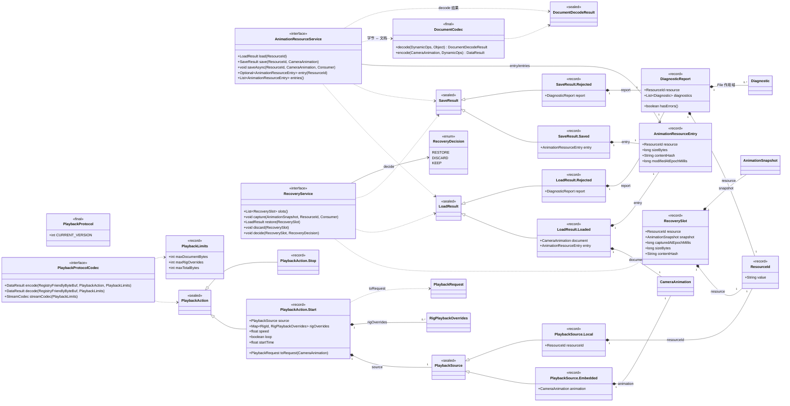

**存储与协议规则**（设计 §8.2–§8.4）：

| 规则 | 说明 |
| --- | --- |
| `ResourceId` 只是身份 | 非空白检查不等于路径安全；资源根、相对路径映射与越界拒绝由实现负责 |
| 诊断作用域 | 文件诊断只能是 `DiagnosticScope.File(ResourceId)`，不带对象 ID 或 `Fix`；对象定位只用于已接受文档 |
| 载入 | 先结构解码，再统一文档校验；结构失败无候选、不调用 validator；任一 `ERROR` 拒绝发布 |
| 保存 | 编码成功才写临时文件并原子替换；失败清理临时文件，不留下半份文件 |
| 恢复槽 | 独立资源、独立文件；不覆盖正式文件，不保存渲染缓存或撤销栈；恢复经正常 Codec + 校验 + `switchDocument(..., RESTORE)` |
| 网络来源 | `Embedded` 转本地请求必须沿用同一文档实例；`Local` 由接收端资源服务解析；解析失败不发布 |
| 协议上限 | `PlaybackLimits` 在遍历/分配前或过程中检查；未知类型、未知版本、超限都转成可报告失败 |
| 编码成功值 | `PlaybackProtocolCodec.encode` 成功返回非空 `Unit.INSTANCE`；适配失败转 `EncoderException` / `DecoderException` |
| 音频/叠加 | `AudioRef` 只是身份边界；`AudioRef`/`OverlayElement` 的非空编码在 O1–O3 前拒绝，不静默丢弃 |

---

## 9. 开放类型与客户端能力

### C12 注册表、解析器与能力服务类图

类型系统分两层：**common 类型描述**（ID + Codec + 可选 `TypeValidator`）与**客户端执行部件**（锚点解析器、采样采集器、事件执行器）。同一个类型可以“已注册但本机缺执行部件”，这是运行能力缺失，不是文档结构非法。

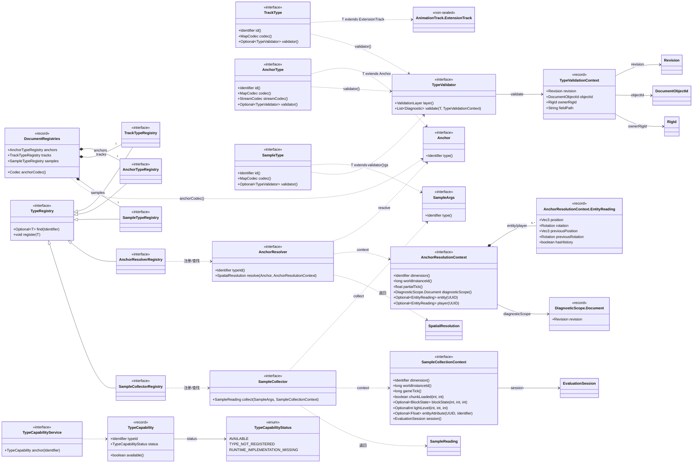

**类型与能力规则**（设计 §2.2、§3.4、§7.7；P1 决定 O + B）：

| 规则 | 说明 |
| --- | --- |
| 注册后冻结 | 类型注册在启动后冻结；重复 ID、冻结后注册、未知类型解码均拒绝。P1 `TypeRegistry` 未暴露 `freeze()`，冻结由实现负责 |
| 轨道类型上界 | `TrackType<T extends AnimationTrack.ExtensionTrack>`；内建 `curve/aim/active/camera_source` 不能注册成扩展类型 |
| 锚点双 Codec | `AnchorType` 同时提供存档 `MapCodec` 与网络 `StreamCodec`；客户端解析器单独注册 |
| 采样无网络 Codec | `SampleType` 只提供 `MapCodec`；本轮不下发服务端采样表，`SampleCollector` 只在客户端注册 |
| 类型校验只处理单实例 | `TypeValidator` 只报告已解码单实例自身约束；跨对象引用/区间规则归统一 `DocumentValidator` |
| 校验上下文显式绑定 | `TypeValidationContext` 携带 `Revision`、稳定对象 ID、可选所属 `RigId` 与字段路径；不读当前 store、不修改候选 |
| 能力三态 | `AVAILABLE` / `TYPE_NOT_REGISTERED` / `RUNTIME_IMPLEMENTATION_MISSING`；本机缺执行部件不使已注册类型的文档结构非法 |
| common 不加载客户端 | 客户端解析器/采集器不得在 common 类初始化时加载；`AnchorResolver` / `SampleCollector` 由客户端生命周期注册 |

---

## 10. 活动图

> 活动图把**设计规定的行为**画成流程，不代表这些步骤已在 P1 运行验收。黄色虚线步骤是 `core` / `editor` 实现，P1 只有端口或值类型；绿色是成功终点，红色是拒绝/失败终点。
> 所有“失败”分支都遵守同一条原则：**不发布部分结果、不静默回退、不吞掉诊断**。

### A1 资源载入、两阶段解码与发布

两阶段顺序是硬约束：先结构解码（构造局部约束），再统一文档校验；结构失败没有候选，因此**不调用** validator。载入成功后仍要通过 `switchDocument` 进入同一文档存储，不能绕过发布序号直接替换当前文档。

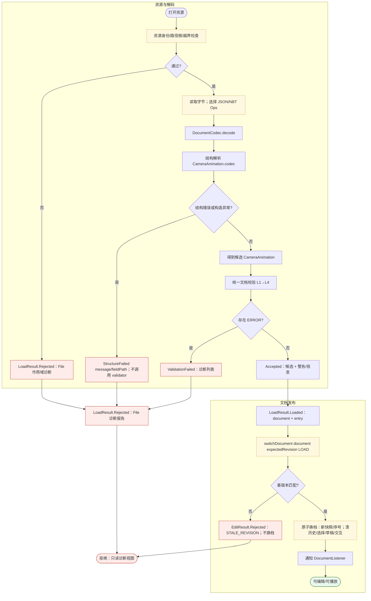

**判定口径**：

- 结构失败（字段缺失、未知类型、版本不匹配、构造异常）→ `StructureFailed`；没有候选，validator 不参与。
- 结构成功但 validator 报任一 `ERROR` → `ValidationFailed`；`Accepted` 不得携带 `ERROR`。
- 载入成功后以 `SessionSwitch.LOAD` 换档；换档失败（旧基版本）仍是拒绝，不得先改内存再回滚。
- 诊断报告限定单一资源与 File 作用域；路径安全、真实磁盘/网络 Ops 与 `fieldPath` 填充仍待实现。

### A2 编辑提交、撤销与重做

同步提交与延迟提交共享同一发布内核；区别只在“何时重查基版本”。通知期间禁止同步写入，避免监听器回调把文档改到正在遍历的状态。

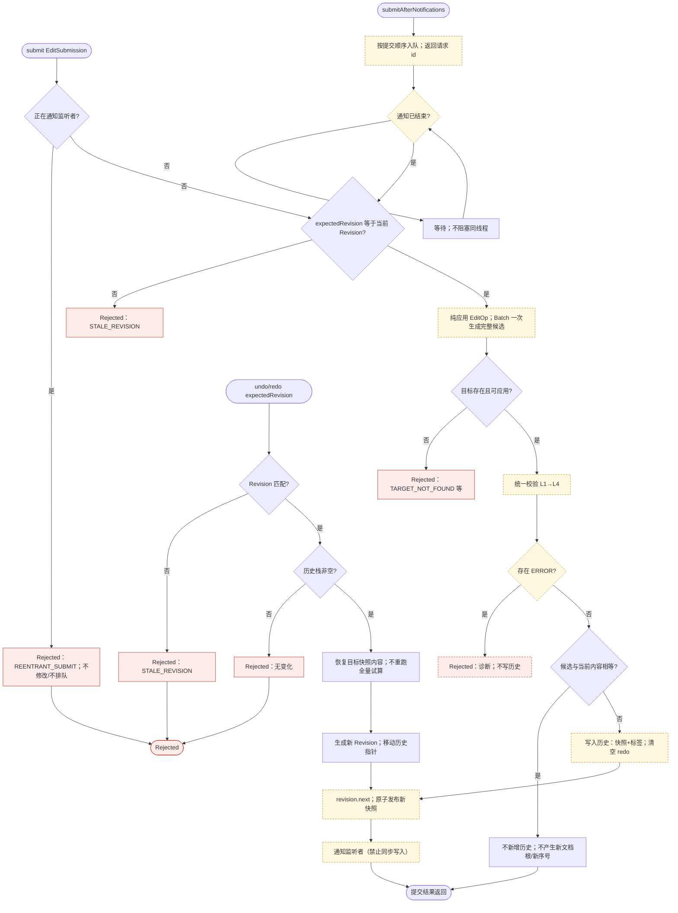

**结果与历史**：

- 拒绝时文档、历史、发布序号均不变；`Rejected` 至少含一条诊断。
- 无变化提交不新增历史项；标签只在成功且有变化时随历史项保存。
- `undo`/`redo` 也递增 `Revision`，旧基版本请求在换档/撤销/重做后失效。
- 延迟提交的成功/拒绝在存储线程**恰好回调一次**；调用方不能阻塞等待同线程队列。
- 换档（`INITIAL/LOAD/NETWORK/RESTORE/SWITCH`）清空历史、选择、交互请求与草稿；序号不重置或回退。

### A3 编辑事务、字段草稿与统一预览

事务把“输入文本”和“文档候选”分开：非法文本保留在草稿里，不构造非法文档；可解析时生成独立预览候选，但**不发布**。拖动期间只做轻量检查与当前帧求值，松手/确认才提交。

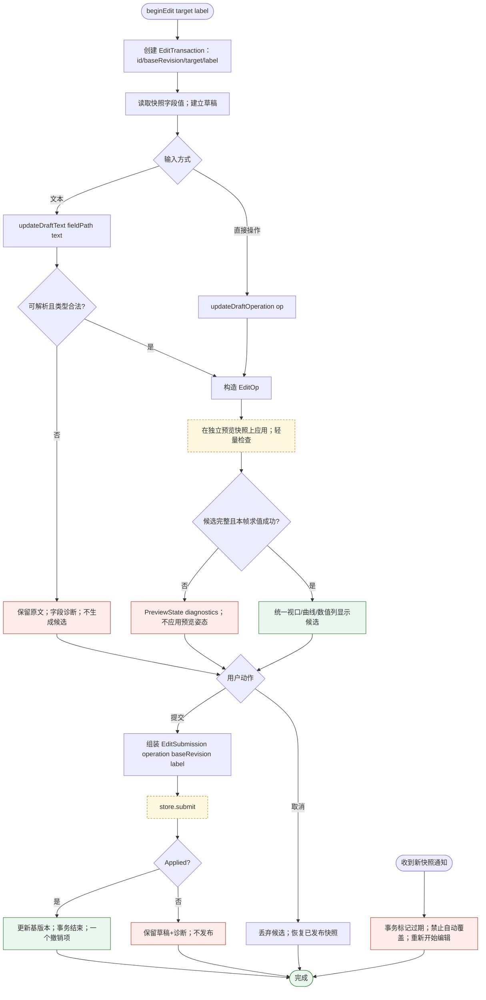

**关键边界**：

- 预览与正式播放使用同一套采样/姿态/合成规则；不能各自抓取世界或求值。
- 候选不完整、结构不合法或本帧求值失败时，显示诊断且**不应用该帧预览姿态**。
- 基版本变化时事务过期；面板重建、活动机位切换、后端切换不得丢失草稿，但不允许过期基版本提交。
- 提交成功仅产生一个撤销项；取消不发布、不写历史。

### A4 帧准备：一次捕获快照与事实

准备阶段是“纯求值 + 一次外部事实捕获”。顺序不能颠倒：先求值来源/活动/注视并确定**实际依赖**，再让 `FrameFactsProvider` 只准备这些事实；之后所有通道、布局、公式与空间合成都读同一份冻结事实。

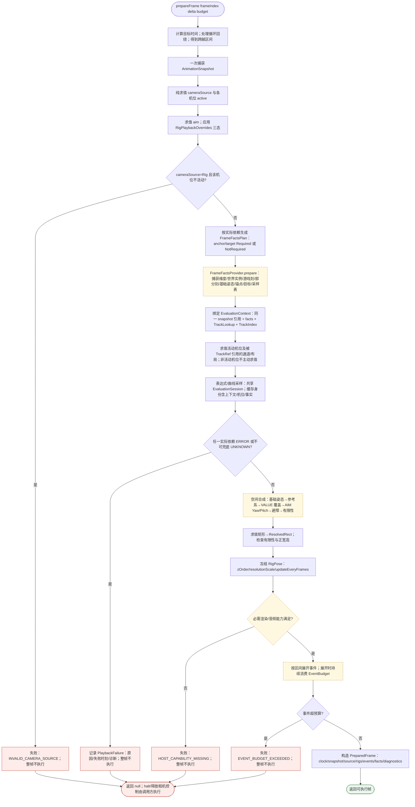

**必须保持的顺序与判定**：

1. **一次捕获**：`AnimationSnapshot` 只捕获一次；后续求值、事件解析、矩形/层级/质量请求都绑定它，不得中途换成新快照。
2. **先依赖、后事实**：`FrameFactsPlan` 逐机位给出覆盖后的生效锚点、`AimState` 及 `anchor/target` 需求；provider 不重读文档默认配置，也不因查询加载远端区块。
3. **同源绑定**：`EvaluationContext` 要求 `facts.sourceSnapshot` 与 `trackIndex.snapshot()` 都是同一个快照引用；同 revision/同内容的异源快照拒绝。`TrackIndex` / `TrackLookup` 由 core 在绑定快照时派生，先检查 `TrackId` 唯一，不能沿用旧索引。
4. **共享预算**：表达式、`TrackRef`、曲线公式、变量/函数递归使用同一个 `EvaluationSession`；失败前已消耗的工作量不退回。
5. **整帧失败**：任一当前活动机位或实际依赖失败，整帧不执行；准备成功前不应用任何一路新姿态，也不执行本帧事件。
6. **非活动机位**：不主动求值姿态/矩形/渲染，但指向其通道的 `TrackRef` 仍按依赖求值；不能因未活动而跳过错误检查。
7. **事件预算在展开时消费**：不能先完整展开再交给执行器限流；超限立即停止准备。
8. **失败返回 null**：`prepareFrame` 返回空，失败原因由 `failure()` 查询；宿主终止播放并释放相机，不自动退回 Player 或换机位。
9. **可选能力**：可选音频/叠加能力缺失按 `TypeCapability` 或宿主诊断报告；只有本帧实际必需的渲染/音频能力缺失才以 `HOST_CAPABILITY_MISSING` 终止整帧。

### A5 帧执行：相机、合成与事件

执行阶段只消费 `PreparedFrame`，不重新读取 store、不重新求值。世界模拟与文档事件每帧只执行一次；多路渲染可以重复提取/提交，但不能重复执行世界模拟或事件。

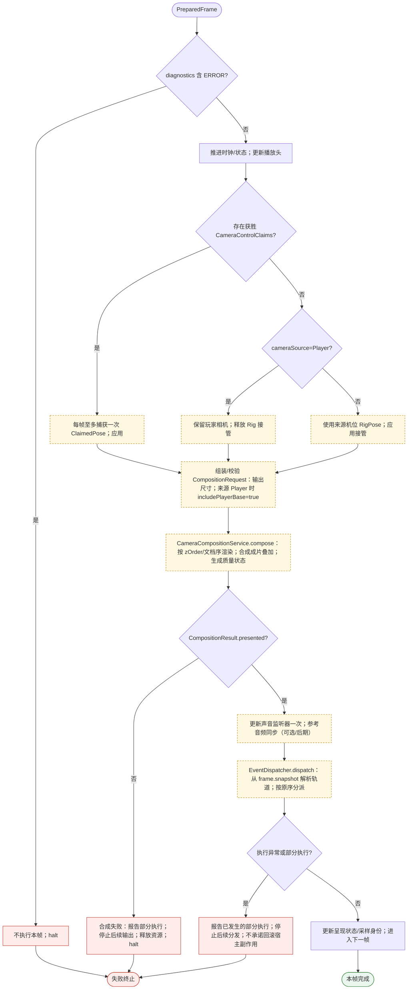

**执行规则**：

| 情形 | 正式播放行为 |
| --- | --- |
| 准备帧含 `ERROR` | 防御性拒绝，不应用任何新姿态；进入失败终止 |
| 任一锚点/目标不可用、类型或解析器缺失 | 终止并释放相机，保留失败时刻，提示原因 |
| 启用通道求值错误、最终姿态非法 | 同上；不执行本帧事件 |
| 活动机位矩形非法，或来源指向不存在/不活动 Rig | 终止整场并定位属性；不应在提交/载入时漏检 |
| 事件工作量超限 | 终止并报告，不静默丢弃事件 |
| 渲染宿主异常 | 停止后续输出与事件，释放资源，报告可能的部分执行 |
| 性能/兼容性降级 | 可见、可恢复的运行策略，不等同求值失败；不改写文档 |
| 事件执行异常 | 只报告已发生的部分执行，不承诺回滚宿主副作用 |

**事件分派细节**：`EventDispatcher` 接收整帧，按 `frame.snapshot` 解析事件载荷；`EventExecutorRegistry` 按轨道类型查找执行器。执行器只接收**原发生序中的连续同类型片段或单事件**，可以多次调用同一执行器，但不得跨类型/周期聚合重排。内建 `curve/aim/active/camera_source` 类型不能注册事件执行器。

**相机接管**：`CameraControlClaims` 的登记/释放/捕获限宿主主线程；`winningPose` 每帧至多调用一次，捕获期间登记/释放影响下一次捕获；provider 异常转本帧失败，不静默退回 Player。没有编辑器覆盖声明时，才由 `cameraSource` 决定接管。图中的捕获/应用属于执行阶段；若宿主把 `winningPose` 放在准备阶段完成，则准备帧只携带结果、执行阶段仍只应用一次，异常同样转本帧失败。

### A6 表达式编译与求值

编译与求值严格分离：编译只读源码，失败不产生句柄；求值只读显式输入，失败返回来源化失败链。样本三态、预算/深度与缓存规则都在求值侧完成。

```mermaid
flowchart TD
    subgraph COMPILE[编译 expression]
        A([compile source]) --> B{源码长度/嵌套预算?}
        B -- 超限 --> C[Rejected：SOURCE_TOO_LARGE/NESTING_TOO_DEEP]
        B -- 否 --> D[解析为内部 AST]
        D --> E{语法错误?}
        E -- 是 --> F[Rejected：SYNTAX_ERROR]
        E -- 否 --> G[检查内建函数 arity 与 sample 静态名字]
        G --> H{失败?}
        H -- 是 --> I[Rejected：BUILTIN_ARITY_MISMATCH/SAMPLE_REFERENCE_INVALID]
        H -- 否 --> J[CompiledExpression + references]
    end

    subgraph EVAL[求值 eval]
        K([evaluate compiled inputs]) --> L{缓存命中?}
        L -- 是 --> M[取回确定性结果/领域失败；按当前 source 重包装；命中不扣额度]
        L -- 否 --> N[读取 inputs：context/source/rigId/t/p/wt/spatial/seed/session/sampler]
        N --> O{深度/工作额度足够?}
        O -- 否 --> P[Failure：DEPTH_LIMIT_EXCEEDED/WORK_LIMIT_EXCEEDED；不写共享缓存]
        O -- 是 --> Q[求值 AST；select 只求值选中分支]
        Q --> R{引用 sample name fallback?}
        R -- 是 --> S[查 FrameFacts.samples]
        S --> T{reading?}
        T -- VALUE --> U[有限数值]
        T -- UNKNOWN --> V{带 fallback?}
        V -- 是 --> W[仅在 UNKNOWN 时惰性求值 fallback]
        V -- 否 --> X[Failure：SAMPLE_UNKNOWN]
        T -- COLLECTION_ERROR --> Y[Failure：SAMPLE_COLLECTION_ERROR；不可兜底]
        R -- 否 --> Z{TrackRef/变量/函数?}
        Z -- 是 --> AA[共享同一 EvaluationSession；TrackRef 用轨道所属机位；深度进入/退出配对]
        AA --> Q
        Z -- 否 --> AB[内建/算术/常量]
        U --> AC{结果有限?}
        W --> AC
        AB --> AC
        AC -- 否 --> AD[Failure：NON_FINITE_RESULT]
        AC -- 是 --> AE[Value：有限数值]
        X --> AF[Failure 链：source + span + causes]
        Y --> AF
        P --> AF
        AD --> AF
        AE --> AG[写确定性结果缓存]
    end

    M --> AH([ExpressionSample])
    AG --> AH
    AF --> AH
    C --> AI([CompilationResult.Rejected])
    F --> AI
    I --> AI
    J --> AJ([CompilationResult.Compiled])
    J -. 编译产物交给求值 .-> K

    classDef planned fill:#fff8e1,stroke:#b8860b,stroke-dasharray:4 3
    classDef fail fill:#fdecea,stroke:#c0392b
    classDef ok fill:#eaf7ee,stroke:#2e7d32
    class M,N,O,Q,S,AA,AG planned
    class C,F,I,P,X,Y,AD,AF,AI fail
    class AE,AJ,AH ok
```

**求值语义清单**：

1. **编译失败无句柄**：语法错误、源码超预算、内建实参个数不符、`sample` 名字不是静态字符串字面量都返回 `Rejected`；不得返回“可求值但会失败”的句柄。
2. **作用域推迟到 L3**：变量/自定义函数是否存在、实参个数是否匹配符号表、样本名是否绑定采样声明，由统一文档校验使用 `references()` 完成；编译期只认识内建量与内建函数。
3. **显式输入**：`ExpressionInputs` 必须携带 `context`、`source`、可空 `rigId`、`t/p/wt`、`spatial`、`randomSeed`、`session`、`sampler`；不得从当前 store 或当前编辑机位隐式补足。
4. **样本语义**：`sample(name)` 读到 `UNKNOWN` 返回 `SAMPLE_UNKNOWN`；`sample(name,fallback)` 只在 `UNKNOWN` 时惰性求值 fallback；`COLLECTION_ERROR` 不可兜底；未知样本名返回 `UNKNOWN_SAMPLE_NAME`。
5. **惰性控制流**：`select(cond,a,b)` 只求值选中分支；静态校验仍检查两个分支的引用与依赖。
6. **预算与深度**：经 `TrackRef`、曲线公式、变量/函数递归时传递同一 `EvaluationSession`；超深度/超工作量返回对应失败，且不进入会话无关缓存。
7. **失败链**：`ExpressionFailure` 按“外到内”保留来源；缓存命中取回的失败按**当前**入口 `source` 重新包装，不能继承其他入口的来源链。
8. **非确定**：`random()` 明确非确定；试算遇到非确定公式应报告 `Incomplete`，不能以一次随机结果作为拒绝依据。`noise(seed,t)` 是确定性替代。
9. **空间上下文**：读取空间事实但没有 `rigId` 时返回 `SPATIAL_CONTEXT_MISSING`；`TrackRef` 使用被引用轨道所属机位，不使用入口的 `rigId` 冒充。

### A7 播放启动、停止与失败终止

`start` 的关键不是“能否构造请求”，而是**失败时不能扰动旧播放**：先校验请求与基版本、准备初始条件，全部成功后才由同一文档存储换档并切状态。

```mermaid
flowchart TD
    A([start request expectedRevision]) --> B[校验速度>0、startTime 在可播放范围、loop、覆盖 RigId 存在]
    B --> C{请求合法?}
    C -- 否 --> D[StartResult false + PlaybackFailure]
    C -- 是 --> E{expectedRevision 等于 store.snapshot.revision?}
    E -- 否 --> D
    E -- 是 --> F[准备初始条件：时钟/来源/初始事实/相机条件；不执行事件]
    F --> G{准备成功?}
    G -- 否 --> H[保持原文档/序号/状态/相机控制不变]
    H --> D
    G -- 是 --> I[同一 store.switchDocument request.animation expectedRevision]
    I --> J{换档成功?}
    J -- 否 --> H
    J -- 是 --> K[建立 PlaybackClock；state=PLAYING；快照/序号已切换]
    K --> L([StartResult true])

    M([pause]) --> M1[PAUSED；保留时钟与当前画面]
    N([resume]) --> N1{运行条件仍有效?}
    N1 -- 否 --> O[halt failure；HALTED]
    N1 -- 是 --> N2[PLAYING]
    P([seek t]) --> P1{有限非负且在可播放范围?}
    P1 -- 否 --> P2[拒绝；播放头不变]
    P1 -- 是 --> P3[更新播放头；不求值、不执行事件]
    Q([stopAndReset]) --> Q1[IDLE；播放头归零；释放相机控制]
    R([halt failure]) --> R1[HALTED；保留 failureTime/原因；释放控制；不再执行本帧事件]

    classDef planned fill:#fff8e1,stroke:#b8860b,stroke-dasharray:4 3
    classDef fail fill:#fdecea,stroke:#c0392b
    classDef ok fill:#eaf7ee,stroke:#2e7d32
    class F,I,D,H,O,P2,R1 planned
    class D,H,O,P2 fail
    class L ok
```

**启动/停止规则**：

- 速度必须有限且大于零；第一版不支持反向播放。开始时间有限、非负且在可播放范围；空动画只接受零时刻。
- 覆盖按 `RigId` 定位；未知机位拒绝，不能把一份覆盖隐式施加到所有机位。
- `start` 成功后才换档并切 `PLAYING`；启动准备失败时旧文档、序号、播放状态与相机控制均不变，不允许先换档再回滚。
- `pause` 保留时钟与画面；`resume` 前必须重新确认运行条件；`seek` 只更新播放头，不触发事件；`stopAndReset` 重置播放头；`halt` 保留失败时刻供诊断。
- 普通停止与失败终止分开：`stopAndReset` 是用户停止；`halt` 是运行失败，两者都释放相机控制，但失败保留诊断。

### A8 编辑工具：缓动、批量、烘焙与注视捕获

工具只生成 `ToolResult.Ready(EditOp)` 或整体拒绝；它们**不发布**、不读当前 store。所有工具请求显式持有冻结快照/基版本/求值上下文，提交时沿用该基版本。

```mermaid
flowchart TD
    A([工具请求：Easing/Batch/Bake/AimCapture]) --> B[冻结快照/请求参数；注视捕获与烘焙另含求值上下文]
    B --> C{请求基版本与冻结快照一致?}
    C -- 否 --> D[ToolResult.Rejected：STALE_REVISION]
    C -- 是 --> E[只读冻结快照与事实；不读当前 store]
    E --> F{工具类型}
    F -- 缓动/批量 --> G[计算全部目标键/值；检查冲突与公式处理]
    F -- 烘焙 --> H[按区间/步长采样；检查 maxKeys/预算]
    F -- 注视捕获 --> I[求 t 有效 AimState/姿态；LEFT_TARGET 只看紧邻左侧]
    I --> J{request/preview 覆盖固定 Target?}
    J -- 是 --> K[Rejected：需先清除覆盖]
    J -- 否 --> L[局部空间逆变换→XYZ 常量键 + 同 t Off 键]
    G --> M{冲突/公式/不兼容?}
    H --> N{缺事实/UNKNOWN/ERROR/超预算?}
    L --> O{目标/事实/转换失败?}
    M -- 是 --> P[Rejected；不生成部分候选]
    N -- 是 --> P
    O -- 是 --> P
    M -- 否 --> Q[构造完整 EditOp（Batch）]
    N -- 否 --> Q
    O -- 否 --> Q
    Q --> R[ToolResult.Ready op + diagnostics]
    R --> S[调用方用同一 baseRevision 组装 EditSubmission]
    S --> T[store.submit：一次校验/一次发布/一个撤销项]
    T --> U{Applied?}
    U -- 是 --> V([完成])
    U -- 否 --> W([Rejected；文档不变])
    K --> P

    classDef planned fill:#fff8e1,stroke:#b8860b,stroke-dasharray:4 3
    classDef fail fill:#fdecea,stroke:#c0392b
    classDef ok fill:#eaf7ee,stroke:#2e7d32
    class B,G,H,I,L,S,T planned
    class D,K,P,W fail
    class R,V ok
```

**工具差异**：

| 工具 | 关键限制 |
| --- | --- |
| 缓动 `EasingRequest` | 预设写入明确插值模式与曲柄值，不新增隐式算法；快照显式，输出提交沿用该基版本 |
| 批量 `BatchTransformRequest` | 区分值域/时间域；公式不能静默转常量；全部目标先计算再统一校验，冲突整批拒绝 |
| 烘焙 `BakeRequest` | 指定机位/轨道/区间/步长/插值/最大键数与完整环境；缺输入、UNKNOWN、ERROR、超预算均不发布；成功才原子替换 |
| 注视捕获 `AimCaptureRequest` | 先得到关闭前有效姿态；`LEFT_TARGET` 只看紧邻左侧 Target，不回溯更早；固定 `Replace(Target)` 覆盖必须先清除；同一 `t` 写旋转 XYZ 常量键与 `Off` 键；替换已有键需显式确认；一次提交、一个撤销项 |

`ToolResult.Ready` 不得携带 `ERROR` 诊断；`Rejected` 至少一条诊断。工具不发布、不读当前 store，也不自行补后续旋转动作。

### A9 保存、自动恢复与恢复槽

正式保存与自动恢复是两条独立的 IO 路径：正式保存原子替换目标文件；恢复槽写独立文件，绝不覆盖正式文件。恢复经正常解码、完整校验和 `switchDocument(RESTORE)` 进入会话。

```mermaid
flowchart TD
    subgraph SAVE[正式保存 core.storage 待实现]
        A([save/saveAsync]) --> B[资源根/路径越界/身份检查]
        B --> C{通过?}
        C -- 否 --> D[SaveResult.Rejected：File 诊断]
        C -- 是 --> E[DocumentCodec.encode]
        E --> F{编码错误?}
        F -- 是 --> D
        F -- 否 --> G[深度/数量/字节保护；写临时文件]
        G --> H{写入成功?}
        H -- 否 --> I[清理临时文件；Rejected]
        H -- 是 --> J[原子替换正式文件]
        J --> K[计算 size/hash/mtime → AnimationResourceEntry]
        K --> L([Saved entry / 异步完成回调])
    end

    subgraph RECOVERY[自动恢复 core.storage 待实现]
        M([capture snapshot resource]) --> N[防抖/周期触发；不阻塞编辑]
        N --> O[编码 + 写独立恢复槽：临时文件 + 原子替换]
        O --> P{成功?}
        P -- 否 --> Q[诊断；不标记正式保存]
        P -- 是 --> R[更新 RecoverySlot 元数据]
        S([slots]) --> T[展示恢复槽与正式版本的身份/时间]
        T --> U{用户选择}
        U -- RESTORE --> V[restore slot：正常 decode + 完整校验]
        V --> W{Accepted?}
        W -- 否 --> X[诊断；不换档]
        W -- 是 --> Y[switchDocument RESTORE；新 revision；清历史]
        Y --> Z([恢复完成])
        U -- DISCARD --> AA[discard/decide DISCARD；不碰正式文件]
        U -- KEEP --> AB[decide KEEP；保留槽]
    end

    classDef planned fill:#fff8e1,stroke:#b8860b,stroke-dasharray:4 3
    classDef fail fill:#fdecea,stroke:#c0392b
    classDef ok fill:#eaf7ee,stroke:#2e7d32
    class B,E,G,J,O,V,Y planned
    class D,I,Q,X,AA fail
    class L,Z ok
```

**存储边界**：

- `ResourceId` 的非空白检查只是身份约束，不是路径安全；资源根、相对路径映射、越界拒绝由实现负责。
- 正式保存必须临时文件 + 原子替换；失败清理临时文件，不留下半份文件。
- 恢复槽独立资源、独立文件；不覆盖正式文件，不保存渲染缓存或撤销栈；写入完成不能把较新编辑错误标记为“已正式保存”。
- 恢复必须重新走正常 Codec 与统一校验，再以 `RESTORE` 换档；不能自行反序列化或恢复旧撤销栈。
- `saveAsync` / `capture` 的完成回调必须绑定到对应的资源与版本，不能把旧版本结果当成新版本成功。

### A10 编辑器打开、暂停与关闭

编辑器打开流程只处理“会话 + 后端选择 + 生命周期”，不直接解析文件或修改文档。屏幕暂停不等于关闭会话；后端切换复用会话，不能丢失草稿或预览覆盖。

```mermaid
flowchart TD
    A([创建或恢复 EditorSession]) --> B[恢复 SessionViewState/草稿/预览覆盖；不写文档]
    B --> C[EditorUiHost.open session selector]
    C --> D{selector 指定 ID?}
    D -- 否 auto --> E[按 priority 降序；同优先级按 ID 稳定排序；内置最低]
    E --> F{候选 canOpen?}
    F -- 是 --> G[open session]
    F -- 否 --> H{还有候选?}
    H -- 是 --> E
    H -- 否 --> I[报告无法打开；不关闭会话]
    D -- 是 --> J{ID 已注册?}
    J -- 否 --> K[打开内置实现]
    K --> G
    J -- 是 --> L{canOpen?}
    L -- 否 --> M[提示失败；不自动切换；不关闭会话]
    L -- 是 --> G
    T([openDefault session]) --> K
    G --> N([会话运行])
    N --> O{生命周期}
    O -- suspend --> P[取消捕获/清空按键/释放光标/保存草稿；会话保留]
    O -- backend switch --> Q[复用会话；保持草稿/预览覆盖；重新 open]
    Q --> G
    O -- close session --> R[结束事务/交互请求/相机声明；释放资源；close]
    R --> S([结束])

    classDef planned fill:#fff8e1,stroke:#b8860b,stroke-dasharray:4 3
    classDef fail fill:#fdecea,stroke:#c0392b
    classDef ok fill:#eaf7ee,stroke:#2e7d32
    class B,C,E,G,K,P,Q,R planned
    class I,M fail
    class N,S ok
```

**生命周期区分**：

| 操作 | 行为 |
| --- | --- |
| `attach` | 挂载组件、订阅会话、恢复视图状态 |
| `suspend` | 取消捕获、清空按键集合、释放光标控制、保存草稿；会话保留 |
| `resume` | 重新布局并核对草稿版本，按需恢复有效焦点 |
| `detach` | 移除订阅和 UI 资源，幂等清理 |
| `session.close` | 结束事务、交互请求与相机声明，执行会话级关闭 |

后端选择失败（已注册但拒绝接管）不得关闭会话或遗留相机接管令牌；指定未注册 ID 才按约定回警告并打开内置实现。`Minecraft Screen.removed()` 只应触发安全的暂停/卸载清理，不能直接推断“会话应关闭”。

---

## 11. 契约覆盖与缺口

### 11.1 P1 已交付 vs 运行待实现

| 领域 | P1 已交付（本文类图） | 运行待实现（活动图中的宿主步骤） |
| --- | --- | --- |
| 文档模型 | 不可变 `CameraAnimation` / `CameraRig` / 轨道 / 路径 / 符号 / 标记 / 采样声明 / 音频与叠加身份 | 全文档唯一 ID、跨对象引用与领域规则的统一校验执行 |
| 布局 | `AnimatedNumber`、可动画矩形、`ResolvedRect` | 几何算法、锚点解析、逐帧求值与姿态合成 |
| 编辑与发布 | `EditOp`、`EditSubmission`、`Revision`、快照、store/历史/事务/预览契约 | store 发布、通知队列、撤销重做、编辑执行、统一 validator、试算与工具算法 |
| 表达式与求值 | 编译器接口、不透明编译产物、引用/诊断、显式输入、共享执行会话、索引/缓存接口 | 编译器、解释器、索引构建、依赖图、实际缓存及候选隔离 |
| 开放类型 | 自有 `TypeRegistry`、类型描述/Codec、`TypeValidator`、客户端 resolver/collector 与能力服务契约 | 注册表实现/冻结时序、类型校验分派、客户端执行部件与受控世界查询 |
| 编解码 | 成员 Codec、`DocumentRegistries`、根文档组合、严格整数、两阶段 `DocumentCodec` | Codec 实际填充 `fieldPath`、NBT/网络 Ops 往返、深度/数量/字节限制及兼容矩阵 |
| 播放与渲染 | 请求/覆盖/时钟/准备帧、事件预算/执行器注册、相机接管、合成与质量状态、网络动作/来源/限额 | 时间推进、事件展开与执行、仲裁、真实网络协议、来源解析、多机位 renderer 与质量策略 |
| 存储 | `ResourceId`、资源服务、载入/保存结果、文件诊断报告、恢复槽与选择契约 | 资源根/路径安全、IO、原子替换、恢复调度 |
| 编辑器 | 会话、草稿、选择/视图、按 `RigId` 预览覆盖、交互请求、后端选择与 open 契约 | 会话实现、后端装配、草稿恢复、UI/输入/生命周期及预览执行 |
| 叠加与音频 | `OverlayElement` 暂存不透明内容；`AudioRef` / `AudioRefId` 仅身份与边界 | O1–O3 与音频整体最后实施 |

### 11.2 本文与 P1 文档的对应关系

- 类图层：本文 C1–C12（含 C5b、C7a、C7b）对应 [P1 契约计划](<refactor/P1-contract-plan.md>) §1 的“已交付”列；未交付实现不画成类。
- 活动图层：A1–A10 对应主设计 §3.3、§4、§5、§6、§7、§8、§9 与 UI 设计 §3、§4、§6、§7；P1 文档 §5 的验收清单是这些“待实现”步骤的具体展开。
- 不在本文展开：旧根包 `free_camera_api_tripod` 的可变实现、`docs/_survey-current-code.md` 的现状勘察、`review-feature-parity.md` 的产品对照；它们不是 P1 目标架构。

### 11.3 维护规则

1. **先改设计，再改图**：若行为裁决变化，先更新主设计/UI 设计，再同步本文的类关系与活动分支；不得只改图造成规范分叉。
2. **P1 边界不能漂移**：新增 `api` 类型时补类图；新增 `core`/`editor` 实现类时，本文只把它们画进宿主泳道或实现方表，不混入 `api` 类图。
3. **图不代替测试**：活动图中的“禁止静默回退/不发布部分结果”是契约，不是已验证行为；运行验收仍按 P1 文档 §5 的矩阵执行。
4. **Mermaid 校验**：本文所有 Mermaid 块应至少通过 `mermaid.parse`（编写时使用 mermaid 12.2.0）；修改后建议重新跑一次，避免文档在 GitHub/IDE 中渲染失败。
5. **图索引**：C1 系统总览、C2 文档聚合、C3 轨道与值源、C4 空间与姿态、C5 发布与历史、C5b 工具与试算、C6 诊断与消息、C7a 帧事实与计划、C7b 求值上下文与采样、C8 表达式、C9 播放与合成、C10 编辑器会话、C11 存储与协议、C12 开放类型；A1 载入发布、A2 编辑提交、A3 事务预览、A4 帧准备、A5 帧执行、A6 表达式、A7 播放启停、A8 编辑工具、A9 保存恢复、A10 编辑器生命周期。

---

## 附录 A：关键类型到源码入口

| 领域 | 源码入口 |
| --- | --- |
| 文档与轨道 | [`api/animation/block`](<../src/main/java/cn/anecansaitin/free_camera_api_tripod_v2/api/animation/block/>) |
| 值源、曲线与布局 | [`api/animation/field`](<../src/main/java/cn/anecansaitin/free_camera_api_tripod_v2/api/animation/field/>) |
| 编辑意图、诊断与工具 | [`api/animation/edit`](<../src/main/java/cn/anecansaitin/free_camera_api_tripod_v2/api/animation/edit/>) |
| 快照、发布与历史 | [`api/animation/document`](<../src/main/java/cn/anecansaitin/free_camera_api_tripod_v2/api/animation/document/>) |
| 求值与帧事实 | [`api/animation/eval`](<../src/main/java/cn/anecansaitin/free_camera_api_tripod_v2/api/animation/eval/>) |
| 表达式 | [`api/animation/expression`](<../src/main/java/cn/anecansaitin/free_camera_api_tripod_v2/api/animation/expression/>) |
| 播放、合成与协议 | [`api/animation/playback`](<../src/main/java/cn/anecansaitin/free_camera_api_tripod_v2/api/animation/playback/>) |
| 空间与锚点 | [`api/spatial`](<../src/main/java/cn/anecansaitin/free_camera_api_tripod_v2/api/spatial/>) |
| 类型注册表与能力 | [`api/animation/registry`](<../src/main/java/cn/anecansaitin/free_camera_api_tripod_v2/api/animation/registry/>) |
| 存储与恢复 | [`api/storage`](<../src/main/java/cn/anecansaitin/free_camera_api_tripod_v2/api/storage/>) |
| 编辑器会话 | [`api/editor`](<../src/main/java/cn/anecansaitin/free_camera_api_tripod_v2/api/editor/>) |
| P1 回归测试 | [`src/test/java/.../free_camera_api_tripod_v2`](<../src/test/java/cn/anecansaitin/free_camera_api_tripod_v2/>) |

## 附录 B：验证记录

- 编写时对全文 Mermaid 块执行 `mermaid.parse`（mermaid 12.2.0 + jsdom），全部通过。
- 类图/活动图的语义依据 P1 源码（220 个 `_v2` Java 文件）与设计文档；未使用旧根包实现推断新契约。
- P1 已执行基线：`.\gradlew.bat --offline compileJava test --rerun --console=plain` → BUILD SUCCESSFUL，33 suite / 219 用例，v2 27/153，失败/错误/跳过均为 0（见 P1 文档 §6）。
- 本文不新增运行验证；活动图中的宿主步骤仍是“待实现/待验收”，不能以本文代替真实 store、时序、世界、渲染或网络测试。
