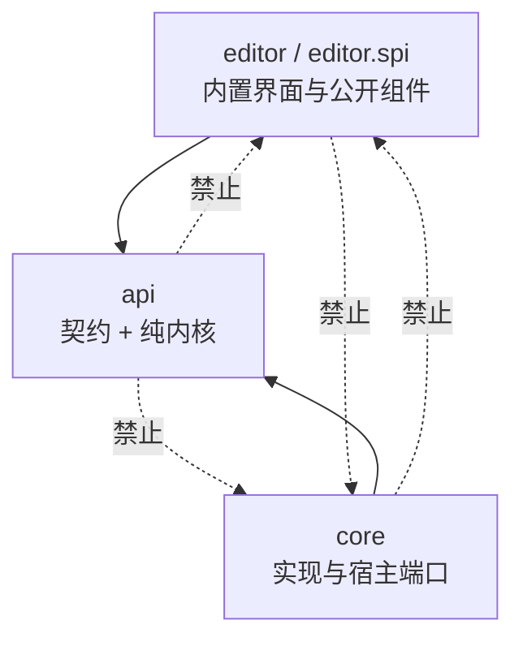
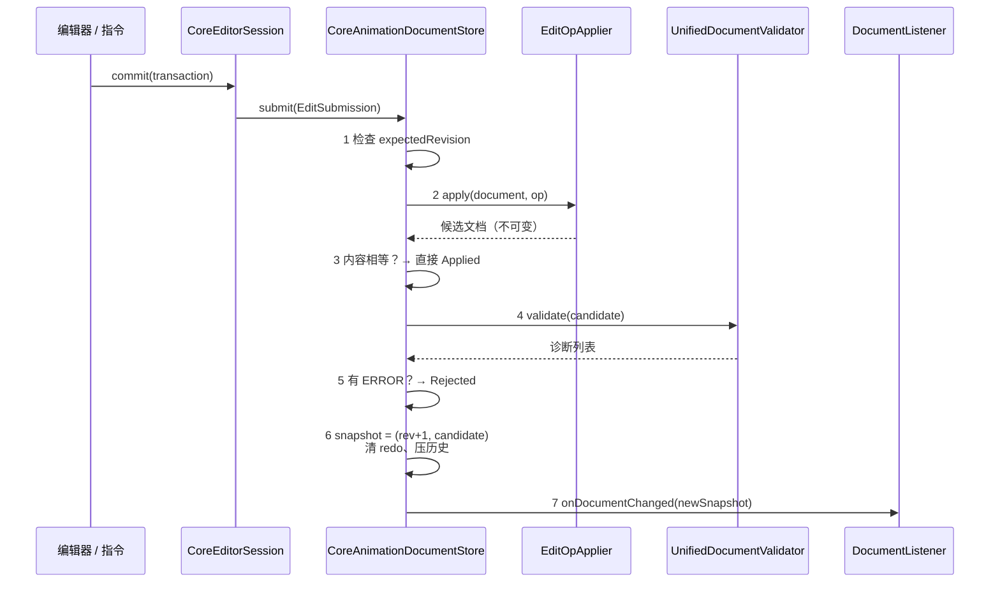
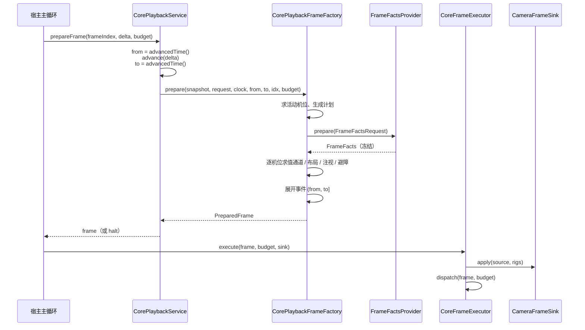
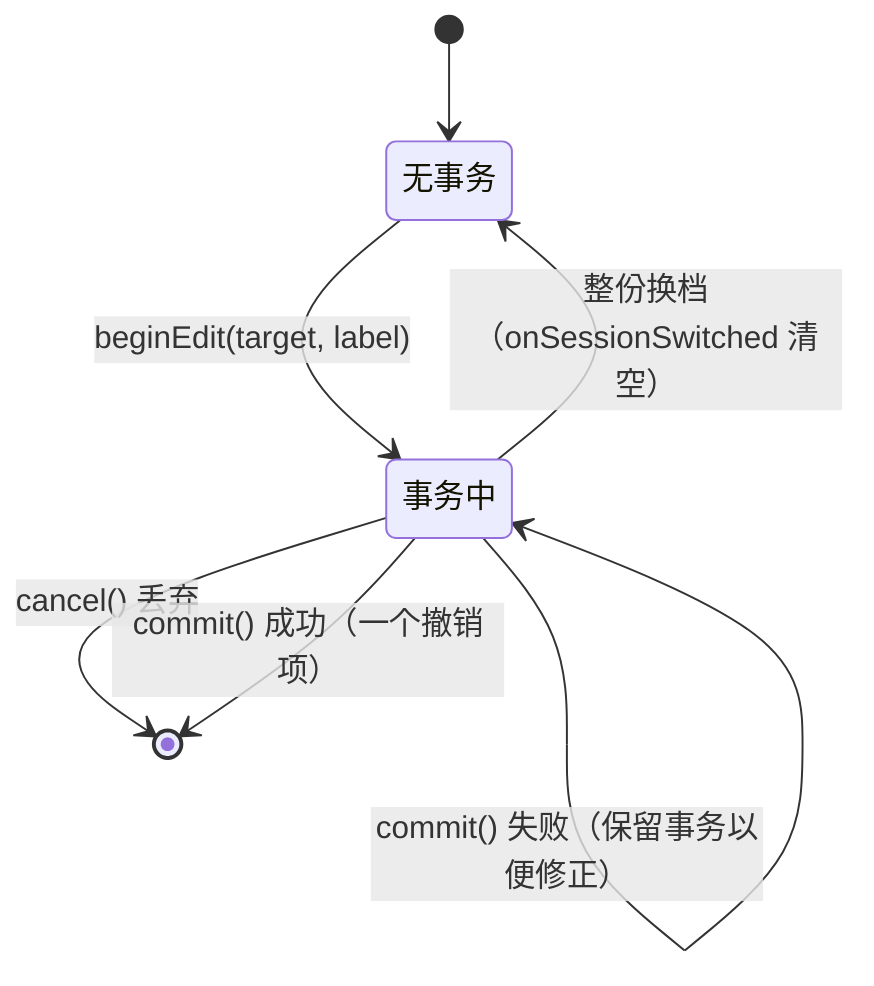

# V2 代码导读：从「看不懂」到「知道该改哪」

> **适用基线**：`src/main/java/cn/anecansaitin/free_camera_api_tripod_v2`，307 个 Java 文件、约 3.17 万行；测试 64 个文件、约 1.57 万行。
> **配套文档**：行为规范见[动画、播放与编辑器主设计](design-animation-editor-framework.md)，施工状态见 [P1 实施与验收](refactor/P1-contract-plan.md)。
>
> **本文不是规范**。它是一张"怎么读代码"的地图：告诉你哪些类重要、数据怎么流、哪里容易踩坑、想改某功能该翻哪几个文件。规范与代码冲突时，以代码 + 主设计为准，并把差异记进审核文档，而不是改本文。
>
> **设计变更提示（2026-10-28）**：主设计新增「全局轨道池 + 属性显式绑定」模型（[§1.3](design-animation-editor-framework.md#13-相机属性与全局轨道池2026-10-28-变更未实现)），尚未实现。本文描述的是**当前代码**的每机位通道/注视/活动轨道模型；迁移后 §2、§3 的模型说明需要重写，不能把新设计当作已存在的代码。

---

## 0. 先看这一页

**一句话**：V2 是一套**不依赖 Minecraft 客户端的相机动画内核**——文档是不可变的，修改必须提交，一帧的输入（世界事实）先冻结再求值，最后把结果交给宿主去画。

**五个必须记住的词**：

| 词 | 一句话解释 | 代码落点 |
| --- | --- | --- |
| 文档 | 一份动画的全部创作数据，不可变 | `api.animation.block.CameraAnimation` |
| 快照 | 文档 + 发布序号，一次读出、不会撕裂 | `api.animation.document.AnimationSnapshot` |
| 轨道 | 时间轴上一行，有稳定 ID | `AnimationTrack` 的三个分支 |
| 帧事实 | 某一渲染帧冻结的世界 / 空间读数 | `api.animation.eval.FrameFacts` |
| 宿主 | 真正读世界、写相机、放声音的那一层 | `core` 的端口实现 + 游戏侧代码 |

**三条口诀**：

1. **想改文档，只能交 `EditOp`**——不能改字段、不能 `new` 一个改过的对象自己用。
2. **求值阶段不读世界**——世界读数在"帧准备"阶段一次性冻结成事实。
3. **失败必须说清楚**——没有"算不出来就用默认值"的路径；只有作者显式写的 `fallback` 例外。

**如果只想读三个文件**：

| 顺序 | 文件 | 你会得到什么 |
| --- | --- | --- |
| 1 | `api/animation/block/CameraAnimation.java` | 文档长什么样、为什么所有方法都是 `with*` |
| 2 | `core/animation/document/CoreAnimationDocumentStore.java` | 一次修改从提交到发布的全过程 |
| 3 | `core/animation/playback/CorePlaybackFrameFactory.java` | 一帧画面怎么从文档算出来 |

---

## 1. 这份文档怎么用

| 你的情况 | 建议读 | 预计时间 |
| --- | --- | --- |
| 第一次接触，只想搞清项目在干嘛 | §0 → §2 → §3 | 15 分钟 |
| 要改代码，先建立整体印象 | §0 → §3 → §4 → §5 | 1.5 小时 |
| 要修某个具体问题 | §10 按需索引 → 对应 §5 场景 → §11 测试 | 按需 |
| 要加一种新轨道 / 锚点 / 采样类型 | §13 扩展 | 1 小时 |
| 隔了几个月回来看自己的代码 | §15 速查 + §14 现状边界 | 20 分钟 |
| 只想知道"这功能写没写" | §14 现状边界 | 10 分钟 |

> ⚠️ 读之前先接受一件事：**这个仓库的 JavaDoc 写得比代码还多**。很多类头部的注释就是一篇小设计文档（比如 `KeyframeTrack`、`FrameFacts`、`CoreFrameFactsProvider`）。**先读类注释，再读方法**，效率会高很多。但也要注意 §14.3 的"注释可能过时"。

---

## 2. 用一个剧组类比建立直觉

拍一段 Minecraft 短片，需要：分镜稿、修改稿子的人、出版社、每一版印刷、摄影机、开关灯牌、场记、现场收音。V2 的每个概念几乎都能对上：

| 剧组里的东西 | V2 里对应什么 | 为什么这么设计 |
| --- | --- | --- |
| 分镜稿 | `CameraAnimation` | 一份完整创作数据 |
| 在稿子上划一道 | `EditOp`（纯意图，不含结果） | 操作可以被校验、被拒绝、被撤销 |
| 编辑 | 调用方构造 `EditOp` 的地方 | 编辑只描述"想改成什么样" |
| 出版社 | `AnimationDocumentStore` | 唯一能"印出来"的地方 |
| 每一版印刷 | `AnimationSnapshot` + `Revision` | 读者永远拿到完整的一版，不会拿到半本 |
| 存档柜里的历史版本 | `UndoHistory` | 撤销是回到旧内容 + 新版本号 |
| 摄影机 | `CameraRig` | 一台机位一路画面 |
| 镜头运动轨迹 | `CurveTrack` / `Curve` / `Keyframe` | 数值随时间变化 |
| 灯牌（开 / 关） | `KeyframeTrack`（注视 / 活动 / 相机来源） | 离散状态，只能瞬间切换，不能插值 |
| 场记 | `CorePlaybackService` + `PlaybackTimeline` | 只负责时间推进与状态，不负责拍 |
| 现场收音、道具位置 | `FrameFacts` | 这一帧世界的快照，全剧组共用一份 |
| 摄影棚 | 宿主（游戏侧） | 真正能碰到世界的只有摄影棚 |

**这个类比最有用的一点**：它解释了"为什么改一个数字要经过这么多层"。因为动画是可以被打包分享、被别人播放、被撤销、被自动恢复的——如果允许任何代码直接改内存里的对象，那"撤销"和"多人同步"就永远做不对。

---

## 3. 代码地图

### 3.1 规模与目录

```
src/main/java/cn/anecansaitin/
├── free_camera_api_tripod/          ← 旧实现（v1），保留、未接线
└── free_camera_api_tripod_v2/       ← 本次重构目标
    ├── api/      220 个文件  ← 契约 + 纯内核（不碰客户端）
    ├── core/      84 个文件  ← 纯内核实现 + 宿主端口实现
    └── editor/     3 个文件  ← 目前只有分包说明
```

| 包 | 文件 | 管什么 | 你要不要改 |
| --- | ---: | --- | --- |
| `api.animation.block` | 27 | 文档模型：文档、机位、三类轨道、叠加、采样声明、符号表 | 改数据结构来这里 |
| `api.animation.document` | 17 | 快照、存储接口、历史、事务、解码结果、字段路径 | 改发布流程来这里 |
| `api.animation.edit` | 24 | `EditOp` 全集、诊断、分层校验、试算、编辑工具 | 加一种编辑操作来这里 |
| `api.animation.eval` | 26 | 求值上下文、采样请求、帧事实、三态结果、依赖图 | 改求值语义来这里 |
| `api.animation.playback` | 29 | 播放请求、帧结构、事件、接管、合成与质量状态 | 改播放契约来这里 |
| `api.animation.registry` | 20 | 三类开放类型的注册表、能力服务、校验钩子 | 加扩展类型来这里 |
| `api.animation.field` | 14 | 值源（常量 / 公式 / 轨道引用）、曲线、关键帧、通道 | 改"数值从哪来"来这里 |
| `api.animation.id` | 11 | 8 种稳定 ID + `IdGenerator` | 基本不用改 |
| `api.animation.expression` | 9 | 表达式编译契约、引用、轻量诊断 | 只改编译契约时来 |
| `api.animation.path` | 3 | 路径与节点 | 加路径模式时来 |
| `api.animation.codec` | 1 | `Codecs`：枚举、strictInt、非空白串等工具 | 加通用编码工具时来 |
| `api.spatial` | 11 | `Vec3` / `Rotation` / `Space` / 锚点 / 注视 / 避障 | 改空间语义时来 |
| `api.storage` | 11 | 资源身份、载入 / 保存结果、恢复槽 | 改存储契约时来 |
| `api.editor` | 16 | 会话、视图状态、交互请求、UI 后端 | 改编辑器契约时来 |
| `core.animation.playback` | 21 | 时间轴、帧工厂、事件展开、分发、执行、协议编解码 | 最核心的实现区 |
| `core.animation.eval` | 9 | 表达式求值器、曲线采样、帧事实、轨道索引、依赖图 | 第二核心实现区 |
| `core.animation.document` | 6 | Store 实现、`EditOpApplier`、载入器、预览器 | 编辑实现区 |
| `core.animation.validation` | 3 | 统一校验器、表达式校验 | 校验实现区 |
| `core.animation.registry` | 8 | 冻结注册表、能力服务 | 类型装配区 |
| `core.animation.edit` | 1 | `CoreEditTools`（缓动 / 批量 / 烘焙 / 捕获） | 编辑工具 |
| `core.animation.path` | 1 | `CorePathSampler` | 路径采样 |
| `core.expression` | 15 | 词法、语法、AST、解释器 | 表达式实现区 |
| `core.math` | 1 | `CoreRotationMath`（YXZ、四元数、注视） | 数学区 |
| `core.storage` | 14 | JSON / NBT / GZIP、路径解析、恢复、调度 | 存储实现区 |
| `core.editor` | 5 | 会话实现、草稿文本解析、UI 宿主、消息渲染 | 会话实现区 |
| `editor` / `editor.spi` / `editor.internal` | 各 1 | **目前只有 `package-info.java`**，真实界面尚未迁移 | §14 说明 |

**一个反直觉的数字**：`api` 有 220 个文件，比 `core` 的 84 个多得多。原因是 V2 把"契约"拆到了 record 级别——一个三态结果、一个请求、一个结果，各占一个文件。**不要被文件数吓到**：`api` 里 90% 的文件是 30~120 行的不可变 `record`，读起来很快。

### 3.2 依赖方向：三条铁律



| 编号 | 规则 | 违反会怎样 | 怎么发现 |
| --- | --- | --- | --- |
| R1 | `api` 不得依赖 `core` / `editor` | 纯内核无法脱离游戏测试 | 编译产物依赖检查 |
| R2 | `api` 不得引用 `net.minecraft.client.*` | 服务端加载 `api` 时会炸 | 同上 |
| R3 | `core` 与 `editor` 互不依赖 | 两个方向都得靠接口穿透 | 同上 |
| R4 | `editor.spi` 不得依赖 `editor.internal` | 公开组件契约被内部实现绑死 | 同上 |

文本搜索只能当辅助：**字符串里出现 `client` 不算依赖，`import` 才算**。

### 3.3 其实有五个层次，不是三个

| 层 | 代表 | 依赖谁 | 怎么测 |
| --- | --- | --- | --- |
| ① 值类型 | `Vec3`、`Rotation`、`RigId`、`LocalizedMessage` | 只有 JDK / DFU | 纯单元测试 |
| ② 文档模型 | `CameraAnimation`、`CameraRig`、各类轨道 | ① + 注册表 | 构造 / Codec 往返 |
| ③ 纯内核服务 | `CoreAnimationDocumentStore`、`UnifiedDocumentValidator`、`CoreExpressionEvaluator`、`CorePlaybackService` | ①② | 纯 JVM，不启动游戏 |
| ④ 宿主端口 | `FrameFactsProvider`、`CameraProbe`、`CameraFrameSink`、`AnchorResolver`、`SampleCollector`、`CameraCompositionService` | ③ 定义的接口 | 游戏侧实现 + 手工验收 |
| ⑤ 宿主与界面 | Minecraft 相机 / 渲染 / 输入、未来的 `editor` | ④ | 真实游戏 |

**这条分层的实际意义**：看到 `③` 里的类，你可以放心在 JUnit 里 new 出来跑；看到 `④` 里的接口在 `core` 里没有实现类，那不是漏写，那是**留给游戏层的插槽**（见 §14）。

### 3.4 从文件名猜角色

| 后缀 | 含义 | 例子 |
| --- | --- | --- |
| `...Result` / `...Outcome` | 一次操作的结果（通常 `sealed`，成功 / 失败两分支） | `EditResult`、`LoadResult`、`DocumentDecodeResult` |
| `...Request` | 一次调用的输入（不可变，自校验） | `CurveSampleRequest`、`FrameFactsRequest` |
| `...Snapshot` | 某一时刻的完整只读视图 | `AnimationSnapshot` |
| `...Service` | 宿主注入的能力 | `PlaybackService`、`AnimationResourceService` |
| `...Provider` | 一帧内生成某类数据的端口 | `FrameFactsProvider` |
| `...Registry` | 启动注册、运行只读的表 | `TrackTypeRegistry`、`EventExecutorRegistry` |
| `...Factory` | 组装复杂对象 | `CorePlaybackFrameFactory` |
| `...Sink` / `...Probe` | 单方法出口 / 入口 | `CameraFrameSink`、`CameraProbe` |
| `Core...` | `core` 里对某个 `api` 契约的实现 | `CoreAnimationDocumentStore` |
| `Frozen...` | 冻结后只读的实现 | `FrozenTrackTypeRegistry` |

---

## 4. 六个心智模型

这一节是全文最重要的部分。**读懂这六条，剩下的是查方法名。**

### 模型 1：不可变文档——所有修改都是"生一个新的"

`CameraAnimation`、`CameraRig`、`CurveTrack`、`Keyframe` 全是 `record`；集合在构造器里 `List.copyOf`；修改方法一律叫 `withXxx`，返回新对象。

```java
// 真实源码：CameraAnimation.withRig
public CameraAnimation withRig(CameraRig rig) {
    for (int i = 0; i < rigs.size(); i++) {
        if (!rigs.get(i).id().equals(rig.id())) continue;
        if (rigs.get(i).equals(rig)) return this;      // 内容没变 → 返回自身
        List<CameraRig> replaced = new ArrayList<>(rigs);
        replaced.set(i, rig);
        return withRigs(replaced);                      // 只复制变化的那条路径
    }
    return this;                                        // 找不到 → 返回自身，不抛异常
}
```

**为什么**：撤销要保存旧版本、预览要同时存在"已发布"和"草稿候选"、渲染线程要能安全读。可变对象做不到这些。

**能省内存的原因**：`with*` 只复制变化路径上的容器，未变化的对象被共享。改一条机位不会深拷贝整份文档。

**常见误解**：

| 误解 | 事实 |
| --- | --- |
| "`withRig` 会抛异常告诉我机位不存在" | 不会，返回 `this`；"目标不存在"由提交层单独诊断 |
| "内容相同也会生成新对象" | 不会，`equals` 相等时返回 `this`——这是"无变化不写历史"的基础 |
| "record 的 `equals` 可以用来比较快照" | **不能**，见模型 3 |

### 模型 2：唯一写入口——`AnimationDocumentStore`

所有已发布变更都经过同一个对象：

```text
检查 expectedRevision
→ 执行纯编辑操作（EditOp → 候选文档）
→ 强制文档校验（L1–L4）
→ 更新历史与快照
→ 通知监听者
```

**为什么**：撤销、自动恢复、网络载入、编辑器提交必须走同一套规则，否则"这个文件能不能打开"会取决于从哪个入口进来。

**四个必须知道的行为**：

| 行为 | 结果 |
| --- | --- |
| 基版本过期 | `STALE_REVISION`，**不覆盖**当前文档 |
| 内容没变化 | `Applied(当前快照)`，不产生新快照、不写历史 |
| 校验有 `ERROR` | 整体拒绝，文档 / 历史 / 序号全不变 |
| 监听器里再提交 | `REENTRANT_SUBMIT`；要延后写就用 `submitAfterNotifications` |

### 模型 3：三套身份，互不替代

这是新人最容易混的地方。

| 身份 | 类型 | 作用域 | 例子 | 能不能改 |
| --- | --- | --- | --- | --- |
| 类型标识 | `net.minecraft.resources.Identifier` | 全局，注册表分派 | `free_camera_api_tripod:curve` | 不能（框架 / 类型定义固定） |
| 文档对象身份 | `TrackId` / `RigId` / `KeyId` / … | 各自作用域内唯一且持久化 | `track-3f2a…` | 移动 / 排序 / 改名 / 撤销都**保留**；复制才换新 |
| 用户名称 | `String` | 只给人看 | `"位置 X"` | 随时可改，不改 ID |

**推论**：

- **不要用名字当 ID。** 改名后变量绑定会断（v1 就踩过：把存档里的名字当轨道 id）。
- **不要用 ID 排序。** 顺序由集合顺序表达：`rigs` 顺序服务显示与合成，`channels` 顺序服务序列化，`tracks` 顺序服务事件分派。
- **`Revision` 不是快照身份。** 它只在同一个 store 实例内单调；两个 store 都可能有 `Revision(3)`。判断"是不是同一份快照"要用**引用身份**（`EvaluationContext` 构造器就是这么做的：`trackIndex.snapshot() != snapshot` 直接拒绝）。

### 模型 4：三态，而不是 `null` / `NaN` / 兜底

全项目反复出现同一个形状：

```java
sealed interface X permits Absent, Value, Error { }
```

| 场景 | 类型 | 三态含义 |
| --- | --- | --- |
| 单个数值通道 | `ChannelSample` + `SampleStatus` | `ABSENT` 没写 / `VALUE` 有值 / `ERROR` 算失败 |
| 姿态的某一轴 | `AxisSample` | 同上 |
| 锚点 / 注视目标 | `SpatialResolution` | `NotRequired` 不需要 / `Resolved` 成功 / `Failed` 失败 |
| 世界采样读数 | `SampleReading` | `Value` / `Unknown`（可兜底）/ `CollectionError`（**不可**兜底） |
| 解码结果 | `DocumentDecodeResult` | `Accepted` / `StructureFailed` / `ValidationFailed` |
| 提交结果 | `EditResult` | `Applied` / `Rejected` |

**为什么不用 `null`**：`null` 只能表达"没有"，不能区分"作者没写"和"本帧算错了"。这两件事的处理方式完全相反——前者用基础姿态补，后者要终止播放。

**为什么不用 `NaN`**：`NaN` 一旦进入相机就是画面烂掉；而且"失败"和"未求值"会混在一起，缓存也无法判断该不该存。

**为什么不用默认值兜底**：作者写了 `1/0`，你不能悄悄给他 `0`。他会在发布之后才发现自己的动画"看起来不对但又不报错"。

### 模型 5：一帧一份事实

```text
准备阶段（只读，纯计算）
  捕获一次快照
  → 求相机来源 / 机位活动 / 注视状态
  → 生成"本帧需要什么"的计划（FrameFactsPlan）
  → 一次性向宿主拿锚点、目标、世界采样（FrameFacts）
  → 在同一份事实上求值所有活动机位
  → 得到 PreparedFrame（姿态 + 矩形 + 层级 + 质量 + 事件 + 诊断）

执行阶段（有副作用）
  应用相机 → 提交多路渲染 → 分发事件
```

**关键点**：`FrameFacts` 里带着 `sourceSnapshot` 的**引用**，`EvaluationContext` 会校验它和 `snapshot` 是同一个对象。所以"同一帧里突然有人提交了编辑"不会污染这一帧——因为这一帧根本没再看 store。

**容易误解的地方**：

| 误解 | 事实 |
| --- | --- |
| "`FrameFacts` 是文档的一部分" | 不是。它是运行期数据，不序列化、不进历史、不进网络包 |
| "游戏刻相同就是同一帧" | 不是。同一游戏刻可以定位到不同动画时间；`FrameFactsRequest` 显式携带动画时间 |
| "帧事实可以缓存到下一帧" | 不行。世界实例 `worldInstanceId` 变了就全部失效；重进同一维度也会变 |

### 模型 6：端口与实现分离

`api` 定义一个方法的小接口，`core` 或游戏层去实现：

| 端口 | 谁实现 | 干什么 |
| --- | --- | --- |
| `CameraProbe` | 宿主 | 读当前玩家相机的基础姿态 |
| `FrameFactsProvider` | `CoreFrameFactsProvider`（半成品，世界查询面待接） | 生成一帧事实 |
| `AnchorResolver` | 客户端注册 | 把一个 `Anchor` 解析成世界坐标 + 旋转 |
| `SampleCollector` | 客户端注册 | 采集一种世界采样 |
| `ObstacleResolver` | 宿主 | 避障修正位置 |
| `CameraFrameSink` | 宿主 | 把一帧姿态应用到相机 |
| `CameraCompositionService` | 客户端渲染层 | 多路画面合成 |
| `AnimationResourceService` | `FileAnimationResourceService` / `NbtAnimationResourceService` | 存盘 / 读盘 |

> 音频不在上表里：V2 目前只有 `AudioRef` / `AudioRefId` 的身份与结构边界，独立音频 API（资源解析、波形、有声同步等服务契约）尚未定义，见 [独立空间音频设计](design-spatial-audio-api.md)。

**判断一个功能有没有写完**：看端口有没有**实现类**（不是看接口在不在）。`grep "implements CameraProbe"` 找不到 → 还没接。

---

## 5. 跟着数据走：五个必读场景

### 5.1 场景 A：造一份文档

文档的最小构造链是 `CameraAnimation.create` → `CameraRig.create`，但两者都要求调用方先准备好 ID。

```java
// 1) ID 先行。真实项目里由宿主注入的 IdGenerator 生成；
//    这里手写便于阅读。TrackId 必须整份文档唯一。
TrackId trackPosX = new TrackId("track-pos-x");
TrackId trackAim   = new TrackId("track-aim");
TrackId trackActive= new TrackId("track-active");
TrackId trackSource= new TrackId("track-source");

// 2) 一条数值曲线：0 秒在 x=0，10 秒到 x=20，中间线性插值。
//    Keyframe(KeyId, 秒, NumberSource, inSlope, outSlope, inLength, outLength, Interpolation)
Curve curve = new Curve(List.of(
        new Keyframe(new KeyId("key-0"), 0f,
                new Constant(0f), 0f, 0f, 0f, 0f, Curve.Interpolation.LINEAR),
        new Keyframe(new KeyId("key-1"), 10f,
                new Constant(20f), 0f, 0f, 0f, 0f, Curve.Interpolation.LINEAR)
), Curve.Wrap.CLAMP, Curve.Wrap.CLAMP);

// 3) 包成"相机通道轨道"：语义键 = POSITION_X
CurveTrack posX = CurveTrack.ofChannel(trackPosX, "位置 X", CameraChannel.POSITION_X, curve);

// 4) 机位：一条通道 + 默认不注视 + 默认活动
CameraRig rig = CameraRig.create(new RigId("rig-main"), "主机位",
        List.of(posX), trackAim, trackActive);

// 5) 文档：来源默认 Player（不接管玩家相机）
CameraAnimation doc = CameraAnimation.create("demo", rig, trackSource);
```

画成结构图：

```text
CameraAnimation "demo"
├── rigs[0] CameraRig "主机位"
│   ├── channels[0] CurveTrack "位置 X"   channel=POSITION_X
│   │   └── Curve ─ Keyframe(0s) Keyframe(10s)
│   ├── aim      AimTrack(默认 Off，无键)
│   ├── view     RigView(enabled=true, active=ActiveTrack(默认 true), 全屏)
│   ├── space    Space.World
│   └── path     Path.EMPTY + MotionMode.COORDINATE
├── cameraSource CameraSourceTrack(默认 Player，无键)
├── symbols / markers / samples / audioRefs / overlays 全空
└── dataVersion 1
```

**这里能学到三件事**：

1. **ID 由调用方给**，框架不偷偷生成——纯内核没有随机源或计数器。
2. **默认值都是"最不用接管"的那一档**：不动玩家相机、不注视、全屏、每帧。
3. **`channels` 是 `List<CurveTrack>`**，顺序会写进存档；语义键（`CameraChannel`）和 `TrackId` 是两套东西。

**多机位（画中画）示例**：

```java
// channelX(id, from, to) 是上面那种"两键线性曲线 + ofChannel"的简写，这里不重复展开
TrackId pipActive = new TrackId("track-pip-active");

CameraRig pip = CameraRig.create(new RigId("rig-pip"), "画中画",
                List.of(channelX(new TrackId("track-pip-x"), 8f, 12f)),
                new TrackId("track-pip-aim"), pipActive)
        .withView(RigView.full(ActiveTrack.disabled(pipActive))   // 默认不出画面
                .withRect(RigView.Rect.pictureInPicture())        // 右下角小窗
                .withZOrder(10));                                  // 层级更高，盖在主画面上

CameraAnimation two = doc.withRigs(List.of(rig, pip));
```

> 注意 `RigView.full(...)` 要传**活动轨道**，所以 `pipActive` 必须先建好再传两次（一次给 `create`，一次给 `full`）。这是"状态轨道只持久化一次"的直接后果——它挂在 `RigView` 上，不在 `tracks` 里另存一份。

### 5.2 场景 B：改一次文档

这是全项目最重要的一条链路。**建议边读边打开 `CoreAnimationDocumentStore.java` 对着看。**



每一步的源码位置与失败后果：

| 步 | 方法 | 失败 | 后果 |
| --- | --- | --- | --- |
| 1 | `snapshot.revision().equals(expected)` | `STALE_REVISION` | 文档 / 历史 / 序号都不动 |
| 2 | `EditOpApplier.apply(document, op)` | `EditApplyException` / `IllegalArgumentException` / 其它 RuntimeException | 转成结构化诊断后拒绝 |
| 3 | `candidate.equals(snapshot.document())` | — | 返回当前快照，**不写历史** |
| 4 | `validatorFactory.forRevision(rev).validate(candidate)` | 校验器自己抛异常 | 转成一条 `INVALID_EDIT` ERROR，整体拒绝 |
| 5 | `diagnostics.anyMatch(severity == ERROR)` | — | `Rejected`，候选不发布 |
| 6 | `new AnimationSnapshot(rev.next(), candidate)` | — | 清空 redo，压历史，裁剪到 64 项 |
| 7 | `notifyListeners(next)` | 某个监听器抛异常 | 当前实现**没有隔离**（已知缺陷 R69-N1），见 §14 |

**提交代码长这样**：

```java
EditResult result = store.submit(new EditSubmission(
        new EditOp.SetRigZOrder(new RigId("rig-pip"), 10),
        store.snapshot().revision(),                  // 基版本：你读到的那一版
        LocalizedMessage.literal("调整画中画层级")));

switch (result) {
    case EditResult.Applied ok -> {
        AnimationSnapshot now = ok.snapshot();        // 新版本
        // 提示性诊断（非 ERROR）也在这里
    }
    case EditResult.Rejected bad -> {
        for (Diagnostic d : bad.diagnostics()) {
            // d.code() 稳定可断言，d.message() 可本地化
        }
    }
}
```

**复合修改一定要用 `Batch`**：

```java
// ✅ 一次校验、一次发布、一个撤销项
new EditOp.Batch(List.of(
        new EditOp.SetRigZOrder(rigId, 10),
        new EditOp.SetRigRect(rigId, RigView.Rect.rightHalf())));

// ❌ 两个撤销项；而且中间那一瞬间可能不合法
store.submit(...); store.submit(...);
```

**撤销是什么**：`store.undo(expectedRevision)` 把旧文档内容恢复，但**生成新的 Revision**、压回历史、清 redo。所以"撤销"也是"一次新的发布"，监听者照样会收到通知。

### 5.3 场景 C：存盘与读盘（本项目最容易搞混的地方）

这里有**三种解码入口**和一个**唯一发布出口**，用途完全不同。混用会导致"没校验就发布了"。

| 入口 | 结构解码 | 统一校验（L2–L4） | 返回 | 用在哪 |
| --- | --- | --- | --- | --- |
| `FileAnimationResourceService.load` | ✅ | ❌ | `LoadResult.Loaded` | 只把字节读成对象，**必须**再接 loader |
| `CoreAnimationLoader.load(...)` | 由资源服务完成 | ✅（store 的 validator） | `DocumentLoadOutcome.Published / Rejected` | 打开 / 载入正式文件 |
| `DocumentCodec.decode(ops, input)` | ✅ | ✅ | `DocumentDecodeResult` | 内存数据校验、`NbtDocumentCodec` |
| `FileRecoveryService` 恢复槽 | ✅ | ❌ | 槽内容 | 恢复仍要经过正常发布链路 |

**推荐记法**：

```text
字节 / JSON / NBT
   └─ 资源服务：结构解码（L1）           ← FileAnimationResourceService / NbtAnimationResourceService
        └─ CoreAnimationLoader：交给 store
             └─ store.switchDocument：统一校验（L2–L4）+ 发布   ← 唯一的发布口
```

**为什么不能跳过校验**：`LoadResult.Loaded` 的注释里写得很清楚——它只表示"能读出对象"，不表示"是合法文档"。比如 `cameraSource` 指向一个不存在的机位，结构完全合法，但 L2 必须拒绝。

**两阶段解码的错误形状也不一样**：

| 阶段 | 返回 | 有没有候选文档 | 能不能定位到对象 |
| --- | --- | --- | --- |
| 结构失败 | `StructureFailed(message, fieldPath?)` | 没有 | 只能给字段路径字符串 |
| 校验失败 | `ValidationFailed(List<Diagnostic>)` | 有（但不发布） | 能：错误码 + 对象 ID + 字段路径 + 可选修复 |

**读盘示例**：

```java
// 资源服务只认"资源根 + 相对 ID"，不认绝对路径
ResourcePathResolver resolver = new ResourcePathResolver(Path.of("config/free_camera_tripod"));
AnimationResourceService resources =
        new FileAnimationResourceService(resolver, registries, JsonResourceLimits.DEFAULT);

CoreAnimationLoader loader = new CoreAnimationLoader(store);
DocumentLoadOutcome outcome = loader.load(
        resources, new ResourceId("demo.json"),
        store.snapshot().revision(), SessionSwitch.LOAD);
```

### 5.4 场景 D：播放一帧



**播放服务只做四件事**（`CorePlaybackService`）：状态机、时钟推进、启动的原子性、失败终止。它**不做**求值、不读世界、不碰相机。

**帧工厂做全部纯计算**（`CorePlaybackFrameFactory#prepareInternal`），顺序是固定的：

| 步 | 做什么 | 关键代码 |
| --- | --- | --- |
| 1 | 取宿主环境 | `environment.get()` → `FrameEnvironment` |
| 2 | 算哪些机位在本帧活动 | `rig.view().enabled() && rig.view().active().at(time)` |
| 3 | 建一个本帧共享的预算会话 | `EvaluationSession.create(1_000_000, 64)` |
| 4 | 生成空间需求计划 | `FrameFactsPlanBuilder.build(snapshot, time, overrides, activeIds)` |
| 5 | 一次性拿事实 | `factsProvider.prepare(new FrameFactsRequest(...))` |
| 6 | 建轨道索引 + 绑定上下文 | `SnapshotTrackIndex.build` + `EvaluationContext.bind` |
| 7 | 读一次宿主基础姿态 | `cameraProbe.basePose()` |
| 8 | 逐机位求值 | `evaluateRig(...)` |
| 9 | 展开本帧事件 | `PlaybackEventExpander.expand(...)` |
| 10 | 检查相机来源合法 | `cameraSourceAt(time)` + 机位存在且活动 |

**`evaluateRig` 内部顺序**（`CorePlaybackFrameFactory#evaluateRig`，建议逐行读）：

```text
6 个轴分别采样（x/y/z/pitch/yaw/roll）+ FOV 采样
→ 组 DocumentPose（三态轴 + 汇总诊断）
→ 局部空间：解析锚点，把基础姿态逆变换到文档参考系
→ 路径模式：采样 PATH_DISTANCE，再交给 CorePathSampler
→ 用 VALUE 轴覆盖、ABSENT 轴用基础补全
→ 正变换回世界（局部空间才做）
→ 应用注视：只覆盖掩码启用的 Yaw/Pitch，Roll 保留
→ 避障：只修位置，不再注视
→ FOV 兜底到基础姿态并检查有限正数
→ 布局矩形：ResolvedRectEvaluator
→ 组 RigPose
```

**两个时间读数，千万别混**（`PlaybackTimeline`）：

| 读数 | 含义 | 谁用 |
| --- | --- | --- |
| `clock().time()` / `time()` | **播放相位**：循环时已取模，非循环时夹在结尾 | 求姿态、求布局、给渲染 |
| `advancedTime()` | **未取模的推进终点**：循环时可能大于时长 | 展开事件区间 |

举个具体例子：时长 10 秒、循环、从 8 秒推进 5 秒。

```text
time()         = 3      （8 + 5 = 13，13 % 10 = 3）
advancedTime() = 13     （真实走了 13 秒）
事件区间       = (8, 13]  ← 不是 (8, 3]
```

如果拿 `(8, 3]` 去展开，`to < from`，整段跨越周期的事件就丢了。

**执行阶段**（`CoreFrameExecutor#execute`）：先 `sink.apply(source, rigs)`，成功后再 `events.dispatch(frame, budget)`。相机失败 → `RENDER_FAILURE`，本帧不再分发事件；事件中途失败 → 报告**已分发几条**，相机副作用不回滚。

### 5.5 场景 E：编辑器里改一个数字



三层职责：

| 层 | 类 | 只做什么 |
| --- | --- | --- |
| 契约 | `EditorSession` | 提交、事务、预览、撤销、播放控制、视图状态、交互请求、关闭 |
| 实现 | `CoreEditorSession` | 会话内草稿表、当前事务、视图状态、交互队列；**所有写入仍委托 store** |
| 文本解析 | `CoreDraftTextParser` | 把一批字段原文解析成**一个** `EditOp`（多字段时合成 `Batch`），只支持已列字段 |

**草稿允许非法，候选不允许**：

| 状态 | 存在哪 | 会不会进文档 |
| --- | --- | --- |
| 字段原文（`"1e100"`、`"abc"`） | `Draft.fieldTexts` | 不会 |
| 解析诊断 | `Draft.textDiagnostics` | 不会（只给面板显示） |
| 结构化候选 `EditOp` | `Draft.candidate` | 只有 `commit` 成功才会 |
| 预览文档 | `PreviewState.candidate` | **永不发布**，只给视口 / 曲线 / 数值列共用 |

**`preview()` 的三个拒绝条件**（`CoreEditorSession#preview`）：

1. 基版本已变（`stale == true`）；
2. 没有候选（`draft.candidate == null`）；
3. 诊断里有 `ERROR`。

任何一条成立，都不构造预览文档——**面板拿到的是"空候选 + 诊断"，不是一个"凑合能用"的文档**。

---

## 6. 关键类名片

每张名片：**一句话职责 → 先看哪个方法 → 读的时候注意什么**。

### 6.1 `CameraAnimation`（api/animation/block）

- **职责**：文档根，持有 `rigs / cameraSource / tracks / symbols / markers / samples / audioRefs / overlays`。
- **先看**：`create`（最小文档）→ `duration`（时长规则）→ `track` / `curveTrack`（全文档按 ID 查）。
- **注意**：
  - `duration()` 是**派生值**，不存字段。静态布局（常量矩形）**不延长**动画。
  - `cameraSource` 是文档级的，每台机位没有"我是不是主机位"这种字段。
  - 通过 `track(id)` 找轨道时，会**同时**找机位通道、注视轨道、活动轨道、来源轨道、文档级轨道。

### 6.2 `CameraRig`（api/animation/block）

- **职责**：一台机位：`channels / path / motionMode / distanceMode / space / aim / obstacle / view`。
- **先看**：`create` → `contentDuration` → `channel(CameraChannel)`。
- **注意**：
  - `channels` 是 `List<CurveTrack>`；同一个 `CameraChannel` 在一台机位里最多一条（L3 校验）。
  - `motionMode` 和 `distanceMode` 只改标记，**不换算已有键值**。模式切换是显式编辑操作。
  - `space` 与 `motionMode` 正交：世界坐标 / 局部坐标 × 坐标通道 / 路径，四种组合都合法。

### 6.3 `Curve` + `Keyframe` + `NumberSource`（api/animation/field）

- **职责**：数值随时间变化的最小单元。
- **先看**：`Curve` 构造器（排序 + 时间唯一 + KeyId 唯一）→ `Keyframe`（时间、值源、曲柄、插值）。
- **注意**：
  - `Curve` **不含插值算法**。插值在 `core.animation.eval.CurveInterpolation` / `ExpressionCurveSampler`。
  - `NumberSource` 只有两个分支：`Constant`、`Formula`。`TrackRef` **不是** `NumberSource`——它在类型上就进不了关键帧。
  - 公式只存文本，编译产物不进 `record`（否则 `equals` 和存档往返都会带上语法树）。

### 6.4 `KeyframeTrack` + 三个分支（api/animation/block）

- **职责**：离散状态的时间轴：`AimTrack`（注视）、`ActiveTrack`（机位活动）、`CameraSourceTrack`（相机来源）。
- **先看**：`KeyframeTrack#at(float)`（唯一求值规则）→ `ValueKeyframe`。
- **注意**：
  - 只有 STEP 语义：首键前用 `defaultValue`，键时间起（含）用键值，末键后保持。
  - **没有"上一帧状态"**：直接定位和顺序播放结果相同。这就是为什么 `Off` 不需要"恢复旧角度"。
  - 三个分支是 `sealed`，不通过注册表开放；第三方数据走 `ExtensionTrack`。

### 6.5 `AnimationTrack`（api/animation/block）

- **职责**：轨道三兄弟的父接口：`CurveTrack` / `KeyframeTrack` / `ExtensionTrack`。
- **先看**：三个 `type()` 常量与 `ExtensionTrack#withName`。
- **注意**：
  - `id()` 在**整份文档内唯一**（跨机位也唯一），所以 `TrackRef` 只需要一个 `TrackId`。
  - 扩展轨道**必须**实现 `withName`，且必须返回同一具体类型——否则按 `type` 分派的 Codec 编不回去。
  - 扩展轨道不能伪造内建类型 ID（`curve` / `aim` / `active` / `camera_source`），L2 会拒绝。

### 6.6 `EditOp` + `EditSubmission` + `EditResult`（api/animation/edit、document）

- **职责**：纯编辑意图、提交信封、提交结果。
- **先看**：`EditOp` 的分区注释（文档 / 机位 / 通道 / 轨道 / 关键帧 / 符号 / 路径 / 标记…）。
- **注意**：
  - `EditOp` **不携带**校验结果、**不修改**输入、**不执行 IO**。
  - 标签在 `EditSubmission` 上，不在每个 `EditOp` 里——否则每个操作都得复制一个字段。
  - `EditTarget`（在 `document` 包）是**草稿目标**，不是编辑操作；它保存稳定 ID，不保存对象或下标。

### 6.7 `CoreAnimationDocumentStore`（core/animation/document）

- **职责**：发布、历史、换档、延迟提交。
- **先看**：`submitInternal` → `notifyListeners` → `drainPending`。
- **注意**：
  - 写方法都 `synchronized`；`snapshot()` 直接读一个 `volatile` 字段。但**线程纪律靠宿主**：发布必须在文档线程。
  - 构造时可以注入固定校验器（测试方便）或统一校验器（生产）。
  - 历史裁剪只按 64 项，**没有**内存估算（见 §14）。

### 6.8 `UnifiedDocumentValidator`（core/animation/validation）

- **职责**：按 L1 → L2 → L3 → L4 分层校验，前一层有 ERROR 就停。
- **先看**：`validate` 的四段 → 每层几个代表检查。
- **注意**：
  - 校验器**只读**候选：不夹取、不覆盖、不量化、不读 store。
  - 类型级校验钩子（`TypeValidator`）按声明的层参与同层分派。
  - 依赖环判定需要同时看到符号表和轨道表，所以放在 L3。

### 6.9 `EvaluationContext` + `FrameFacts` + `CurveSampleRequest`（api/animation/eval）

- **职责**：一次求值的"环境三件套"。
- **先看**：`EvaluationContext` 构造器的两条引用身份校验。
- **注意**：
  - `TrackIndex.snapshot() != snapshot` 或 `facts.sourceSnapshot() != snapshot` 都会抛异常。
  - `CurveSampleRequest` 必须携带**本帧正在使用**的 `EvaluationSession`，不能新建——否则嵌套求值可以绕过预算。
  - `contextId` 区分正式播放 / 预览 / 试算；预览不能和正式播放共享缓存。

### 6.10 `CorePlaybackService` + `PlaybackTimeline`（core/animation/playback）

- **职责**：状态机、时钟、启动原子性、失败终止。
- **先看**：`start` 的九步 → `prepareFrame` 的失败分支 → `PlaybackTimeline.advance`。
- **注意**：
  - `start` 是"先准备、后换档"：准备失败时文档、序号、状态都不变。
  - `halt` 与 `stopAndReset` 是两件事：前者保留失败时刻，后者回到 0。
  - 构造时抓 `Thread.currentThread()` 当 owner thread，之后跨线程直接抛 `IllegalStateException`。

### 6.11 `CorePlaybackFrameFactory`（core/animation/playback）

- **职责**：一帧的全部纯求值。
- **先看**：`prepareInternal` 的十步 → `evaluateRig` 的姿态合成顺序。
- **注意**：
  - 它**不读 store**：所有输入都来自参数（`snapshot`、`request`、`clock`、预算）。
  - `prepareStart` 走同一个 `prepareInternal`，但 `expandEvents = false`、时间不推进。
  - `prepareRig` 是给编辑工具用的单机位版本，不检查活动集合、不展开事件。

### 6.12 `DocumentCodec` + `CoreAnimationLoader`（api/animation/document、core/animation/document）

- **职责**：两阶段解码 / 把载入结果接到发布口。
- **先看**：`DocumentCodec.decode` 的三分支 → `CoreAnimationLoader.load` 的 `switch`。
- **注意**：
  - `DocumentCodec` 是**结构 + 校验**；`FileAnimationResourceService` 只有**结构**。
  - `CameraAnimation.mapCodec` 里 `data_version` 是必填且只能是 `CURRENT_DATA_VERSION`。
  - `overlays` 在 O1–O3 之前**双向拒绝**非空内容，不是静默丢弃。

### 6.13 `CoreEditorSession`（core/editor）

- **职责**：会话状态编排 + 草稿 + 预览 + 委托 store。
- **先看**：`commit`（基版本重查）→ `preview`（三拒绝条件）→ `documentListener`（换档清理）。
- **注意**：
  - 它**不直接改文档**；所有写入都是 `store.submit(...)`。
  - 监听器可能在非宿主线程被调用：那时只置 `resetPending`，下一次宿主线程调用前再清理。
  - 关闭后大部分方法变成空操作 / 拒绝，只有 `snapshot()` 和 `close()` 还能用。

---

## 7. 七个容易踩的坑

### 坑 1：直接改对象字段 / 自己 new 一个改过的文档

```java
// ❌ 能编译，但什么也不会发生：返回值被丢掉，文档、历史、监听者都不知道你改过
rig.view().withZOrder(10);

// ✅ 走提交
store.submit(new EditSubmission(
        new EditOp.SetRigZOrder(rig.id(), 10),
        store.snapshot().revision(),
        LocalizedMessage.literal("调整层级")));
```

### 坑 2：把 `revision` 当快照身份

```java
// ❌ 两个 store 都可能有 Revision(3)；撤销后 revision 会继续涨
if (a.snapshot().revision().equals(b.snapshot().revision())) { /* 以为是同一份 */ }

// ✅ 比引用
if (a.snapshot() == b.snapshot()) { /* 同一份快照对象 */ }
// 或者让 EvaluationContext 帮你校验（它内部就是引用比较）
```

### 坑 3：把 `ABSENT` 当成 0

```java
// ❌ 没写 rotation 的机位会被你摆到世界原点、朝向 0
float yaw = sample.value();   // ABSENT / ERROR 时 value 字段都是 0

// ✅ 先看状态，再决定补不补基础姿态
AxisSample yawSample = ...;
double yaw = yawSample instanceof AxisSample.Value v ? v.value() : base.rotation().yaw();
// CorePlaybackFrameFactory 内部就是这么写的（私有辅助方法 value(sample, fallback)）
```

### 坑 4：在 `onDocumentChanged` 里再提交

```java
// ❌ 返回 REENTRANT_SUBMIT 拒绝；监听器若忽略返回值，你的"顺手修正"就悄悄没生效
store.addListener(s -> store.submit(...));

// ✅ 延后提交；通知结束后按提交顺序执行，并重新检查基版本
store.addListener(s -> store.submitAfterNotifications(
        new EditSubmission(op, s.revision(), label),
        result -> { /* 恰好一次 */ }));
```

### 坑 5：用显示名当轨道 ID

```java
// ❌ 改名后变量绑定断掉（v1 的历史包袱）
Variable v = new Variable("shaky", new TrackRef(new TrackId(track.name())));

// ✅ 用稳定 ID；改名不动 ID
Variable v = new Variable("shaky", new TrackRef(track.id()));
```

### 坑 6：以为"静态校验通过"就能播放

静态校验只能证明**数据形状**合法。下面这些只有运行期才能发现：

| 运行期才暴露的问题 | 处理 |
| --- | --- |
| 曲线过冲导致宽度 ≤ 0 | 准备失败，终止整场 |
| 公式 `1/t` 在 t=0 时无穷 | `ERROR` 诊断 |
| 锚点指向的实体已卸载 | `SpatialResolution.Failed` |
| 避障时起点到终点被墙挡住 | 修正位置或报错 |
| `cameraSource` 指向的机位在本帧不活动 | 准备阶段报错 |

所以编辑预览必须用**同一套**求值规则跑当前帧（`PreviewState`），而不是拿静态校验结果当保证。

### 坑 7：在一帧里反复读 `store.snapshot()`

```java
// ❌ 姿态用 S1、事件用 S2 —— 画面上会出现"上一版的位置 + 这一版的音效"
for (RigPose pose : prepare(store.snapshot())) { ... }
dispatch(store.snapshot());

// ✅ 捕获一次，传给所有下游
AnimationSnapshot captured = store.snapshot();
PreparedFrame frame = factory.prepare(captured, ...);   // frame 里也带着这个引用
executor.execute(frame, budget, sink);                  // 执行器只用 frame.snapshot()
```

---

## 8. 代码里的"方言"

读这个仓库时，碰到下面这些写法不用查文档，它们有固定含义：

| 写法 | 含义 |
| --- | --- |
| `withXxx(...)` | 纯派生，返回新对象，不改自身 |
| `record X(...) { public X { ... } }` | 紧凑构造器里做局部约束；非法值直接 `IllegalArgumentException` |
| `sealed interface X permits ...` | 封闭分支，穷尽 `switch` 能在编译期保证不漏分支 |
| `xxxResult` / `xxxOutcome` | 成功 / 失败两分支，失败必须带诊断 |
| `Diagnostic` | 错误码 + 级别 + 不可变消息 + 作用域 + 定位 + 可选修复 |
| `DiagnosticCode` | 稳定字符串，测试断言用它，不用消息文本 |
| `LocalizedMessage` | 不可变消息描述；渲染成 `Component` 是宿主的事 |
| `@NullMarked` / `@Nullable` | 包级默认非空；可空必须显式标注 |
| `///` + Markdown | 部分新文件使用 Java 23+ 的 Markdown 注释（支持表格、代码块）；旧文件仍是 `/** */`，内容同样重要 |
| `package-info.java` | **先读它**：一个包的设计摘要，比任何单个类都全 |
| `requireXxx(...)` | 前置条件检查，失败抛 `IllegalArgumentException` / `IllegalStateException` |
| `xxResolver` / `xxProvider` / `xxSink` / `xxProbe` | 端口，不是实现 |
| `FrozenXxx` | 冻结后只读；`register` 会抛异常 |
| `CoreXxx` | `api` 契约在 `core` 里的实现 |

---

## 9. 术语表

| 术语 | 英文 / 代码名 | 一句话 |
| --- | --- | --- |
| 文档 | `CameraAnimation` | 一份动画的全部创作数据，不可变 |
| 机位 | rig / `CameraRig` | 一台可独立取景的相机 |
| 轨道 | track / `AnimationTrack` | 时间轴上一行 |
| 通道 | channel / `CameraChannel` | 相机的一个语义量（位置 X、FOV…） |
| 键 | key / `Keyframe`、`ValueKeyframe` | 某个时刻的一个值 |
| 值源 | value source / `ValueSource` | 数值从哪来：常量 / 公式 / 轨道引用 |
| 快照 | snapshot / `AnimationSnapshot` | 文档 + 发布序号 |
| 发布序号 | revision / `Revision` | 同一 store 内单调递增的版本号 |
| 提交 | submission / `EditSubmission` | 操作 + 基版本 + 动作标签 |
| 换档 | session switch / `switchDocument` | 整份替换文档（载入 / 恢复 / 网络） |
| 帧事实 | frame facts / `FrameFacts` | 一帧内冻结的世界与空间读数 |
| 求值上下文 | evaluation context | 快照 + 事实 + 轨道查询 + 索引 |
| 帧准备 | prepare / `PreparedFrame` | 纯计算出一帧的全部结果 |
| 执行 | execute | 有副作用：应用相机、渲染、分发事件 |
| 接管 | claim / `CameraControlClaims` | 编辑器临时抢相机控制权 |
| 覆盖 | override / `RigPlaybackOverrides` | 一次播放对锚点 / 注视 / 避障的临时替换 |
| 锚点 | anchor / `Anchor` | 世界里的一个参考点 + 朝向 |
| 注视 | aim / `AimState`、`AimTarget` | 让相机朝向某个目标 |
| 参考系 | space / `Space` | 坐标是世界的还是相对锚点的 |
| 降级 | degrade / `DegradeReason` | 性能不够时可见地降低质量，不改文档 |
| 草稿 | draft / `EditDraftState` | 界面里的输入原文与临时候选 |
| 事务 | transaction / `EditTransaction` | 一次草稿编辑的上下文 |
| 预览 | preview / `PreviewState` | 未发布的候选文档 |
| 作用域 | scope / `DiagnosticScope` | 诊断属于文档还是文件 |
| 预算 | budget / `EvaluationSession`、`EventBudget` | 每帧工作量 / 事件数上限 |

---

## 10. 按需索引：我想做 X

| 我想… | 先看这个 | 再改这里 |
| --- | --- | --- |
| 知道某时刻相机在哪 | `CorePlaybackFrameFactory#evaluateRig` | — |
| 加一个相机通道 | `CameraChannel` | `CameraChannel` + L3 校验 + 通道描述注册表 |
| 加一种编辑操作 | `EditOp` 的分区 | `EditOp` + `EditOpApplier` + `CoreDraftTextParser`（若要文本编辑） |
| 加一条事件轨道 | `ExtensionTrack`、`ExtensionTimelineTrack` | 新 record + `TrackType` 注册 + `EventExecutor` 注册 |
| 改文档格式 | `CameraAnimation#mapCodec` | Codec + `CURRENT_DATA_VERSION` + 兼容测试 |
| 改校验规则 | `UnifiedDocumentValidator` | 对应层 + 诊断码 + 测试 |
| 改求值语义 | `CurveInterpolation`、`ExpressionCurveSampler`、`CoreExpressionEvaluator` | 采样器 + 预算记账 + 测试 |
| 接真实世界 | `AnchorResolver`、`SampleCollector`、`FrameFactsProvider` | 客户端注册 + `CoreFrameFactsProvider` 的查询面 |
| 把画面画到屏幕 | `CameraFrameSink`、`CameraCompositionService` | 游戏侧实现 |
| 存盘 / 读盘 | `AnimationResourceService` | `FileAnimationResourceService` / NBT 实现 |
| 做自动恢复 | `RecoveryService`、`CoreRecoveryScheduler` | 恢复 UI（未做） |
| 加编辑器后端 | `EditorUiBackend`、`CoreEditorUiHost` | 注册 + 选择器配置 |
| 加文本可编辑字段 | `CoreDraftTextParser` | 新分支 + `EditOp` |
| 改历史容量 | `CoreAnimationDocumentStore.MAX_HISTORY_ENTRIES` | 仅常量；内存估算未实现 |
| 查"哪些错误会停播" | `PlaybackFailure.Reason` | 九个枚举值就是九类终止原因 |
| 查"为什么这个字段不能这样写" | `package-info.java` | 再看具体类的类注释 |

**九类停播原因速查**：

| `Reason` | 触发点 |
| --- | --- |
| `ANCHOR_UNAVAILABLE` | 锚点解析失败 / 解析器缺失 |
| `AIM_UNAVAILABLE` | 注视目标解析失败 |
| `EVALUATION_ERROR` | 通道求值失败、公式失败、最终姿态非法 |
| `INVALID_LAYOUT` | 矩形非法（非有限、宽高 ≤ 0） |
| `INVALID_CAMERA_SOURCE` | 来源机位不存在或本帧不活动 |
| `EVENT_BUDGET_EXCEEDED` | 事件数量 / 区间数超预算 |
| `SAMPLE_UNKNOWN` | 必需样本 UNKNOWN 且没有显式 fallback |
| `RENDER_FAILURE` | 相机应用或渲染宿主抛异常 |
| `HOST_CAPABILITY_MISSING` | 宿主缺所需能力（解析器、采集器、渲染特性） |

---

## 11. 测试是最好的文档

### 11.1 测试地图

| 想确认… | 打开这个测试 |
| --- | --- |
| 提交顺序、历史、重入、延迟提交 | `CoreAnimationDocumentStoreTest` |
| 帧准备、通道补全、局部参考系、布局、错误传播 | `CorePlaybackFrameFactoryTest` |
| 播放生命周期、启动原子性、失败终止 | `CorePlaybackServiceTest` |
| 时间推进与循环 | `PlaybackTimelineTest` |
| 事件区间、跨周期、预算 | `PlaybackEventExpanderTest` |
| 事件分派顺序与部分执行 | `CoreEventDispatcherTest`、`CoreFrameExecutorTest` |
| L1–L4 分层与引用 | `UnifiedDocumentValidatorTest` |
| 文档 Codec 往返与拒绝 | `DocumentCodecTest`、`NbtDocumentCodecTest` |
| 表达式编译 | `DefaultExpressionCompilerTest`、`BoundedExpressionCompilerTest` |
| 表达式求值（含预算 / 深度 / 惰性） | `CoreExpressionEvaluatorTest` |
| 依赖图与环检测 | `CoreDependencyGraphTest` |
| 帧事实、计划、采样缓存 | `CoreFrameFactsProviderTest`、`FrameFactsPlanBuilderTest` |
| 轨道索引与重复 ID | `SnapshotTrackIndexTest` |
| 编辑器会话、草稿、换档清理 | `CoreEditorSessionTest` |
| 编辑工具（缓动 / 批量 / 烘焙） | `CoreEditToolsTest` |
| 协议字节编解码 | `FlatPlaybackProtocolCodecTest` |
| 相机接管仲裁 | `CoreCameraControlClaimsTest` |
| 文件存储、路径安全、NBT | `FileAnimationResourceServiceTest`、`ResourcePathResolverTest`、`NbtAnimationResourceServiceTest` |
| 恢复与调度 | `FileRecoveryServiceTest`、`CoreRecoverySchedulerTest` |
| 旋转 / 路径数学 | `CoreRotationMathTest`、`CorePathSamplerTest` |

### 11.2 跑测试

```powershell
# 全量
.\gradlew.bat test --console=plain

# 只跑 V2 的某个测试类
.\gradlew.bat test --tests "*CoreAnimationDocumentStoreTest" --console=plain

# 仓库习惯：离线 + 不用构建缓存
.\gradlew.bat --offline test --no-build-cache --rerun-tasks --console=plain
```

> 测试是**纯 JVM** 的（`neoForge.unitTest.enable()` + JUnit 5），不启动游戏。这也是分层设计最实际的回报：内核逻辑可以秒级回归。

### 11.3 五组"改坏它"的实验（比读十遍有用）

| 实验 | 怎么做 | 你应该看到 |
| --- | --- | --- |
| 时间必须唯一 | 把 `Curve` 里两个键的 `time` 改成相同 | 构造器抛 `IllegalArgumentException`；`CurveContractTest` / `DocumentCodecTest` 红 |
| 基版本会过期 | 提交时把 `expectedRevision` 传成 `new Revision(999)` | `Rejected` + `STALE_REVISION`；文档和序号都不变 |
| 监听期间不能重入 | 在 `onDocumentChanged` 里调 `submit` | `Rejected` + `REENTRANT_SUBMIT`；改用 `submitAfterNotifications` 才成功 |
| 循环的两个时间读数 | 时长 10、loop、8 秒推进 5 秒 | `time()==3`、`advancedTime()==13`；事件区间是 `(8,13]` |
| 公式失败不兜底 | 把某个 `Constant` 换成 `new Formula("1/0")` | 帧准备产生 `ERROR`，`frame.isExecutable()==false`，播放 `halt` |

---

## 12. 三条推荐阅读路线

### 路线 A：4 小时速览（先能和人讨论）

| 顺序 | 读什么 | 目标 |
| --- | --- | --- |
| 1 | 本文 §0–§4 | 建立词汇和心智模型 |
| 2 | `api/animation/block/package-info.java` | 文档模型全景 |
| 3 | `CameraAnimation` + `CameraRig` + `CurveTrack` 的类注释 | 知道数据长什么样 |
| 4 | `CoreAnimationDocumentStore#submitInternal` | 知道一次修改怎么落地 |
| 5 | `CorePlaybackFrameFactory#prepareInternal` + `#evaluateRig` | 知道一帧怎么算 |
| 6 | 本文 §5.4、§14 | 知道哪些还没接 |

### 路线 B：两天精读（能独立改内核）

| 天 | 上午 | 下午 |
| --- | --- | --- |
| 第 1 天 | §3–§5 + `api.animation.id` / `field` / `block` | `document` + `edit` + `UnifiedDocumentValidator` + 对应测试 |
| 第 2 天 | `core.expression` + `core.animation.eval`（采样 → 求值 → 依赖图） | `core.animation.playback`（时间轴 → 帧工厂 → 事件 → 执行）+ 对应测试 |

### 路线 C：只改 UI / 编辑器

1. `api/editor` 的 `EditorSession`、`EditDraftState`、`SessionViewState`
2. `CoreEditorSession`（尤其 `commit` / `preview` / `documentListener`）
3. `CoreDraftTextParser`（文本字段解析）
4. `EditorUiBackend` + `CoreEditorUiHost`（后端选择）
5. `editor/*/package-info.java`（目标分区，目前只有说明）
6. 最后再回头看 `EditOp` 与诊断模型

---

## 13. 怎么扩展

### 13.1 加一种扩展轨道（事件 / 特效 / 第三方数据）

```java
// 1) 数据：必须深不可变，必须实现 withName 并返回同一具体类型。
//    ExtensionTimelineTrack 本身已 extends ExtensionTrack，二选一即可
//    （只需要解码 / 不需要时间轴编辑时，实现 ExtensionTrack 就够了）。
public record MyTrack(TrackId id, String name, List<MyKey> keys)
        implements ExtensionTimelineTrack {

    public static final Identifier TYPE = Identifier.fromNamespaceAndPath("mymod", "my_track");

    @Override public Identifier type() { return TYPE; }
    @Override public float duration() { ... }
    @Override public int keyCount() { return keys.size(); }
    @Override public MyTrack withName(String n) { return new MyTrack(id, n, keys); }

    // 已实现 ExtensionTimelineTrack，所以统一时间轴能看到这条轨道的键
    @Override public List<TimelineKey> timelineKeys() { ... }
}

// 2) 类型描述：ID + 自身字段 MapCodec + 可选校验器
public final class MyTrackType implements TrackType<MyTrack> {
    @Override public Identifier id() { return MyTrack.TYPE; }
    @Override public MapCodec<MyTrack> codec() { ... }
    @Override public Optional<TypeValidator<MyTrack>> validator() { ... }
}

// 3) 启动阶段注册并冻结
trackTypes.register(new MyTrackType());
trackTypes.freeze();

// 4) 若要参与播放事件：给这个类型注册执行器
new EventExecutorRegistry(List.of(
        new EventExecutorRegistry.Entry(MyTrack.TYPE, myExecutor)));
```

**四条硬约束**（不满足会被校验或运行期拒绝）：

| 约束 | 原因 |
| --- | --- |
| `id()` / `type()` 不能用内建保留 ID | 否则注册表分派错乱 |
| `withName` 必须返回同一具体类型 | 否则按 `type` 找到的 Codec 编不回去 |
| 深不可变、不暴露可变集合 | 文档会被多线程读、被历史共享 |
| 键时间有限、非负、严格递增 | 时间轴与事件展开的前提 |

### 13.2 加一种锚点类型

需要**两个**部件，分居两端：

| 部件 | 位置 | 内容 |
| --- | --- | --- |
| `AnchorType` | common 侧注册表 | 类型 ID、`MapCodec`、`StreamCodec`（网络要用） |
| `AnchorResolver` | 客户端注册表 | 真正把锚点解析成 `ResolvedAnchor`（要读世界） |

**为什么分开**：服务端也要能解码/转发文档，但不能加载客户端世界查询类。

### 13.3 加一种世界采样

| 部件 | 位置 |
| --- | --- |
| `SampleArgs`（名义参数，不可变） | `api.animation.block` |
| `SampleType<T extends SampleArgs>`（ID + `MapCodec`） | common 注册表 |
| `SampleCollector`（真正采集） | 客户端注册表 |

返回值只有三种：`Value` / `Unknown` / `CollectionError`。**不要**用 `Unknown` 表示采集器炸了——那会被作者的 `fallback` 掩盖。

---

## 14. 现状边界：别找了，还没写

> 这一节很重要。读代码时找不到某个实现，先来这里确认是"没接"还是"你看漏了"。
> 权威状态见 [P1 实施与验收](refactor/P1-contract-plan.md) §1；这里只给"读代码时需要知道的"。

### 14.1 完全没有实现类的端口

在 `free_camera_api_tripod_v2` 内 `grep "implements Xxx"` 找不到实现，说明它是**留给游戏层的插槽**：

| 端口 | 现状 |
| --- | --- |
| `CameraProbe` | 无实现（测试里用 lambda） |
| `ObstacleResolver` | 无实现；`CorePlaybackFrameFactory` 里为空时会报错 |
| `CameraCompositionService` | 只有数据契约，无合成实现 |
| `EvaluationCache` | 只有契约，无运行结果缓存 |
| 音频服务 | 连契约都没有：只有 `AudioRef` / `AudioRefId` 的身份与结构边界（音频整体留到最后阶段） |
| `AnchorResolver` / `SampleCollector` | 无实现；注册表在 `core` 里只有冻结表 |
| `EditorUiBackend` 的真实屏幕 | `editor` 包只有 `package-info`；真实界面仍在旧根包 |

### 14.2 半成品：有骨架，缺真实世界

| 模块 | 已有什么 | 缺什么 |
| --- | --- | --- |
| 帧事实 | 计划生成、逐项解析编排、采样周期缓存、表版本 | 真实世界查询面（当前受控查询恒为空、`chunkLoaded` 恒 `false`） |
| 播放 | 时间轴、帧准备、事件展开、分发、执行、接管 | 每帧驱动、真实相机应用、renderer |
| 合成 | 矩形、层级、质量、降级状态的数据结构 | 真正的多路渲染 |
| 网络 | 协议字节编解码、接收编排 | 包注册、传输、线程、授权 |
| 叠加 | `OverlayElement` 暂存 | O1–O3 的封闭内容与渲染 |
| 恢复 | 文件恢复槽、防抖调度 | 恢复 UI、体积 / 保留期淘汰 |
| 编辑器 | 会话、草稿、预览、后端选择 | 真实屏幕、输入法、焦点、模态 |
| 文本编辑 | `CoreDraftTextParser` 支持文档名、机位名 / 开关 / 层级 / 质量 / 矩形 / 避障、轨道名 | 其他字段 |

### 14.3 JavaDoc 可能落后于代码

这是本仓库的真实情况，**判断"有没有实现"要看构造与调用点，不要只看类注释**：

| 位置 | 注释说 | 实际 |
| --- | --- | --- |
| `ConstantCurveSampler` | "表达式求值器尚未实现，公式端点不能参与采样" | `ExpressionCurveSampler` + `CoreExpressionEvaluator` 已是帧准备用的正式路径；`ConstantCurveSampler` 现在只在测试与文档注释里出现 |
| `CorePlaybackFrameFactory` 类注释 | "避障、参考系完整旋转、路径模式与真实世界读数仍不在本版" | `evaluateRig` 已实现路径采样、局部参考系正逆变换与避障端口调用 |
| `CurveInterpolation` 注释 | 提到"取值来源的判断与诊断由 `ConstantCurveSampler` 完成" | 实际由 `ExpressionCurveSampler` 承担 |

处理原则：**读注释建立预期，读代码确认事实**；发现注释与代码矛盾时，以代码为准，并在审核文档里记一笔，不要顺手改注释掩盖问题。

### 14.4 已知的"不完美"

| 项 | 说明 |
| --- | --- |
| 监听器异常隔离 | `notifyListeners` 目前没有逐个 try/catch（R69-N1） |
| 采样校验参数 | 类型校验钩子拿到的参数曾与 `sample.args()` 错配（R69-N2） |
| 路径距离反算 | 距离 → 曲线参数的弧长反算有已知反例（R69-N3） |
| 事件预算时机 | `appendRange` 先构造再检查（R69-N4） |
| 依赖图指数展开 | 共享变量 DAG 可能按调用路径指数展开（R69-N5） |
| 历史容量 | 只有 64 项上限，没有 32 MiB 内存估算 |
| 若干重复成本 | 每帧重建轨道索引、构图线性查轨、路径每帧重算段长…（见 P1 §5.2） |

> 这些不是"设计如此"，是**已知待修**。改到相关代码时，先看 P1 文档的修复条件，别把缺陷当契约保留下来。

---

## 15. 一页速查

### 15.1 常用操作

| 我要… | 代码 |
| --- | --- |
| 新建文档 | `CameraAnimation.create(name, rig, cameraSourceTrackId)` |
| 新建机位 | `CameraRig.create(rigId, name, channels, aimTrackId, activeTrackId)` |
| 建一条位置通道 | `CurveTrack.ofChannel(id, name, CameraChannel.POSITION_X, curve)` |
| 建一个键 | `new Keyframe(keyId, 秒, new Constant(v), 0,0,0,0, Curve.Interpolation.LINEAR)` |
| 切注视目标 | `AimTrack.of(id, "aim", AimState.off(), List.of(ValueKeyframe.at(keyId, 10f, AimState.target(t))))` |
| 让第二路 10 秒才出现 | `ActiveTrack.disabled(id)` + 10 秒键 `true` |
| 提交修改 | `store.submit(new EditSubmission(op, store.snapshot().revision(), label))` |
| 复合修改 | `new EditOp.Batch(List.of(...))` |
| 撤销 / 重做 | `store.undo(rev)` / `store.redo(rev)` |
| 读某时刻状态 | `rig.view().active().at(t)`、`rig.aim().at(t)`、`doc.cameraSourceAt(t)` |
| 读动画时长 | `doc.duration()`（派生值，不存字段） |
| 建 store（生产） | `CoreAnimationDocumentStore.withUnifiedValidation(doc, registries)` |
| 建 store（测试） | `CoreAnimationDocumentStore.withFixedValidator(doc, candidate -> List.of())` |
| 开始播放 | `playback.start(new PlaybackRequest(doc, Map.of(), 1f, false, 0f), rev)` |
| 准备一帧 | `playback.prepareFrame(frameIndex, delta, new EventBudget(64, 16))` |
| 执行一帧 | `new CoreFrameExecutor(dispatcher).execute(frame, budget, sink)` |

### 15.2 七个"永远成立"的检查

```text
1. 文档不可变：没有任何方法原地改已发布对象
2. 写必过 store：没有第二个发布口
3. 快照一次读：文档和序号来自同一个 AnimationSnapshot
4. 一帧一事实：所有机位与公式读同一份 FrameFacts
5. 失败有身份：ERROR 一定带 DiagnosticCode + 定位
6. 三态不混用：ABSENT ≠ ERROR ≠ 默认值
7. 端口不跨界：api 不 import client，core 不认识 editor
```

### 15.3 三个"看到就该警觉"的信号

| 你看到 | 可能的问题 |
| --- | --- |
| 某处 `store.snapshot()` 被调用了两次以上 | 一帧内可能混用两个版本 |
| 某处 `catch (RuntimeException) { return 默认值; }` | 隐式兜底，违反 I9；应该转成 ERROR 诊断 |
| 某处直接用 `name` 当 key | 改名即断链；应该用稳定 ID |

---

## 附录 A：一次完整的"读一帧"追踪练习

目标：从 `frameIndex = 0`、`delta = 1.0`、时长 10 秒、非循环、`startTime = 0` 出发，追出第一帧。

| 步 | 位置 | 结果 |
| --- | --- | --- |
| 1 | `PlaybackTimeline.start(10, 1, false, 0)` | `time=0`、`advancedTime=0` |
| 2 | `advancedTime()` 读作 from | `from = 0` |
| 3 | `timeline.advance(1.0)` | `time=1`、`advancedTime=1` |
| 4 | `prepareFrame` 调 `frameFactory.prepare(snapshot, req, clock(1), 0, 1, 0, budget)` | — |
| 5 | `active = rigs.filter(enabled && active.at(1))` | 取决于 `ActiveTrack` |
| 6 | `FrameFactsPlanBuilder.build(snapshot, 1, overrides, activeIds)` | 每台活动机位一条需求 |
| 7 | `factsProvider.prepare(...)` | 锚点 / 目标 / 采样冻结 |
| 8 | `SnapshotTrackIndex.build(snapshot)` | 重复 ID 会在这里报 ERROR |
| 9 | `EvaluationContext.bind(0, snapshot, facts, doc::curveTrack, index)` | 引用不同源直接抛异常 |
| 10 | `cameraProbe.basePose()` | 宿主基础姿态 |
| 11 | `evaluateRig(...)` | 6 轴 + FOV + 布局 + 注视 + 避障 |
| 12 | `eventExpander.expand(snapshot, 0, 1, false, 10, budget)` | `from==0` 时额外包含 0 秒事件 |
| 13 | `cameraSourceAt(1)` | `Player` 或 `Rig` |
| 14 | 返回 `PreparedFrame(clock, snapshot, source, rigs, events, facts, diagnostics)` | — |
| 15 | `CoreFrameExecutor.execute(frame, budget, sink)` | 先 apply，再 dispatch |

**自查问题**（能答上来就说明读懂了）：

1. 如果第 3 步改成 `advance(0.5)`，`from` 和 `to` 各是多少？
2. 如果时长改成 0，`start(…, startTime=0)` 还能成功吗？`startTime=1` 呢？
3. 如果第 7 步某个锚点解析失败，第 11 步会发生什么？第 15 步呢？
4. 如果第 12 步预算 `maxEvents=1` 而实际有 3 个事件，`preparedFrame` 会带着部分事件吗？
5. 如果第 9 步传入的 `index` 来自另一个快照，会在哪一行抛异常？

> 参考答案散在 §5.4、§7、§14；第 4 题的关键是"预算失败不携带部分事件"，第 5 题在 `EvaluationContext` 构造器。

---

## 附录 B：想更进一步时读什么

| 想深入 | 读 |
| --- | --- |
| 为什么这样设计（规范层） | [主设计](design-animation-editor-framework.md) §3–§7 |
| 编辑器 UI 的输入 / 焦点 / 布局 | [UI 设计](design-editor-ui-framework.md) |
| 音频为什么最后做 | [独立空间音频设计](design-spatial-audio-api.md) |
| 当前施工顺序与性能清单 | [P1 实施与验收](refactor/P1-contract-plan.md) §5 |
| 具体缺陷证据 | [P1 审核记录](refactor/P1-review.md) |
| 旧实现长什么样（历史） | [重构前勘察](_survey-current-code.md) |
